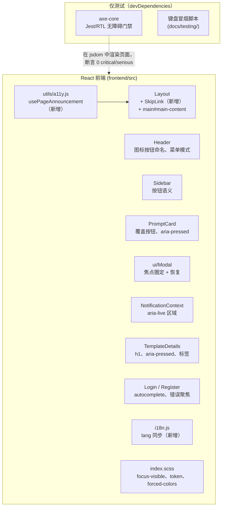

# 无障碍（WCAG 2.1 AA）— 架构设计

| | |
|---|---|
| **功能 ID** | accessibility |
| **版本** | 1.0 |
| **状态** | 已批准 |
| **作者** | 架构 Agent |
| **上游** | [需求文档](../design/accessibility-requirements-zh-CN.md) · [UI/UX 设计](../design/accessibility-ui-ux-design-zh-CN.md) |
| **下游** | [详细设计](accessibility-detailed-design-zh-CN.md) · 开发者 Agent |

## 1. 概述

本功能是对现有前端的系统性 WCAG 2.1 AA 合规改造 —— **不是重新设计**。代码库本身基础不错（`Layout` 中的语义化地标、带 label 关联的 `Field`、带 Escape 关闭与打开即聚焦的 `Modal`、全局 `prefers-reduced-motion` 降级、`VersionSelect` 中的 listbox ARIA），但存在六类缺口，阻碍键盘用户和屏幕阅读器用户：仅可点击的卡片与侧边栏项、无标签的图标按钮、`Modal` 无焦点圈定/恢复、无跳转链接、导航与语言切换时不同步 `lang`/标题、静默的 toast 提示，以及两个对比度不达标的 token。

改造优先集中在**共享基础组件**（`Modal`、toast、`PromptCard`、`Sidebar`、`Header`），使每个页面 —— 以及每个未来功能（包括管理后台）—— 自动继承修复。本功能完全在前端实现：不涉及 proto、DDL、网关，也不新增运行时依赖（axe-core 仅为 devDependency，只在测试中使用）。

### 已解决的开放问题

| # | 问题（需求文档 §10） | 决策 |
|---|---|---|
| 1 | axe-core 放在 Jest/RTL（jsdom）还是 Playwright（对运行中的环境） | **以 Jest/RTL + axe-core（jsdom）作为 CI 门禁。** 仓库的前端测试设施是 react-scripts/Jest（`Header.test.js` 等已在用）；jsdom 方式快速、确定性强、无需运行后端。已知局限：jsdom 不做布局计算，axe 的 `color-contrast` 规则无法运行 —— 对比度由 **token 审计表**（§5，本文档中已计算并锁定比值）加上双主题人工走查保障。Playwright 方案作为后续跟进项记录，不作为 v1 门禁。 |
| 2 | 暗色 `--text-3` `#6e768c` → `#8b92a8`；`--text-3` 是否仅用于次要文本？ | **确认，并修正了数值。** 实测：当前 `#6e768c` 在 `--surface` `#171b26` 上为 **3.79:1**（比设计文档估计的 ≈4.0 更差）；提议的 `#8b92a8` 在 `--surface` 上为 **5.55:1**，且在所有暗色表面上 ≥**4.55:1**（`--bg` 6.13、`--bg-soft` 5.88、`--surface-2` 5.12、`--surface-3` 4.55）。使用约定：正文使用 `--text-2`；`--text-3` 用于次要/元信息文本 —— 现在即使在这些位置也符合 AA。 |
| 3 | 亮色 `--text-3` `#8b92a8` → `#767e93`？ | **已修正 —— 设计文档的值不达标。** `#767e93` 在白色上实测 **4.06:1**（在带色表面上更低），仍低于 4.5:1。采用值：**`#626b7a`** —— 在 `--surface` 白色上 5.38:1、`--bg` `#f4f5fa` 上 5.06:1、`--surface-2` 上 4.84:1、最深的亮色表面 `--surface-3` `#eceef5` 上 **4.64:1**。这是对 UI/UX 文档 §5.8 的有意偏离，在此记录为规范值。 |
| 4 | `PromptCard`：外层 `<a>` 包裹 vs 覆盖式按钮 | **覆盖式按钮**（确认设计推荐）。一个绝对定位的 `<button>` 覆盖整卡（`inset: 0; z-index: 1`），`aria-label={template.title}`；内部点赞/收藏按钮设 `position: relative; z-index: 2`，保持可直接点击和聚焦。外层 `<a>` 会造成交互元素嵌套的非法结构；覆盖式方案保持每卡一个 Tab 停留点且零布局变化。 |
| 5 | 路由切换聚焦：每次导航 vs 仅主导航 | **每次 `pathname` 变化都聚焦 `h1`，但仅查询串变化不触发。** 侧边栏筛选和分页只改变 URL 查询参数而不离开页面 —— 重复播报会成为噪音。`usePageAnnouncement` hook 的 effect 仅以 `location.pathname` 为依赖。 |
| 6 | CI 门禁页面集：六个页面 vs 更小起步 | **全部六个页面**（首页、登录、注册、模板详情、个人主页、API 密钥）。jsdom axe 跑一遍代价很小；更小的门禁之后也只是扩容。管理后台页面在可路由后加入门禁（FR-28）。 |

### 非目标

- WCAG 2.1 AAA（v1 目标为 AA）。
- NVDA/JAWS/VoiceOver 人工认证（v1 为 axe + 键盘测试；人工屏幕阅读器走查为后续项）。
- 除两个 `--text-3` token 值、focus-visible 轮廓、跳转链接、更大点击区域之外的任何视觉重设计（NFR-1）。
- 音视频字幕（无此类内容）、第三方嵌入的无障碍（无）、语音输入优化。
- 任何后端/API/模式变更（NFR-3）。
- 不引入任何形式的货币化（货币化不在本项目范围内）。

## 2. 系统上下文

仅前端；不改变任何后端交互。

## 3. 涉及组件

| 层 | 组件 | 变更 |
|---|---|---|
| 样式 | `frontend/src/index.scss` | 全局 `:focus-visible` 规则（替换输入框的 `outline: none`）；双主题 `--text-3`；`forced-colors` 媒体查询；`.skip-link` 样式；卡片点击区域 |
| 共享 | `frontend/src/components/ui/Modal.jsx` | Tab/Shift+Tab 焦点圈定；关闭后焦点恢复到触发器；`aria-labelledby` |
| 共享 | `frontend/src/context/NotificationContext.js` | `role="region"` + `aria-live="polite"` 容器；错误 toast `role="alert"` |
| 共享 | `frontend/src/components/PromptCard.js(+scss)` | 覆盖式 `<button>`；点赞/收藏改为 `<button aria-pressed>`；≥24px 点击区域 |
| 共享 | `frontend/src/components/Sidebar.js(+scss)` | `li onClick` → 内部 `<button>`；标签 `` → `<button>`；`aria-current` |
| 共享 | `frontend/src/components/Header.js` | 头像 `aria-label` + `aria-haspopup`/`aria-expanded`；下拉项 div → button；Escape/方向键菜单模式 |
| 布局 | `frontend/src/components/Layout.js` | `SkipLink` 为首个子元素；`main` 增加 `id="main-content"` + `tabIndex={-1}` |
| 页面 | `TemplateDetails.js` | `h2` → `h1`；点赞/收藏 `aria-pressed`；复制按钮 `aria-label` |
| 页面 | `Home.js`、`Login.js`、`Register.js`、`Profile.js` | 每页一个 `h1`（提升或新增视觉隐藏）；认证表单 `autocomplete` 属性；提交失败聚焦 |
| i18n | `frontend/src/i18n.js` | `languageChanged` → `document.documentElement.lang` 同步（+ 初始设置） |
| 工具 | `frontend/src/utils/a11y.js` | **新增** —— `usePageAnnouncement` hook（pathname 变化时设置标题 + 聚焦 h1） |
| 工具 | `frontend/src/components/SkipLink.jsx` | **新增** —— 跳转到内容链接 |
| i18n | `locales/{en,zh}/translation.json` | `a11y.*`、`header.open_user_menu`、`template_details.copy_code` |
| 测试 | `frontend/src/a11y/*.test.js` | **新增** —— 六个页面的 axe-core 门禁 |
| 测试 | `docs/testing/keyboard-smoke-test.md` | **新增** —— 人工键盘测试脚本（FR-26） |
| CI | `.github/workflows/ci.yml` | **新增 job** `frontend-a11y` 运行 axe 门禁 |

## 4. API 设计

**无 API 变更。** 不新增或修改任何 gRPC RPC、REST 路由、请求/响应结构（NFR-3）。本功能对现有端点的消费方式不变。

## 5. 数据模型

**无数据库变更。** 唯一的"数据"是 CSS token 审计（规范对比度表）：

| Token | 主题 | 旧值 | 旧比值（最差表面） | 新值 | 新比值（最差表面） |
|---|---|---|---|---|---|
| `--text-3` | 暗色（`:root`） | `#6e768c` | `--surface` 上 3.79:1 | **`#8b92a8`** | `--surface-3` 上 4.55:1（`--surface` 上 5.55:1） |
| `--text-3` | 亮色（`html.light-theme`） | `#8b92a8` | `--surface` 上 3.10:1 | **`#626b7a`** | `--surface-3` 上 4.64:1（`--surface` 上 5.38:1） |

其余文本 token 均已带余量通过 AA（已验证：`--text-1` 暗色 14.8:1 / 亮色 15+:1；`--text-2` 双主题 ≥6.4:1；`--accent` 焦点环对表面 ≥4.3:1，满足 3:1 的非文本最低要求）。比值使用 WCAG 相对亮度公式对每个主题的全部表面 token 计算得出。

## 6. 鉴权与授权

无变更。（无障碍不改变认证流程；登录/注册页面仅增加 `autocomplete` 属性和错误聚焦行为。）

## 7. 前端

修复顺序（每步可独立交付，遵循 UI/UX 设计 §11）：

1. **全局样式 + token** —— 全局 `:focus-visible`（2px `--accent`、2px 偏移；输入框保留柔和光环*并*增加轮廓）、双主题 `--text-3`、`forced-colors` 块、`.skip-link` 样式。
2. **`Modal`** —— 焦点圈定（Tab/Shift+Tab 在 `a[href], button:not([disabled]), input, select, textarea, [tabindex]:not([tabindex="-1"])` 内循环）、打开时保存 `document.activeElement` 关闭时恢复、`aria-labelledby` 指向标题 `id`。
3. **Toast** —— 带标签的 `role="region"` + `aria-live="polite"` 容器；错误 toast `role="alert"`；toast 永不抢焦点。
4. **`PromptCard`** —— 覆盖式按钮（单一 Tab 停留点、`aria-label` = 标题）；点赞/收藏 `` → `<button aria-pressed aria-label>`，通过 padding 实现 ≥24px（移动端 44px）点击区域；内部按钮位于覆盖层之上（`z-index: 2`）。
5. **`Sidebar`** —— 分类/特殊项变为 `li` 内的按钮；标签 chip 变为 `<button class="tag">`；激活项 `aria-current="true"`；计数保留在按钮标签内。
6. **`Header`** —— 头像按钮 `aria-label`（`header.open_user_menu`）+ `aria-haspopup="menu"` + `aria-expanded`；下拉项 `div onClick` → `<button>`；Escape 关闭并恢复焦点；方向键在菜单内移动。
7. **`SkipLink` + `main`** —— `Layout` 中首个可聚焦元素；`main` 获得 `id="main-content"` + `tabIndex={-1}`，使锚点跳转移动的是焦点而非仅滚动。
8. **`usePageAnnouncement`** —— `location.pathname` 变化时：`document.title = t(pageTitleKey)`，聚焦页面 `h1`（带 `tabIndex={-1}`）。仅查询串变化被忽略。
9. **`lang` 同步** —— `i18n.on('languageChanged', …)` 设置 `document.documentElement.lang`；启动时初始设置；语言切换触发播报 toast。
10. **标题层级** —— 每页恰好一个 `h1`：TemplateDetails 标题 `h2`→`h1`；Home/Login/Register/Profile 各补一个（无可见标题处用视觉隐藏）；不跳级。
11. **表单** —— 认证输入框 `autocomplete` 属性；提交失败时聚焦第一个 `.field-invalid .input`（`Field` 已渲染 `aria-invalid` + 错误文本）。
12. **Axe 门禁 + 冒烟脚本** —— 六个页面的 Jest/RTL axe 测试；`docs/testing/keyboard-smoke-test.md` 键盘冒烟脚本；CI job。

## 8. 配置

- `axe-core` 作为 **devDependency** 加入（生产代码绝不导入 —— NFR-2）。
- 新增 npm script `test:a11y`（`react-scripts test --watchAll=false --testPathPattern=a11y`）及 `.github/workflows/ci.yml` 中的 `frontend-a11y` CI job（Node 安装 + `npm ci` + script），与现有 `frontend-lint` job 并行。
- 无运行时配置、功能开关或环境变量。

## 9. 安全与隐私

无安全或隐私面变更。（不收集新数据；axe-core 仅在 CI/测试中运行。）

## 10. 部署说明

- 仅前端构建；无迁移、无 proto 重新生成、无后端重新部署。
- `--text-3` 变更影响大量表面 —— 发布说明应明确指出这次有意的对比度调整，且部署前应对双主题做视觉回归走查。

## 11. 测试策略

- **Axe 门禁（CI）**：Jest/RTL 在 jsdom 中渲染六个页面（首页、登录、注册、详情、个人主页、API 密钥），带 mock 的 API 状态，主题相关处在双主题下渲染；`axe.run()` 断言 **0 critical / 0 serious** 违规。已知 jsdom 局限：`color-contrast` 无法评估 —— 对比度由 §5 token 表锁定并人工验证。
- **键盘冒烟脚本**（`docs/testing/keyboard-smoke-test.md`）：核心流程（加载 → 跳转链接 → 卡片 → 详情 → 点赞 → 复制 → 返回）的逐步 Tab/Enter 走查，每次发布人工执行（FR-26、AC-12）。
- **单元测试**：焦点圈定回绕行为、焦点恢复、`usePageAnnouncement` 标题/聚焦 effect、`lang` 同步。
- **AC 映射**：AC-1（键盘流程）→ 冒烟脚本；AC-2 → axe 门禁；AC-3 → lang 同步单元测试；AC-4 → Modal 单元测试；AC-5/6 → axe `button-name` + `aria-pressed` 断言；AC-7 → toast live-region 渲染测试；AC-8 → §5 token 表 + 人工审计；AC-9/10 → 双主题人工走查；AC-11 → `usePageAnnouncement` 测试；AC-12 → 脚本存在 + 人工通过。

## 12. 性能与缓存

- 无运行时无障碍库（NFR-2）：所有修复均为原生 HTML/ARIA，外加一个小 hook 和每个打开的 modal 一个 keydown 监听。
- axe 门禁仅在 CI 运行；生产 bundle 不受影响（验证 `axe-core` 不出现在客户端 chunk 中）。
- 焦点圈定对打开的对话框仅使用一个 `keydown` 监听；无轮询、无 observer。
