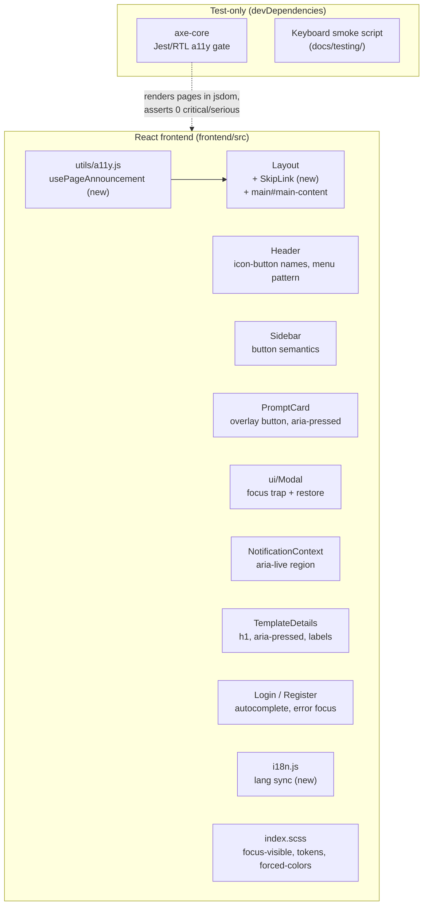

# Accessibility (WCAG 2.1 AA) — Architecture Design

| | |
|---|---|
| **Feature ID** | accessibility |
| **Version** | 1.0 |
| **Status** | Approved |
| **Author** | Architect Agent |
| **Upstream** | [Requirements](../design/accessibility-requirements.md) · [UI/UX Design](../design/accessibility-ui-ux-design.md) |
| **Downstream** | [Detailed Design](accessibility-detailed-design.md) · Developer Agent |

## 1. Overview

This feature is a systematic WCAG 2.1 AA remediation of the existing frontend — **not a redesign**. The codebase already has good bones (semantic landmarks in `Layout`, label-associated `Field`, `Modal` with Escape + focus-on-open, a global `prefers-reduced-motion` guard, listbox ARIA in `VersionSelect`), but six gap classes block keyboard and screen-reader users: click-only cards and sidebar items, unlabeled icon buttons, no focus trap/restore in `Modal`, no skip link, no `lang`/title sync on navigation or language switch, silent toasts, and two contrast-failing tokens.

The work concentrates on **shared primitives first** (`Modal`, toasts, `PromptCard`, `Sidebar`, `Header`) so every page — and every future feature, including the admin console — inherits the fixes. It is entirely frontend: no proto, no DDL, no gateway, no new runtime dependencies (axe-core is a devDependency used only in tests).

### Resolved Open Questions

| # | Question (Requirements §10) | Decision |
|---|---|---|
| 1 | axe-core in Jest/RTL (jsdom) vs Playwright against a running stack | **Jest/RTL + axe-core in jsdom as the CI gate.** The repo's frontend test infra is react-scripts/Jest (already used by `Header.test.js` etc.); a jsdom pass is fast, deterministic, and needs no running backend. Known limitation: jsdom computes no layout, so axe's `color-contrast` rule cannot run there — contrast is enforced by the **token audit table** (§5, ratios computed and pinned in this doc) plus a manual both-themes visual pass. A Playwright pass remains a documented follow-up, not a v1 gate. |
| 2 | Dark `--text-3` `#6e768c` → `#8b92a8`; reserve `--text-3` for secondary text? | **Confirmed with corrected numbers.** Measured: current `#6e768c` on `--surface` `#171b26` is **3.79:1** (worse than the design's ≈4.0 estimate); proposed `#8b92a8` is **5.55:1** on `--surface` and ≥**4.55:1** on every dark surface (`--bg` 6.13, `--bg-soft` 5.88, `--surface-2` 5.12, `--surface-3` 4.55). Usage guidance adopted: body copy uses `--text-2`; `--text-3` is for secondary/meta text — now AA-compliant even there. |
| 3 | Light `--text-3` `#8b92a8` → `#767e93`? | **Corrected — the design's value fails.** `#767e93` measures **4.06:1** on white (and less on tinted surfaces), still below 4.5:1. Adopted value: **`#626b7a`** — 5.38:1 on `--surface` white, 5.06:1 on `--bg` `#f4f5fa`, 4.84:1 on `--surface-2`, and **4.64:1** on the darkest light surface `--surface-3` `#eceef5`. This is a deliberate deviation from the UI/UX doc §5.8, recorded here as the normative value. |
| 4 | `PromptCard`: wrapping `<a>` vs overlay-button | **Overlay-button** (design recommendation confirmed). An absolutely-positioned `<button>` covering the card (`inset: 0; z-index: 1`) with `aria-label={template.title}`; inner like/favorite buttons get `position: relative; z-index: 2` so they stay directly clickable and focusable. A wrapping `<a>` would nest interactive elements illegally; the overlay keeps one tab stop per card with zero layout change. |
| 5 | Route-change focus: every navigation vs main navigations only | **Focus the `h1` on every `pathname` change, but not on query-string-only changes.** Sidebar filters and pagination mutate the URL query without leaving the page — re-announcing those would be noise. The `usePageAnnouncement` hook keys its effect on `location.pathname` only. |
| 6 | CI gate page set: six pages vs smaller start | **All six pages** (home, login, register, template details, profile, API keys). The jsdom axe pass is cheap; a smaller gate would just grow later. Admin pages join the gate when they become routable (FR-28). |

### Non-Goals

- WCAG 2.1 AAA (v1 targets AA).
- NVDA/JAWS/VoiceOver manual certification (axe + keyboard testing in v1; manual SR passes are a follow-up).
- Any visual redesign beyond the two `--text-3` token values, the focus-visible outlines, the skip link, and larger hit areas (NFR-1).
- Audio/video captions (no such content), third-party embed a11y (none), speech-input optimization.
- Backend/API/schema changes of any kind (NFR-3).
- No monetization of any kind (monetization is out of scope for this project).

## 2. System Context

Frontend-only; no backend interaction changes.

## 3. Components Involved

| Layer | Component | Change |
|---|---|---|
| styles | `frontend/src/index.scss` | `:focus-visible` global rules (replace `outline: none` on inputs); `--text-3` both themes; `forced-colors` media query; `.skip-link` styles; card hit areas |
| shared | `frontend/src/components/ui/Modal.jsx` | Tab/Shift+Tab focus trap; focus restore to trigger; `aria-labelledby` |
| shared | `frontend/src/context/NotificationContext.js` | `role="region"` + `aria-live="polite"` wrapper; error toasts `role="alert"` |
| shared | `frontend/src/components/PromptCard.js(+scss)` | Overlay `<button>`; like/favorite become `<button aria-pressed>`; ≥24px hit areas |
| shared | `frontend/src/components/Sidebar.js(+scss)` | `li onClick` → inner `<button>`; tag `` → `<button>`; `aria-current` |
| shared | `frontend/src/components/Header.js` | Avatar `aria-label` + `aria-haspopup`/`aria-expanded`; dropdown items → buttons; Escape/arrow-key menu pattern |
| layout | `frontend/src/components/Layout.js` | `SkipLink` first child; `main` gets `id="main-content"` + `tabIndex={-1}` |
| pages | `TemplateDetails.js` | `h2` → `h1`; like/favorite `aria-pressed`; copy buttons `aria-label` |
| pages | `Home.js`, `Login.js`, `Register.js`, `Profile.js` | One `h1` per page (promote or add visually-hidden); auth `autocomplete` attrs; submit-error focus |
| i18n | `frontend/src/i18n.js` | `languageChanged` → `document.documentElement.lang` sync (+ initial set) |
| util | `frontend/src/utils/a11y.js` | **New** — `usePageAnnouncement` hook (title + h1 focus on pathname change) |
| util | `frontend/src/components/SkipLink.jsx` | **New** — skip-to-content link |
| i18n | `locales/{en,zh}/translation.json` | `a11y.*`, `header.open_user_menu`, `template_details.copy_code` |
| tests | `frontend/src/a11y/*.test.js` | **New** — axe-core gate over the six pages |
| tests | `docs/testing/keyboard-smoke-test.md` | **New** — manual keyboard script (FR-26) |
| CI | `.github/workflows/ci.yml` | **New job** `frontend-a11y` running the axe gate |

## 4. API Design

**No API changes.** No new or modified gRPC RPCs, REST routes, or request/response shapes (NFR-3). The feature consumes existing endpoints unchanged.

## 5. Data Model

**No database changes.** The only "data" is the CSS token audit (the normative contrast table):

| Token | Theme | Old | Old ratio (worst surface) | New | New ratio (worst surface) |
|---|---|---|---|---|---|
| `--text-3` | dark (`:root`) | `#6e768c` | 3.79:1 on `--surface` | **`#8b92a8`** | 4.55:1 on `--surface-3` (5.55:1 on `--surface`) |
| `--text-3` | light (`html.light-theme`) | `#8b92a8` | 3.10:1 on `--surface` | **`#626b7a`** | 4.64:1 on `--surface-3` (5.38:1 on `--surface`) |

All other text tokens already pass AA with margin (verified: `--text-1` 14.8:1 dark / 15+:1 light; `--text-2` ≥6.4:1 both themes; `--accent` focus ring ≥4.3:1 against surfaces, satisfying the 3:1 non-text minimum). Ratios computed with the WCAG relative-luminance formula against every surface token in each theme.

## 6. Auth & Authorization

No changes. (A11y does not alter auth flows; the login/register pages merely gain `autocomplete` attributes and error-focus behavior.)

## 7. Frontend

Fix order (each step independently shippable, per the UI/UX design §11):

1. **Global styles + tokens** — `:focus-visible` everywhere (2px `--accent`, 2px offset; inputs keep their soft ring *and* gain the outline), `--text-3` both themes, `forced-colors` block, `.skip-link` styles.
2. **`Modal`** — focus trap (Tab/Shift+Tab cycle within `a[href], button:not([disabled]), input, select, textarea, [tabindex]:not([tabindex="-1"])`), save `document.activeElement` on open and restore on close, `aria-labelledby` pointing at the title's `id`.
3. **Toasts** — labeled `role="region"` + `aria-live="polite"` container; error toasts `role="alert"`; toasts never take focus.
4. **`PromptCard`** — overlay button (single tab stop, `aria-label` = title); like/favorite `` → `<button aria-pressed aria-label>` with ≥24px (44px mobile) hit areas via padding; inner buttons above the overlay (`z-index: 2`).
5. **`Sidebar`** — category/special items become buttons inside their `li`; tag chips become `<button class="tag">`; active item gets `aria-current="true"`; counts stay inside the label.
6. **`Header`** — avatar button `aria-label` (`header.open_user_menu`) + `aria-haspopup="menu"` + `aria-expanded`; dropdown items `div onClick` → `<button>`; Escape closes and restores focus; arrow keys move within the menu.
7. **`SkipLink` + `main`** — first focusable element in `Layout`; `main` gets `id="main-content"` + `tabIndex={-1}` so the anchor moves focus, not just scroll.
8. **`usePageAnnouncement`** — on `location.pathname` change: `document.title = t(pageTitleKey)`, focus the page `h1` (with `tabIndex={-1}`). Query-only changes are ignored.
9. **`lang` sync** — `i18n.on('languageChanged', …)` sets `document.documentElement.lang`; initial set on boot; language switch fires an announced toast.
10. **Headings** — exactly one `h1` per page: TemplateDetails promotes its title `h2`→`h1`; Home/Login/Register/Profile add one (visually hidden where no visible heading exists); no level skips.
11. **Forms** — `autocomplete` attributes on auth inputs; on failed submit, focus the first `.field-invalid .input` (`Field` already renders `aria-invalid` + error text).
12. **Axe gate + smoke script** — Jest/RTL axe tests over the six pages; keyboard smoke script in `docs/testing/keyboard-smoke-test.md`; CI job.

## 8. Configuration

- `axe-core` added as a **devDependency** (never imported by production code — NFR-2).
- New npm script `test:a11y` (`react-scripts test --watchAll=false --testPathPattern=a11y`) and a `frontend-a11y` CI job in `.github/workflows/ci.yml` (Node setup + `npm ci` + script), parallel to the existing `frontend-lint` job.
- No runtime configuration, feature flags, or environment variables.

## 9. Security & Privacy

No security or privacy surface changes. (No new data collection; axe-core runs only in CI/test.)

## 10. Deployment Notes

- Frontend-only build; no migration, no proto regeneration, no backend redeploy.
- The `--text-3` change touches many surfaces — the release notes should call out the deliberate contrast adjustment and both themes should get a visual regression pass before deploy.

## 11. Test Strategy

- **Axe gate (CI)**: Jest/RTL renders each of the six pages (home, login, register, details, profile, API keys) with mocked API state in both themes where theme-dependent; `axe.run()` asserts **0 critical / 0 serious** violations. Known jsdom limitation: `color-contrast` can't evaluate — contrast is pinned by the §5 token table and verified manually.
- **Keyboard smoke script** (`docs/testing/keyboard-smoke-test.md`): step-by-step Tab/Enter walkthrough of the core flow (load → skip link → card → details → like → copy → back), executed manually per release (FR-26, AC-12).
- **Unit tests**: focus-trap wrap behavior, focus restore, `usePageAnnouncement` title/focus effect, `lang` sync.
- **AC mapping**: AC-1 (keyboard flow) → smoke script; AC-2 → axe gate; AC-3 → lang-sync unit test; AC-4 → Modal unit tests; AC-5/6 → axe `button-name` + `aria-pressed` assertions; AC-7 → toast live-region render test; AC-8 → §5 token table + manual audit; AC-9/10 → manual both-themes pass; AC-11 → `usePageAnnouncement` test; AC-12 → script existence + manual pass.

## 12. Performance & Caching

- No runtime a11y library (NFR-2): all fixes are native HTML/ARIA plus one small hook and a keydown listener per open modal.
- The axe gate runs only in CI; production bundles are unaffected (verify `axe-core` absent from the client chunk).
- Focus trap uses a single `keydown` listener scoped to the open dialog; no polling, no observers.
