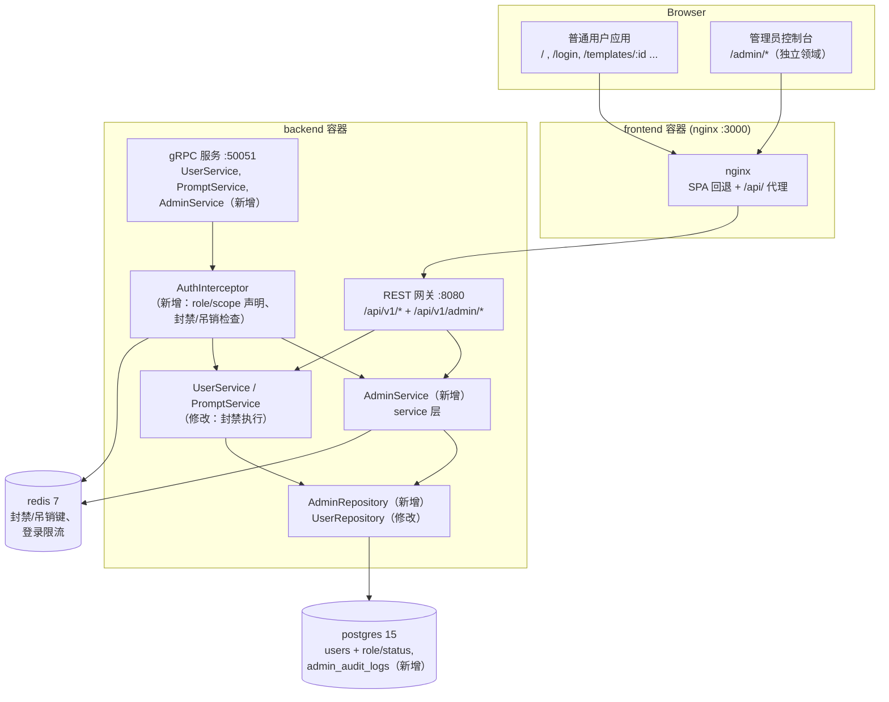

# 管理员用户管理系统 — 架构设计

- **功能 ID：** `admin-user-management`
- **版本：** 1.0
- **状态：** 已批准进入实现
- **作者：** 架构 Agent
- **上游文档：**[需求分析](../design/admin-user-management-requirements-zh-CN.md) · [UI/UX 设计](../design/admin-user-management-ui-ux-design-zh-CN.md)
- **下游文档：**[详细设计（中文）](./admin-user-management-detailed-design-zh-CN.md) · [Detailed Design (EN)](./admin-user-management-detailed-design.md)

---

## 1. 概述

本功能为 Open Prompts 引入第一个管理能力：一个**完全独立的管理员领域**，包括：

1. **管理员 Web 控制台**，位于 `/admin/*`（登录、仪表盘、用户管理、模板审核、审计日志）。
2. **管理员 API**，位于 `/api/v1/admin/*`，由服务端强制校验。
3. 用户上的**角色/状态模型**（`role`：`user`|`admin`，`status`：`active`|`banned`）。
4. 只追加的**审计日志**（`admin_audit_logs`），记录每一次管理员变更操作。
5. 贯穿登录、会话、API Key 与公开模板广场的**封禁执行**。

所有内容均为全新构建，但严格遵循现有架构：Go 后端保持相同分层（proto → 网关 → service → repository → data），React 前端沿用现有模式（pages、redux slice、axios 客户端、i18next），部署拓扑不变（docker-compose、helm chart、幂等 `init.sql`）。

**非目标（v1）：** 管理员编辑/删除模板、批量操作、举报队列、管理员分析图表、管理员控制台 SSO 登录（见需求 §8）。

## 2. 系统上下文



不引入任何新服务、容器或基础设施依赖（NFR-10）。管理员控制台由同一前端 bundle 提供服务（懒加载路由），管理员 API 由同一后端进程提供。

## 3. 涉及组件与变更

| 组件 | 变更类型 | 摘要 |
|---|---|---|
| `backend/api/proto/v1/admin.proto` | **新增** | `AdminService` gRPC 契约（11 个 RPC）+ 生成的 `admin.pb.go`、`admin_grpc.pb.go` |
| `backend/api/proto/v1/prompt.proto` | 不变 | 不修改现有契约（admin 独立 proto 文件） |
| `backend/internal/models/user.go` | 修改 | `User` 增加 `Role`、`Status` 字段 |
| `backend/internal/models/admin.go` | **新增** | `AdminAuditLog` 模型 |
| `backend/internal/repository/admin_repository.go` | **新增** | `AdminRepository`：用户列表/详情/统计、管理员模板列表/详情、审计日志写入/读取 |
| `backend/internal/repository/user_repository.go` | 修改 | 读取 `role`/`status` 列；`UpdateRoleAndStatus` |
| `backend/internal/repository/template_repository.go` | 修改 | 公开列表/分类/标签排除被封禁用户的模板 |
| `backend/internal/service/admin.go` | **新增** | `AdminService`（登录、会话刷新、统计、用户、封禁/解禁/角色、模板、审计） |
| `backend/internal/service/auth.go` | 修改 | 基于声明的校验（`role`、`scope`、`iat`）、上下文角色注入、Redis 封禁/吊销检查、`AdminLogin` 加入公开 RPC 集合 |
| `backend/internal/service/user.go` | 修改 | 登录（密码 + OAuth）拒绝被封禁用户、签发带 role/scope 的令牌、引导提升钩子 |
| `backend/cmd/server/main.go` | 修改 | `/api/v1/admin/*` 管理员 REST 处理器、`requireAdmin` 中间件助手、`AdminService` 装配与 gRPC 注册、启动引导 |
| `frontend/src/App.js` | 修改 | 嵌套 `/admin` 路由、懒加载管理员页面 |
| `frontend/src/pages/admin/*` | **新增** | 7 个管理员页面 |
| `frontend/src/components/admin/*` | **新增** | `AdminLayout`、`AdminTable`、`KpiCard`、`Badge`、`Pagination`、`ReasonModal`、`AdminSearchInput`、`AdminSelect`、`EmptyState`、`ErrorBanner` |
| `frontend/src/services/adminApi.js` | **新增** | 独立 axios 实例（`/api/v1`、管理员令牌、401 → `/admin/login`） |
| `frontend/src/store/adminAuthSlice.js` | **新增** | 管理员会话状态（`op_admin_token` / `op_admin_user` 存储键） |
| `frontend/src/locales/{en,zh}/translation.json` | 修改 | 新增 `admin.*` 命名空间（两个语言文件键集合一致） |
| `deployment/init.sql` + chart 副本 | 修改 | `users.role`、`users.status`（幂等 `DO $$` ALTER）、`admin_audit_logs` 表、索引 |
| `deployment/docker-compose.yml` | 修改 | `ADMIN_BOOTSTRAP_EMAIL`、`ADMIN_BOOTSTRAP_PASSWORD`、`ADMIN_SESSION_TTL_MINUTES` 环境变量透传 |
| `deployment/chart/open-prompts/` | 修改 | `values.yaml` + `deployment-backend.yaml` 环境变量；`init.sql` 副本同步 |
| `tests/fvt.py` | 修改 | 管理员 FVT 套件（compose 启动带引导环境变量、新测试函数） |

## 4. API 设计（摘要）

所有管理员端点位于 **`/api/v1/admin`** 之下，返回 JSON（protojson，`UseProtoNames` → snake_case），与现有端点一致。完整的请求/响应结构与错误码见[详细设计](./admin-user-management-detailed-design-zh-CN.md)。

| 方法与路径 | 鉴权 | 用途 |
|---|---|---|
| `POST /api/v1/admin/login` | 无（限流） | 管理员登录；签发 30 分钟 admin 作用域 JWT |
| `POST /api/v1/admin/session/refresh` | admin JWT | 管理员会话滑动续期 |
| `GET /api/v1/admin/stats` | admin JWT | 仪表盘 KPI + 最近注册 + 最近公开模板 |
| `GET /api/v1/admin/users` | admin JWT | 分页用户列表：搜索、状态/角色过滤、排序 |
| `GET /api/v1/admin/users/{id}` | admin JWT | 用户详情：资料、统计、身份、API Key、模板、操作历史 |
| `POST /api/v1/admin/users/{id}/ban` | admin JWT | 封禁（必填理由，3–500 字符） |
| `POST /api/v1/admin/users/{id}/unban` | admin JWT | 解禁（必填理由） |
| `POST /api/v1/admin/users/{id}/role` | admin JWT | 提升/降级（必填理由）；禁止自我降级 |
| `GET /api/v1/admin/templates` | admin JWT | 分页模板审核列表（含私有） |
| `GET /api/v1/admin/templates/{id}` | admin JWT | 模板详情（含全部版本，只读） |
| `GET /api/v1/admin/audit-log` | admin JWT | 分页审计日志，按操作/操作者过滤 |

**分页模型。** 管理员列表端点采用**基于页码的分页**（`page`、`per_page`，响应含 `total`），有意与公开 API 的 token 分页不同：管理员表格需要渲染"第 2 页，共 63 页（1,248 个用户）"，需要总数与页码跳转。在管理员流量规模下，offset 分页是合适的。

**错误模型。** 与现有 `writeError` 网关助手一致：gRPC 状态码映射到 HTTP（`InvalidArgument`→400、`Unauthenticated`→401、`PermissionDenied`→403、`NotFound`→404、`AlreadyExists`/failed-precondition→409），纯文本消息体。前端在 toast/内联错误中展示消息。

## 5. 数据模型

### 5.1 `users` 表变更（幂等迁移）

```sql
DO $$
BEGIN
    IF NOT EXISTS (SELECT 1 FROM information_schema.columns WHERE table_name='users' AND column_name='role') THEN
        ALTER TABLE users ADD COLUMN role TEXT NOT NULL DEFAULT 'user';
    END IF;
END $$;
-- status TEXT NOT NULL DEFAULT 'active' 采用相同模式
```

- `role`：`'user'` | `'admin'`（默认 `'user'`）。所有现有行回填为 `'user'`。
- `status`：`'active'` | `'banned'`（默认 `'active'`）。所有现有行回填为 `'active'`。
- 新增索引：`idx_users_role`、`idx_users_status`、`idx_users_created_at`（列表排序，NFR-2）。

### 5.2 新表 `admin_audit_logs`

只追加审计记录（FR-29–31）。列：`id UUID 主键`、`actor_id TEXT NOT NULL`、`actor_email TEXT NOT NULL`（写入时快照）、`action TEXT`（`ban`|`unban`|`role_change`）、`target_type TEXT`（`user`）、`target_id TEXT`、`reason TEXT`（3–500 字符）、`created_at TIMESTAMPTZ`。**无外键** —— 审计记录必须在用户行被删除后依然存在；`actor_email` 做快照以保证记录可读。索引：`created_at`、`actor_id`、`target_id`。精确 DDL 见详细设计。

### 5.3 现有表

`templates`、`template_versions`、`prompts`、`api_keys`、`user_identities` 结构不变；被封禁用户的过滤在查询中完成（JOIN `users.status`），不做反范式列。

## 6. 鉴权与授权模型

### 6.1 角色与令牌类型

| 令牌 | 签发方 | 声明 | TTL | 有效范围 |
|---|---|---|---|---|
| 普通 JWT | `POST /api/v1/login` | `sub`、`role`、`iat`、`exp`、`iss` | 24 小时 | 所有常规 `/api/v1/*` 端点 |
| 管理员 JWT | `POST /api/v1/admin/login` | `sub`、`role:"admin"`、**`scope:"admin"`**、`iat`、`exp`、`iss` | 30 分钟（可配置） | 常规端点**以及** `/api/v1/admin/*` |

关键决策：**管理员的普通登录令牌不能访问管理员 API。** 管理员中间件同时要求 `role == "admin"` 与 `scope == "admin"`。这确保 FR-8（短管理员会话）不受 24 小时普通令牌影响，并使两个领域真正分离（AC-1、AC-2）。

### 6.2 管理员中间件

REST 网关中的 `requireAdmin` 助手（以及 `AdminService` 方法内部的等价检查，保护 gRPC 路径）：校验 JWT 签名 → 要求 `role=admin` + `scope=admin` → 检查 Redis 吊销（见下） → 将用户 ID 注入上下文。缺失/无效令牌 → `401`；有效令牌但无 admin 作用域/角色 → `403`（FR-4）。

### 6.3 封禁与吊销传播（Redis）

JWT 是无状态的，因此封禁/角色变更的失效通过 Redis 键实现，并在每个已认证请求上检查：

| 键 | 值 | 设置/移除 | 检查方 |
|---|---|---|---|
| `user_banned:<user_id>` | `1` | 封禁时设置，解禁时移除 | JWT 校验 + API Key 校验 |
| `token_revoked_before:<user_id>` | unix 秒 | 封禁**和**角色变更时设置 | JWT 校验（`iat` < 值则拒绝） |
| `admin_login_attempts:<ip>` | 计数器 | 每次管理员登录失败自增，TTL 15 分钟 | 管理员登录处理器（上限 5 次，NFR-1） |

- **封禁**同时设置两个键 → 该用户的所有 JWT 立即失效、API Key 返回 `403`、登录被拒绝（登录额外检查数据库中的 `users.status`，它是事实来源）。
- **角色变更**设置 `token_revoked_before` → 目标的现有令牌（任意作用域）失效；重新登录即可。这使降级立即生效。
- **解禁**移除 `user_banned` 但保留 `token_revoked_before` —— 封禁前的令牌不会复活；用户重新登录（AC-6 要求登录可用，这满足）。
- Redis 出错时回退为直接查询数据库 `users.status`/`role`（正确性优先于可用性）。
- 键 TTL：`token_revoked_before` 25 小时（长于 24 小时最长普通令牌）；`user_banned` 25 小时且每次封禁重设。

### 6.4 管理员引导（FR-7）

管理员不开放注册。在**后端启动时**执行（幂等，每次启动都运行）：

- `ADMIN_BOOTSTRAP_EMAIL` 为空 → 引导禁用（安全默认值）。
- 该邮箱的用户已存在 → `UPDATE users SET role='admin'`（提升运维人员既有账号）。
- 不存在且设置了 `ADMIN_BOOTSTRAP_PASSWORD` → 创建账号（`role='admin'`，bcrypt 密码）。未设置密码则记录警告并跳过创建。
- 引导邮箱必须由运维人员控制；生产部署通过 `deployment/.env`（已 gitignore）或 helm values 设置。CI/FVT 在 compose 启动命令中显式传入 `ADMIN_BOOTSTRAP_EMAIL=admin@example.com`，因此 **compose 文件中不内置任何特权默认值**。

### 6.5 普通用户面的执行变更

- `Login`（密码）与 `LoginWithOAuth` 拒绝被封禁用户，返回 `403 "account banned"` —— 与 `401 "invalid credentials"` 区分（FR-22、FR-33、AC-5）。
- `VerifyAPIKey` 拒绝被封禁用户的 Key，返回 `403`（无效 Key 仍是 `401`）。
- 公开模板列表（`ListTemplates` 公开可见性）、`ListCategories`、`ListTags` 排除被封禁用户拥有的模板（FR-23、US-U1）。`GetTemplate` 对被封禁用户的公开模板返回 `404`（除非调用者是所有者，而被封禁用户本来就无法认证）—— 使直链访问与隐藏的广场保持一致。

## 7. 前端架构

### 7.1 路由（独立领域）

```
/admin/login                 AdminLoginPage      （独立页，无 AdminLayout）
/admin                       DashboardPage       （AdminLayout，受守卫保护）
/admin/users                 UsersPage           （AdminLayout，受守卫保护）
/admin/users/:id             UserDetailPage      （AdminLayout，受守卫保护）
/admin/templates             TemplatesPage       （AdminLayout，受守卫保护）
/admin/templates/:id         TemplateDetailPage  （AdminLayout，受守卫保护）
/admin/audit-log             AuditLogPage        （AdminLayout，受守卫保护）
```

- 路由在 `App.js` 中以嵌套布局路由添加；管理员页面使用 `React.lazy` 懒加载，不影响主 bundle。
- `AdminLayout` 是**全新外壳**（顶栏 + 左侧导航，按 UI/UX 设计）—— 不复用主应用的 `Layout`/`Header`/`Sidebar`。它复用 `Modal`、`Field`、`Spinner`、`Icons`、`NotificationContext` 与 Aurora 令牌。
- **路由守卫：** `AdminLayout` 在挂载与路由变化时检查管理员会话；未认证 → `/admin/login?redirect=<path>`；已认证非管理员 → 403 页面（AC-2）。守卫只是 UX —— API 才是安全边界（NFR-1）。
- 列表页将搜索/过滤/排序/页码保存在 URL 查询串中（`useSearchParams`），便于分享视图。

### 7.2 API 客户端与会话状态

- `services/adminApi.js`：**独立 axios 实例**，`baseURL: '/api/v1'` 加 `/admin/...` 路径，请求拦截器附加 `op_admin_token`，响应拦截器在 401 时清除管理员会话并重定向到 `/admin/login?redirect=...`（绝不跳 `/login`）。必须独立实例的原因：现有 `api.js` 会把 401 劫持到用户登录页。
- `store/adminAuthSlice.js`：`adminLoginSuccess` / `adminLogout` / `initializeAdminAuth`，持久化到 `localStorage.op_admin_token` / `op_admin_user`，使管理员与用户会话互不覆盖。
- **空闲会话（FR-8）：** 管理员令牌携带 30 分钟 `exp`。每次管理员 API 成功响应后，客户端解码 `exp`/`iat`；若令牌签发超过 10 分钟则调用 `POST /api/v1/admin/session/refresh` 并替换新令牌（滑动窗口）。空闲 25 分钟时 toast 提醒；30 分钟后下一次调用返回 401 并重定向。服务端 `exp` 是权威的。

### 7.3 i18n 与主题

- 所有管理员文案放在 **`locales/en/translation.json`** 与 **`locales/zh/translation.json`** 的 `admin.*` 命名空间下（NFR-4、AC-11）。两个语言文件必须保持键集合一致（当前仓库为 245/245 对齐；管理员键需同时加入两者）。
- 主题复用现有 `light-theme` 类 + `localStorage.theme`；管理员外壳不新增设计令牌（NFR-5）。

## 8. 配置

| 变量 | 默认值 | 作用域 | 用途 |
|---|---|---|---|
| `ADMIN_BOOTSTRAP_EMAIL` | *（空 = 禁用）* | 后端 | 引导管理员账号邮箱（启动时提升或创建） |
| `ADMIN_BOOTSTRAP_PASSWORD` | *（空）* | 后端 | 创建引导账号时使用的密码（仅当账号不存在时使用） |
| `ADMIN_SESSION_TTL_MINUTES` | `30` | 后端 | 管理员 JWT 生命周期 / 空闲窗口（FR-8） |
| `JWT_SECRET` | *（现有）* | 后端 | 不变；签发两种令牌 |

- `deployment/docker-compose.yml`：从宿主环境透传三个变量（`${ADMIN_BOOTSTRAP_EMAIL:-}` 等），与现有 `SMTP_*` 变量模式相同。**不设非空特权默认值。**
- Helm chart：在 `values.yaml` 中新增 `backend.env.adminBootstrapEmail`、`adminBootstrapPassword`、`adminSessionTtlMinutes`，并在 `templates/deployment-backend.yaml` 中接线。
- `deployment/.env`（已 gitignore）是运维人员设置生产值的地方。
- FVT：`tests/fvt.py` 在调用 `docker compose up` 时传入 `ADMIN_BOOTSTRAP_EMAIL=admin@example.com ADMIN_BOOTSTRAP_PASSWORD=Admin_123456` 环境变量，然后以该管理员登录。

## 9. 安全考量

1. **处处服务端执行。** 角色检查位于网关中间件与 service 层，绝不仅存在于 UI（NFR-1、FR-4）。gRPC 路径由 `AdminService` 内部的相同检查保护。
2. **管理员登录限流：** 通过 Redis 计数器每 IP 每 15 分钟 5 次失败尝试 → `429`（NFR-1）。
3. **理由必填：** 每次变更在服务端校验 3–500 字符理由；审计写入与变更发生在同一请求中（NFR-3）。
4. **操作者来自已验证令牌：** `actor_id` 始终来自已认证上下文，绝不来自请求体；`actor_email` 由服务端快照（NFR-3）。
5. **管理视图无秘密：** 密码哈希绝不离开 repository 层；API Key 仅列出 `name/prefix/status/last_used`（NFR-8、FR-18）。
6. **自我保护规则：** 自我封禁与自我降级在服务端被拒绝（FR-21；自我封禁会把运维锁在门外）。
7. **引导安全：** 引导环境变量默认为空；引导邮箱必须由运维控制；创建的引导账号使用 bcrypt 哈希密码；提升操作幂等且有日志。
8. **封禁是纵深防御：** 数据库状态（登录）+ Redis 键（活跃会话/API Key）+ 查询级过滤（公开广场）—— 任何单一组件失效都无法复活被封禁用户的访问。
9. **无破坏性变更：** 新列为增量添加且带默认值；现有端点契约不变（NFR-7）。对现有 API 唯一的行为变化是*新增*封禁执行（被封禁登录返回 403、隐藏被封禁用户的公开模板），这正是本功能的意图。
10. **审计不可变：** 不存在审计条目的更新/删除端点；表无外键，不会级联删除历史。

## 10. 部署说明

- **数据库迁移**是自动的：`init.sql` 在全新数据库上运行；既有数据库同样获得新列/表，因为该文件是幂等的 —— 但注意 `init.sql` 只在 postgres 数据卷为**空**时自动执行。对既有部署，同样的幂等 SQL 需执行一次（部署流程重建容器而不重建卷；开发者需在 PR 描述/README 中说明 `docker exec -i <postgres> psql -U user -d open_prompts < deployment/init.sql` 升级步骤）。helm 的 `configmap-postgres-init` 副本同步更新。
- **后端启动**幂等地执行引导提升/创建 —— 每次重启都安全。
- **CI：** FVT 任务以引导环境变量启动 compose 并端到端验证管理员 API；无需修改 CI workflow。
- **生产部署**（push 到 main）走同一流程；运维人员应在引入本功能的部署**之前**在 `deployment/.env` 中设置 `ADMIN_BOOTSTRAP_EMAIL/PASSWORD`，然后登录并修改密码 / 提升真实账号。

## 11. 测试策略（摘要）

- **FVT（开发者，`tests/fvt.py`）：** 管理员登录（非管理员 403、被封禁 403、限流）、统计正确性、用户列表搜索/过滤/分页、封禁全流程（登录拒绝、令牌/API Key 失效、公开广场隐藏、审计条目）、解禁流程、角色变更 + 自我降级拒绝、管理员模板列表（含私有）、审计日志列表。详细用例见详细设计 §8。
- **后端单元测试：** 封禁/解禁/角色校验规则与审计写入的 service 层测试；新增 Go 文件覆盖率 ≥ 80%（仓库约束）。
- **E2E（测试 Agent，Nightwatch，`test/e2e/`）：** AC-1..AC-12 映射为浏览器场景（管理员登录、路由守卫、仪表盘、用户列表交互、封禁弹窗、审计日志、i18n/主题、普通面隔离）。
- **手工验证：** `docker compose up` + 管理员控制台在两种主题与两种语言下的走查。

---

*本文档是架构级契约。端点结构、DDL、分层职责、前端文件拆分、i18n 键与测试用例在[详细设计](./admin-user-management-detailed-design-zh-CN.md)中规定。英文版 [Architecture Design (EN)](./admin-user-management-architecture.md) 与本文档内容一致。*
