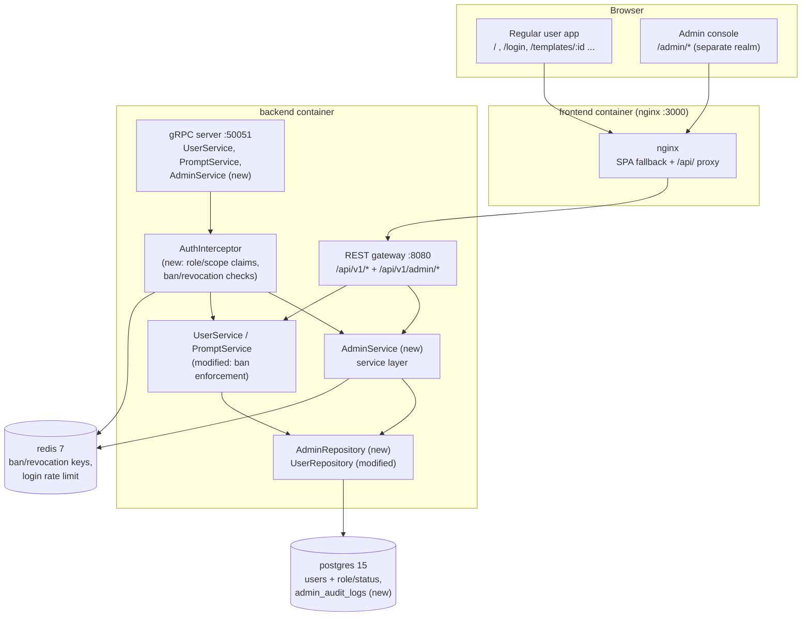

# Admin User Management System — Architecture Design

- **Feature ID:** `admin-user-management`
- **Version:** 1.0
- **Status:** Approved for implementation
- **Author:** Architect Agent
- **Upstream docs:** [Requirements](../design/admin-user-management-requirements.md) · [UI/UX Design](../design/admin-user-management-ui-ux-design.md)
- **Downstream docs:** [Detailed Design (EN)](./admin-user-management-detailed-design.md) · [详细设计（中文）](./admin-user-management-detailed-design-zh-CN.md)

---

## 1. Overview

This feature introduces the first administrative capability for Open Prompts: a **fully separate admin realm** consisting of:

1. An **admin web console** under `/admin/*` (login, dashboard, user management, template moderation, audit log).
2. **Admin APIs** under `/api/v1/admin/*`, enforced server-side.
3. A **role/status model** on users (`role`: `user`|`admin`, `status`: `active`|`banned`).
4. An **append-only audit log** (`admin_audit_logs`) for every admin mutation.
5. **Ban enforcement** across login, sessions, API keys, and the public template square.

Everything is built new, but strictly following the existing architecture: Go backend with the same layering (proto → gateway → service → repository → data), React frontend with the same patterns (pages, redux slices, axios client, i18next), and the same deployment topology (docker-compose, helm chart, idempotent `init.sql`).

**Non-goals (v1):** template editing/deleting by admins, bulk actions, report queues, admin analytics charts, SSO into the admin console (see requirements §8).

## 2. System Context



No new services, containers, or infrastructure dependencies are introduced (NFR-10). The admin console is served by the same frontend bundle (lazy-loaded routes) and the admin API by the same backend process.

## 3. Components Involved & Changes

| Component | Change type | Summary |
|---|---|---|
| `backend/api/proto/v1/admin.proto` | **new** | `AdminService` gRPC contract (11 RPCs) + generated `admin.pb.go`, `admin_grpc.pb.go` |
| `backend/api/proto/v1/prompt.proto` | unchanged | No edits to existing contract (admin lives in its own proto file) |
| `backend/internal/models/user.go` | modified | `User` gains `Role`, `Status` fields |
| `backend/internal/models/admin.go` | **new** | `AdminAuditLog` model |
| `backend/internal/repository/admin_repository.go` | **new** | `AdminRepository`: user list/detail/stats, admin template list/detail, audit log write/read |
| `backend/internal/repository/user_repository.go` | modified | Read `role`/`status` columns; `UpdateRoleAndStatus` |
| `backend/internal/repository/template_repository.go` | modified | Public list/categories/tags exclude banned owners' templates |
| `backend/internal/service/admin.go` | **new** | `AdminService` (login, session refresh, stats, users, ban/unban/role, templates, audit) |
| `backend/internal/service/auth.go` | modified | Claims-based verification (`role`, `scope`, `iat`), context role injection, Redis ban/revocation checks, `AdminLogin` in public RPC set |
| `backend/internal/service/user.go` | modified | Reject banned users at login (password + OAuth), issue role/scope-aware tokens, bootstrap promotion hook |
| `backend/cmd/server/main.go` | modified | Admin REST handlers under `/api/v1/admin/*`, `requireAdmin` middleware helper, `AdminService` wiring + gRPC registration, startup bootstrap |
| `frontend/src/App.js` | modified | Nested `/admin` routes, lazy-loaded admin pages |
| `frontend/src/pages/admin/*` | **new** | 7 admin pages |
| `frontend/src/components/admin/*` | **new** | `AdminLayout`, `AdminTable`, `KpiCard`, `Badge`, `Pagination`, `ReasonModal`, `AdminSearchInput`, `AdminSelect`, `EmptyState`, `ErrorBanner` |
| `frontend/src/services/adminApi.js` | **new** | Separate axios instance (`/api/v1`, admin token, 401 → `/admin/login`) |
| `frontend/src/store/adminAuthSlice.js` | **new** | Admin session state (`op_admin_token` / `op_admin_user` storage keys) |
| `frontend/src/locales/{en,zh}/translation.json` | modified | New `admin.*` namespace (identical key sets in both locales) |
| `deployment/init.sql` + chart copy | modified | `users.role`, `users.status` (idempotent `DO $$` ALTER), `admin_audit_logs` table, indexes |
| `deployment/docker-compose.yml` | modified | `ADMIN_BOOTSTRAP_EMAIL`, `ADMIN_BOOTSTRAP_PASSWORD`, `ADMIN_SESSION_TTL_MINUTES` env passthrough |
| `deployment/chart/open-prompts/` | modified | `values.yaml` + `deployment-backend.yaml` env; `init.sql` copy kept in sync |
| `tests/fvt.py` | modified | Admin FVT suite (bootstrap env in compose invocation, new test functions) |

## 4. API Design (Summary)

All admin endpoints live under **`/api/v1/admin`** and return JSON (protojson, `UseProtoNames` → snake_case), consistent with existing endpoints. Full request/response schemas and error codes are in the [detailed design](./admin-user-management-detailed-design.md).

| Method & Path | Auth | Purpose |
|---|---|---|
| `POST /api/v1/admin/login` | none (rate-limited) | Admin login; issues 30-min admin-scoped JWT |
| `POST /api/v1/admin/session/refresh` | admin JWT | Sliding renewal of the admin session |
| `GET /api/v1/admin/stats` | admin JWT | Dashboard KPIs + recent signups + recent public templates |
| `GET /api/v1/admin/users` | admin JWT | Paginated user list: search, status/role filters, sort |
| `GET /api/v1/admin/users/{id}` | admin JWT | User detail: profile, stats, identities, API keys, templates, action history |
| `POST /api/v1/admin/users/{id}/ban` | admin JWT | Ban with required reason (3–500 chars) |
| `POST /api/v1/admin/users/{id}/unban` | admin JWT | Unban with required reason |
| `POST /api/v1/admin/users/{id}/role` | admin JWT | Promote/demote with required reason; self-demotion blocked |
| `GET /api/v1/admin/templates` | admin JWT | Paginated template moderation list (includes private) |
| `GET /api/v1/admin/templates/{id}` | admin JWT | Template detail incl. all versions (read-only) |
| `GET /api/v1/admin/audit-log` | admin JWT | Paginated audit log, filter by action/actor |

**Pagination model.** Admin list endpoints use **page-based pagination** (`page`, `per_page`, response includes `total`), deliberately diverging from the token-based pagination of the public API: admin tables render "Page 2 of 63 (1,248 users)" and need total counts and page jumps. At admin-traffic volumes, offset pagination is appropriate.

**Error model.** Consistent with the existing `writeError` gateway helper: gRPC status codes mapped to HTTP (`InvalidArgument`→400, `Unauthenticated`→401, `PermissionDenied`→403, `NotFound`→404, `AlreadyExists`/failed-precondition→409), plain-text message body. The frontend surfaces the message in toasts/inline errors.

## 5. Data Model

### 5.1 `users` table changes (idempotent migration)

```sql
DO $$
BEGIN
    IF NOT EXISTS (SELECT 1 FROM information_schema.columns WHERE table_name='users' AND column_name='role') THEN
        ALTER TABLE users ADD COLUMN role TEXT NOT NULL DEFAULT 'user';
    END IF;
END $$;
-- same pattern for status TEXT NOT NULL DEFAULT 'active'
```

- `role`: `'user'` | `'admin'` (default `'user'`). All existing rows backfill to `'user'`.
- `status`: `'active'` | `'banned'` (default `'active'`). All existing rows backfill to `'active'`.
- New indexes: `idx_users_role`, `idx_users_status`, `idx_users_created_at` (list sorting, NFR-2).

### 5.2 New table `admin_audit_logs`

Append-only audit trail (FR-29–31). Columns: `id UUID PK`, `actor_id TEXT NOT NULL`, `actor_email TEXT NOT NULL` (snapshot at write time), `action TEXT` (`ban`|`unban`|`role_change`), `target_type TEXT` (`user`), `target_id TEXT`, `reason TEXT` (3–500 chars), `created_at TIMESTAMPTZ`. **No foreign keys** — the audit trail must survive even if a user row is ever removed; `actor_email` is snapshotted so entries remain readable. Indexes on `created_at`, `actor_id`, `target_id`. Exact DDL in the detailed design.

### 5.3 Existing tables

`templates`, `template_versions`, `prompts`, `api_keys`, `user_identities` are unchanged structurally; banned-owner filtering is done in queries (JOIN on `users.status`), not via denormalized columns.

## 6. Auth & Authorization Model

### 6.1 Roles and token types

| Token | Issued by | Claims | TTL | Valid where |
|---|---|---|---|---|
| Regular JWT | `POST /api/v1/login` | `sub`, `role`, `iat`, `exp`, `iss` | 24 h | All regular `/api/v1/*` endpoints |
| Admin JWT | `POST /api/v1/admin/login` | `sub`, `role:"admin"`, **`scope:"admin"`**, `iat`, `exp`, `iss` | 30 min (configurable) | Regular endpoints **and** `/api/v1/admin/*` |

Key decision: **an admin's regular login token does not grant admin API access.** The admin middleware requires both `role == "admin"` and `scope == "admin"`. This enforces FR-8 (short admin sessions) regardless of the 24 h regular token, and keeps the two realms truly separate (AC-1, AC-2).

### 6.2 Admin middleware

A `requireAdmin` helper in the REST gateway (and an equivalent check inside `AdminService` methods, protecting the gRPC path): verify JWT signature → require `role=admin` + `scope=admin` → check Redis revocations (below) → inject user ID into context. Missing/invalid token → `401`; valid token without admin scope/role → `403` (FR-4).

### 6.3 Ban & revocation propagation (Redis)

JWTs are stateless, so ban/role-change invalidation uses Redis keys checked on every authenticated request:

| Key | Value | Set / removed | Checked by |
|---|---|---|---|
| `user_banned:<user_id>` | `1` | set on ban, removed on unban | JWT verification + API key verification |
| `token_revoked_before:<user_id>` | unix seconds | set on ban **and** role change | JWT verification (reject if `iat` < value) |
| `admin_login_attempts:<ip>` | counter | incr per failed admin login, TTL 15 min | Admin login handler (max 5, NFR-1) |

- **Ban** sets both keys → all of the user's JWTs die immediately, API keys are rejected with `403`, and login is rejected (login additionally checks `users.status` in the DB, the source of truth).
- **Role change** sets `token_revoked_before` → the target's existing tokens (either scope) die; they simply log in again. This makes demotion effective immediately.
- **Unban** removes `user_banned` but keeps `token_revoked_before` — pre-ban tokens are not resurrected; the user logs in again (AC-6 requires login to work, which it does).
- Redis errors fall back to a direct `users.status`/`role` DB check (correctness over availability).
- Key TTLs: `token_revoked_before` 25 h (outlives the 24 h max regular token); `user_banned` 25 h and re-set on every ban.

### 6.4 Admin bootstrap (FR-7)

No open sign-up for admins. At **backend startup** (idempotent, runs on every boot):

- If `ADMIN_BOOTSTRAP_EMAIL` is empty → bootstrap disabled (safe default).
- If a user with that email exists → `UPDATE users SET role='admin'` (promotes an operator's pre-existing account).
- If it does not exist and `ADMIN_BOOTSTRAP_PASSWORD` is set → create the account (`role='admin'`, bcrypt password). If the password is not set, log a warning and skip creation.
- The bootstrap email must be operator-controlled; production deployments set it via `deployment/.env` (gitignored) or helm values. CI/FVT passes `ADMIN_BOOTSTRAP_EMAIL=admin@example.com` explicitly in the compose invocation, so **no privileged default ships in the compose file**.

### 6.5 Regular-surface enforcement changes

- `Login` (password) and `LoginWithOAuth` reject banned users with `403 "account banned"` — distinct from `401 "invalid credentials"` (FR-22, FR-33, AC-5).
- `VerifyAPIKey` rejects banned users' keys with `403` (vs `401` for invalid keys).
- Public template listing (`ListTemplates` public visibility), `ListCategories`, and `ListTags` exclude templates owned by banned users (FR-23, US-U1). `GetTemplate` returns `404` for a public template of a banned owner unless the caller is the owner (banned owners cannot authenticate anyway) — keeping direct-link access consistent with the hidden square.

## 7. Frontend Architecture

### 7.1 Routing (separate realm)

```
/admin/login                 AdminLoginPage      (standalone, no AdminLayout)
/admin                       DashboardPage       (AdminLayout, guarded)
/admin/users                 UsersPage           (AdminLayout, guarded)
/admin/users/:id             UserDetailPage      (AdminLayout, guarded)
/admin/templates             TemplatesPage       (AdminLayout, guarded)
/admin/templates/:id         TemplateDetailPage  (AdminLayout, guarded)
/admin/audit-log             AuditLogPage        (AdminLayout, guarded)
```

- Routes are added in `App.js` as a nested layout route; admin pages are `React.lazy`-loaded so the main bundle is unaffected.
- `AdminLayout` is a **new shell** (top bar + left nav, per the UI/UX design) — it does not reuse the main-app `Layout`/`Header`/`Sidebar`. It reuses `Modal`, `Field`, `Spinner`, `Icons`, `NotificationContext`, and Aurora tokens.
- **Route guard:** `AdminLayout` checks the admin session on mount and route change; unauthenticated → `/admin/login?redirect=<path>`; authenticated non-admin → 403 page (AC-2). The guard is UX only — the API is the security boundary (NFR-1).
- List pages keep search/filter/sort/page in the URL query string (`useSearchParams`) for shareable views.

### 7.2 API client & session state

- `services/adminApi.js`: **separate axios instance**, `baseURL: '/api/v1'` with `/admin/...` paths, request interceptor attaches `op_admin_token`, response interceptor on 401 clears the admin session and redirects to `/admin/login?redirect=...` (never `/login`). This is why a separate instance is required — the existing `api.js` hijacks 401s to the user login.
- `store/adminAuthSlice.js`: `adminLoginSuccess` / `adminLogout` / `initializeAdminAuth`, persisting to `localStorage.op_admin_token` / `op_admin_user` so admin and user sessions coexist without clobbering each other.
- **Idle session (FR-8):** the admin token carries a 30-min `exp`. After each successful admin API response, the client decodes `exp`/`iat`; if the token was issued > 10 min ago it calls `POST /api/v1/admin/session/refresh` and swaps in the new token (sliding window). A toast warns at 25 min idle; at 30 min the next call 401s and the user is redirected. The server-side `exp` is authoritative.

### 7.3 i18n & theming

- All admin strings under the `admin.*` namespace in **both** `locales/en/translation.json` and `locales/zh/translation.json` (NFR-4, AC-11). The two locales must keep identical key sets (the repo currently has 245/245 parity; admin keys are added to both).
- Theming reuses the existing `light-theme` class + `localStorage.theme`; the admin shell adds no new design tokens (NFR-5).

## 8. Configuration

| Variable | Default | Scope | Purpose |
|---|---|---|---|
| `ADMIN_BOOTSTRAP_EMAIL` | *(empty = disabled)* | backend | Bootstrap admin account email (promote-or-create at startup) |
| `ADMIN_BOOTSTRAP_PASSWORD` | *(empty)* | backend | Password for bootstrap account creation (only used if the account doesn't exist) |
| `ADMIN_SESSION_TTL_MINUTES` | `30` | backend | Admin JWT lifetime / idle window (FR-8) |
| `JWT_SECRET` | *(existing)* | backend | Unchanged; signs both token types |

- `deployment/docker-compose.yml`: pass the three vars through from the host environment (`${ADMIN_BOOTSTRAP_EMAIL:-}` etc.), same pattern as the existing `SMTP_*` vars. **No non-empty privileged defaults.**
- Helm chart: add `backend.env.adminBootstrapEmail`, `adminBootstrapPassword`, `adminSessionTtlMinutes` to `values.yaml` and wire them in `templates/deployment-backend.yaml`.
- `deployment/.env` (gitignored) is where operators set production values.
- FVT: `tests/fvt.py` invokes `docker compose up` with `ADMIN_BOOTSTRAP_EMAIL=admin@example.com ADMIN_BOOTSTRAP_PASSWORD=Admin_123456` in the environment, then logs in as that admin.

## 9. Security Considerations

1. **Server-side enforcement everywhere.** Role checks live in the gateway middleware and service layer, never only in the UI (NFR-1, FR-4). The gRPC path is protected by the same checks inside `AdminService`.
2. **Admin login rate limiting:** 5 failed attempts per 15 min per IP via Redis counter → `429` (NFR-1).
3. **Reason mandatory:** every mutation validates a 3–500 char reason server-side; the audit write and the mutation happen in the same request (NFR-3).
4. **Actor from verified token:** `actor_id` always comes from the authenticated context, never the request body; `actor_email` is snapshotted server-side (NFR-3).
5. **No secrets in admin views:** password hashes never leave the repository layer; API keys are listed as `name/prefix/status/last_used` only (NFR-8, FR-18).
6. **Self-protection rules:** self-ban and self-demotion are rejected server-side (FR-21; self-ban would lock out the operator).
7. **Bootstrap safety:** empty-by-default bootstrap env; bootstrap email must be operator-controlled; created bootstrap account uses a bcrypt-hashed password; promotion is idempotent and logged.
8. **Ban is defense-in-depth:** DB status (login) + Redis keys (live sessions/API keys) + query-level filtering (public square) — a stale component cannot resurrect banned access.
9. **No breaking changes:** new columns are additive with defaults; existing endpoints keep their contracts (NFR-7). The only behavioral change to existing APIs is the *addition* of ban enforcement (403 on banned login, hidden banned-owner public templates), which is the feature's intent.
10. **Audit immutability:** no update/delete endpoints exist for audit entries; table has no FKs that could cascade-delete history.

## 10. Deployment Notes

- **Database migration** is automatic: `init.sql` runs on fresh databases; existing databases get the new columns/table because the file is idempotent — but note `init.sql` only auto-runs on an **empty** postgres data volume. For existing deployments, the same idempotent SQL must be applied once (the deploy flow recreates containers, not volumes; the developer documents the `docker exec -i <postgres> psql -U user -d open_prompts < deployment/init.sql` upgrade step in the PR description/README). The helm `configmap-postgres-init` copy is updated in sync.
- **Backend startup** performs the bootstrap promotion/creation idempotently — safe on every restart.
- **CI:** the FVT job boots compose with the bootstrap env and exercises the admin API end-to-end; no CI workflow changes needed.
- **Production deploy** (push to main) applies the same flow; operators should set `ADMIN_BOOTSTRAP_EMAIL/PASSWORD` in `deployment/.env` **before** the deploy that introduces this feature, then log in and change the password / promote real accounts.

## 11. Test Strategy (Summary)

- **FVT (developer, `tests/fvt.py`):** admin login (non-admin 403, banned 403, rate limit), stats correctness, user list search/filter/pagination, ban flow end-to-end (login rejection, token/API-key invalidation, public-square hiding, audit entry), unban flow, role change + self-demotion rejection, admin template list incl. private, audit log listing. Detailed case list in the detailed design §8.
- **Backend unit tests:** service-layer tests for ban/unban/role validation rules and audit writes; ≥ 80 % coverage on new Go files (repo constraint).
- **E2E (test-agent, Nightwatch, `test/e2e/`):** AC-1..AC-12 mapped to browser scenarios (admin login, route guard, dashboard, user list interactions, ban modal, audit log, i18n/theme, regular-surface isolation).
- **Manual verification:** `docker compose up` + admin console walkthrough in both themes and both locales.

---

*This document is the architecture-level contract. Endpoint schemas, DDL, layer responsibilities, frontend file breakdown, i18n keys, and test cases are specified in the [detailed design](./admin-user-management-detailed-design.md). The Chinese version [架构设计（中文）](./admin-user-management-architecture-zh-CN.md) mirrors this document.*
