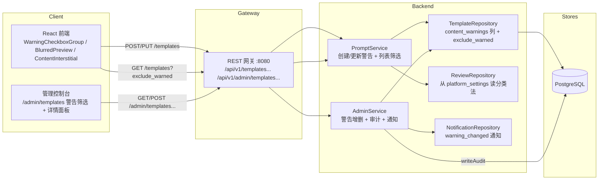
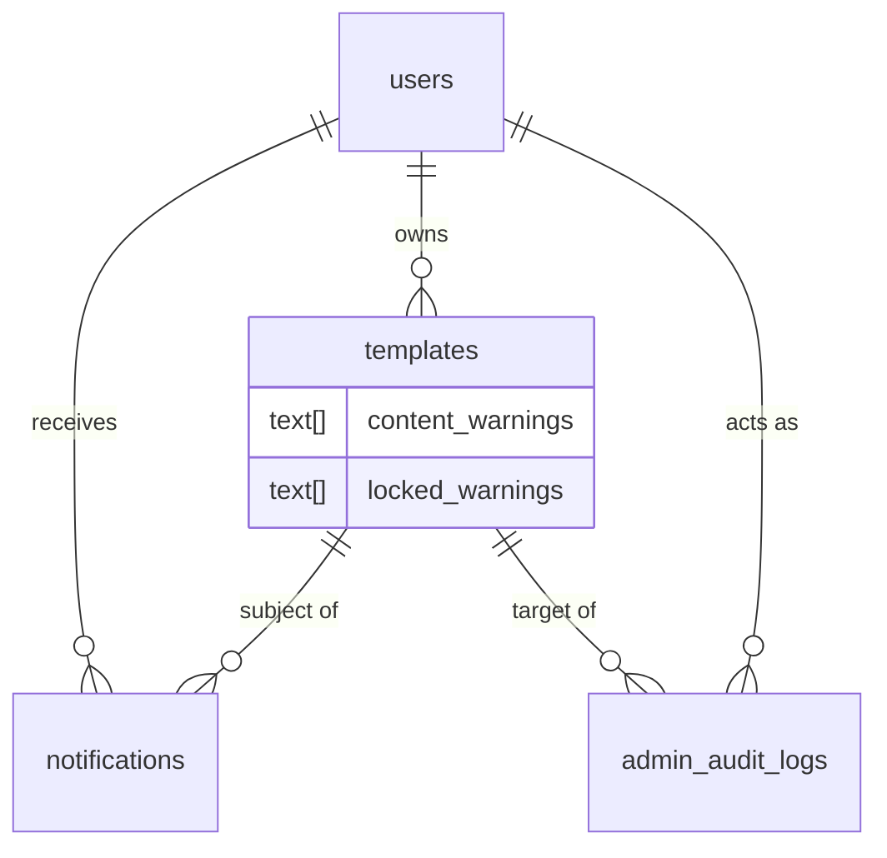

# 内容警告 — 架构设计

| | |
|---|---|
| **Feature ID** | content-warnings |
| **Version** | 1.0 |
| **Status** | Approved for implementation |
| **Author** | Architect Agent |
| **Upstream** | [需求文档](../design/content-warnings-requirements-zh-CN.md), [UI/UX 设计](../design/content-warnings-ui-ux-design-zh-CN.md) |
| **Downstream** | [详细设计](content-warnings-detailed-design-zh-CN.md) |

## 1. 概述

内容警告为平台提供对敏感但合法模板的分级响应。一个固定、配置驱动的四类
警告分类法（`mature`、`violence`、`profanity`、`sensitive`）以
`content_warnings`（数组）存储在模板上。创作者在创建/编辑时自我申报警告；
审核员可以带必填原因增删警告（可审计，且一旦施加对创作者不可变）。带警告
模板保持完全可发现、可排序（FR-11 —— 与搜索排序、趋势或发布前审核无任何
交互），但被视觉门控：卡片模糊预览并带警告角标，详情页在内容前显示插页，
嵌入显示同样的插页。揭示按模板在会话内持久。观众有两个偏好：
`show_warned_content`（始终显示，跳过门控）与 `exclude_warned` 筛选
（从浏览/搜索中完全隐藏带警告模板）。

本设计复用既有模式：`platform_settings` 键值存储（由 pre-publication-review
引入）保存分类法；`writeAudit` + `requireAdminContext` 的 admin-service
形状；`createEngagementNotification` 的尽力而为通知钩子；
`/api/v1/admin/{resource}` 的网关分支风格；以及 admin-template-moderation
的管理控制台外壳（`/admin/templates` 列表 + 详情）。

### 1.1 已决开放问题

| # | 问题（来自需求 §10） | 决策 |
|---|---|---|
| 1 | 数组列 vs. 关联表；审核员锁定的来源标记 | **`templates` 上两个并行的 `TEXT[]` 列：`content_warnings`（全部生效警告）与 `locked_warnings`（审核员施加的子集）。** 锁定 = 两数组的*交集* —— 当且仅当某警告出现在 `locked_warnings` 中才对创作者不可变。这使读取保持单行（无连接）、可 GIN 索引（服务管理端筛选与 `exclude_warned`），来源标记是普通数组比较而非关联表行。关联表会为每个警告增加元数据（谁/何时），而审计日志已捕获这些（FR-7 写入 `template.warning_add`/`template.warning_remove`，含操作者与原因），因此冗余。 |
| 2 | 匿名访客的 `exclude_warned` 默认 | **关闭（最大化可发现性），与设计假设一致。** 匿名访客看到带角标的模糊警告模板（AC-8）并可按会话揭示；只是没有持久偏好。`exclude_warned` 筛选对所有人都是可选的，登录用户按用户持久，匿名仅 URL 参数。 |
| 3 | 会话级揭示 vs. 按用户的持久"已揭示"列表 | **会话级揭示，客户端 `sessionStorage` 按模板 id 存储。** 无服务端存储、无按用户已揭示列表表、零后端面。新会话（或新浏览器）重新门控（AC-2）。`show_warned_content` 是唯一*持久*的观众控制，存于服务端用户上。 |
| 4 | 审核员对 `in_review` 提交的警告变更在审核队列中可见 | **完全分离（非阻塞，无队列信号）。** FR-11 明确禁止警告与发布前审核门控之间的任何交互。审核队列已作为附加展示显示模板的自我申报警告（D-6），让审核员在上下文中看到；但审核员警告变更不改变队列排序、状态或任何审核决定。 |
| 5 | 通知负载：全集 vs. 增量；深链目标 | **通知携带增量（增/删的警告名）加模板标题，深链到模板详情页。** UI/UX 文案（`warnings.notify.changed` = "Content warnings on \"{{title}}\" were changed: {{change}}"）是增量形状，因此负载为 `{added: [...], removed: [...]}` 渲染进句子。深链到模板详情页（创作者与其他人一样看到插页，按 UI/UX §6.9）—— 而非帮助页。 |

### 1.2 非目标

- 年龄验证或年龄门控账号（观众通过偏好自选）。
- 对集合、评论、用户主页或提示词施加警告（仅模板，FR-13）。
- 按警告类型的观众偏好（v1 仅单一全局"始终显示"开关）。
- 自动/AI 辅助的警告建议。
- 面向 SDK 消费者的警告门控 API 访问（API 返回数组；客户端自行决定）。
- 邮件通知（仅应用内）。
- **任何形式的商业化** —— 支付、定价、购买、收益、销售、付费排名等均不在范围内，已从本架构中剔除。

## 2. 系统上下文



## 3. 涉及组件

| 组件 | 变更 |
|---|---|
| `backend/api/proto/v1/prompt.proto` | `Template` 新增 `content_warnings`（27）与 `locked_warnings`（28）；`CreateTemplateRequest`/`UpdateTemplateRequest` 新增 `content_warnings`（10/11）；`ListTemplatesRequest` 新增 `exclude_warned`（12）。 |
| `backend/api/proto/v1/admin.proto` | `AdminTemplateSummary` 新增 `content_warnings`（15）与 `locked_warnings`（16）；`ListAdminTemplatesRequest` 新增 `warning` 筛选（7）；`AdminService` 新增 2 个 RPC：`UpdateTemplateWarnings`、`ListWarningHistory`。 |
| `backend/internal/service/prompt.go` | `templateModelToProto` 映射 `content_warnings`/`locked_warnings`；创建/更新时校验分类法；执行创作者不可变锁定（403）；列表应用 `exclude_warned`。 |
| `backend/internal/service/admin.go` | `UpdateTemplateWarnings`（带原因增删、审计、通知）；`ListWarningHistory`；从 `platform_settings` 读分类法。 |
| `backend/internal/repository/template_repository.go` | SELECT/INSERT/UPDATE 中的 `content_warnings`/`locked_warnings`；`buildTemplateConditions` 中的 `exclude_warned` 筛选；管理端列表的警告状态筛选。 |
| `backend/internal/repository/review_repository.go` | 从 `platform_settings` 读分类法（新键 `content_warning_taxonomy`）。 |
| `backend/internal/models/` | `Template.ContentWarnings/LockedWarnings`（`pq.StringArray`）；新 `WarningHistoryEntry` 模型。 |
| `backend/cmd/server/main.go` | `/api/v1/admin/templates/{id}/warnings` 下 2 条管理路由（全部 `requireAdmin`）；公开列表的 `exclude_warned` 查询参数。 |
| `frontend/src/components/warnings/*` | **新建。** `WarningCheckboxGroup`、`WarningChip`、`BlurredPreview`、`ContentInterstitial`、`HideWarnedFilterChip`、`ShowWarnedToggle`、`WarningActionsPanel`。 |
| `frontend/src/pages/Home.js`、`TemplateDetails.js`、`PromptCard.js`、`Profile.js`、`CreateTemplateModal.js` | 警告角标/模糊/插页、筛选角标、设置开关、锁定显示。 |
| `frontend/src/pages/admin/TemplatesPage.js`、`TemplateDetailPage.js` | 警告筛选下拉 + 警告操作面板。 |
| `deployment/init.sql`（+ chart 副本） | `templates` ALTER（`content_warnings`、`locked_warnings`）；`platform_settings` 分类法种子；`admin_audit_logs` action CHECK 扩宽（`template.warning_add`/`template.warning_remove`）；`notifications` type CHECK 扩宽（`template_warning_changed`）。 |

## 4. API 设计

### 4.1 创作者 / 观众面

| 方法 | 路径 | 描述 |
|---|---|---|
| `POST` | `/api/v1/templates` | 创建。请求体新增 `content_warnings`（分类法键数组）。响应 `Template` 携带 `content_warnings` + `locked_warnings`（创建时为空）。 |
| `PUT` | `/api/v1/templates/{id}` | 更新。请求体新增 `content_warnings`。服务拒绝（403）任何移除 `locked_warnings` 中警告的尝试（FR-8）。 |
| `GET` | `/api/v1/templates` | 列表/搜索。查询新增 `exclude_warned`（布尔）。为真时，带警告模板从公开流中过滤掉（FR-6）。 |
| `GET` | `/api/v1/templates/{id}` | 详情。响应 `Template` 携带 `content_warnings` + `locked_warnings`（locked 仅对所有者/管理员有意义）。 |

无新创作者/观众端点 —— 警告搭载在既有模板消息与列表查询上。

### 4.2 管理面

| 方法 | 路径 | 描述 |
|---|---|---|
| `GET` | `/api/v1/admin/templates` | 列表。查询新增 `warning` 筛选：`""`（任意）、`none` 或特定分类法键（`mature`/`violence`/`profanity`/`sensitive`）（FR-9）。 |
| `GET` | `/api/v1/admin/templates/{id}` | 详情。响应 `AdminTemplateSummary` 携带 `content_warnings` + `locked_warnings`；详情响应新增警告历史列表。 |
| `POST` | `/api/v1/admin/templates/{id}/warnings` | 添加警告。请求体 `{warnings: [...], reason}` —— 原因必填（3–500 字符）。审计（`template.warning_add`），通知创作者。 |
| `DELETE` | `/api/v1/admin/templates/{id}/warnings` | 移除警告。请求体 `{warnings: [...], reason}` —— 原因必填。审计（`template.warning_remove`），通知创作者。 |
| `GET` | `/api/v1/admin/templates/{id}/warnings/history` | 模板的警告变更历史（从 `admin_audit_logs` 按目标 + 动作过滤）。 |

所有管理路由位于 `requireAdmin`（网关）与 `requireAdminContext`（服务）之后。与既有 28 条路由无冲突。

### 4.3 错误码

| HTTP | gRPC | 条件 |
|---|---|---|
| 400 | `INVALID_ARGUMENT` | 未知警告类型；空警告数组；原因缺失或 <3/>500 字符。 |
| 401 | `UNAUTHENTICATED` | 缺失/无效的管理员令牌。 |
| 403 | `PERMISSION_DENIED` | 非管理员访问管理路由；创作者尝试移除锁定警告。 |
| 404 | `NOT_FOUND` | 模板 id 未知；未知模板的警告历史。 |

## 5. 数据模型

### 5.1 列新增（幂等，两份 init.sql）

- `templates.content_warnings TEXT[] NOT NULL DEFAULT '{}'` —— 全部生效
  警告（自我申报 + 审核员施加）。
- `templates.locked_warnings TEXT[] NOT NULL DEFAULT '{}'` —— 审核员施加
  的子集；对创作者不可变。

两者在 GORM 模型中均为 `pq.StringArray`。锁定规则为
`locked_warnings ⊆ content_warnings`（锁定警告始终也在 `content_warnings`
中；创作者禁止将其从 `content_warnings` 移除）。`content_warnings` 上的
GIN 索引服务 `exclude_warned` 筛选与管理端警告状态筛选。

### 5.2 平台设置种子

```sql
INSERT INTO platform_settings (key, value) VALUES
    ('content_warning_taxonomy', '["mature","violence","profanity","sensitive"]')
ON CONFLICT (key) DO NOTHING;
```

分类法是键的 JSON 数组，管理员可在运行时编辑（NFR-2），通过既有的
`PUT /api/v1/admin/settings`（`settings_change` 审计动作与 `platform`
target_type 已由 pre-publication-review 提供）。服务对任何传入的
`content_warnings` 对照此列表校验。

### 5.3 CHECK 扩宽（受保护、幂等）

- `admin_audit_logs.action` += `template.warning_add`、`template.warning_remove`
  （target_type `template` 已存在）。
- `notifications.type` += `template_warning_changed`。

### 5.4 实体关系



## 6. 认证与授权

- 所有警告管理路由位于 `requireAdmin`（网关）与 `requireAdminContext`
  （服务）之后 —— role=admin AND scope=admin，与既有管理控制台端点一致。
- 创作者警告编辑从认证上下文取用户，绝不从请求体取（既有
  `GetUserIDFromContext` 模式）。
- **创作者不可变锁定（FR-8）：** 在 `UpdateTemplate` 上，服务计算传入
  `content_warnings` 与模板 `locked_warnings` 的差集。若任一锁定警告不在
  传入集合中，更新被拒绝为 `403 PERMISSION_DENIED`（AC-6）。创作者可自由
  增删自己申报的警告。
- 审核员变更可归因：`writeAudit` 记录操作者 id/email、动作
  （`template.warning_add`/`template.warning_remove`）、目标（`template`，
  模板 id）与原因 —— 满足 NFR-5。

## 7. 前端

- **创作者/观众：**
  - `CreateTemplateModal` 与编辑表单中的 `WarningCheckboxGroup` —— 从
    分类法多选；锁定警告渲染为禁用、勾选的角标，带锁图标与提示（UI/UX
    §4.1）。
  - `PromptCard`（及任何卡片列表）上的 `BlurredPreview` —— 预览 CSS
    `filter: blur(12px)`，`WarningChip` 覆盖指明原因，标题在模糊之外
    （FR-3）。
  - `TemplateDetails` 上的 `ContentInterstitial` —— 内容上方全宽面板：
    原因列表、"显示内容"/"返回"；焦点陷阱，Escape = 返回（FR-4，UI/UX
    §6.10）。
  - 浏览/搜索筛选行中的 `HideWarnedFilterChip` —— 切换
    `exclude_warned=true`，按用户持久，同步 URL `?hideWarned=1`（FR-6）。
  - `Profile` → 内容偏好中的 `ShowWarnedToggle` —— 在服务端用户上持久
    `show_warned_content`（FR-5）。
  - 揭示状态存于按模板 id 的 `sessionStorage`（OQ-3）。
- **管理控制台：**
  - `TemplatesPage` 新增 `AdminWarningFilter` 下拉（任意 / 无 / 成人 /
    暴力 / 语言 / 敏感）（FR-9）。
  - `TemplateDetailPage` 新增 `WarningActionsPanel` —— 当前警告带来源
    徽章（创作者/审核）、添加下拉、移除按钮、原因输入（必填，≥3 字符）、
    历史列表（FR-7）。
- **通知：** `NotificationItem` 渲染新的 `template_warning_changed` 类型，
  带增量句子（`warnings.notify.changed`），深链到模板（FR-10，OQ-5）。
- **i18n：** `warnings.*` 键逐字取自 UI/UX §8，EN/ZH 对齐。

## 8. 配置

| 设置 | 默认 | 描述 |
|---|---|---|
| `content_warning_taxonomy` | `["mature","violence","profanity","sensitive"]` | 固定警告分类法（键的 JSON 数组）。管理员可在运行时编辑（NFR-2）—— 无需发版。 |

存于 `platform_settings`（与 pre-publication-review 阈值同机制）。通过既有
60 秒设置缓存读取；写入使其失效。分类法在每次创建/更新与管理端变更时在
服务端校验。

## 9. 安全与隐私考量

- **无状态泄露：** 警告不是可见性门控 —— 带警告模板保持完全公开且可排序
  （FR-11）。`content_warnings` 数组返回给所有人；`locked_warnings` 仅对
  所有者与管理员有意义但不敏感（它是 `content_warnings` 的子集）。
- **创作者不可变执行：** 锁定在服务端执行（403），绝不信任客户端（FR-8）。
- **可审计性：** 每次审核员警告变更写入带操作者与原因的不可变审计行
  （NFR-5）。
- **注入：** 仅参数化 SQL；警告类型对照服务端分类法白名单校验；筛选值
  绝不进入 SQL 文本。
- **透明（NFR-4）：** 每次审核员变更通知创作者并带原因。

## 10. 部署说明

- DDL 为增量且幂等；`deployment/init.sql` 与
  `deployment/chart/open-prompts/init.sql` 在同一提交中逐字节一致更新。
  CHECK 扩宽使用 `pg_get_constraintdef` 保护。
- 回填：`content_warnings`/`locked_warnings` 默认为空数组 —— 既有模板无需
  回填。
- 无新服务、端口或基础设施；除 init.sql ConfigMap 内容外无 chart 变更。
- `backend/server` 是受跟踪的构建产物 —— 绝不提交对其的变更。

## 11. 测试策略

- **FVT**（`tests/fvt.py`）：`test_content_warnings` —— 创作者创建时标记
  `mature` → API 返回 `content_warnings: ["mature"]`；卡片/详情门控为客户端
  行为（FVT 断言 API 契约）；`exclude_warned=true` 从列表/搜索移除带警告
  模板；创作者移除锁定警告 → 403；移除自己警告 → 200；管理员带原因增删 →
  审计日志含 `template.warning_add`/`template.warning_remove` + 创作者通知；
  管理端警告筛选（`none`/`any`/特定类型）；分类法来自设置；FR-11（带警告
  模板在最新/最多点赞/趋势排序中的位置不变）。覆盖 AC-1..10。
- **单元：** 分类法校验矩阵、锁定执行矩阵（锁定 vs 自我申报）、
  `exclude_warned` 筛选 SQL、管理端警告状态筛选、审计/通知尽力而为。
- **E2E**（test-agent）：模糊 + 角标渲染、插页揭示 + 会话持久、
  `show_warned_content` 跳过、`exclude_warned` 筛选持久 + URL 同步、管理端
  面板带原因必填增删、创作者编辑器锁定显示、通知渲染、i18n EN/ZH 对齐。

## 12. 性能与缓存

- **NFR-1（p95 不变）：** 模糊/揭示纯客户端；`content_warnings` 数组为既有
  SELECT 增加单个 `TEXT[]` 列 —— 无可测延迟。
- **NFR-6（10k+ 模板）：** `exclude_warned` 为 `NOT (content_warnings &&
  ARRAY[...])`（可 GIN 索引）；管理端警告状态筛选使用同一 `content_warnings`
  GIN 索引。无全表扫描。
- **分类法缓存：** 通过既有 60 秒设置缓存读取；热列表路径上除缓存值外无
  每请求设置查询。