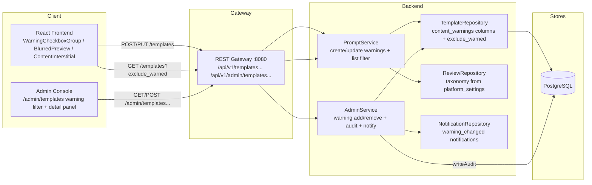
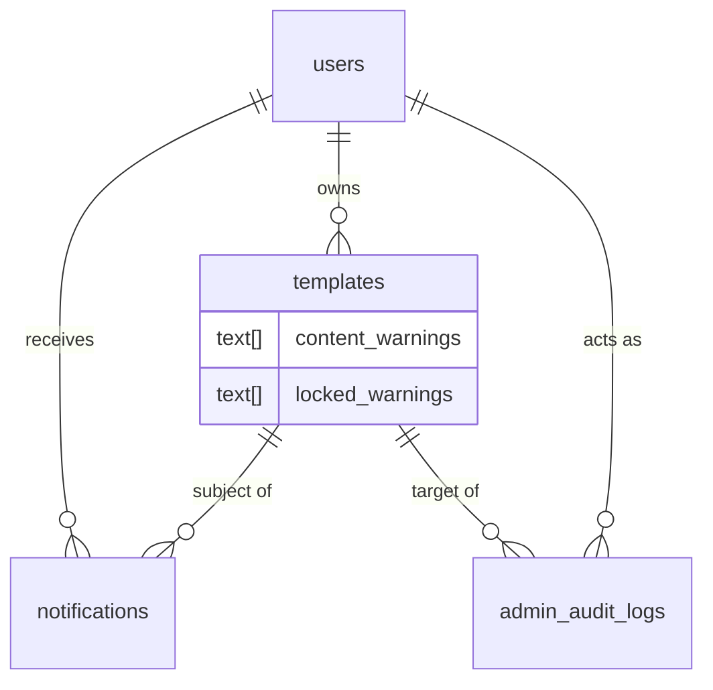

# Content Warnings — Architecture Design

| | |
|---|---|
| **Feature ID** | content-warnings |
| **Version** | 1.0 |
| **Status** | Approved for implementation |
| **Author** | Architect Agent |
| **Upstream** | [Requirements](../design/content-warnings-requirements.md), [UI/UX Design](../design/content-warnings-ui-ux-design.md) |
| **Downstream** | [Detailed Design](content-warnings-detailed-design.md) |

## 1. Overview

Content warnings give the platform a graduated response to
sensitive-but-legitimate templates. A fixed, configuration-driven taxonomy of
four warning types (`mature`, `violence`, `profanity`, `sensitive`) is stored
on each template as `content_warnings` (an array). Creators self-declare
warnings at create/edit time; moderators can add or remove warnings with a
mandatory reason (audited, and creator-immutable once applied). Warned
templates stay fully discoverable and rankable (FR-11 — no interaction with
search ranking, trending, or pre-publication-review gating), but are visually
gated: cards blur their preview with a warning chip, the detail page shows an
interstitial before content, and embeds show the same interstitial. Reveal is
session-scoped per template. Viewers have two preferences: `show_warned_content`
(always show, skip the gate) and an `exclude_warned` filter (hide warned
templates from browse/search entirely).

The design reuses established patterns: the `platform_settings` key-value
store (introduced by pre-publication-review) holds the taxonomy; the
`writeAudit` + `requireAdminContext` admin-service shape; the
`createEngagementNotification` best-effort notification hook; the
`/api/v1/admin/{resource}` gateway branch style; and the admin console shell
(`/admin/templates` list + detail) from admin-template-moderation.

### 1.1 Resolved Open Questions

| # | Question (from requirements §10) | Decision |
|---|---|---|
| 1 | Array column vs. join table; origin marker for the moderator lock | **Two parallel `TEXT[]` columns on `templates`: `content_warnings` (all active warnings) and `locked_warnings` (the subset applied by moderation).** The lock is the *intersection* of the two arrays — a warning is creator-immutable iff it appears in `locked_warnings`. This keeps reads single-row (no join), is GIN-indexable for the admin filter and `exclude_warned`, and the origin marker is a plain array comparison rather than a join-table row. A join table would add per-warning metadata (who/when) that the audit log already captures (FR-7 writes `template.warning_add`/`template.warning_remove` with actor + reason), so it would be redundant. |
| 2 | `exclude_warned` default for anonymous visitors | **OFF (maximize discoverability), matching the design assumption.** Anonymous visitors see warned templates blurred with a chip (AC-8) and can reveal per session; they simply have no persistent preference. The `exclude_warned` filter is opt-in for everyone, persisted per user (logged-in) or via URL parameter only (anonymous). |
| 3 | Session-scoped reveal vs. per-user persistent revealed list | **Session-scoped reveal, stored client-side in `sessionStorage` keyed by template id.** No server storage, no per-user revealed-list table, zero backend surface. A new session (or a new browser) re-gates (AC-2). The `show_warned_content` preference is the only *persistent* viewer control and lives server-side on the user. |
| 4 | Moderator warning change on an `in_review` submission visible in the review queue | **Kept entirely separate (non-blocking, no queue signal).** FR-11 explicitly forbids any interaction between warnings and pre-publication-review gating. The review queue already shows the template's self-declared warnings as an additive display (D-6) so reviewers see them in context, but a moderator warning change does not alter queue ordering, status, or any review decision. |
| 5 | Notification payload: full set vs. delta; deep-link target | **The notification carries the delta (added/removed warning names) plus the template title, and deep-links to the template detail page.** The UI/UX copy (`warnings.notify.changed` = "Content warnings on \"{{title}}\" were changed: {{change}}") is delta-shaped, so the payload is `{added: [...], removed: [...]}` rendered into the sentence. Deep-link to the template detail page (the creator sees the interstitial like anyone else, per UI/UX §6.9) — not a help page. |

### 1.2 Non-Goals

- Age verification or age-gated accounts (viewers self-select via preference).
- Warnings on collections, comments, user profiles, or prompts (templates
  only, FR-13).
- Per-warning viewer preferences (single global "always show" toggle in v1).
- Automatic/AI-assisted warning suggestions.
- Warning-gated API access for SDK consumers (the API returns the array;
  clients decide).
- Email notifications (in-app only).
- **Monetization of any kind** — payments, pricing, purchases, earnings,
  sales, or paid-ranking surfaces are out of scope and excluded from this
  architecture.

## 2. System Context



## 3. Components Involved

| Component | Change |
|---|---|
| `backend/api/proto/v1/prompt.proto` | `Template` gains `content_warnings` (27) and `locked_warnings` (28); `CreateTemplateRequest`/`UpdateTemplateRequest` gain `content_warnings` (10/11); `ListTemplatesRequest` gains `exclude_warned` (12). |
| `backend/api/proto/v1/admin.proto` | `AdminTemplateSummary` gains `content_warnings` (15) and `locked_warnings` (16); `ListAdminTemplatesRequest` gains `warning` filter (7); 2 new RPCs on `AdminService`: `UpdateTemplateWarnings`, `ListWarningHistory`. |
| `backend/internal/service/prompt.go` | Map `content_warnings`/`locked_warnings` in `templateModelToProto`; validate taxonomy on create/update; enforce the creator-immutable lock (403); apply `exclude_warned` in list. |
| `backend/internal/service/admin.go` | `UpdateTemplateWarnings` (add/remove with reason, audit, notify); `ListWarningHistory`; taxonomy read from `platform_settings`. |
| `backend/internal/repository/template_repository.go` | `content_warnings`/`locked_warnings` in SELECT/INSERT/UPDATE; `exclude_warned` filter in `buildTemplateConditions`; warning-state filter on the admin list. |
| `backend/internal/repository/review_repository.go` | Taxonomy read from `platform_settings` (new key `content_warning_taxonomy`). |
| `backend/internal/models/` | `Template.ContentWarnings/LockedWarnings` (`pq.StringArray`); new `WarningHistoryEntry` model. |
| `backend/cmd/server/main.go` | 2 admin routes under `/api/v1/admin/templates/{id}/warnings` (all `requireAdmin`); `exclude_warned` query param on the public list. |
| `frontend/src/components/warnings/*` | **New.** `WarningCheckboxGroup`, `WarningChip`, `BlurredPreview`, `ContentInterstitial`, `HideWarnedFilterChip`, `ShowWarnedToggle`, `WarningActionsPanel`. |
| `frontend/src/pages/Home.js`, `TemplateDetails.js`, `PromptCard.js`, `Profile.js`, `CreateTemplateModal.js` | Warning chips/blur/interstitial, filter chip, settings toggle, locked display. |
| `frontend/src/pages/admin/TemplatesPage.js`, `TemplateDetailPage.js` | Warning filter dropdown + warning actions panel. |
| `deployment/init.sql` (+ chart copy) | `templates` ALTERs (`content_warnings`, `locked_warnings`); `platform_settings` seed for the taxonomy; `admin_audit_logs` action CHECK widening (`template.warning_add`/`template.warning_remove`); `notifications` type CHECK widening (`template_warning_changed`). |

## 4. API Design

### 4.1 Creator / viewer surface

| Method | Path | Description |
|---|---|---|
| `POST` | `/api/v1/templates` | Create. Body gains `content_warnings` (array of taxonomy keys). Response `Template` carries `content_warnings` + `locked_warnings` (empty on create). |
| `PUT` | `/api/v1/templates/{id}` | Update. Body gains `content_warnings`. The service rejects (403) any attempt to remove a warning present in `locked_warnings` (FR-8). |
| `GET` | `/api/v1/templates` | List/search. Query gains `exclude_warned` (bool). When true, warned templates are filtered out of the public stream (FR-6). |
| `GET` | `/api/v1/templates/{id}` | Detail. Response `Template` carries `content_warnings` + `locked_warnings` (locked only meaningful to owner/admin). |

No new creator/viewer endpoints — warnings ride on the existing template
messages and the list query.

### 4.2 Admin surface

| Method | Path | Description |
|---|---|---|
| `GET` | `/api/v1/admin/templates` | List. Query gains `warning` filter: `""` (any), `none`, or a specific taxonomy key (`mature`/`violence`/`profanity`/`sensitive`) (FR-9). |
| `GET` | `/api/v1/admin/templates/{id}` | Detail. Response `AdminTemplateSummary` carries `content_warnings` + `locked_warnings`; the detail response gains a warning history list. |
| `POST` | `/api/v1/admin/templates/{id}/warnings` | Add warnings. Body `{warnings: [...], reason}` — reason required (3–500 chars). Audited (`template.warning_add`), creator notified. |
| `DELETE` | `/api/v1/admin/templates/{id}/warnings` | Remove warnings. Body `{warnings: [...], reason}` — reason required. Audited (`template.warning_remove`), creator notified. |
| `GET` | `/api/v1/admin/templates/{id}/warnings/history` | Warning change history for the template (from `admin_audit_logs` filtered by target + action). |

All admin routes sit behind `requireAdmin` (gateway) and
`requireAdminContext` (service). No collisions with the existing 28 routes.

### 4.3 Error Codes

| HTTP | gRPC | Condition |
|---|---|---|
| 400 | `INVALID_ARGUMENT` | Unknown warning type; empty warnings array; reason missing or <3/>500 chars. |
| 401 | `UNAUTHENTICATED` | Missing/invalid admin token. |
| 403 | `PERMISSION_DENIED` | Non-admin on admin routes; creator attempting to remove a locked warning. |
| 404 | `NOT_FOUND` | Template id unknown; warning history for unknown template. |

## 5. Data Model

### 5.1 Column additions (idempotent, both init.sql copies)

- `templates.content_warnings TEXT[] NOT NULL DEFAULT '{}'` — all active
  warnings (self-declared + moderator-applied).
- `templates.locked_warnings TEXT[] NOT NULL DEFAULT '{}'` — the subset
  applied by moderation; creator-immutable.

Both are `pq.StringArray` in the GORM model. The lock rule is
`locked_warnings ⊆ content_warnings` (a locked warning is always also in
`content_warnings`; removing it from `content_warnings` is forbidden for the
creator). A GIN index on `content_warnings` serves the `exclude_warned`
filter and the admin warning-state filter.

### 5.2 Platform settings seed

```sql
INSERT INTO platform_settings (key, value) VALUES
    ('content_warning_taxonomy', '["mature","violence","profanity","sensitive"]')
ON CONFLICT (key) DO NOTHING;
```

The taxonomy is a JSON array of keys, admin-editable at runtime (NFR-2) via
the existing `PUT /api/v1/admin/settings` (the `settings_change` audit action
and `platform` target_type already exist from pre-publication-review). The
service validates any incoming `content_warnings` against this list.

### 5.3 CHECK widenings (guarded, idempotent)

- `admin_audit_logs.action` += `template.warning_add`, `template.warning_remove`
  (target_type `template` already present).
- `notifications.type` += `template_warning_changed`.

### 5.4 Entity relationships



## 6. Auth & Authorization

- All warning admin routes sit behind `requireAdmin` (gateway) and
  `requireAdminContext` (service) — role=admin AND scope=admin, identical to
  the existing admin console endpoints.
- Creator warning edits derive the user from the auth context, never the
  request body (existing `GetUserIDFromContext` pattern).
- **Creator-immutable lock (FR-8):** on `UpdateTemplate`, the service
  computes the set difference between the incoming `content_warnings` and the
  template's `locked_warnings`. If any locked warning is absent from the
  incoming set, the update is rejected with `403 PERMISSION_DENIED` (AC-6).
  The creator may freely add/remove their own self-declared warnings.
- Moderator changes are attributable: `writeAudit` records actor id/email,
  action (`template.warning_add`/`template.warning_remove`), target
  (`template`, template id), and the reason — satisfying NFR-5.

## 7. Frontend

- **Creator/viewer:**
  - `WarningCheckboxGroup` in `CreateTemplateModal` and the edit form —
    multi-select from the taxonomy; locked warnings render as disabled,
    checked chips with a lock icon and tooltip (UI/UX §4.1).
  - `BlurredPreview` on `PromptCard` (and any card list) — CSS
    `filter: blur(12px)` on the preview, `WarningChip` overlay naming the
    reasons, title outside the blur (FR-3).
  - `ContentInterstitial` on `TemplateDetails` — full-width panel above
    content: reasons list, "Show content" / "Go back"; focus-trapped,
    Escape = back (FR-4, UI/UX §6.10).
  - `HideWarnedFilterChip` in the browse/search filter row — toggles
    `exclude_warned=true`, persists per user, syncs to URL `?hideWarned=1`
    (FR-6).
  - `ShowWarnedToggle` in `Profile` → Content preferences — persists
    `show_warned_content` server-side on the user (FR-5).
  - Reveal state in `sessionStorage` keyed by template id (OQ-3).
- **Admin console:**
  - `TemplatesPage` gains a `AdminWarningFilter` dropdown (Any / None /
    Mature / Violence / Profanity / Sensitive) (FR-9).
  - `TemplateDetailPage` gains a `WarningActionsPanel` — current warnings
    with origin badges (creator/moderation), add dropdown, remove buttons,
    reason input (required, ≥3 chars), history list (FR-7).
- **Notifications:** `NotificationItem` renders the new
  `template_warning_changed` type with the delta sentence
  (`warnings.notify.changed`), deep-linking to the template (FR-10, OQ-5).
- **i18n:** `warnings.*` keys verbatim from UI/UX §8, EN/ZH parity.

## 8. Configuration

| Setting | Default | Description |
|---|---|---|
| `content_warning_taxonomy` | `["mature","violence","profanity","sensitive"]` | The fixed warning taxonomy (JSON array of keys). Admin-editable at runtime (NFR-2) — no deploy. |

Lives in `platform_settings` (same mechanism as pre-publication-review's
thresholds). Read through the existing 60s settings cache; writes invalidate
it. The taxonomy is validated server-side on every create/update and admin
change.

## 9. Security & Privacy Considerations

- **No status leak:** warnings are not a visibility gate — warned templates
  remain fully public and rankable (FR-11). The `content_warnings` array is
  returned to everyone; `locked_warnings` is only meaningful to the owner and
  admins but is not sensitive (it is a subset of `content_warnings`).
- **Creator-immutable enforcement:** the lock is enforced server-side (403),
  never trusted to the client (FR-8).
- **Auditability:** every moderator warning change writes an immutable audit
  row with actor + reason (NFR-5).
- **Injection:** parameterized SQL only; warning types validated against the
  server-side taxonomy whitelist; filter values never reach SQL text.
- **Transparency (NFR-4):** every moderator change notifies the creator with
  the reason.

## 10. Deployment Notes

- DDL is additive and idempotent; both `deployment/init.sql` and
  `deployment/chart/open-prompts/init.sql` updated byte-identically in the
  same commit. CHECK widenings use the `pg_get_constraintdef` guard.
- Backfills: `content_warnings`/`locked_warnings` default to empty arrays —
  no backfill needed for existing templates.
- No new services, ports, or infrastructure; no chart changes beyond the
  init.sql ConfigMap content.
- `backend/server` is a tracked build artifact — never commit changes to it.

## 11. Test Strategy

- **FVT** (`tests/fvt.py`): `test_content_warnings` — creator tags `mature`
  at create → API returns `content_warnings: ["mature"]`; card/detail gating
  is client-side (FVT asserts the API contract); `exclude_warned=true`
  removes warned templates from list/search; creator removing a locked
  warning → 403; removing own warning → 200; admin add/remove with reason →
  audit log contains `template.warning_add`/`template.warning_remove` +
  creator notification; admin warning filter (`none`/`any`/specific type);
  taxonomy from settings; FR-11 (warned template's position in
  newest/most_liked/trending unchanged). Covers AC-1..10.
- **Unit:** taxonomy validation matrix, lock-enforcement matrix (locked vs
  self-declared), `exclude_warned` filter SQL, admin warning-state filter,
  audit/notification best-effort.
- **E2E** (test-agent): blur + chip rendering, interstitial reveal +
  session persistence, `show_warned_content` skip, `exclude_warned` filter
  persistence + URL sync, admin panel add/remove with reason-required,
  locked display in creator editor, notification rendering, i18n EN/ZH
  parity.

## 12. Performance & Caching

- **NFR-1 (p95 unchanged):** blur/reveal is purely client-side; the
  `content_warnings` array adds a single `TEXT[]` column to the existing
  SELECT — no measurable latency.
- **NFR-6 (10k+ templates):** `exclude_warned` is `NOT (content_warnings &&
  ARRAY[...])` (GIN-indexable); the admin warning-state filter uses the same
  GIN index on `content_warnings`. No full-table scans.
- **Taxonomy cache:** read through the existing 60s settings cache; no
  per-request settings queries on the hot list path beyond the cached value.