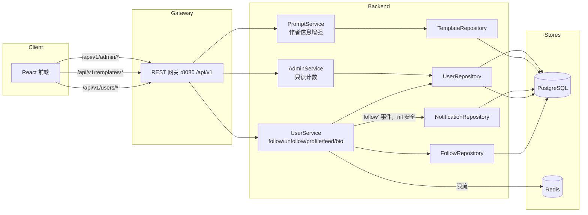

# 关注创作者 — 架构设计

| | |
|---|---|
| **Feature ID** | follow-creators |
| **Version** | 1.0 |
| **Status** | Approved for implementation |
| **Author** | Architect Agent |
| **Upstream** | [需求文档](../design/follow-creators-requirements-zh-CN.md), [UI/UX 设计](../design/follow-creators-ui-ux-design-zh-CN.md) |
| **Downstream** | [详细设计](follow-creators-detailed-design-zh-CN.md) |

## 1. 概述

关注创作者（follow-creators）为 Open Prompts 补上"人"的维度：用户可以关注其他用户、
浏览创作者主页，并消费来自已关注创作者的新公开模板流。本特性引入关注图
（`user_follows`）、`users` 表上的反规范化计数器、可选的 `bio` 个人简介字段、
公开的创作者主页，以及"正在关注"信息流 —— 全程不改动模板内容模型。

本设计刻意复用已实现的 admin-user-management 与正在开发中的 notifications 特性
所确立的模式：

- **反规范化计数器**与图边写入在同一事务中维护（`like_count` / `favorite_count`
  模式），不使用触发器。
- 服务层的 **Redis 固定窗口限流**（auth 节流模式），Redis 故障时放行。
- 通过执行服务中 **nil 安全的仓储钩子**发通知（`createEngagementNotification`
  模式），新增的 `'follow'` 事件类型不携带模板。

### 1.1 已决开放问题

| # | 问题（来自需求 §10） | 决策 |
|---|---|---|
| 1 | 图 + 动作的服务层归属 | **扩展 `UserService`**（用户域；已持有用于节流的 `Redis`），新增 `FollowRepository` 承担 SQL。不新建 gRPC 服务，也不放入 `PromptService`。 |
| 2 | 关注信息流查询归属 | **`UserService`** 持有该 RPC；`FollowRepository` 执行联表（follows ⋈ templates ⋈ users）。采用独立端点 `GET /api/v1/users/me/following-feed` 而非列表过滤，使 me 作用域契约显式化。 |
| 3 | 信息流规模 / 物化 | **v1 使用带索引的联表 + 分页。** 扇出/物化信息流明确推迟；当关注行数超过约 10 万或 p95 超出 NFR 目标时再评估。 |
| 4 | `'follow'` 通知事件 | **现在即加入枚举**，并协同 DDL：`notifications.template_id` 改为可空，`type` CHECK 扩宽以包含 `'follow'`。两个特性无论谁后落地，都由守卫化的幂等 DDL 块保证顺序无关。 |
| 5 | 列表响应的作者信息增强范围 | **所有模板列表响应**均增加作者显示名（`templateRepository.List` 中单次 JOIN）；模板详情增加完整 `owner` 对象。 |

### 1.2 非目标

- 推荐算法、"为你推荐"排序。
- 拉黑、屏蔽、关注申请、私密账号。
- 关注模板（watch-template，关注内容而非人）。
- 信息流排序、摘要邮件、邮件通知。
- 管理员关注/取关端点（管理面仅提供只读计数）。
- **任何形式的商业化** —— 支付、定价、购买、收益、销售等均不在范围内，已从本架构中剔除。

## 2. 系统上下文



## 3. 涉及组件

| 组件 | 变更 |
|---|---|
| `backend/api/proto/v1/prompt.proto` | `UserService` 新增 `FollowUser`/`UnfollowUser`/`GetCreatorProfile`/`ListFollowers`/`ListFollowing`/`GetFollowingFeed` RPC；`UpdateProfileRequest` 增加 `bio`；`Template` 增加 `owner_display_name`/`owner_avatar`；`GetTemplateResponse.owner`；`UserStats` 计数。 |
| `backend/internal/repository/follow_repository.go` | **新增。** 图 CRUD、计数器维护、followers/following 列表、信息流联表。 |
| `backend/internal/repository/user_repository.go` | SELECT/UPDATE 中加入 `bio`、`follower_count`、`following_count`。 |
| `backend/internal/repository/template_repository.go` | `List` 中增加作者信息 JOIN。 |
| `backend/internal/service/user.go` | 关注相关 RPC、限流、关注通知钩子、bio 处理。 |
| `backend/internal/service/prompt.go` | `GetTemplate` 中组装 `owner` 对象。 |
| `backend/internal/service/admin.go` | `UserStats` 增加粉丝数/关注数。 |
| `backend/cmd/server/main.go` | 新增 `/api/v1/users/*` 路由组。 |
| `frontend/src/pages/CreatorProfilePage.js` | **新增。** 带标签页的公开创作者主页。 |
| `frontend/src/components/{FollowButton,UserCard,OwnerChip}.js` | **新增。** |
| `frontend/src/pages/{Home,Profile,TemplateDetails}.js`、`PromptCard.js` | Following 标签页、bio 字段、作者芯片、by-line。 |
| `deployment/init.sql`（+ chart 副本） | `user_follows` 表、`users` ALTER、notifications 可空/CHECK 扩宽。 |

## 4. API 设计

所有新的用户端端点位于 `/api/v1/users` 前缀下（新前缀；不移动任何既有路由）。
管理端端点除响应增强外不变。普通用户面与管理面保持分离。

### 4.1 关注图

| 方法 | 路径 | 鉴权 | 说明 |
|---|---|---|---|
| `POST` | `/api/v1/users/{userId}/follow` | 必需 | 幂等关注。`200` 返回 `{following: true, follower_count}`。 |
| `DELETE` | `/api/v1/users/{userId}/follow` | 必需 | 幂等取关。`200` 返回 `{following: false, follower_count}`。 |

- 自我关注 → `400 INVALID_ARGUMENT`。
- 任一方被封禁 → `403 PERMISSION_DENIED`（既有边保留）。
- 被关注者不存在 → `404 NOT_FOUND`（对不存在的用户取关同样 `404`；对存在但未关注的用户取关返回 `200` 幂等）。
- 限流：每账号每分钟 30 次成功的关注/取关动作 → `429 RESOURCE_EXHAUSTED`，附 `Retry-After` 头。

### 4.2 创作者主页

| 方法 | 路径 | 鉴权 | 说明 |
|---|---|---|---|
| `GET` | `/api/v1/users/{userId}/profile` | **公开** | `{id, display_name, avatar, bio, follower_count, following_count, created_at, is_following, follows_you}`。绝不返回 email/mobile/role。 |
| `GET` | `/api/v1/users/{userId}/templates` | **公开** | 该创作者的公开模板，按最新优先分页。映射到既有 `ListTemplates` RPC（`owner_id` + `visibility=public`）。 |
| `GET` | `/api/v1/users/{userId}/followers` | **公开** | 分页用户卡片。 |
| `GET` | `/api/v1/users/{userId}/following` | **公开** | 分页用户卡片。 |

`is_following`/`follows_you` 对匿名调用者为 `false`。被封禁的创作者仍可访问
（公开身份保留）；其模板标签页为空，因为 `templateRepository.List` 既有的
封禁作者排除逻辑会隐藏这些模板。

### 4.3 关注信息流

| 方法 | 路径 | 鉴权 | 说明 |
|---|---|---|---|
| `GET` | `/api/v1/users/me/following-feed?page_size=&page_token=` | 必需 | 已关注创作者的最新公开模板。`{templates, total_count, next_page_token}`。 |

私有模板与被封禁创作者在服务端排除。页大小默认 20，最大 50。

### 4.4 资料更新

`PUT /api/v1/profile`（既有路由）接受可选 `bio` 字符串：服务端 trim，
0–280 字符，空串清除该字段。与 `display_name`/`avatar`（仅非空才应用）不同，
`bio` 按提交值应用以便可清除 —— 该契约差异在详细设计中说明。

### 4.5 模板信息增强

- `GET /api/v1/templates/{id}` 响应增加 `owner`：
  `{id, display_name, avatar, follower_count, is_following}`。
- 所有模板列表响应的每一项增加 `owner_display_name`（及 `owner_avatar`），
  卡片上渲染为 "by {display_name}"。

### 4.6 管理端（只读）

`GET /api/v1/admin/users/{id}` 的 `stats` 增加 `follower_count` 与
`following_count`。不存在管理员关注端点；尝试访问将命中网关 404 处理器。

### 4.7 错误码

| HTTP | gRPC | 条件 |
|---|---|---|
| 400 | `INVALID_ARGUMENT` | 自我关注；bio 超过 280 字符。 |
| 401 | `UNAUTHENTICATED` | 需鉴权路由缺少/无效令牌。 |
| 403 | `PERMISSION_DENIED` | 任一方被封禁；被封禁调用者更新资料。 |
| 404 | `NOT_FOUND` | 用户不存在（关注/取关/主页/列表）。 |
| 429 | `RESOURCE_EXHAUSTED` | 超出限流（`Retry-After` 头）。 |

## 5. 数据模型

### 5.1 新表：`user_follows`

```sql
CREATE TABLE IF NOT EXISTS user_follows (
    follower_id TEXT NOT NULL REFERENCES users(id) ON DELETE CASCADE,
    followee_id TEXT NOT NULL REFERENCES users(id) ON DELETE CASCADE,
    created_at TIMESTAMPTZ NOT NULL DEFAULT now(),
    PRIMARY KEY (follower_id, followee_id),
    CONSTRAINT chk_no_self_follow CHECK (follower_id <> followee_id)
);
CREATE INDEX IF NOT EXISTS idx_user_follows_followee ON user_follows(followee_id, created_at DESC);
```

### 5.2 `users` ALTER（幂等，两份 init.sql 副本）

```sql
ALTER TABLE users ADD COLUMN IF NOT EXISTS bio TEXT;
ALTER TABLE users ADD COLUMN IF NOT EXISTS follower_count INT NOT NULL DEFAULT 0;
ALTER TABLE users ADD COLUMN IF NOT EXISTS following_count INT NOT NULL DEFAULT 0;
```

### 5.3 Notifications 协同

`'follow'` 事件不携带模板，因此（守卫化、幂等、顺序无关）：

- `notifications.template_id` → 可空（在 `pg_attribute` 的 `attnotnull` 守卫下
  `DROP NOT NULL`）。
- `type` CHECK 扩宽为 `('like','favorite','fork','comment','follow')`，
  沿用守卫下删除/重建的既有模式。
- `notificationRepository.Create` 的去重谓词改用
  `template_id IS NOT DISTINCT FROM $3`，使 NULL 与 NULL 匹配。

### 5.4 计数器维护

关注/取关在单事务中执行：边 INSERT（`ON CONFLICT DO NOTHING`）+ 仅当确实
插入行时才条件性递增计数器（DELETE 对称处理）。这与 `like_count` 模式一致：
无触发器、无重复计数、幂等重试安全。用户删除依赖 `ON DELETE CASCADE`；
任何未来的用户删除端点必须在同一事务中重算受影响计数器（详细设计提供 SQL）。

## 6. 鉴权与授权

- 关注/取关/信息流/bio：通过既有 `VerifyAnyToken` 中间件的会话或 API-key 鉴权；
  用户 id 取自上下文。
- 创作者主页、创作者模板、followers/following 列表：公开。
- 公开响应仅暴露 `id, display_name, avatar, bio, counts, created_at,
  is_following, follows_you` —— 绝不暴露 `email`、`mobile`、`role`。
- 被封禁用户不能发起关注，也不能被新关注；既有边与公开身份保留（FR-6/FR-18）。
- 限流在 `UserService` 中通过 Redis 固定窗口（`follow_rate_min:{user_id}`）
  执行，Redis 故障时放行。

## 7. 前端

- **路由**：`/creators/:id`（懒加载，像 `/notifications` 一样用 Suspense 包裹）。
  自己的主页重定向到 "Edit profile" → `/profile`。
- **CreatorProfilePage**：96px 头像、显示名、bio、"Follows you" 徽章、计数、
  加入日期、标签页（Templates / Followers / Following）。
- **FollowButton**：乐观切换、出错回滚；`aria-pressed`；悬停/聚焦时
  Following → Unfollow（危险色）；无确认弹窗。
- TemplateDetails 上的 **OwnerChip** 取代原始的 `by {owner_id}` 字符串；
  **PromptCard** 增加 "by {display_name}" 行并链至创作者主页。
- **Home** 增加 "Following" 标签页（信息流网格 + Load more；匿名时显示登录
  引导卡片；空状态展示按粉丝数排序的前 5 位推荐创作者）。
- **Profile** 增加带字符计数的 bio 文本域。
- **管理端 UserDetailPage** 增加只读的粉丝/关注统计行。
- **i18n**：`creators.*`、`follow.*`、`home.following.*` 命名空间；EN/ZH 对齐；
  通过共享 `formatCount` 工具实现本地化数字缩写（`1.2k` / `1.2万`）。

## 8. 配置

| 变量 | 默认值 | 说明 |
|---|---|---|
| `FOLLOW_RATE_PER_MINUTE` | `30` | 每账号每分钟成功的关注/取关动作数。 |

加入 `deployment/docker-compose.yml`（backend 服务）与 Helm chart
（`values.yaml` 的 `backend.env.followRatePerMinute` +
`templates/deployment-backend.yaml`），与 `NOTIFICATION_*` 变量保持一致。

## 9. 安全考量

- **隐私**：公开端点绝不返回 email、mobile、role；profile 响应形状在服务层
  白名单化，而非临时过滤。
- **枚举**：用户 id 在模板上本已公开；主页暴露不新增标识符面。限流约束图
  变更滥用。
- **信息流泄漏**：私有模板与被封禁创作者在 SQL 层排除，而非客户端过滤。
- **XSS**：bio 为纯文本；React 转义生效（不渲染 HTML）。
- **注入**：所有查询参数化；无字符串拼接。

## 10. 部署说明

- DDL 为增量且幂等；`deployment/init.sql` 与
  `deployment/chart/open-prompts/init.sql` 必须在同一提交中同步更新。
- notifications 可空/CHECK 扩宽块无论先于或后于 notifications 特性自身的
  DDL 落地都安全 —— 守卫使其顺序无关。
- 无新服务或基础设施；Redis 与 PostgreSQL 用法不变。
- `backend/server` 是被跟踪的构建产物 —— 绝不提交其变更。

## 11. 测试策略

- **FVT**（`tests/fvt.py`）：`test_follow_creators` —— 三个用户；关注/取关
  幂等性 + 计数断言；自我关注 400；封禁 403；主页隐私（断言响应中无
  email/mobile/role）；信息流正确性（仅公开、最新优先、排除封禁）；
  followers/following 列表；bio 设置/清除；详情 `owner` 对象；列表增强。
- **单元测试**：`FollowRepository` 计数数学（重复插入、删除不存在）、bio
  trim/校验、限流窗口行为。
- **E2E**（test-agent）：关注按钮切换、创作者主页标签页、信息流空态/登录态、
  i18n 对齐抽查。
