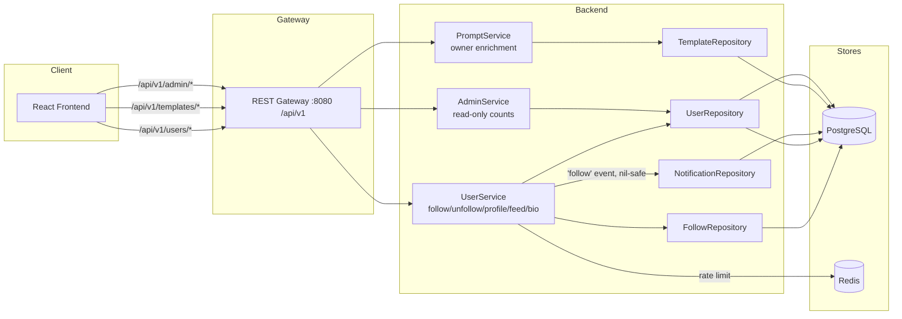

# Follow Creators — Architecture Design

| | |
|---|---|
| **Feature ID** | follow-creators |
| **Version** | 1.0 |
| **Status** | Approved for implementation |
| **Author** | Architect Agent |
| **Upstream** | [Requirements](../design/follow-creators-requirements.md), [UI/UX Design](../design/follow-creators-ui-ux-design.md) |
| **Downstream** | [Detailed Design](follow-creators-detailed-design.md) |

## 1. Overview

Follow-creators adds the people layer to Open Prompts: users follow other users,
browse creator profiles, and consume a feed of new public templates from the
creators they follow. The feature introduces a follow graph (`user_follows`),
denormalized counters on `users`, an optional `bio` profile field, a public
creator profile page, and a "Following" feed — all without touching the
template content model.

The design deliberately reuses established patterns from the implemented
admin-user-management and the in-flight notifications feature:

- **Denormalized counters** maintained transactionally in the same write as the
  graph edge (the `like_count` / `favorite_count` pattern), no triggers.
- **Redis fixed-window rate limiting** in the service layer (the auth-throttle
  pattern), fail-open.
- **Notification emission** via a nil-safe repository hook in the acting
  service (the `createEngagementNotification` pattern), with a new `'follow'`
  event type that carries no template.

### 1.1 Resolved Open Questions

| # | Question (from requirements §10) | Decision |
|---|---|---|
| 1 | Service placement for graph + actions | **Extend `UserService`** (user domain; it already holds `Redis` for throttling) with a new `FollowRepository` for SQL. Not a new gRPC service, not `PromptService`. |
| 2 | Following-feed query placement | **`UserService`** owns the feed RPC; `FollowRepository` performs the join (follows ⋈ templates ⋈ users). A dedicated `GET /api/v1/users/me/following-feed` endpoint — not a list filter — keeps the me-scoped contract explicit. |
| 3 | Feed scale / materialization | **v1 uses an indexed join with pagination.** Fan-out/materialized feed is explicitly deferred; revisit when follow rows exceed ~100k or p95 degrades beyond NFR targets. |
| 4 | `'follow'` notification event | **Add to the enum now**, with coordinated DDL: `notifications.template_id` becomes nullable and the `type` CHECK is widened to include `'follow'`. Whichever feature lands second applies the guarded, idempotent DDL blocks. |
| 5 | Owner-enrichment scope for list responses | **All template list responses** gain owner display name (single JOIN in `templateRepository.List`); template detail gains a full `owner` object. |

### 1.2 Non-Goals

- Recommendation algorithms, suggested-for-you ranking.
- Blocking, muting, follow requests, or private accounts.
- Watch-template (follow a template, not a person).
- Feed ranking, digests, or email notifications.
- Admin follow/unfollow endpoints (admin surface is read-only counts).
- **Monetization of any kind** — payments, pricing, purchases, earnings, sales,
  or paid-follower tiers are out of scope and excluded from this architecture.

## 2. System Context



## 3. Components Involved

| Component | Change |
|---|---|
| `backend/api/proto/v1/prompt.proto` | New `FollowUser`/`UnfollowUser`/`GetCreatorProfile`/`ListFollowers`/`ListFollowing`/`GetFollowingFeed` RPCs on `UserService`; `bio` on `UpdateProfileRequest`; `Template.owner_display_name`/`owner_avatar`; `GetTemplateResponse.owner`; `UserStats` counters. |
| `backend/internal/repository/follow_repository.go` | **New.** Graph CRUD, counter maintenance, followers/following lists, feed join. |
| `backend/internal/repository/user_repository.go` | `bio`, `follower_count`, `following_count` in SELECT/UPDATE. |
| `backend/internal/repository/template_repository.go` | Owner-enrichment JOIN in `List`. |
| `backend/internal/service/user.go` | Follow RPCs, rate limiting, follow-notification hook, bio handling. |
| `backend/internal/service/prompt.go` | `owner` object assembly in `GetTemplate`. |
| `backend/internal/service/admin.go` | `UserStats` gains follower/following counts. |
| `backend/cmd/server/main.go` | New `/api/v1/users/*` route group. |
| `frontend/src/pages/CreatorProfilePage.js` | **New.** Public creator profile with tabs. |
| `frontend/src/components/{FollowButton,UserCard,OwnerChip}.js` | **New.** |
| `frontend/src/pages/{Home,Profile,TemplateDetails}.js`, `PromptCard.js` | Following tab, bio field, owner chip, by-line. |
| `deployment/init.sql` (+ chart copy) | `user_follows` table, `users` ALTERs, notifications nullable/CHECK widening. |

## 4. API Design

All new user-facing endpoints live under `/api/v1/users` (a new prefix; no
existing route moves). Admin endpoints are unchanged apart from response
enrichment. Regular-user and admin surfaces remain separate.

### 4.1 Follow Graph

| Method | Path | Auth | Description |
|---|---|---|---|
| `POST` | `/api/v1/users/{userId}/follow` | Required | Idempotent follow. `200` with `{following: true, follower_count}`. |
| `DELETE` | `/api/v1/users/{userId}/follow` | Required | Idempotent unfollow. `200` with `{following: false, follower_count}`. |

- Self-follow → `400 INVALID_ARGUMENT`.
- Either party banned → `403 PERMISSION_DENIED` (existing edges retained).
- Followee not found → `404 NOT_FOUND` (unfollow of a non-existent user is also
  `404`; unfollow of an existing but not-followed user is `200` idempotent).
- Rate limit: 30 successful follow/unfollow actions per minute per account →
  `429 RESOURCE_EXHAUSTED` with `Retry-After` header.

### 4.2 Creator Profile

| Method | Path | Auth | Description |
|---|---|---|---|
| `GET` | `/api/v1/users/{userId}/profile` | **Public** | `{id, display_name, avatar, bio, follower_count, following_count, created_at, is_following, follows_you}`. Never email/mobile/role. |
| `GET` | `/api/v1/users/{userId}/templates` | **Public** | Public templates of the creator, newest-first, paginated. Maps to the existing `ListTemplates` RPC with `owner_id` + `visibility=public`. |
| `GET` | `/api/v1/users/{userId}/followers` | **Public** | Paginated user cards. |
| `GET` | `/api/v1/users/{userId}/following` | **Public** | Paginated user cards. |

`is_following`/`follows_you` are `false` for anonymous callers. Banned creators
still resolve (public identity retained); their templates tab is empty because
the existing banned-owner exclusion in `templateRepository.List` hides them.

### 4.3 Following Feed

| Method | Path | Auth | Description |
|---|---|---|---|
| `GET` | `/api/v1/users/me/following-feed?page_size=&page_token=` | Required | Newest public templates from followed creators. `{templates, total_count, next_page_token}`. |

Private templates and banned creators are excluded server-side. Page size
defaults to 20, max 50.

### 4.4 Profile Update

`PUT /api/v1/profile` (existing route) accepts an optional `bio` string:
trimmed server-side, 0–280 chars, empty string clears the field. Unlike
`display_name`/`avatar` (applied only when non-empty), `bio` is applied
as-sent so it can be cleared — the contract difference is documented in the
detailed design.

### 4.5 Template Enrichment

- `GET /api/v1/templates/{id}` response gains `owner`:
  `{id, display_name, avatar, follower_count, is_following}`.
- All template list responses gain `owner_display_name` (and `owner_avatar`)
  on each item, rendered as "by {display_name}" on cards.

### 4.6 Admin (read-only)

`GET /api/v1/admin/users/{id}` `stats` gains `follower_count` and
`following_count`. No admin follow endpoints exist; attempts hit the gateway's
404 handler.

### 4.7 Error Codes

| HTTP | gRPC | Condition |
|---|---|---|
| 400 | `INVALID_ARGUMENT` | Self-follow; bio > 280 chars. |
| 401 | `UNAUTHENTICATED` | Missing/invalid token on authed routes. |
| 403 | `PERMISSION_DENIED` | Either party banned; banned caller on profile update. |
| 404 | `NOT_FOUND` | User not found (follow/unfollow/profile/lists). |
| 429 | `RESOURCE_EXHAUSTED` | Rate limit exceeded (`Retry-After` header). |

## 5. Data Model

### 5.1 New Table: `user_follows`

```sql
CREATE TABLE IF NOT EXISTS user_follows (
    follower_id TEXT NOT NULL REFERENCES users(id) ON DELETE CASCADE,
    followee_id TEXT NOT NULL REFERENCES users(id) ON DELETE CASCADE,
    created_at TIMESTAMPTZ NOT NULL DEFAULT now(),
    PRIMARY KEY (follower_id, followee_id),
    CONSTRAINT chk_no_self_follow CHECK (follower_id <> followee_id)
);
CREATE INDEX IF NOT EXISTS idx_user_follows_followee ON user_follows(followee_id, created_at DESC);
```

### 5.2 `users` ALTERs (idempotent, both init.sql copies)

```sql
ALTER TABLE users ADD COLUMN IF NOT EXISTS bio TEXT;
ALTER TABLE users ADD COLUMN IF NOT EXISTS follower_count INT NOT NULL DEFAULT 0;
ALTER TABLE users ADD COLUMN IF NOT EXISTS following_count INT NOT NULL DEFAULT 0;
```

### 5.3 Notifications Coordination

The `'follow'` event has no template, so (guarded, idempotent, order-independent):

- `notifications.template_id` → nullable (`DROP NOT NULL` under an
  `attnotnull` guard from `pg_attribute`).
- `type` CHECK widened to `('like','favorite','fork','comment','follow')` via
  the established drop/re-add-under-guard pattern.
- `notificationRepository.Create` dedupe predicate uses
  `template_id IS NOT DISTINCT FROM $3` so NULL matches NULL.

### 5.4 Counter Maintenance

Follow/unfollow run in a single transaction: edge INSERT (`ON CONFLICT DO
NOTHING`) + conditional counter increment only when a row was actually
inserted (and symmetrically for DELETE). This matches the `like_count`
pattern: no triggers, no double counting, idempotent retries safe. User
deletion relies on `ON DELETE CASCADE`; any future user-deletion endpoint must
recompute affected counters in the same transaction (SQL provided in the
detailed design).

## 6. Auth & Authorization

- Follow/unfollow/feed/bio: session or API-key auth via the existing
  `VerifyAnyToken` middleware; user id from context.
- Creator profile, creator templates, followers/following lists: public.
- Public responses expose only `id, display_name, avatar, bio, counts,
  created_at, is_following, follows_you` — never `email`, `mobile`, or `role`.
- Banned users cannot initiate follows and cannot be newly followed; existing
  edges and public identity are retained (FR-6/FR-18).
- Rate limiting is enforced in `UserService` via Redis fixed window
  (`follow_rate_min:{user_id}`), fail-open on Redis errors.

## 7. Frontend

- **Route**: `/creators/:id` (lazy-loaded, Suspense-wrapped like
  `/notifications`). Own profile redirects to "Edit profile" → `/profile`.
- **CreatorProfilePage**: 96px avatar, display name, bio, "Follows you" badge,
  counts, joined date, tabs (Templates / Followers / Following).
- **FollowButton**: optimistic toggle with revert on error; `aria-pressed`;
  Following → Unfollow (danger) on hover/focus; no confirm modal.
- **OwnerChip** on TemplateDetails replaces the raw `by {owner_id}` string;
  **PromptCard** gains a "by {display_name}" line linking to the creator page.
- **Home** gains a "Following" tab (feed grid + Load more; login-prompt card
  when anonymous; empty state with top-5 suggested creators by follower count).
- **Profile** gains the bio textarea with character counter.
- **Admin UserDetailPage** gains a read-only followers/following stats row.
- **i18n**: `creators.*`, `follow.*`, `home.following.*` namespaces; EN/ZH in
  parity; locale-aware count abbreviation (`1.2k` / `1.2万`) via a shared
  `formatCount` util.

## 8. Configuration

| Variable | Default | Description |
|---|---|---|
| `FOLLOW_RATE_PER_MINUTE` | `30` | Successful follow/unfollow actions per minute per account. |

Added to `deployment/docker-compose.yml` (backend service) and the Helm chart
(`values.yaml` `backend.env.followRatePerMinute` +
`templates/deployment-backend.yaml`), mirroring `NOTIFICATION_*` variables.

## 9. Security Considerations

- **Privacy**: public endpoints never return email, mobile, or role; the
  profile response shape is allow-listed in the service layer, not filtered
  ad hoc.
- **Enumeration**: user ids are already public on templates; profile exposure
  adds no new identifier surface. Rate limiting bounds graph-mutation abuse.
- **Feed leakage**: private templates and banned creators are excluded in SQL,
  not filtered client-side.
- **XSS**: bio is plain text; React escaping applies (no HTML rendering).
- **Injection**: all queries are parameterized; no string interpolation.

## 10. Deployment Notes

- DDL is additive and idempotent; both `deployment/init.sql` and
  `deployment/chart/open-prompts/init.sql` must be updated in the same commit.
- The notifications nullable/CHECK-widening blocks are safe to land before or
  after the notifications feature's own DDL — guards make them order-independent.
- No new services or infrastructure; Redis and PostgreSQL usage is unchanged.
- `backend/server` is a tracked build artifact — never commit changes to it.

## 11. Test Strategy

- **FVT** (`tests/fvt.py`): `test_follow_creators` — three users; follow/
  unfollow idempotency + counter assertions; self-follow 400; banned 403;
  profile privacy (assert absence of email/mobile/role); feed correctness
  (public-only, newest-first, banned excluded); followers/following lists;
  bio set/clear; detail `owner` object; list enrichment.
- **Unit**: `FollowRepository` counter math (insert-existing, delete-missing),
  bio trim/validation, rate-limit window behavior.
- **E2E** (test-agent): follow button toggle, creator profile tabs, following
  feed empty/login states, i18n parity spot checks.
