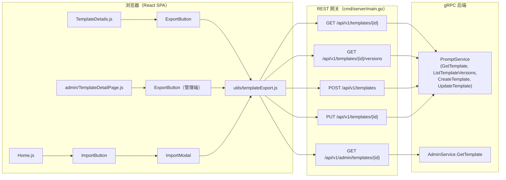
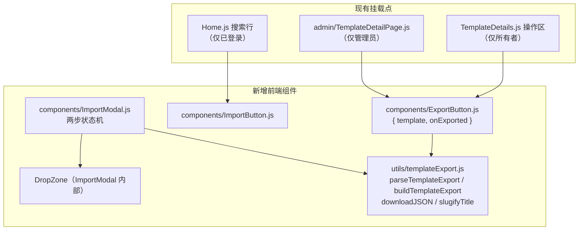

# 模板导入/导出 — 架构设计

| | |
|---|---|
| **功能 ID** | FE-010 |
| **版本** | 1.0 |
| **状态** | 已批准 |
| **作者** | architect-agent |
| **日期** | 2026-10-12 |
| **上游设计** | `docs/design/import-export-requirements-zh-CN.md`、`docs/design/import-export-ui-ux-design-zh-CN.md` |

## 1. 概述

模板导入/导出让用户真正"拥有"自己的提示词模板：所有者可将任意自有模板导出为单个 `.json` 文件（含完整版本历史），任何已登录用户可导入该文件，生成一份带完整历史的私有副本。管理员在管理台获得完全相同的导出操作，用于支持与排查场景。

本功能**几乎完全在客户端实现**。导出由浏览器基于现有 `getTemplate` 与 `listTemplateVersions` 响应拼装文件；导入复用现有 `createTemplate` 与 `updateTemplate` 端点回放版本历史。唯一的后端改动是管理端模板详情读取路径的小幅增强（管理端版本增加 `change_note`、管理端模板摘要增加 `category`），使管理员导出与普通用户导出字节级兼容。

### 已裁决的开放问题（对应需求文档 §10）

| OQ | 决策 |
|---|---|
| **OQ-1 多版本导入机制** | **最早版本优先回放**：先用*最早*版本的内容调用 `createTemplate`，再按 v2…vN 顺序逐个 `updateTemplate`。这是唯一正确的顺序，见 §7.1。UI/UX 设计文档实现注记 6（"先以最新内容创建，再应用更早版本"）**按原文是错误的**，以本文档为准：`UpdateTemplate` 只会*追加*版本，若先以最新内容创建、再提交更早内容，将得到 `[vN, v1, …, v(N-1)]` 且 `latest` 别名指向错误内容。超过 50 个版本的文件截断为最近 50 个（评审步骤中给出非阻断警告）。 |
| **OQ-2 导入时的变更说明** | **回放。** 每次回放 `updateTemplate` 携带原版本的 `change_note`，防御性截断到 200 字符（服务层强制 ≤ 200，见 `prompt.go` `UpdateTemplate`）。 |
| **OQ-3 文件大小上限** | **确认 1 MB。** `content` 列为 `TEXT` 且无 CHECK 约束；50 版本 × 平均约 20 KB 内容完全够用。上限在解析*之前*于客户端强制执行。 |
| **OQ-4 管理员导出数据源** | **现有 `GET /api/v1/admin/templates/{id}`**，补充两处 proto 字段（见 §6），不新增端点。 |

### 其他决策

- **导入模板一律 `type: "user"`** —— 与 `CreateTemplateModal`（硬编码 `user`）和 `ForkTemplate`（创建私有 `user` 副本）一致。评审表单不暴露 `type`；导出文件中的 `type` 值在导入时忽略。
- **导入强制 `visibility: "private"`**（FR-10）；用户可在评审步骤修改。导出文件中的 visibility 值仅作参考展示。
- **版本 `created_at` 仅为信息性字段。** 创建/更新路径会赋予真实时间戳；导入的版本获得当前时间。文件中的 `created_at` 用于溯源保留在文件里，但无法回放。
- **中途失败保留部分历史。** 若回放过程中某次更新失败，已追加的版本保留（模板默认私有，不会暴露任何内容）。错误 toast 报告已导入的版本数。不做自动回滚——网络抖动时删除比部分状态破坏性更大。

## 2. 目标与非目标

**目标**

- 所有者可将任意自有模板导出为单个可移植的 `.json` 文件，含完整版本历史（FR-1–6）。
- 已登录用户通过两步弹窗（选文件 → 评审）导入文件，评审表单复用创建表单字段集（FR-7–14）。
- 管理员在 `/admin/templates/:id` 导出任意模板，输出格式完全一致（需求 §5.3）。
- 不新增任何面向用户的后端端点；仅一处管理端读取路径增强。

**非目标**

- 批量导出 / 账号归档（需求 §8 明确排除）。
- 第三方格式导入（AIPRM、ChatGPT）；仅支持 `open-prompts-template` 格式版本 1。
- 服务端传输、链接分享或任何跨实例机制。
- 导出提示词（使用记录）或 API key。
- 任何变现、市场上架或导出文件的商业分发。
- 修复既有未鉴权的 `/versions` 端点（在 §9 中作为独立跟进项标记；不并入本功能）。

## 3. 系统上下文



所有数据都走现有端点。导出文件不经过服务端；导入文件完全在客户端解析。

## 4. 组件视图



挂载点适配（已对照当前代码核实）：

- **TemplateDetails.js**：`ExportButton` 加入现有操作区（与 Edit/Fork 并列），仅在 `isOwner`（`user.id === template.owner_id`）时渲染。
- **admin/TemplateDetailPage.js**：同一 `ExportButton` 组件，数据源换成 `getAdminTemplate`。
- **Home.js**：模板首页没有"+ New"工具栏（创建入口是 `Layout.js` 的浮动按钮）。`ImportButton` 追加到现有 `home-search-row`（与 `SearchBar`/`SortDropdown` 并列），仅在 `isAuthenticated` 时渲染。

## 5. 数据模型

**无 schema 变更，无 DDL。** 本功能只读写现有表（`templates`、`template_versions`）。

**导出文件格式**（格式版本 1）是唯一的新数据契约：

```json
{
  "format": "open-prompts-template",
  "format_version": 1,
  "exported_at": "2026-10-10T12:00:00Z",
  "source": "open-prompts",
  "template": {
    "title": "My Prompt Template",
    "description": "...",
    "visibility": "public",
    "type": "system",
    "tags": ["prompt", "writing"],
    "category": "Writing",
    "language": "en",
    "versions": [
      { "version": 1, "content": "...", "change_note": "initial", "created_at": "..." },
      { "version": 7, "content": "...", "change_note": null, "created_at": "..." }
    ]
  }
}
```

规则：

- 文件中的 `versions` 按**时间正序（最早在前）**排列，尽管 `listTemplateVersions` 返回最新在前（导出方将分页结果反转）。
- 任何位置都不含所有者身份信息（FR-6）：无用户 id、邮箱、显示名。
- 版本无变更说明时 `change_note` 为 `null`。
- 序列化使用 2 空格缩进和结尾换行（AC-1 要求人类可读）。
- 向前兼容：导入时未知 `format_version` 以 `unsupported_version` 拒绝（NFR-4）；版本 1 文件在未来版本中始终可导入。

## 6. API 设计

### 6.1 用户侧：不新增端点

| 操作 | 现有端点 | 说明 |
|---|---|---|
| 获取模板元数据 | `GET /api/v1/templates/{id}` | 导出数据源；返回 `category`、`language`、`tags`、`visibility`、`type`。 |
| 获取版本历史 | `GET /api/v1/templates/{id}/versions?page_size=50&page_token=…` | 导出方跟随 `next_page_token`（最新在前），再反转。 |
| 创建导入模板 | `POST /api/v1/templates` | 请求体：最早版本内容 + 评审后的元数据；`type: "user"`、`visibility: "private"`。 |
| 回放版本 | `PUT /api/v1/templates/{id}` | 每个剩余版本一次调用，最早→最新；携带完整元数据 + 该版本 `content` 与 `change_note`。 |
| 标题冲突检查 | `GET /api/v1/templates?owner_id={me}&page_size=100` | 可选鉴权 GET 在 `owner_id` 为本人时返回其公开+私有模板。首页（100 条）检查对 v1 足够——该警告仅为提示，且 schema 中标题本就不唯一。 |

### 6.2 管理端：增强现有读取路径（唯一后端改动）

`GET /api/v1/admin/templates/{id}` 目前返回的 `AdminTemplateSummary`（无 `category`）与 `AdminTemplateVersion`（无 `change_note`）都缺 FR-2 所需字段。补充：

**`backend/api/proto/v1/admin.proto`**

```protobuf
message AdminTemplateSummary {
  // ... 字段 1-12 不变 ...
  string category = 13;   // 新增
}

message AdminTemplateVersion {
  // ... 字段 1-5 不变 ...
  string change_note = 6; // 新增；版本无变更说明时为 ""
}
```

- 仅 `int32`/`string` 标量——无 `int64` 字段，不涉及 protojson 字符串序列化问题。
- 仓储层：`adminTemplateColumns` 增加 `t.category`，`GetTemplateWithVersions` 版本查询增加 `tv.change_note`（`admin_repository.go`）。
- 模型层：`models.AdminTemplate` 增加 `Category string`，`models.AdminTemplateVersion` 增加 `ChangeNote sql.NullString`（`models/admin.go`）。
- 服务层：在 `GetTemplate`（`admin.go`）中映射两者；`change_note` 为 NULL 时输出 `""`（与 `alias_name` 的处理一致）。

网关无需改动：管理端 handler 已用 protojson 序列化响应。

## 7. 关键流程

### 7.1 导入版本回放（最早优先）

```
解析后的文件：versions [v1 .. vN]（时间正序，截断后 N ≤ 50）

1. createTemplate({
     title, description, category, tags, language,   // 评审后（可能已编辑）
     visibility: "private",                           // 强制（FR-10）
     type: "user",                                    // 强制
     content: v1.content
   })                                   → 创建模板，版本 1 = v1.content

2. for i in 2..N:
     updateTemplate(templateId, {
       title, description, category, tags, language,  // 同一套评审后元数据
       visibility,                                     // 评审时确认的值
       content: vi.content,
       change_note: truncate(vi.change_note, 200)      // OQ-2
     })                                 → 追加版本 i（仅当内容与最新版本不同时，
                                          见边界情况）

3. 跳转 /templates/{newId}；成功 toast
```

为什么最早优先是唯一正确的顺序：`UpdateTemplate`（`prompt.go`）仅当内容与最新版本不同时才追加新版本，编号恒为 `latest + 1` 并重指 `latest` 别名。若先以最新内容创建、再提交更早内容，这些内容会被追加到最新版本*之后*，历史错乱且 `latest` 别名指向错误内容。最早优先恰好得到 `[v1 … vN]` 且 `latest → vN`，满足 AC-3/AC-4。

**边界情况**

- **N = 1**：单次 `createTemplate`，无更新。
- **相邻内容相同**（外部制作的文件可能出现）：该次更新退化为仅更新元数据（不产生新版本）。最终版本数 < N；顺序与内容仍正确。属可接受行为，无需警告（没有信息丢失）。
- **N > 50**：截断为最近 50 个版本（`v(N-49) … vN`）；评审步骤显示非阻断警告。理由：回放成本为 N 次 API 调用；50 与导出分页页大小及设计文档声明的上限一致。
- **回放中途失败**：停止，保留部分历史，toast 提示"已导入 i / N 个版本"。模板为私有；用户可重新导入或手动继续编辑。
- **change_note > 200 字符**：发送前截断为 197 + `…`（服务层拒绝 > 200）。

### 7.2 导出拼装

```
1. 并行：getTemplate(id) + listTemplateVersions(id, { page_size: 50 })
2. 跟随 next_page_token 直到取尽（最新在前的分页）
3. 反转为时间正序；构造格式版本 1 对象（§5）
4. downloadJSON(slugifyTitle(title, id) + ".json", JSON.stringify(obj, null, 2) + "\n")
```

`slugifyTitle`：标题转小写 ASCII slug，上限 60 字符；追加 `-` + 模板 id 前 8 位；若标题 slug 化后为空（如纯中日韩标题），回退为 `template-{id8}`。示例：`my-prompt-template-a1b2c3d4.json`。

管理员导出流程相同，仅数据源为 `getAdminTemplate(id)`（摘要 + description + 版本列表），§6.2 完成后即携带 FR-2 所需的全部字段。

## 8. 错误契约

所有导入校验错误都在客户端产生（不新增服务端错误码）。工具函数抛出类型化错误，由弹窗消费：

| 错误码 | 触发条件 | 对应 HTTP | i18n key |
|---|---|---|---|
| `too_large` | `file.size > 1_048_576`（解析前检查） | — | `import_export.error_too_large` |
| `not_json` | `JSON.parse` 抛异常 | — | `import_export.error_not_json` |
| `bad_format` | `format !== "open-prompts-template"` 或缺少 `template` 对象 | — | `import_export.error_bad_format` |
| `unsupported_version` | `format_version !== 1` | — | `import_export.error_unsupported_version` |
| `missing_field:{field}` | `title` / `versions[0].content` 等缺失或为空 | — | `import_export.error_missing_field` |
| `invalid_field:{field}` | 防御性约束：标题 > 200 字符、标签 > 20 个、单标签 > 50 字符、版本内容为空 | — | `import_export.error_invalid_field`（新增 key，见详细设计） |

创建/更新回放期间的服务端错误走现有网关映射（`writeError`：校验失败 → 400、未认证 → 401、`PermissionDenied` → 403、不存在 → 404），以与现有创建/编辑流程完全一致的方式呈现为表单/toast 错误。

## 9. 安全考量

- **导出不含 PII（FR-6/NFR-3）。** 构造函数按字段白名单复制；所有者 id/显示名/邮箱绝不写入。文件可安全公开分享。
- **不可信 JSON 解析（NFR-3）。** 导入在大小检查之后于 `try/catch` 中解析用户提供的文件；畸形输入只会产生类型化校验错误，绝不崩溃。无任何 eval 类求值；仅 `JSON.parse` + 结构检查。
- **鉴权继承而非重造。** 导出使用 `getTemplate`/`listTemplateVersions`（所有者上下文）；导出*按钮*对非所有者额外隐藏（FR-5），但服务端仍是权威——非所有者直接调用底层 API 只能得到其权限允许的内容。导入调用 `createTemplate`/`updateTemplate`，其服务层从 context 取身份（`GetUserIDFromContext`），绝不信任客户端传入的 `owner_id`——即既有 AuthZ 模式。
- **管理员导出**复用 `/api/v1/admin/*` 网关上现有的 `requireAdmin` 守卫。
- **⚠ 既有问题（跟进项，不在本功能范围）：** `GET /api/v1/templates/{id}/versions` 目前以 `context.Background()` 调用 `ListTemplateVersions`——不转发鉴权——且服务层**没有可见性门禁**，任何拿到模板 id 的人都能读取私有模板的版本内容。本功能并不依赖该缺陷（所有者本就有权），但建议单独加固：在服务层加入 `ListComments` 式可见性门禁（公开 → 任何人；私有 → 所有者或管理员），并在网关该分支转发可选鉴权，与 `GET /api/v1/templates` 列表 handler 的做法一致。涉及文件：`backend/cmd/server/main.go` versions 分支、`backend/internal/service/prompt.go` `ListTemplateVersions`。应作为独立于 import-export 的变更跟踪修复。
- **导出文件绝不包含凭据/token**（NFR-3）；构造函数只读取模板/版本字段。

## 10. 部署

- **无 DDL、无迁移、无新服务。** 两份 `deployment/init.sql` 均不改动。
- 后端：proto 重新生成（`admin.proto` 两个新字段）+ 仓储/模型/服务映射——向后兼容的增量变更；旧客户端忽略未知字段。
- 前端：新组件 + 工具函数；无路由变更。

## 11. 测试策略

- **单元测试（`utils/templateExport.test.js`）**：parse/build/slugify 往返；全部校验分支（`too_large`、`not_json`、`bad_format`、`unsupported_version`、`missing_field:*`、`invalid_field:*`）；>50 版本截断；change_note 200 字符截断；slug 边界（空 slug、60 字符上限、中日韩回退）。
- **FVT（后端）**：管理端 `GetTemplate` 逐版本返回 `change_note`（NULL → `""`）、摘要返回 `category`；既有管理端测试不受影响。
- **E2E**：所有者导出 N 版本模板 → 第二个账号导入 → 详情页按序显示同样 N 个版本、visibility 为 private、type 为 user（AC-3/AC-4）；非所有者看不到 Export（AC-2）；管理员导出结构一致（AC-9）；损坏/超大/错误格式文件产生具体错误（AC-5–7）。

## 12. 实施顺序

1. 后端：`admin.proto` 字段 + 仓储/模型/服务映射 + FVT（小而独立）。
2. 前端工具：`utils/templateExport.js` + 单元测试。
3. `ExportButton` 上线 TemplateDetails（所有者）与管理端 TemplateDetailPage。
4. `ImportButton` + `ImportModal` 上线 Home；i18n EN/ZH。
5. E2E 往返验证。
