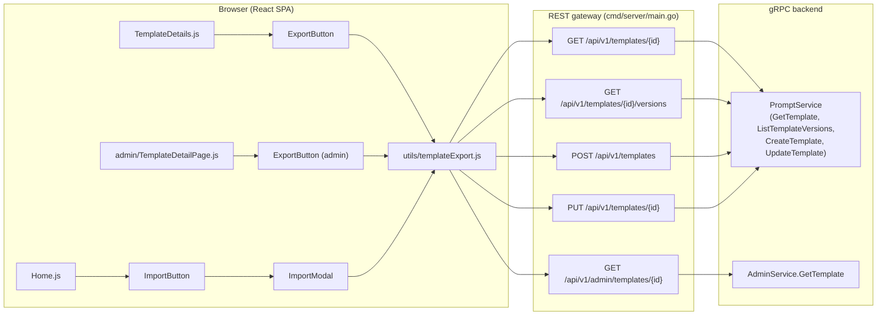
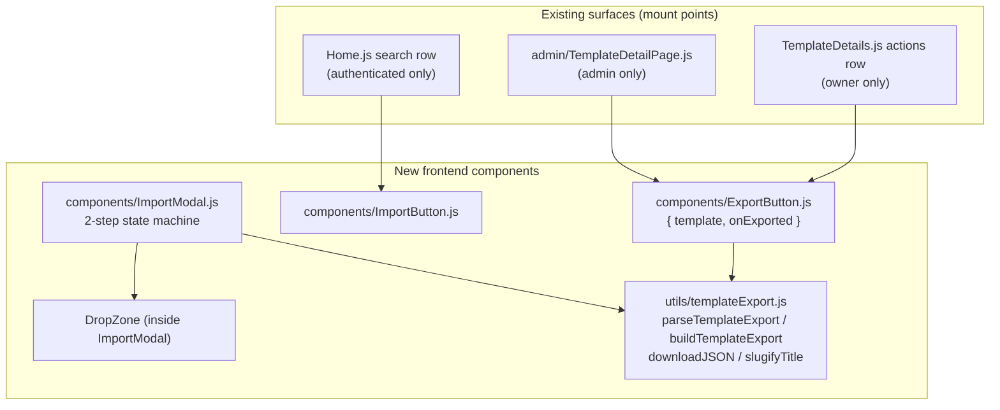

# Template Import/Export — Architecture

| | |
|---|---|
| **Feature ID** | FE-010 |
| **Version** | 1.0 |
| **Status** | Approved |
| **Author** | architect-agent |
| **Date** | 2026-10-12 |
| **Upstream design** | `docs/design/import-export-requirements.md`, `docs/design/import-export-ui-ux-design.md` |

## 1. Overview

Template import/export gives users portable ownership of their prompt templates: owners export any template they own as a single `.json` file (full version history included), and any authenticated user imports such a file to create a private copy with history replayed. Admins get an identical export action in the admin console for support and debugging workflows.

The feature is **almost entirely client-side**. Export assembles the file in the browser from the existing `getTemplate` and `listTemplateVersions` responses; import reuses the existing `createTemplate` and `updateTemplate` endpoints to replay version history. The only backend change is a small read-path enrichment of the admin template detail response (adding `change_note` to admin versions and `category` to the admin template summary) so admin exports are byte-compatible with user exports.

### Resolved open questions (from requirements §10)

| OQ | Decision |
|---|---|
| **OQ-1 Multi-version import mechanics** | **Earliest-first replay**: `createTemplate` with the *earliest* version's content, then sequential `updateTemplate` calls for v2…vN. This is the only correct order — see §7.1. The UI/UX design's implementation note 6 ("create with latest content, then apply earlier versions") is **incorrect as written** and is superseded by this document: `UpdateTemplate` only *appends* versions, so creating with the latest content and then updating with earlier contents would produce `[vN, v1, …, v(N-1)]` with the `latest` alias pointing at the wrong content. Files with more than 50 versions are truncated to the most recent 50 (non-blocking warning in the review step). |
| **OQ-2 Change notes on import** | **Yes, replayed.** Each replay `updateTemplate` call carries the original version's `change_note`, defensively truncated to 200 characters (the service enforces ≤ 200, `prompt.go` `UpdateTemplate`). |
| **OQ-3 File size cap** | **1 MB confirmed.** The `content` column is `TEXT` with no CHECK constraint; 50 versions × ~20 KB average content fits comfortably. The cap is enforced client-side *before* parsing. |
| **OQ-4 Admin export data source** | **Existing `GET /api/v1/admin/templates/{id}`**, enriched with two proto additions (see §6). No new endpoint. |

### Additional decisions

- **Imported templates always get `type: "user"`** — consistent with `CreateTemplateModal` (hardcodes `user`) and `ForkTemplate` (creates a private `user` copy). The review form does not expose `type`; the exported `type` value is ignored on import.
- **Visibility is forced to `private` on import** (FR-10); the user may change it in the review step. The exported visibility value is shown for reference only.
- **Version `created_at` is informational only.** The create/update path assigns real timestamps; imported versions get current times. The file's `created_at` values are preserved in the file for provenance but cannot be replayed.
- **Mid-failure leaves partial history.** If a replay update fails after the template was created, the already-appended versions remain (the template is private by default, so nothing is exposed). The error toast reports how many versions were imported. No automatic rollback — deleting on a network flake would be more destructive than the partial state.

## 2. Goals and Non-Goals

**Goals**

- Owners export any template they own as a single portable `.json` file with full version history (FR-1–6).
- Authenticated users import the file via a two-step modal (pick → review) that reuses the create-form field set (FR-7–14).
- Admins export any template from `/admin/templates/:id` with identical output format (FR §5.3).
- Zero new user-facing backend endpoints; one small admin read-path enrichment.

**Non-Goals**

- Bulk export / account archive (explicitly out of scope, requirements §8).
- Import from third-party formats (AIPRM, ChatGPT); only `open-prompts-template` format version 1.
- Server-side transfer, share-by-link, or any cross-instance mechanism.
- Export of prompts (usage records) or API keys.
- Any monetization, marketplace listing, or commercial distribution of export files.
- Fixing the pre-existing ungated `/versions` endpoint (flagged in §9 as a separate follow-up; not bundled into this feature).

## 3. System Context



All data flows through existing endpoints. The export file never touches the server; the import file is parsed entirely client-side.

## 4. Component View



Mount-point adaptations (verified against current code):

- **TemplateDetails.js**: `ExportButton` joins the existing actions row next to Edit/Fork, rendered only when `isOwner` (`user.id === template.owner_id`).
- **admin/TemplateDetailPage.js**: same `ExportButton` component with the admin data source (`getAdminTemplate`).
- **Home.js**: there is no "+ New" toolbar on the templates home (creation is the floating button in `Layout.js`). `ImportButton` is appended to the existing `home-search-row` (next to `SearchBar`/`SortDropdown`), rendered only when `isAuthenticated`.

## 5. Data Model

**No schema changes. No DDL.** The feature reads and writes only existing tables (`templates`, `template_versions`).

The **export file format** (format version 1) is the only new data contract:

```json
{
  "format": "open-prompts-template",
  "format_version": 1,
  "exported_at": "2026-10-10T12:00:00Z",
  "source": "open-prompts",
  "template": {
    "title": "My Prompt Template",
    "description": "...",
    "visibility": "public",
    "type": "system",
    "tags": ["prompt", "writing"],
    "category": "Writing",
    "language": "en",
    "versions": [
      { "version": 1, "content": "...", "change_note": "initial", "created_at": "..." },
      { "version": 7, "content": "...", "change_note": null, "created_at": "..." }
    ]
  }
}
```

Rules:

- `versions` is **chronological (earliest first)** in the file, even though `listTemplateVersions` returns newest-first (the exporter reverses the paginated result).
- No owner identity anywhere (FR-6): no user id, email, or display name.
- `change_note` is `null` when the version has none.
- Serialized with 2-space indent and a trailing newline (human-readable per AC-1).
- Forward compatibility: unknown `format_version` values are rejected on import with `unsupported_version` (NFR-4); version 1 files remain importable in future releases.

## 6. API Design

### 6.1 User-facing: no new endpoints

| Operation | Existing endpoint | Notes |
|---|---|---|
| Fetch template metadata | `GET /api/v1/templates/{id}` | Export source; returns `category`, `language`, `tags`, `visibility`, `type`. |
| Fetch version history | `GET /api/v1/templates/{id}/versions?page_size=50&page_token=…` | Exporter follows `next_page_token` (newest-first), then reverses. |
| Create imported template | `POST /api/v1/templates` | Body: earliest version's content + reviewed metadata; `type: "user"`, `visibility: "private"`. |
| Replay versions | `PUT /api/v1/templates/{id}` | One call per remaining version, earliest→latest; full metadata + that version's `content` and `change_note`. |
| Title-collision check | `GET /api/v1/templates?owner_id={me}&page_size=100` | Optional-auth GET returns the caller's public+private templates when `owner_id` is self. First-page (100) check is sufficient for v1 — the warning is advisory and titles are not unique in the schema. |

### 6.2 Admin: enrich existing read path (only backend change)

`GET /api/v1/admin/templates/{id}` currently returns `AdminTemplateSummary` (no `category`) and `AdminTemplateVersion` (no `change_note`). Both are required by FR-2 for byte-compatible admin exports. Additions:

**`backend/api/proto/v1/admin.proto`**

```protobuf
message AdminTemplateSummary {
  // ... fields 1-12 unchanged ...
  string category = 13;   // NEW
}

message AdminTemplateVersion {
  // ... fields 1-5 unchanged ...
  string change_note = 6; // NEW; "" when the version has none
}
```

- `int32`/`string` scalars only — no `int64` fields, so protojson string-encoding concerns do not apply.
- Repository: add `t.category` to `adminTemplateColumns` and `tv.change_note` to the `GetTemplateWithVersions` version query (`admin_repository.go`).
- Model: add `Category string` to `models.AdminTemplate`, `ChangeNote sql.NullString` to `models.AdminTemplateVersion` (`models/admin.go`).
- Service: map both in `GetTemplate` (`admin.go`), `change_note` rendered as `""` when NULL (consistent with `alias_name` handling).

No gateway changes: the admin handler already marshals the response with protojson.

## 7. Key Flows

### 7.1 Import version replay (earliest-first)

```
parsed file: versions [v1 .. vN] (chronological, N ≤ 50 after truncation)

1. createTemplate({
     title, description, category, tags, language,   // reviewed, possibly edited
     visibility: "private",                           // forced (FR-10)
     type: "user",                                    // forced
     content: v1.content
   })                                   → template created, version 1 = v1.content

2. for i in 2..N:
     updateTemplate(templateId, {
       title, description, category, tags, language,  // same reviewed metadata
       visibility,                                     // as confirmed in review
       content: vi.content,
       change_note: truncate(vi.change_note, 200)      // OQ-2
     })                                 → appends version i (only if content differs
                                          from latest — see edge cases)

3. navigate to /templates/{newId}; success toast
```

Why earliest-first is the only correct order: `UpdateTemplate` (`prompt.go`) appends a new version only when the content differs from the latest version, always numbering it `latest + 1` and re-pointing the `latest` alias. Creating with the latest content and then sending earlier contents would append them *after* the latest version, producing a scrambled history with the `latest` alias on the wrong content. Earliest-first yields exactly `[v1 … vN]` with `latest → vN`, satisfying AC-3/AC-4.

**Edge cases**

- **N = 1**: single `createTemplate`, no updates.
- **Consecutive identical contents** (possible in files authored elsewhere): the update becomes a metadata-only no-op (no new version). Final version count < N; order and content are still correct. Accepted behavior; no warning needed (nothing is lost).
- **N > 50**: truncate to the most recent 50 versions (`v(N-49) … vN`); the review step shows a non-blocking warning. Rationale: replay cost is N API calls; 50 matches the export pagination page size and the design's stated cap.
- **Replay failure mid-sequence**: stop, keep partial history, toast "imported i of N versions". The template is private; the user can re-import or continue editing manually.
- **change_note > 200 chars**: truncate to 197 + `…` before sending (service rejects > 200).

### 7.2 Export assembly

```
1. Parallel: getTemplate(id) + listTemplateVersions(id, { page_size: 50 })
2. Follow next_page_token until exhausted (newest-first pages)
3. Reverse to chronological; build the format-version-1 object (§5)
4. downloadJSON(slugifyTitle(title, id) + ".json", JSON.stringify(obj, null, 2) + "\n")
```

`slugifyTitle`: lowercase, ASCII-slugify the title, cap at 60 chars; append `-` + first 8 chars of the template id; if the title slugifies to empty (e.g. all-CJK title), fall back to `template-{id8}`. Example: `my-prompt-template-a1b2c3d4.json`.

Admin export is identical except the data source is `getAdminTemplate(id)` (summary + description + versions), which after §6.2 carries every field FR-2 requires.

## 8. Error Contract

All import validation errors are client-side (no new server error codes). The utility throws a typed error consumed by the modal:

| Code | Condition | HTTP equivalent | i18n key |
|---|---|---|---|
| `too_large` | `file.size > 1_048_576` (checked before parsing) | — | `import_export.error_too_large` |
| `not_json` | `JSON.parse` throws | — | `import_export.error_not_json` |
| `bad_format` | `format !== "open-prompts-template"` or `template` object missing | — | `import_export.error_bad_format` |
| `unsupported_version` | `format_version !== 1` | — | `import_export.error_unsupported_version` |
| `missing_field:{field}` | `title` / `versions[0].content` (etc.) absent or empty | — | `import_export.error_missing_field` |
| `invalid_field:{field}` | defensive guards: title > 200 chars, > 20 tags, tag > 50 chars, version content empty | — | `import_export.error_invalid_field` (new key, see detailed design) |

Server-side errors during create/update replay surface through the existing gateway mapping (`writeError`: validation → 400, unauthenticated → 401, `PermissionDenied` → 403, not found → 404) and are shown as form/toast errors exactly like the existing create/edit flows.

## 9. Security Considerations

- **No PII in exports (FR-6/NFR-3).** The builder whitelists fields; owner id/display name/email are never copied. Files are safe to share publicly.
- **Untrusted JSON parsing (NFR-3).** Import parses user-supplied files in `try/catch` after a size check; malformed input can only produce typed validation errors, never a crash. No `eval`-style evaluation; only `JSON.parse` + structural checks.
- **AuthZ is inherited, not re-implemented.** Export uses `getTemplate`/`listTemplateVersions` (owner context); the export *action* is additionally hidden for non-owners (FR-5), but the server remains the authority — a non-owner calling the underlying APIs gets what their permissions allow, nothing more. Import calls `createTemplate`/`updateTemplate`, whose service layer takes identity from context (`GetUserIDFromContext`) and never trusts client-supplied `owner_id` — the established AuthZ pattern.
- **Admin export** rides the existing `requireAdmin` gateway guard on `/api/v1/admin/*`.
- **⚠ Pre-existing issue (follow-up, out of scope):** `GET /api/v1/templates/{id}/versions` currently calls `ListTemplateVersions` with `context.Background()` — no auth forwarding — and the service applies **no visibility gate**, so private template version content is readable by anyone with the template id. This feature does not depend on the flaw (owners are legitimately allowed), but we recommend a separate hardening change: add a `ListComments`-style visibility gate in the service (public → anyone; private → owner or admin) and forward optional auth in the gateway branch, mirroring the `GET /api/v1/templates` list handler. File: `backend/cmd/server/main.go` versions branch; `backend/internal/service/prompt.go` `ListTemplateVersions`. This should be tracked and fixed independently of import/export.
- **No credentials/tokens** are ever included in export files (NFR-3); the builder only reads template/version fields.

## 10. Deployment

- **No DDL, no migrations, no new services.** Both `deployment/init.sql` copies are untouched.
- Backend: proto regeneration (`admin.proto` two new fields) + repository/model/service mapping — backward-compatible additive change; older clients ignore unknown fields.
- Frontend: new components + utility; no routing changes.

## 11. Test Strategy

- **Unit (`utils/templateExport.test.js`)**: parse/build/slugify round-trip; every validation branch (`too_large`, `not_json`, `bad_format`, `unsupported_version`, `missing_field:*`, `invalid_field:*`); >50-version truncation; change_note truncation at 200; slug edge cases (empty slug, 60-char cap, CJK fallback).
- **FVT (backend)**: admin `GetTemplate` returns `change_note` per version (NULL → `""`) and `category` on the summary; existing admin tests unaffected.
- **E2E**: owner exports N-version template → second account imports → details page shows same N versions in order, visibility private, type user (AC-3/AC-4); non-owner sees no Export (AC-2); admin export structure identical (AC-9); corrupt/oversized/wrong-format files produce specific errors (AC-5–7).

## 12. Implementation Order

1. Backend: `admin.proto` fields + repo/model/service mapping + FVT (small, independent).
2. Frontend utility: `utils/templateExport.js` + unit tests.
3. `ExportButton` on TemplateDetails (owner) and admin TemplateDetailPage.
4. `ImportButton` + `ImportModal` on Home; i18n keys EN/ZH.
5. E2E round-trip validation.
