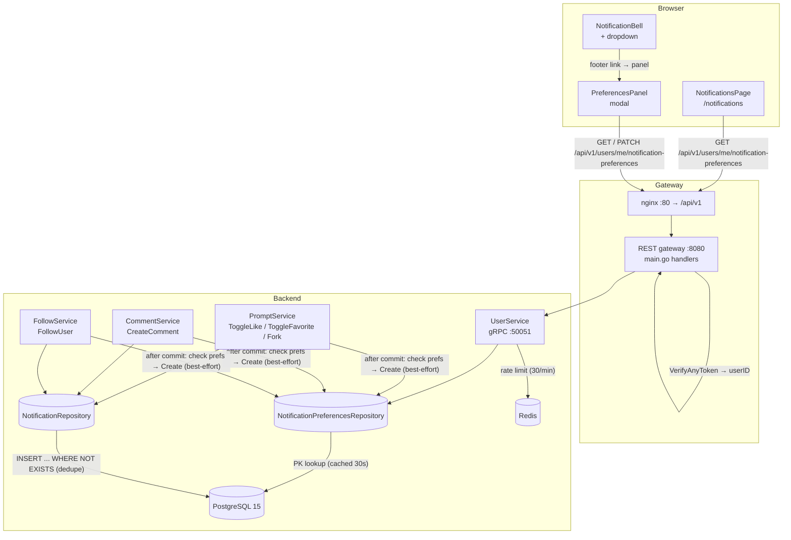

# 通知偏好 — 架构设计

| | |
|---|---|
| **功能 ID** | notification-preferences |
| **版本** | 1.0 |
| **状态** | 已批准实施 |
| **作者** | Architect Agent |
| **上游** | [需求](../design/notification-preferences-requirements-zh-CN.md), [UI/UX 设计](../design/notification-preferences-ui-ux-design-zh-CN.md) |
| **下游** | [详细设计](notification-preferences-detailed-design-zh-CN.md) |

## 1. 概述

通知偏好为用户提供**按类型退出**和**主暂停开关**，用于应用内通知系统。通知功能（已上线）发射 `like`、`favorite`、`fork`、`comment_reply`、`follow` 及审核事件；社交层（评论、关注）正是使偏好成为必要的数量触发点。本功能新增：

1. **按类型开关**，覆盖五种用户事件类型（`like`、`favorite`、`fork`、`comment`、`follow`）——全部默认开启。
2. **主"暂停全部"开关**，用于缓解通知过载。
3. **发射时抑制**：禁用类型或暂停全部意味着不创建通知行——历史页面保持干净，未读徽章绝不计入被抑制的事件。
4. **自动保存**（每个开关 PATCH，无保存按钮），带"已保存"指示和出错回滚。
5. **惰性建行**：缺失行意味着全部默认；每次为接收者发射事件时读取该表。

本功能**纯增量且默认零影响**（NFR-2、NFR-6）：从未打开面板的用户看不到任何行为差异（无行、无抑制、界面相同）。

**已解决开放问题**（来自需求 §10）：

| # | 问题 | 决策 |
|---|---|---|
| 1 | 按类型列 vs JSONB | **按类型列**（六个布尔列）。类型集固定且较小；列提供简单的无 CHECK 布尔、易索引，且与 FR-1 完全一致。JSONB 的灵活性对固定 v1 集无必要，"每个新类型都带开关"契约（Q5）通过每新增一个类型加一列 + 一行 UI 满足。 |
| 2 | 发射时检查形态 | **直接 PK 查找** `notification_preferences`，每次发射事件时执行，**进程内短 TTL 缓存**（如 30 秒）。表以 `user_id` 为主键，因此查找是单次索引点读。短 TTL 进程内缓存避免在互动频率下冲击数据库，同时保持抑制近乎实时（NFR-1）。 |
| 3 | 面板位置 | **通知历史页面齿轮图标 + 铃铛下拉页脚链接**（UI/UX 建议——控制位于噪音所在之处）。两个入口打开同一面板（单一事实来源）。 |
| 4 | 暂停全部语义 | **发射时抑制**（不创建行，徽章保持干净）。暂停用户永久错过事件——接受，符合 FR-7。既有历史不受影响且保持可浏览。 |
| 5 | 未来类型的开关粒度 | **每个新事件类型都带默认开启的开关**（新列 + 一行 UI + 一个 i18n 标签）。这是契约；五种 v1 类型是当前完整集合。 |
| 6 | 速率限制 | **PATCH 偏好每账户每分钟最多 30 次**（防篡改），用现有 Redis 固定窗口计数器模式实现（镜像 `checkRatingRate`）。Redis 不可用时放行。 |

**非目标（v1）：** 邮件/推送渠道（仅应用内）、按来源细粒度（按创作者/按模板铃铛）、摘要/频率选项、按条目/线程静音、管理员查看/覆盖用户偏好，以及管理员/系统通知类型的偏好（v1 不存在）。

## 2. 系统上下文



无新增基础设施组件。唯一新增数据存储对象是现有 PostgreSQL 实例中的 `notification_preferences` 表。Redis 复用于 PATCH 速率限制（现有固定窗口计数器模式）。

## 3. 组件

### 新增组件

| 组件 | 位置 | 职责 |
|---|---|---|
| `NotificationPreferences` 模型 | `backend/internal/models/notification_preferences.go` | 镜像表的结构体（六个布尔 + `updated_at`）。 |
| 通知偏好仓储 | `backend/internal/repository/notification_preferences_repository.go` | `Get`（有效偏好，缺失行用默认值）、`Upsert`（首次更改时惰性建行）。 |
| 偏好服务方法 | `backend/internal/service/user.go` | `UserService` 上的 `GetNotificationPreferences` + `UpdateNotificationPreferences`；速率限制；校验。 |
| `NotificationPreferencesPanel` | `frontend/src/components/notifications/NotificationPreferencesPanel.js` | 带主开关 + 5 个类型行的模态框；每个开关自动保存 PATCH。 |
| 偏好 slice | `frontend/src/store/notificationPreferencesSlice.js` | Redux 状态：prefs、saving 标志、error。 |
| `GearIcon` | `frontend/src/components/ui/Icons.jsx` | 新头部图标（或复用现有设置齿轮）。 |

### 修改组件

| 组件 | 变更 |
|---|---|
| `backend/internal/service/prompt.go` | `createEngagementNotification` 在 `Create` 前增加偏好检查（like/favorite/fork）。 |
| `backend/internal/service/comment.go` | `notifyCommentReply` 在 `Create` 前增加偏好检查（comment）。 |
| `backend/internal/service/user.go` | `emitFollowNotification` 在 `Create` 前增加偏好检查（follow）。 |
| `backend/internal/service/user.go` | 增加 `NotificationPrefsRepo` 字段 + `SetNotificationPrefsRepo` setter；增加两个偏好 RPC 方法。 |
| `backend/cmd/server/main.go` | 将偏好仓储接入 `UserService`；在 `/api/v1/users/me/notification-preferences` 注册 2 个 REST 处理器。 |
| `frontend/src/pages/NotificationsPage.js` | 页面头部增加打开面板的齿轮图标。 |
| `frontend/src/components/notifications/NotificationBell.js` | 增加打开面板的"通知偏好"页脚链接。 |
| `frontend/src/services/api.js` | 增加 `getNotificationPreferences` + `updateNotificationPreferences` 方法。 |
| `frontend/src/store/store.js` | 注册 `notificationPreferencesSlice` reducer。 |
| `frontend/src/locales/{en,zh}/translation.json` | 增加 `notifPrefs.*` 命名空间（两种语言）。 |
| `deployment/init.sql` + `deployment/chart/open-prompts/init.sql` | 追加幂等 `notification_preferences` DDL 块（两份副本，逐字节一致）。 |
| `tests/fvt.py` | 新增 `test_notification_preferences()` 函数。 |

## 4. API 设计（摘要）

所有端点均为**面向用户**（无管理变体），需要认证，用户始终从 JWT 派生——绝不来自请求参数。

| 方法 | 路径 | 用途 | 成功 |
|---|---|---|---|
| GET | `/api/v1/users/me/notification-preferences` | 有效偏好（无行时物化默认值）（FR-11） | `200` `{ like_enabled, favorite_enabled, fork_enabled, comment_enabled, follow_enabled, paused_all }` |
| PATCH | `/api/v1/users/me/notification-preferences` | 更新六个布尔字段的任意子集；未知字段忽略；非布尔拒绝（FR-12） | `200` 完整有效偏好对象 |

错误码：`401` 未认证；`400` 非布尔值 / 畸形请求体；`429` 超过速率限制（带 `Retry-After`）；`500` 内部。完整契约见详细设计 §1。

## 5. 数据模型

一张新表（幂等 DDL，镜像到 helm chart 副本）：

```sql
CREATE TABLE IF NOT EXISTS notification_preferences (
    user_id TEXT PRIMARY KEY REFERENCES users(id) ON DELETE CASCADE,
    like_enabled BOOLEAN NOT NULL DEFAULT true,
    favorite_enabled BOOLEAN NOT NULL DEFAULT true,
    fork_enabled BOOLEAN NOT NULL DEFAULT true,
    comment_enabled BOOLEAN NOT NULL DEFAULT true,
    follow_enabled BOOLEAN NOT NULL DEFAULT true,
    paused_all BOOLEAN NOT NULL DEFAULT false,
    updated_at TIMESTAMPTZ NOT NULL DEFAULT NOW()
);
```

设计说明：

- **`user_id` 是主键**，也是指向 `users(id)` 的外键，带 `ON DELETE CASCADE`——删除用户即删除其偏好（FR-1）。
- **惰性建行（FR-2）：** 缺失行意味着全部启用/未暂停。行在首次 PATCH 时创建。无需迁移回填。
- **布尔列无 CHECK 约束**——它们是普通 `BOOLEAN NOT NULL DEFAULT true/false` 列。
- **`updated_at`** 在每次 PATCH 时维护（用于调试/审计）。

## 6. 认证与授权

- 两个端点均为**非公开**：现有认证拦截器（`VerifyAnyToken`）拒绝未认证调用；`userID` 来自 `ContextWithUserID`，与 profile 端点完全一致。
- **用户作用域：** 用户始终从令牌派生；不存在读取或修改他人偏好的路径（无 IDOR 面）。
- **不涉及任何管理员角色**（FR-14——v1 无管理员可见性或覆盖）。

## 7. 前端架构

- **入口：** `NotificationsPage` 头部的齿轮图标和 `NotificationBell` 下拉的"通知偏好"页脚链接。两者打开同一个 `NotificationPreferencesPanel` 模态框（单一事实来源）。从未打开面板的用户零行为差异（FR-13）。
- **状态：** 新 `notificationPreferencesSlice`——`{ prefs: {...}, saving: {like:false,...}, error: null }`。面板打开时读取偏好（GET）；缺失行渲染全开默认值（无闪烁）。
- **自动保存：** 每个开关立即触发 PATCH；开关乐观动画，然后确认（"已保存 ✓"，1.5 秒）或回滚并显示错误 toast。
- **暂停优先级（FR-6）：** `paused_all` 开启时，类型开关视觉禁用且不可交互，带"暂停全部已开启"说明；关闭暂停后恢复各类型的持久化状态。
- **无障碍（NFR-5）：** 开关使用 `role="switch"` 带 `aria-checked`；面板是可访问模态框（焦点陷阱、Esc 关闭、初始焦点在主开关）；已保存指示和错误 toast 分别使用 polite/assertive 实时区域；禁用开关带 `aria-disabled`。
- **i18n：** EN/ZH 的 `notifPrefs.*` 键；类型标签复用通知功能的事件类型标签以保持一致（NFR-4）。

## 8. 配置

| 变量 | 默认 | 用途 |
|---|---|---|
| `NOTIF_PREFS_RATE_PER_MINUTE` | `30` | 每账户每分钟最大 PATCH 偏好更改次数（防篡改）。 |

通过 `os.Getenv` 读取并带安全默认值（仓储约定）。接入 `deployment/docker-compose.yml`（后端服务环境）和 helm chart（`values.yaml` + deployment 模板），两者均可选带默认值，现有部署无需变更。

## 9. 安全考量

- **无 IDOR：** 用户从令牌派生；不存在跨用户访问路径。
- **无注入面：** 所有查询参数化；PATCH 字段针对六个布尔的白名单校验。
- **无垃圾信息向量：** PATCH 限速（30/min）；表每用户一行。
- **抑制仅限接收（FR-8）：** 禁用点赞的用户仍会为他人产生点赞通知——偏好管接收，不管行为。
- **自操作抑制（FR-9）** 不变，且在偏好检查之前运行。

## 10. 部署说明

- DDL 幂等（`CREATE TABLE IF NOT EXISTS`），因此对全新卷和现有部署都安全（无 ALTER，无需 `DO $$` 块）。
- 两份 `init.sql` 副本（根 + helm chart）必须对新块逐字节一致。
- 无新服务、端口或镜像。后端二进制照常重建；前端是普通 SPA 构建。
- 回滚：删除该表即可（功能自包含）；REST 端点会 404/500，但其他功能不降级。

## 11. 测试策略（摘要）

- **FVT（`tests/fvt.py`）：** 新用户 GET 返回默认值；PATCH 子集仅更新这些字段；关闭"点赞"抑制后续点赞通知（无行、无徽章、无历史）；暂停全部抑制全部五种类型；暂停时类型开关禁用；重新启用恢复先前状态；PATCH 非布尔 → 400；速率限制 → 429；跨用户隔离；未认证 → 401。
- **后端单元测试：** 有效偏好解析（缺失行用默认值）、惰性 upsert、速率限制执行、prompt/comment/user 服务中的抑制钩子行为（mock 偏好仓储）。
- **E2E（Nightwatch，测试代理）：** 齿轮打开面板；开关自动保存带已保存指示；被抑制事件不出现在历史/徽章；暂停全部使开关变灰；i18n EN/ZH；开关的键盘遍历。

详细契约、DDL、分层职责、i18n 键和测试钩子：见[详细设计](./notification-preferences-detailed-design-zh-CN.md)。