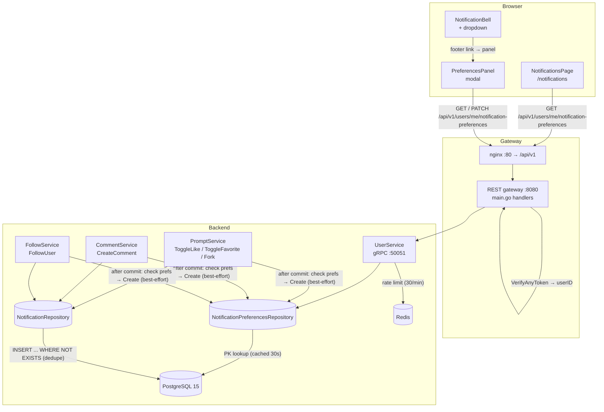

# Notification Preferences — Architecture Design

| | |
|---|---|
| **Feature ID** | notification-preferences |
| **Version** | 1.0 |
| **Status** | Approved for implementation |
| **Author** | Architect Agent |
| **Upstream** | [Requirements](../design/notification-preferences-requirements.md), [UI/UX Design](../design/notification-preferences-ui-ux-design.md) |
| **Downstream** | [Detailed Design](notification-preferences-detailed-design.md) |

## 1. Overview

Notification preferences give users **per-type opt-out and a master pause** for
the in-app notification system. The notifications feature (shipped) emits
`like`, `favorite`, `fork`, `comment_reply`, `follow`, and moderation events;
the social layer (comments, follows) is the volume trigger that makes
preferences necessary. This feature adds:

1. **Per-type toggles** for the five user-event types (`like`, `favorite`,
   `fork`, `comment`, `follow`) — default-on for all.
2. **A master "Pause all" switch** for overwhelm relief.
3. **Emission-time suppression**: a disabled type or paused-all means no
   notification row is created — the history page stays clean and the unread
   badge never counts suppressed events.
4. **Auto-save** (PATCH per toggle, no save button) with a "Saved" indicator
   and rollback-on-error.
5. **Lazy row creation**: absent rows mean all-defaults; the table is read on
   every event emission for the recipient.

The feature is **additive and default-zero** (NFR-2, NFR-6): users who never
open the panel see zero behavioral difference (no row, no suppression,
identical UI).

**Resolved open questions** (from requirements §10):

| # | Question | Decision |
|---|---|---|
| 1 | Column-per-type vs JSONB | **Column-per-type** (six boolean columns). The type set is fixed and small; columns give simple CHECK-free booleans, easy indexing, and match FR-1 exactly. JSONB's flexibility is not needed for a fixed v1 set, and the "every new type ships with a toggle" contract (Q5) is satisfied by adding a column + UI row per new type. |
| 2 | Emission-time check shape | **Direct PK lookup** on `notification_preferences` per emitted event, **cacheable in-process with a short TTL** (e.g. 30 s). The table is keyed by `user_id` (PK), so the lookup is a single indexed point read. A short-TTL in-process cache avoids hammering the DB at engagement frequency while keeping suppression near-real-time (NFR-1). |
| 3 | Panel placement | **Gear icon on the notifications history page + bell dropdown footer link** (the UI/UX recommendation — control lives where the noise lives). Both entry points open the same panel (single source of truth). |
| 4 | Pause-all semantics | **Suppress at emission** (no rows created, badge stays clean). Paused users miss events permanently — accepted, matching FR-7. Existing history is untouched and remains browsable. |
| 5 | Toggle granularity for future types | **Every new event type ships with a toggle defaulting to on** (a new column + a UI row + an i18n label). This is the contract; the five v1 types are the complete current set. |
| 6 | Rate limiting | **PATCH preferences at most 30/min per account** (anti-tamper), enforced with the existing Redis fixed-window counter pattern (mirrors `checkRatingRate`). Fail-open when Redis is unavailable. |

**Non-goals (v1):** email/web-push channels (in-app only), per-source
granularity (per-creator/per-template bells), digests/frequency options,
per-item/thread muting, admin visibility/override of user preferences, and
preferences for admin/system notification types (none exist in v1).

## 2. System Context



No new infrastructure components. The only new data-store object is the
`notification_preferences` table in the existing PostgreSQL instance. Redis is
reused for the PATCH rate limit (existing fixed-window counter pattern).

## 3. Components

### New components

| Component | Location | Responsibility |
|---|---|---|
| `NotificationPreferences` model | `backend/internal/models/notification_preferences.go` | Struct mirroring the table (six booleans + `updated_at`). |
| Notification preferences repository | `backend/internal/repository/notification_preferences_repository.go` | `Get` (effective prefs, defaults for absent row), `Upsert` (lazy row creation on first change). |
| Preferences service methods | `backend/internal/service/user.go` | `GetNotificationPreferences` + `UpdateNotificationPreferences` on `UserService`; rate limit; validation. |
| `NotificationPreferencesPanel` | `frontend/src/components/notifications/NotificationPreferencesPanel.js` | Modal with master switch + 5 type rows; auto-save PATCH per toggle. |
| Preferences slice | `frontend/src/store/notificationPreferencesSlice.js` | Redux state: prefs, saving flags, error. |
| `GearIcon` | `frontend/src/components/ui/Icons.jsx` | New header icon (or reuse an existing settings gear). |

### Modified components

| Component | Change |
|---|---|
| `backend/internal/service/prompt.go` | `createEngagementNotification` gains a preference check before `Create` (like/favorite/fork). |
| `backend/internal/service/comment.go` | `notifyCommentReply` gains a preference check before `Create` (comment). |
| `backend/internal/service/user.go` | `emitFollowNotification` gains a preference check before `Create` (follow). |
| `backend/internal/service/user.go` | Add `NotificationPrefsRepo` field + `SetNotificationPrefsRepo` setter; add the two preference RPC methods. |
| `backend/cmd/server/main.go` | Wire the preferences repository into `UserService`; register 2 REST handlers under `/api/v1/users/me/notification-preferences`. |
| `frontend/src/pages/NotificationsPage.js` | Add gear icon in the page header opening the panel. |
| `frontend/src/components/notifications/NotificationBell.js` | Add "Notification preferences" footer link opening the panel. |
| `frontend/src/services/api.js` | Add `getNotificationPreferences` + `updateNotificationPreferences` methods. |
| `frontend/src/store/store.js` | Register `notificationPreferencesSlice` reducer. |
| `frontend/src/locales/{en,zh}/translation.json` | Add `notifPrefs.*` namespace (both locales). |
| `deployment/init.sql` + `deployment/chart/open-prompts/init.sql` | Append idempotent `notification_preferences` DDL block (both copies, byte-identical). |
| `tests/fvt.py` | New `test_notification_preferences()` function. |

## 4. API Design (summary)

All endpoints are **user-facing** (no admin variants), require authentication,
and derive the user from the JWT — never from request parameters.

| Method | Path | Purpose | Success |
|---|---|---|---|
| GET | `/api/v1/users/me/notification-preferences` | Effective preferences (defaults materialized when no row exists) (FR-11) | `200` `{ like_enabled, favorite_enabled, fork_enabled, comment_enabled, follow_enabled, paused_all }` |
| PATCH | `/api/v1/users/me/notification-preferences` | Update any subset of the six boolean fields; unknown fields ignored; non-boolean rejected (FR-12) | `200` full effective preferences object |

Error codes: `401` unauthenticated; `400` non-boolean value / malformed body;
`429` rate limit exceeded (with `Retry-After`); `500` internal. Full contracts
in the detailed design §1.

## 5. Data Model

One new table (idempotent DDL, mirrored to the helm chart copy):

```sql
CREATE TABLE IF NOT EXISTS notification_preferences (
    user_id TEXT PRIMARY KEY REFERENCES users(id) ON DELETE CASCADE,
    like_enabled BOOLEAN NOT NULL DEFAULT true,
    favorite_enabled BOOLEAN NOT NULL DEFAULT true,
    fork_enabled BOOLEAN NOT NULL DEFAULT true,
    comment_enabled BOOLEAN NOT NULL DEFAULT true,
    follow_enabled BOOLEAN NOT NULL DEFAULT true,
    paused_all BOOLEAN NOT NULL DEFAULT false,
    updated_at TIMESTAMPTZ NOT NULL DEFAULT NOW()
);
```

Design notes:

- **`user_id` is the PK** and the FK to `users(id)` with `ON DELETE CASCADE` —
  deleting a user removes their preferences (FR-1).
- **Lazy row creation (FR-2):** absent rows mean all-enabled/not-paused. The
  row is created on the first PATCH. No migration backfill is needed.
- **No CHECK constraints** on the booleans — they are plain `BOOLEAN NOT NULL
  DEFAULT true/false` columns.
- **`updated_at`** is maintained on every PATCH (for debugging/audit).

## 6. Authentication & Authorization

- Both endpoints are **non-public**: the existing auth interceptor
  (`VerifyAnyToken`) rejects unauthenticated calls; `userID` comes from
  `ContextWithUserID`, exactly like the profile endpoints.
- **User scoping:** the user is always derived from the token; there is no
  path to read or modify another user's preferences (no IDOR surface).
- **No admin role** is involved anywhere (FR-14 — no admin visibility or
  override in v1).

## 7. Frontend Architecture

- **Entry points:** a gear icon in the `NotificationsPage` header and a
  "Notification preferences" footer link in the `NotificationBell` dropdown.
  Both open the same `NotificationPreferencesPanel` modal (single source of
  truth). Users who never open the panel see zero behavioral difference
  (FR-13).
- **State:** new `notificationPreferencesSlice` — `{ prefs: {...}, saving:
  {like:false,...}, error: null }`. The panel reads prefs on open (GET);
  absent row renders all-on defaults (no flicker).
- **Auto-save:** each toggle fires a PATCH immediately; the switch animates
  optimistically, then either confirms ("Saved ✓", 1.5 s) or rolls back with
  an error toast.
- **Pause precedence (FR-6):** while `paused_all` is on, type toggles are
  visually disabled and non-interactive with the "Paused all is on" note;
  switching pause off restores each type's persisted state.
- **A11y (NFR-5):** switches use `role="switch"` with `aria-checked`; the
  panel is an accessible modal (focus trap, Esc close, initial focus on the
  master switch); the Saved indicator and error toast use polite/assertive
  live regions; disabled toggles carry `aria-disabled`.
- **i18n:** `notifPrefs.*` keys in EN/ZH; type labels reuse the notifications
  feature's event-type labels for consistency (NFR-4).

## 8. Configuration

| Variable | Default | Purpose |
|---|---|---|
| `NOTIF_PREFS_RATE_PER_MINUTE` | `30` | Max PATCH preference changes per account per minute (anti-tamper). |

Read via `os.Getenv` with a safe default (repo convention). Wired into
`deployment/docker-compose.yml` (backend service environment) and the helm
chart (`values.yaml` + deployment template), both optional with defaults so
existing deployments need no change.

## 9. Security Considerations

- **No IDOR:** user derived from token; no cross-user access path exists.
- **No injection surface:** all queries parameterized; PATCH fields validated
  against a fixed whitelist of six booleans.
- **No spam vector:** PATCH is rate-limited (30/min); the table is one row per
  user.
- **Suppression is receiving-only (FR-8):** a user with likes disabled still
  generates like notifications for others — the preference governs receiving,
  not acting.
- **Self-action suppression (FR-9)** is unchanged and runs before the
  preference check.

## 10. Deployment Notes

- DDL is idempotent (`CREATE TABLE IF NOT EXISTS`), so it is safe on both
  fresh volumes and existing deployments (no ALTERs, no `DO $$` block needed).
- The two `init.sql` copies (root + helm chart) must stay byte-identical for
  the new block.
- No new services, ports, or images. Backend binary is rebuilt as usual;
  frontend is a normal SPA build.
- Rollback: dropping the table is sufficient (feature is self-contained);
  REST endpoints would 404/500 but nothing else degrades.

## 11. Test Strategy (summary)

- **FVT (`tests/fvt.py`):** GET returns defaults for a fresh user; PATCH a
  subset updates only those fields; toggling off "likes" suppresses subsequent
  like notifications (no row, no badge, no history); pause-all suppresses all
  five types; while paused, type toggles disabled; re-enable restores prior
  states; PATCH with non-boolean → 400; rate limit → 429; cross-user
  isolation; unauthenticated → 401.
- **Backend unit tests:** effective-prefs resolution (defaults for absent
  row), lazy upsert, rate-limit enforcement, suppression hook behavior in
  prompt/comment/user services (mock prefs repo).
- **E2E (Nightwatch, test-agent):** gear opens panel; toggle auto-saves with
  Saved indicator; suppressed event absent from history/badge; pause-all
  greys toggles; i18n EN/ZH; keyboard traversal of switches.

Detailed contracts, DDL, layer responsibilities, i18n keys, and test hooks:
see the [detailed design](./notification-preferences-detailed-design.md).