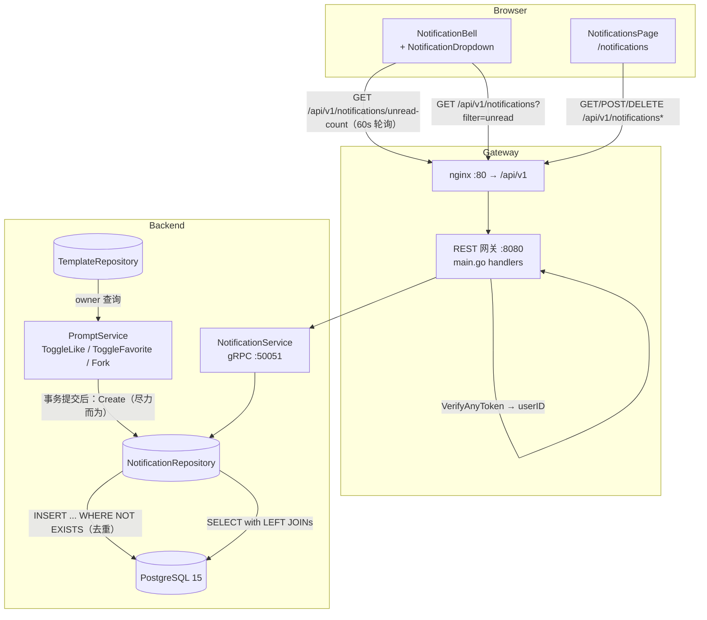

# 通知系统 — 架构设计

- **功能 ID：** `notifications`
- **版本：** 1.0
- **状态：** 已批准进入实现
- **作者：** 架构 Agent
- **上游文档：**[需求分析](../design/notifications-requirements-zh-CN.md) · [UI/UX 设计](../design/notifications-ui-ux-design-zh-CN.md)
- **下游文档：**[详细设计（中文）](./notifications-detailed-design-zh-CN.md) · [Detailed Design (EN)](./notifications-detailed-design.md)

---

## 1. 概述

本功能为 Open Prompts 引入 GitHub/Reddit 风格的**应用内通知**，仅覆盖用户自己模板上的互动事件。范围刻意收窄、仅限互动：

1. **三种事件类型：** `like`、`favorite`、`fork` —— 当*其他*用户点赞、收藏或 Fork 接收者拥有的模板时产生。
2. **自我操作抑制：** 用户永远不会因自己的操作收到通知（FR-2）。
3. **切换去重：** 对之前已取消点赞的模板再次点赞，不会产生重复的未读通知（FR-3）。
4. **按用户划分的界面：** 带未读徽标的顶栏铃铛（轮询）、10 条下拉面板，以及带全部/未读筛选、单条已读、删除、全部已读的 `/notifications` 历史页。
5. **无管理界面：** 这是纯个人功能，没有需要审核的内容（FR-29/FR-30）。不新增 `/admin` 路由，不新增 `/api/v1/admin` 端点。

系统采用**轮询**方式（默认 60 秒，页面不可见时暂停，并带指数退避）。不引入 websocket/SSE 等基础设施。

**已裁决的开放问题**（来自需求 §10）：

| # | 问题 | 决策 |
|---|---|---|
| 1 | 新建 `NotificationService` 还是扩展 `PromptService` | **新建 `NotificationService`**，放在独立的 `notification.proto` 文件中（同属 `openprompts.v1` 包），沿用 `admin.proto` 的先例。保持 `prompt.proto` 稳定，避免与并行开发的功能产生合并冲突。 |
| 2 | 保留机制 | **惰性清理**：在列表调用中顺带执行限频的过期行 `DELETE`。无调度器、无新基础设施。两个带安全默认值的环境变量（§8）。 |
| 3 | 列表响应中是否包含 `unread_count` | **包含。** `ListNotificationsResponse` 携带 `unread_count`，徽标可通过一次调用完成对账，无需单独请求 `/unread-count`。 |

**非目标（v1）：** 实时推送（websocket/SSE）、邮件摘要、通知聚合（"X 等 3 人"）、评论/关注事件（功能尚不存在）、偏好设置页，以及点赞/收藏/Fork 之外的任何事件类型。

## 2. 系统上下文



不新增任何基础设施组件。唯一的新数据对象是现有 PostgreSQL 实例中的 `notifications` 表。本功能不使用 Redis。

## 3. 组件

### 新增组件

| 组件 | 位置 | 职责 |
|---|---|---|
| `notification.proto` + 生成代码 | `backend/api/proto/v1/notification.proto` | `NotificationService` 契约：5 个 RPC（列表、未读数、标记已读、全部已读、删除）。事件创建为**纯内部行为** —— 不设 RPC。 |
| 通知模型 | `backend/internal/models/notification.go` | 与表结构对应的 `Notification` 结构体。 |
| 通知仓储 | `backend/internal/repository/notification_repository.go` | 插入（带去重）、列表（带联表 + 未读数）、未读计数、标记已读、全部已读、删除、惰性清理。 |
| 通知服务 | `backend/internal/service/notification.go` | 实现 gRPC 契约的 `NotificationService`；参数校验；从上下文获取接收者。 |
| 铃铛 + 下拉 | `frontend/src/components/notifications/NotificationBell.js`、`NotificationDropdown.js` | 带徽标的顶栏铃铛、10 条下拉、全部已读、查看全部。 |
| 通知页面 | `frontend/src/pages/NotificationsPage.js` | 历史页：带计数的全部/未读标签、每页 20 条加载更多、单条已读/删除、全部已读。 |
| 通知 slice | `frontend/src/store/notificationsSlice.js` | Redux 状态：items、unreadCount、分页、loading/error。 |
| 轮询 hook | `frontend/src/hooks/useNotificationPolling.js` | 60 秒轮询、页面不可见暂停、聚焦刷新、60→120→300 秒退避。 |
| 相对时间工具 | `frontend/src/utils/time.js` | `formatRelativeTime(date, t)`，供后续功能复用。 |
| `BellIcon` | `frontend/src/components/ui/Icons.jsx` | 新图标（Heart/Star/Fork 图标已存在）。 |

### 修改组件

| 组件 | 变更 |
|---|---|
| `backend/internal/service/prompt.go` | 在 `ToggleLikeTemplate`、`ToggleFavoriteTemplate`、`ForkTemplate` 中埋点：切换为 on 或 fork 成功后，尽力而为地创建通知（查询 owner、自我抑制、错误吞掉并记日志）。 |
| `backend/cmd/server/main.go` | 在 gRPC 上注册 `NotificationService`；在 `/api/v1/notifications` 下接线 5 个 REST handler。 |
| `frontend/src/components/Header.js` | 在语言切换器与个人资料菜单之间插入 `<NotificationBell />`（仅登录态）。 |
| `frontend/src/App.js` | 新增 `/notifications` 路由（懒加载页面）。 |
| `frontend/src/services/api.js` | 新增 5 个通知方法。 |
| `frontend/src/store/store.js` | 注册 `notificationsSlice` reducer。 |
| `frontend/src/locales/{en,zh}/translation.json` | 新增 `notifications.*` 与 `time.*` 命名空间（两种语言）。 |
| `deployment/init.sql` + `deployment/chart/open-prompts/init.sql` | 追加幂等的 `notifications` DDL 块（两份副本，字节一致）。 |
| `deployment/docker-compose.yml` + helm `values.yaml`/deployment | 新增 2 个保留期环境变量（带默认值）。 |
| `tests/fvt.py` | 新增 `test_notifications()` 函数。 |

## 4. API 设计（摘要）

所有端点均为**面向用户**（无管理端变体），要求登录，且接收者一律来自 JWT —— 绝不来自请求参数。

| 方法 | 路径 | 用途 | 成功 |
|---|---|---|---|
| GET | `/api/v1/notifications` | 通知列表；`filter=all\|unread`（默认 `all`）、`page_size`（1–100，默认 20）、`page_token`（字符串形式的 offset，与现有列表端点一致） | `200` items + `unread_count` + `next_page_token` |
| GET | `/api/v1/notifications/unread-count` | 徽标计数 | `200` `{ "count": N }` |
| POST | `/api/v1/notifications/{id}/read` | 标记单条已读（幂等） | `200` `{ "success": true }` |
| POST | `/api/v1/notifications/read-all` | 全部已读 | `200` `{ "success": true, "updated_count": N }` |
| DELETE | `/api/v1/notifications/{id}` | 删除单条 | `200` `{ "success": true }` |

错误码：`401` 未认证；`400` 非法的 `filter`/`page_size`/`page_token`；`404` 未知 id **或他人拥有的 id**（刻意不可区分）；`500` 内部错误。完整契约见详细设计 §1。

## 5. 数据模型

一张新表（幂等 DDL，同步镜像到 helm chart 副本）：

```sql
CREATE TABLE IF NOT EXISTS notifications (
    id UUID PRIMARY KEY DEFAULT gen_random_uuid(),
    recipient_id TEXT NOT NULL REFERENCES users(id) ON DELETE CASCADE,
    actor_id TEXT NOT NULL REFERENCES users(id) ON DELETE CASCADE,
    template_id UUID NOT NULL REFERENCES templates(id) ON DELETE CASCADE,
    type TEXT NOT NULL CHECK (type IN ('like', 'favorite', 'fork')),
    actor_display_name TEXT NOT NULL,
    read_at TIMESTAMPTZ,
    created_at TIMESTAMPTZ NOT NULL DEFAULT now(),
    CONSTRAINT no_self_notify CHECK (recipient_id <> actor_id)
);

CREATE INDEX IF NOT EXISTS idx_notifications_recipient_unread
    ON notifications (recipient_id) WHERE read_at IS NULL;
CREATE INDEX IF NOT EXISTS idx_notifications_recipient_created
    ON notifications (recipient_id, created_at DESC);
```

设计要点：

- **`actor_display_name` 快照** —— 语句渲染事件发生时的名字；actor 之后改名不会改写历史。actor **头像**在读取时实时联表（代价低、始终最新，且下拉面板需要展示）。
- **模板标题为实时值**（读取时联表），且 `ON DELETE CASCADE` 在模板删除时移除对应通知（FR-6）—— 不产生孤儿行。
- **`no_self_notify` CHECK** 在存储层强制 FR-2，作为纵深防御（服务层同样会抑制）。
- **去重（FR-3）** 由插入语句强制：`INSERT ... SELECT ... WHERE NOT EXISTS (相同的 recipient/actor/template/type 且 read_at IS NULL 的行)`。取消点赞后再次点赞，只有在前一条仍未读时才不会产生新行；一旦已读，新的互动会产生新通知（符合预期）。
- **保留（惰性清理）：** 在列表调用中，每实例每 10 分钟至多执行一次（内存限频），删除 `read_at < now() - 'NOTIFICATION_READ_RETENTION_DAYS'` 或 `created_at < now() - 'NOTIFICATION_RETENTION_DAYS'` 的行。失败仅记日志，绝不阻塞列表。

## 6. 认证与授权

- 5 个 RPC 全部**非公开**：现有认证拦截器（`VerifyAnyToken`）拒绝未认证调用；`userID` 来自 `ContextWithUserID`，与 `ListAPIKeys` 等完全一致。
- **接收者范围限定：** 每条仓储查询都过滤 `recipient_id = $已认证用户`。他人拥有的通知与不存在的通知不可区分（`404`），防止枚举。
- **事件创建**只发生在受信任的服务端代码路径（toggle/fork 服务）内 —— 没有创建通知的 RPC，用户无法伪造事件或骚扰他人。
- 任何地方都不涉及管理员角色；管理员与普通用户一样只看到自己的通知。

## 7. 前端架构

- **路由：** 在 `App.js` 中新增 `/notifications` 懒加载路由，位于现有 `Layout` 内（该页隐藏侧栏，与其他整页一致）。无 `/admin` 界面。
- **状态：** 新增 `notificationsSlice` —— `{ items: [], unreadCount: 0, filter: 'all', nextPageToken: '', hasMore: false, loading: false, error: null, lastFetchedAt: 0 }`。铃铛与页面共享该 slice，任何位置的已读操作都会同步更新所有徽标。
- **轮询：** `useNotificationPolling` hook —— 页签可见时每 60 秒一次；`visibilitychange` 隐藏时暂停；窗口聚焦立即刷新；连续错误时指数退避 60→120→300 秒，成功后重置；登出/未认证时停止。在 `Header` 挂载一次（仅登录态）。
- **语句组装：** API 返回类型化数据（`type`、`actor_display_name`、模板标题）；客户端通过 i18n 组装语句（`notifications.type.like` 等），EN/ZH 均可完整翻译。**服务端不拼装文案。**
- **相对时间：** 共享的 `utils/time.js` + `time.*` i18n 键（分钟/小时/天），后续 user-dashboard 复用。
- **无障碍/体验：** 铃铛按钮带计数的 `aria-label`，下拉 `role="menu"`，`Esc` 关闭，点击外部关闭（从个人资料下拉模式中抽取 `useDismissable` hook），删除使用现有 Modal 确认模式，toast 复用现有 NotificationContext toast 系统。

## 8. 配置

| 变量 | 默认值 | 用途 |
|---|---|---|
| `NOTIFICATION_READ_RETENTION_DAYS` | `90` | 超过该天数的已读通知被清理（惰性）。 |
| `NOTIFICATION_RETENTION_DAYS` | `180` | 超过该天数的所有通知被清理（惰性）。 |

通过 `os.Getenv` 读取并带安全默认值（仓库惯例）。接入 `deployment/docker-compose.yml`（backend 服务 environment）与 helm chart（`values.yaml` + deployment 模板），均为可选项且带默认值，存量部署无需变更。

## 9. 安全考量

- **无 IDOR：** 接收者来自 token；跨用户访问返回 `404`（而非 `403`），避免存在性泄露。
- **无注入面：** 所有查询参数化；`filter` 在进入 SQL 前先经白名单（`all`/`unread`）校验。
- **无骚扰向量：** 事件创建仅限服务端内部；去重 + 自我抑制 CHECK 约束每次互动的行增长。
- **XSS：** 通知语句以 React 文本节点渲染（自动转义）；`actor_display_name` 与模板标题绝不作为 HTML 注入。
- **隐私：** 仅快照 `display_name`（模板上本就公开）；通知中不含邮箱或 token。
- **成本控制：** 惰性清理 + 部分索引使表规模有界；轮询对每用户每分钟只是一次索引 COUNT。

## 10. 部署说明

- DDL 幂等（`CREATE TABLE IF NOT EXISTS` + `CREATE INDEX IF NOT EXISTS`），全新卷与存量部署均安全（无需 `DO $$ ... EXCEPTION` 模式 —— 没有 ALTER）。
- 两份 `init.sql` 副本（根目录 + helm chart）的新增块必须字节一致。
- 不新增服务、端口或镜像。后端二进制照常重建；前端为普通 SPA 构建。
- 回滚：删除该表即可（功能自包含）；REST 端点会 404/500，但其余功能不受影响。

## 11. 测试策略（摘要）

- **FVT（`tests/fvt.py`）：** 双用户流 —— 点赞/收藏/Fork 各产生恰好一条通知；自我操作不产生；未读期间切换 off/on 不去重出重复行；列表 + 筛选 + 分页；未读数；标记已读（幂等）/全部已读；删除；跨用户 id 404；模板删除级联。
- **后端单元测试：** 去重 SQL 语义、自我抑制、埋点路径的错误吞掉（mock 仓储）、filter 校验、惰性清理限频。
- **E2E（Nightwatch，test-agent）：** 铃铛仅登录态渲染、徽标计数、下拉 10 条 + 全部已读 + 查看全部、历史页标签/计数/分页、单条已读/删除带确认、EN/ZH 国际化、轮询暂停/恢复行为。

完整契约、DDL、分层职责、i18n 键与测试挂钩：见[详细设计](./notifications-detailed-design-zh-CN.md)。
