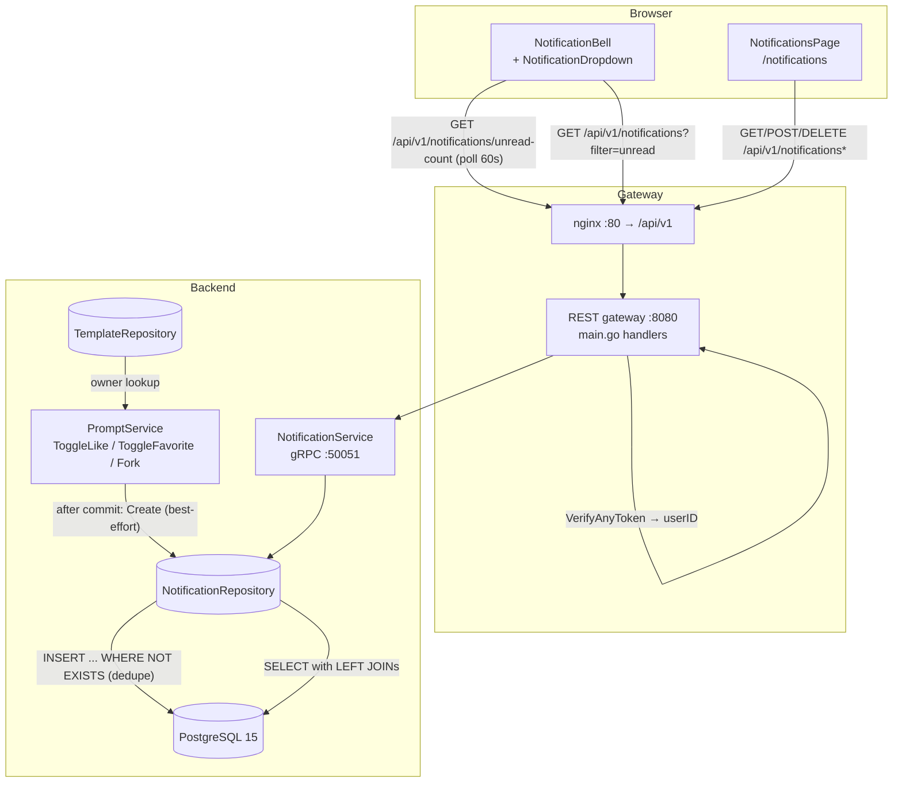

# Notifications System — Architecture Design

- **Feature ID:** `notifications`
- **Version:** 1.0
- **Status:** Approved for implementation
- **Author:** Architect Agent
- **Upstream docs:** [Requirements](../design/notifications-requirements.md) · [UI/UX Design](../design/notifications-ui-ux-design.md)
- **Downstream docs:** [Detailed Design (EN)](./notifications-detailed-design.md) · [详细设计（中文）](./notifications-detailed-design-zh-CN.md)

---

## 1. Overview

This feature adds GitHub/Reddit-style **in-app notifications** for engagement events on the user's own templates. Scope is deliberately narrow and engagement-only:

1. **Three event types:** `like`, `favorite`, `fork` — emitted when *another* user likes, favorites, or forks a template owned by the recipient.
2. **Self-action suppression:** a user never receives a notification for their own action (FR-2).
3. **Toggle-spam dedupe:** re-liking a template the actor previously un-liked does not create a duplicate unread notification (FR-3).
4. **Per-user surfaces:** a header bell with unread badge (polled), a 10-item dropdown, and a `/notifications` history page with All/Unread filtering, per-item mark-read, delete, and mark-all-read.
5. **No admin surface:** this is a per-user feature with nothing to moderate (FR-29/FR-30). No `/admin` routes, no `/api/v1/admin` endpoints.

The system is **polling-based** (60 s default, with visibility pause and exponential backoff). No websocket/SSE infrastructure is introduced.

**Resolved open questions** (from requirements §10):

| # | Question | Decision |
|---|---|---|
| 1 | New `NotificationService` vs extending `PromptService` | **New `NotificationService`** in a separate `notification.proto` file (same package `openprompts.v1`), following the `admin.proto` precedent. Keeps `prompt.proto` stable and avoids merge conflicts with concurrent feature work. |
| 2 | Retention mechanism | **Lazy purge**: an opportunistic, throttled `DELETE` of expired rows piggy-backed on list calls. No scheduler, no new infra. Two env vars with safe defaults (§8). |
| 3 | `unread_count` in list responses | **Yes.** `ListNotificationsResponse` carries `unread_count` so the badge can be reconciled from a single call without hitting `/unread-count` separately. |

**Non-goals (v1):** realtime push (websocket/SSE), email digests, notification aggregation ("X and 3 others"), comments/follows events (features don't exist), a preferences page, and any event types beyond like/favorite/fork.

## 2. System Context



No new infrastructure components. The only new data store object is the `notifications` table in the existing PostgreSQL instance. Redis is not used for this feature.

## 3. Components

### New components

| Component | Location | Responsibility |
|---|---|---|
| `notification.proto` + generated pb | `backend/api/proto/v1/notification.proto` | `NotificationService` contract: 5 RPCs (list, unread-count, mark-read, mark-all-read, delete). Event creation is **internal only** — not an RPC. |
| Notification model | `backend/internal/models/notification.go` | `Notification` struct mirroring the table. |
| Notification repository | `backend/internal/repository/notification_repository.go` | Insert (with dedupe), list (with joins + unread count), unread count, mark read, mark all read, delete, lazy purge. |
| Notification service | `backend/internal/service/notification.go` | `NotificationService` implementing the gRPC contract; parameter validation; recipient scoping from context. |
| NotificationBell + dropdown | `frontend/src/components/notifications/NotificationBell.js`, `NotificationDropdown.js` | Header bell with badge, 10-item dropdown, mark-all-read, view-all link. |
| Notifications page | `frontend/src/pages/NotificationsPage.js` | History page: All/Unread tabs with counts, 20/page Load more, per-item mark-read/delete, mark-all-read. |
| Notifications slice | `frontend/src/store/notificationsSlice.js` | Redux state: items, unreadCount, pagination, loading/error. |
| Polling hook | `frontend/src/hooks/useNotificationPolling.js` | 60 s poll, visibility pause, focus refresh, backoff 60→120→300 s. |
| Relative-time util | `frontend/src/utils/time.js` | `formatRelativeTime(date, t)` shared with future features. |
| `BellIcon` | `frontend/src/components/ui/Icons.jsx` | New icon (Heart/Star/Fork icons already exist). |

### Modified components

| Component | Change |
|---|---|
| `backend/internal/service/prompt.go` | Hook sites in `ToggleLikeTemplate`, `ToggleFavoriteTemplate`, `ForkTemplate`: after a successful toggle-on/fork, best-effort create a notification (owner lookup, self-suppression, error swallowed + logged). |
| `backend/cmd/server/main.go` | Register `NotificationService` on gRPC; wire 5 REST handlers under `/api/v1/notifications`. |
| `frontend/src/components/Header.js` | Insert `<NotificationBell />` between the language switcher and the profile menu (auth-only). |
| `frontend/src/App.js` | Add `/notifications` route (lazy-loaded page). |
| `frontend/src/services/api.js` | Add 5 notification methods. |
| `frontend/src/store/store.js` | Register `notificationsSlice` reducer. |
| `frontend/src/locales/{en,zh}/translation.json` | Add `notifications.*` and `time.*` namespaces (both locales). |
| `deployment/init.sql` + `deployment/chart/open-prompts/init.sql` | Append idempotent `notifications` DDL block (both copies, byte-identical). |
| `deployment/docker-compose.yml` + helm `values.yaml`/deployment | Add 2 retention env vars with defaults. |
| `tests/fvt.py` | New `test_notifications()` function. |

## 4. API Design (summary)

All endpoints are **user-facing** (no admin variants), require authentication, and derive the recipient from the JWT — never from request parameters.

| Method | Path | Purpose | Success |
|---|---|---|---|
| GET | `/api/v1/notifications` | List notifications; `filter=all\|unread` (default `all`), `page_size` (1–100, default 20), `page_token` (offset-as-string, same convention as existing list endpoints) | `200` items + `unread_count` + `next_page_token` |
| GET | `/api/v1/notifications/unread-count` | Badge count | `200` `{ "count": N }` |
| POST | `/api/v1/notifications/{id}/read` | Mark one read (idempotent) | `200` `{ "success": true }` |
| POST | `/api/v1/notifications/read-all` | Mark all read | `200` `{ "success": true, "updated_count": N }` |
| DELETE | `/api/v1/notifications/{id}` | Delete one | `200` `{ "success": true }` |

Error codes: `401` unauthenticated; `400` invalid `filter`/`page_size`/`page_token`; `404` unknown id **or id owned by another user** (indistinguishable by design); `500` internal. Full contracts in the detailed design §1.

## 5. Data Model

One new table (idempotent DDL, mirrored to the helm chart copy):

```sql
CREATE TABLE IF NOT EXISTS notifications (
    id UUID PRIMARY KEY DEFAULT gen_random_uuid(),
    recipient_id TEXT NOT NULL REFERENCES users(id) ON DELETE CASCADE,
    actor_id TEXT NOT NULL REFERENCES users(id) ON DELETE CASCADE,
    template_id UUID NOT NULL REFERENCES templates(id) ON DELETE CASCADE,
    type TEXT NOT NULL CHECK (type IN ('like', 'favorite', 'fork')),
    actor_display_name TEXT NOT NULL,
    read_at TIMESTAMPTZ,
    created_at TIMESTAMPTZ NOT NULL DEFAULT now(),
    CONSTRAINT no_self_notify CHECK (recipient_id <> actor_id)
);

CREATE INDEX IF NOT EXISTS idx_notifications_recipient_unread
    ON notifications (recipient_id) WHERE read_at IS NULL;
CREATE INDEX IF NOT EXISTS idx_notifications_recipient_created
    ON notifications (recipient_id, created_at DESC);
```

Design notes:

- **`actor_display_name` snapshot** — the sentence renders the name at event time; renaming the actor later does not rewrite history. Actor **avatar** is joined live at read time (cheap, always current, and the dropdown shows it).
- **Template title is live** (joined at read time), and `ON DELETE CASCADE` removes notifications when a template is deleted (FR-6) — no orphan rows.
- **`no_self_notify` CHECK** enforces FR-2 at the storage layer as defense-in-depth (the service layer also suppresses).
- **Dedupe (FR-3)** is enforced by the insert statement: `INSERT ... SELECT ... WHERE NOT EXISTS (identical recipient/actor/template/type row with read_at IS NULL)`. A re-like after un-like finds no unread duplicate only if the previous one is still unread; once read, a new engagement creates a fresh notification (intended).
- **Retention (lazy purge):** on list calls, at most once per 10 minutes per instance (in-memory throttle), delete rows where `read_at < now() - interval 'NOTIFICATION_READ_RETENTION_DAYS'` or `created_at < now() - interval 'NOTIFICATION_RETENTION_DAYS'`. Failures are logged and never block the list.

## 6. Authentication & Authorization

- All 5 RPCs are **non-public**: the existing auth interceptor (`VerifyAnyToken`) rejects unauthenticated calls; `userID` comes from `ContextWithUserID`, exactly like `ListAPIKeys` and friends.
- **Recipient scoping:** every repository query filters `recipient_id = $authenticated_user`. A notification owned by someone else is indistinguishable from a nonexistent one (`404`), preventing enumeration.
- **Event creation** happens only inside trusted server code paths (toggle/fork services) — there is no RPC to create notifications, so users cannot forge events or spam others.
- No admin role is involved anywhere; admins see their own notifications like any user.

## 7. Frontend Architecture

- **Routing:** `/notifications` added to `App.js` as a lazy route inside the existing `Layout` (sidebar hidden on this page, matching other full-width pages). No `/admin` surface.
- **State:** new `notificationsSlice` — `{ items: [], unreadCount: 0, filter: 'all', nextPageToken: '', hasMore: false, loading: false, error: null, lastFetchedAt: 0 }`. The bell and the page share this slice, so a mark-read anywhere updates the badge everywhere.
- **Polling:** `useNotificationPolling` hook — 60 s interval while the tab is visible; paused on `visibilitychange` hidden; immediate refresh on window focus; exponential backoff 60→120→300 s on consecutive errors, reset on success; stopped on logout/unauthenticated. Mounted once in `Header` (auth-only).
- **Sentence composition:** the API returns typed data (`type`, `actor_display_name`, template title); the client composes the sentence via i18n (`notifications.type.like` etc.) so EN/ZH stay fully translatable. **No server-composed prose.**
- **Relative time:** shared `utils/time.js` + `time.*` i18n keys (minutes/hours/days), reused later by user-dashboard.
- **A11y/UX:** bell button `aria-label` with count, dropdown `role="menu"`, `Esc` closes, click-outside closes (extracted `useDismissable` hook from the profile dropdown pattern), delete uses the existing Modal confirm pattern, toasts reuse the existing NotificationContext toast system.

## 8. Configuration

| Variable | Default | Purpose |
|---|---|---|
| `NOTIFICATION_READ_RETENTION_DAYS` | `90` | Read notifications older than this are purged (lazy). |
| `NOTIFICATION_RETENTION_DAYS` | `180` | All notifications older than this are purged (lazy). |

Read via `os.Getenv` with safe defaults (repo convention). Wired into `deployment/docker-compose.yml` (backend service environment) and the helm chart (`values.yaml` + deployment template), both optional with defaults so existing deployments need no change.

## 9. Security Considerations

- **No IDOR:** recipient derived from token; cross-user access returns `404` (not `403`) to avoid existence leaks.
- **No injection surface:** all queries parameterized; `filter` validated against a whitelist (`all`/`unread`) before reaching SQL.
- **No spam vector:** event creation is server-internal only; dedupe + self-suppression CHECK constrain row growth per engagement.
- **XSS:** notification sentences are rendered as React text nodes (auto-escaped); `actor_display_name` and template title are never injected as HTML.
- **PII:** only `display_name` (already public on templates) is snapshotted; no emails or tokens in notifications.
- **Cost control:** lazy purge + partial index keep the table bounded; polling is a single indexed COUNT per user per minute.

## 10. Deployment Notes

- DDL is idempotent (`CREATE TABLE IF NOT EXISTS` + `CREATE INDEX IF NOT EXISTS`), so it is safe on both fresh volumes and existing deployments (the `DO $$ ... EXCEPTION` pattern is not needed — no ALTERs).
- The two `init.sql` copies (root + helm chart) must stay byte-identical for the new block.
- No new services, ports, or images. Backend binary is rebuilt as usual; frontend is a normal SPA build.
- Rollback: dropping the table is sufficient (feature is self-contained); REST endpoints would 404/500 but nothing else degrades.

## 11. Test Strategy (summary)

- **FVT (`tests/fvt.py`):** two-user flows — like/favorite/fork create exactly one notification each; self-action creates none; toggle off/on does not duplicate while unread; list + filter + pagination; unread-count; mark read (idempotent) / read-all; delete; cross-user id 404; template deletion cascades.
- **Backend unit tests:** dedupe SQL semantics, self-suppression, error-swallowing in hook paths (mock repo), filter validation, lazy-purge throttle.
- **E2E (Nightwatch, test-agent):** bell renders auth-only, badge count, dropdown 10 items + mark-all + view-all, history page tabs/counts/pagination, per-item mark-read/delete with confirm, i18n EN/ZH, polling pause/resume behavior.

Detailed contracts, DDL, layer responsibilities, i18n keys, and test hooks: see the [detailed design](./notifications-detailed-design.md).
