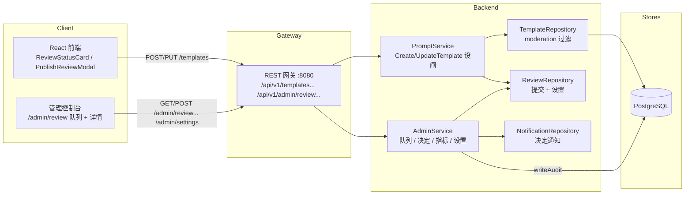
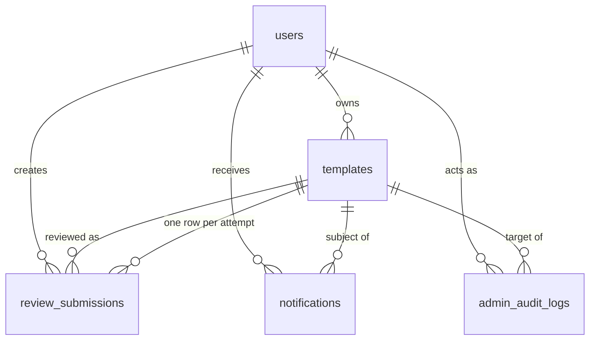

# 发布前审核 — 架构设计

| | |
|---|---|
| **Feature ID** | pre-publication-review |
| **Version** | 1.0 |
| **Status** | Approved for implementation |
| **Author** | Architect Agent |
| **Upstream** | [需求文档](../design/pre-publication-review-requirements-zh-CN.md), [UI/UX 设计](../design/pre-publication-review-ui-ux-design-zh-CN.md) |
| **Downstream** | [详细设计](pre-publication-review-detailed-design-zh-CN.md) |

## 1. 概述

发布前审核对新创作者的*首次发布*设闸：已获批模板少于 N（默认 3）的
创作者，每次发布都进入 `in_review` 而非直接上线；达到阈值的创作者即时
发布。一次管理方下架会重新设闸（接下来 M 次发布，默认 3）。被闸的模板
对除创作者本人和管理员外的所有人不可见 —— 从搜索、信息流、公开主页和
直达 URL（404 等效）中排除 —— 但保持可编辑。管理员在 `/admin/review`
使用 FIFO 队列工作，具备超时升级（>48h 置顶）、重新提交链、固定清单
拒绝原因、审计日志和应用内决定通知。N 与 M 是管理员可配置的平台设置
（无需重新部署）。

本设计复用既有模式：admin-template-moderation 特性（已设计、尚未实现）
的 `moderation_status` 列概念 —— 本特性*引入*该列但使用更窄的 CHECK
（`normal`/`in_review`/`rejected`），moderation 特性后续再扩宽；
`writeAudit` + `requireAdminContext` 的 admin-service 形状；
`createEngagementNotification` 的尽力而为通知钩子；
`buildTemplateConditions` 的封禁隐藏模式（扩展为审核状态 + 所有者旁路）；
以及 `/api/v1/admin/{resource}` 的网关分支风格。

### 1.1 已决开放问题

| # | 问题（来自需求 §10） | 决策 |
|---|---|---|
| 1 | 闸门状态实时计算 vs. 反规范化 | **`users` 表上的反规范化计数：`approved_template_count` + `review_gated_remaining`。** 满足 `approved_template_count < N OR review_gated_remaining > 0` 即设闸。决定时事务性维护（批准递增计数；下架/封禁设置重新设闸计数器）。回填：迁移时 `approved_template_count` = 该作者公开模板数。两个整数列优于 `trust_level` 枚举 —— 阈值保持管理员可调而无需改表结构（NFR-5）。 |
| 2 | 独立 `review_submissions` 表 vs. 复用 `moderation_actions` | **独立 `review_submissions` 表。** 每次尝试一行：`UNIQUE(template_id, attempt_number)` 免费获得重新提交链（链 = 共享 `template_id` 的所有行按 `attempt_number` 排序）；队列查询保持单表；`moderation_actions` 尚不存在且审计日志不是队列。 |
| 3 | `in_review` 模板在创作者公开主页 | **对非所有者排除；对所有者可见并带状态徽章。** 其他人在任何地方都看不到（不可能出现计数差异 —— 这些模板 simply 从所有公开面缺席）。所有者在自己的 Home"你的模板"混合视图中看到带"In review"/"Rejected"徽章的被闸模板，镜像既有的封禁所有者旁路。 |
| 4 | 审核期间创作者被封禁 | **提交留在队列中；不自动拒绝。** 队列详情显示"作者已封禁"标记，让管理员在完整上下文中决定。自动拒绝等于静默拒绝（违反 NFR-4）；被封禁的所有者本来也无法登录查看任何决定。 |
| 5 | 超时升级机制 | **计算排序键，无定时器。** `ORDER BY (submitted_at < now() - interval '48 hours') DESC, submitted_at ASC` —— 超时在读取时推导，永远正确，零后台任务。Aging 筛选标签页追加 `WHERE submitted_at < now() - interval '48 hours'`。索引 `(status, submitted_at)` 同时服务两者。 |

### 1.2 非目标

- 审核豁免创作者已发布模板的编辑（FR-14 明确保持其在线；反应式
  moderation 覆盖之）。
- 第三方 / 自动化 AI 预筛。
- 创作者发起的加急审核请求。
- 年龄限制或内容警告设闸（独立的 `content-warnings` 特性）。
- 邮件通知（仅应用内）。
- **任何形式的商业化** —— 支付、定价、购买、收益、销售、付费排名等均不在范围内，已从本架构中剔除。

## 2. 系统上下文



## 3. 涉及组件

| 组件 | 变更 |
|---|---|
| `backend/api/proto/v1/prompt.proto` | `Template` 新增 `moderation_status`（25）与 `published_at`（26）。 |
| `backend/api/proto/v1/admin.proto` | `AdminService` 新增 7 个 RPC：`ListReviewQueue`、`GetReviewSubmission`、`ApproveReviewSubmission`、`RejectReviewSubmission`、`GetReviewMetrics`、`GetPlatformSettings`、`UpdatePlatformSetting`；新增 review/settings 消息。 |
| `backend/internal/service/prompt.go` | `CreateTemplate`/`UpdateTemplate` 中的设闸钩子；`templateModelToProto` 映射新字段。 |
| `backend/internal/service/admin.go` | 审核队列/决定/指标/设置 RPC；`BanUser` 设置重新设闸计数器。 |
| `backend/internal/repository/template_repository.go` | SELECT/INSERT/UPDATE 中的 `moderation_status`/`published_at`；`Get` + `buildTemplateConditions` 中的 moderation 过滤（含所有者旁路）。 |
| `backend/internal/repository/review_repository.go` | **新建。** 提交 CRUD、队列列表、指标、平台设置。 |
| `backend/internal/models/` | `Template.ModerationStatus/PublishedAt`；`User.ApprovedTemplateCount/ReviewGatedRemaining`；新 `ReviewSubmission`、`PlatformSetting` 模型。 |
| `backend/cmd/server/main.go` | `/api/v1/admin/review*` 与 `/api/v1/admin/settings` 下 7 条管理路由（全部 `requireAdmin`）。 |
| `frontend/src/pages/admin/ReviewPage.js`、`ReviewDetailPage.js` | **新建。** 队列 + 详情。 |
| `frontend/src/components/review/*` | **新建。** `ReviewStatusCard`、`PublishReviewModal`、`QueueTable`、`QueueFilters`、`MetricsBar`、`SubmissionDetail`、`RejectDialog`。 |
| `frontend/src/pages/Home.js`、`TemplateDetails.js`、`PromptCard.js`、`NotificationItem.js` | 创作者界面：状态卡片、所有者横幅、moderation 徽章、新通知类型。 |
| `deployment/init.sql`（+ chart 副本） | `review_submissions` + `platform_settings` 表；`templates`/`users` ALTER；审计动作与通知类型的 CHECK 扩宽。 |

## 4. API 设计

### 4.1 创作者面（无新端点）

设闸改变既有端点的*行为*，而非其形状：

- `POST /api/v1/templates`（创建）：被闸创作者的公开模板以
  `moderation_status = "in_review"`、`published_at = null` 创建；响应
  `Template` 携带 `moderation_status`，前端据此展示审核弹窗。私有创建
  永不设闸。
- `PUT /api/v1/templates/{id}`（更新）：被闸创作者的 private→public
  转换（以及 rejected→public 重新提交）以同样方式进入审核。对
  `in_review`/`rejected` 模板的编辑保持完全允许（FR-3/FR-6）—— 只有
  *发布转换*被闸。
- `GET /api/v1/templates/{id}`：非所有者对 `in_review`/`rejected` 模板
  收到 `404`（与不存在无法区分 —— 不泄露状态，AC-9）；所有者收到带
  `moderation_status` 的模板。
- 列表/搜索/主页：被闸模板对除所有者外的所有人过滤掉（所有者看到
  自己的并带徽章）。

### 4.2 管理审核队列

| 方法 | 路径 | 描述 |
|---|---|---|
| `GET` | `/api/v1/admin/review` | 队列（FR-8）：最旧优先 + 超时置顶排序（FR-13）。查询参数：`category`、`aging`（bool）、`resubmission_only`（bool）、`page`、`per_page`。 |
| `GET` | `/api/v1/admin/review/metrics` | 队列指标（FR-12）：未决数、在审中位时长、今日决定数、按原因的拒绝率。 |
| `GET` | `/api/v1/admin/review/{id}` | 提交详情（FR-9）：完整模板内容、作者摘要、重新提交链。 |
| `POST` | `/api/v1/admin/review/{id}/approve` | 批准（FR-7、FR-11）→ 模板发布、`published_at` = 现在、通知创作者、计入 N。 |
| `POST` | `/api/v1/admin/review/{id}/reject` | 拒绝（FR-5、FR-10、FR-11）。请求体 `{reason_code, note?}`。`reason_code` 必填且来自固定清单（`spam`、`plagiarism`、`harmful`、`lowQuality`、`other`）；`note` 可选 ≤500 字符。 |
| `GET` | `/api/v1/admin/settings` | 平台设置（审核阈值与超时窗口）。 |
| `PUT` | `/api/v1/admin/settings` | 请求体 `{key, value, reason}` —— 记录审计原因。 |

七条全部要求管理员认证（`requireAdmin` 网关闭包 /
`requireAdminContext` 服务检查）。与既有 25 条路由无冲突。

### 4.3 错误码

| HTTP | gRPC | 条件 |
|---|---|---|
| 400 | `INVALID_ARGUMENT` | 无 `reason_code` 拒绝；未知原因码；备注 >500 字符；非法设置键/值。 |
| 401 | `UNAUTHENTICATED` | 缺失/无效管理员令牌。 |
| 403 | `PERMISSION_DENIED` | 非管理员调用任何 review/settings 路由。 |
| 404 | `NOT_FOUND` | 提交 id 未知；非所有者访问被闸模板。 |
| 409 | `FAILED_PRECONDITION` | 提交已有决定。 |

## 5. 数据模型

### 5.1 新表：`review_submissions`

```sql
CREATE TABLE IF NOT EXISTS review_submissions (
    id UUID PRIMARY KEY DEFAULT uuid_generate_v4(),
    template_id UUID NOT NULL REFERENCES templates(id) ON DELETE CASCADE,
    creator_id TEXT NOT NULL,
    attempt_number INT NOT NULL CHECK (attempt_number >= 1),
    status TEXT NOT NULL CHECK (status IN ('pending', 'approved', 'rejected')),
    submitted_at TIMESTAMPTZ NOT NULL DEFAULT NOW(),
    decided_at TIMESTAMPTZ,
    decided_by TEXT,
    reject_reason_code TEXT,
    reject_note TEXT,
    UNIQUE (template_id, attempt_number)
);
CREATE INDEX IF NOT EXISTS idx_review_submissions_pending
    ON review_submissions (status, submitted_at) WHERE status = 'pending';
```

重新提交链是共享 `template_id` 的所有行按 `attempt_number` 排序；队列行
根据 `attempt_number` 渲染"（第 n 次）"标签。

### 5.2 新表：`platform_settings`

```sql
CREATE TABLE IF NOT EXISTS platform_settings (
    key TEXT PRIMARY KEY,
    value TEXT NOT NULL,
    updated_at TIMESTAMPTZ NOT NULL DEFAULT NOW()
);
```

种子行：`review_approval_threshold` = `3`（N）、`review_regate_count` =
`3`（M）、`review_aging_hours` = `48`。通过 60 秒进程内缓存读取；写入
使其失效。

### 5.3 列新增（幂等，两份 init.sql）

- `templates.moderation_status TEXT NOT NULL DEFAULT 'normal'`，CHECK 取值
  （`normal`、`in_review`、`rejected`）—— admin-template-moderation
  特性后续按既有的 `pg_get_constraintdef` 守卫模式用其状态扩宽此
  CHECK。
- `templates.published_at TIMESTAMPTZ`（首次批准前为 null；既有公开模板
  回填 `= created_at`）。
- `users.approved_template_count INT NOT NULL DEFAULT 0`（回填 = 作者
  公开模板数）。
- `users.review_gated_remaining INT NOT NULL DEFAULT 0`。

### 5.4 CHECK 扩宽（带守卫、幂等）

- `admin_audit_logs.action` += `review_approve`、`review_reject`；
  `target_type` += `template`。
- `notifications.type` += `template_approved`、`template_rejected`。

### 5.5 实体关系



## 6. 认证与授权

- 所有 review/settings 路由位于 `requireAdmin`（网关）与
  `requireAdminContext`（服务）之后 —— role=admin 且 scope=admin，与
  既有管理控制台端点一致。
- 创作者闸门检查从认证上下文推导用户，绝不信任请求体（既有
  `GetUserIDFromContext` 模式）。
- 决定可归责：`writeAudit` 记录行为者 id/email、动作
  （`review_approve`/`review_reject`）、目标（`template`、模板 id）与
  原因（拒绝：原因码 + 备注；批准：固定文案）—— 满足 NFR-3。
- 隐藏模板语义：非所有者对 `in_review`/`rejected` 模板收到 `404` 而非
  `403`，不泄露存在性（AC-9）。

## 7. 前端

- **创作者（user-dashboard 已设计但未实现 —— Home 页是创作者的自有
  模板界面）：**
  - Home 上模板网格上方的 `ReviewStatusCard`：每个自己的
    `in_review`/`rejected` 模板一张卡（状态图标、标题、提交时间、
    预期窗口、查看/编辑操作；rejected 显示原因与"修改并重新提交"
    CTA）。
  - 被闸发布后的 `PublishReviewModal`（当创建/更新响应携带
    `moderation_status = "in_review"` 时触发）。
  - `TemplateDetails` 中 rejected 模板的所有者横幅（原因 + CTA）。
  - 自己被闸模板的 `PromptCard` moderation 徽章。
- **管理控制台：** `/admin/review`（MetricsBar + QueueFilters 标签页
  All/Aging/Resubmissions + 类别选择 + QueueTable）与
  `/admin/review/:id`（SubmissionDetail + RejectDialog；键盘 `A` 批准、
  `R` 拒绝、`→` 前进、列表中 `j`/`k`）。AdminLayout 导航新增 Review
  项。
- **通知：** `NotificationItem` 渲染两种新类型，使用无行为者句式
  （`review.notify.approved`/`review.notify.rejected`）。
- **i18n：** `review.*` 键逐字取自 UI/UX §8，EN/ZH 对齐。

## 8. 配置

| 设置 | 默认值 | 描述 |
|---|---|---|
| `review_approval_threshold` | `3` | N —— 跳过审核所需的已批准模板数。 |
| `review_regate_count` | `3` | M —— 管理方下架后重新设闸的发布次数。 |
| `review_aging_hours` | `48` | 提交超过该时长后置顶队列。 |

三者均存于 `platform_settings`（管理员运行时可编辑，NFR-5）—— 无环境
变量、无重新部署。60 秒读取缓存限定过期窗口。

## 9. 安全与隐私考量

- **无状态泄露：** 被闸模板在所有路径上对非所有者 404 —— 详情、列表、
  搜索、主页、fork 源、评论，以及 SDK 的
  `get_template`/`get_prompt_by_alias`（全部流经同一仓储可见性规则）。
- **抗滥用：** 下架后重新设闸（M）与封禁后重新设闸（US-8 ——
  `BanUser` 设置 `review_gated_remaining = M`）阻止借新模板规避。
- **可审计：** 每个决定写入不可变审计行；批准与拒绝一视同仁。
- **注入：** 仅参数化 SQL；原因码对照服务端白名单校验；排序/筛选值
  绝不进入 SQL 文本。
- **透明度（NFR-4）：** 每个决定都通知创作者（FR-11）；拒绝通知始终
  携带原因。

## 10. 部署说明

- DDL 为增量且幂等；`deployment/init.sql` 与
  `deployment/chart/open-prompts/init.sql` 在同一提交中逐字节同步更新。
  CHECK 扩宽使用 `pg_get_constraintdef` 守卫。
- 回填（已批准计数、published_at）在同样的守卫 DO 块内执行 —— 对全新
  与既有数据库均安全。
- 无新服务、端口或基础设施；除 init.sql ConfigMap 内容外无 chart 变更。
- `backend/server` 是被跟踪的构建产物 —— 绝不提交其变更。

## 11. 测试策略

- **FVT**（`tests/fvt.py`）：`test_pre_publication_review` —— 新创作者
  被闸 → 不可见（匿名、第二用户、直达 URL）→ 队列最旧优先 + 超时 →
  批准 → 可见 + `published_at` + 通知 → 无原因拒绝 400 → rejected
  不可见 + 原因通知 → 重新提交"（第 2 次）"→ 指标 → 豁免创作者即时
  发布 → 设置 GET/PUT。覆盖 AC-1..10。
- **单元：** 闸门判定矩阵（阈值、重新设闸计数器、豁免）、仓储队列排序
  （超时优先、FIFO）、设置缓存失效、服务校验矩阵。
- **E2E**（test-agent）：队列表格/筛选/指标渲染、拒绝对话框未选原因前
  禁用、键盘快捷键、创作者状态卡片、通知渲染、i18n EN/ZH 对齐。

## 12. 性能与缓存

- **NFR-1（1k 未决时 500ms p95）：** 队列查询为单表 + `(status, submitted_at) WHERE status = 'pending'` 部分索引；超时排序键在 `ORDER BY` 中计算而非存储。
- **NFR-2（公平性）：** FIFO 排序 + 计算式超时升级；由于超时在读取时
  推导，超过窗口的提交*始终*置顶可见于队列（及 Aging 标签页）—— 72
  小时升级可见性保证无需任何后台任务即成立。
- **NFR-6（1 万未决）：** 对 keyset 友好的排序 + `LIMIT/OFFSET`
  分页（与管理控制台既有列表一致）；部分索引使待扫描的 pending
  集合保持小巧。
- **设置缓存：** 60 秒进程内 TTL；决定每次调用读取一次设置；发布热路径
  上除缓存值外无逐请求设置查询。
- **闸门检查成本：** 发布路径已加载的用户行上的两个整数列 —— 豁免的
  常见情形除用户读取外无额外查询。
