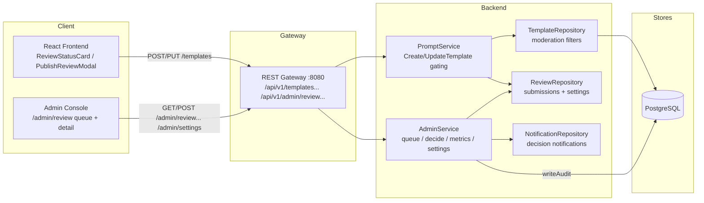
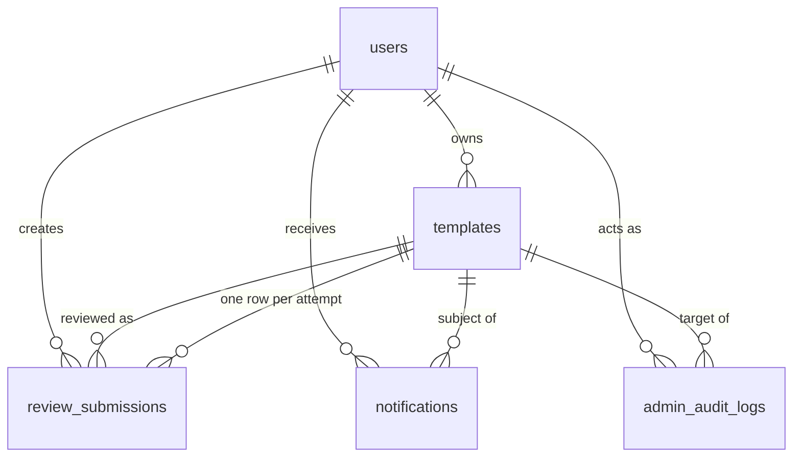

# Pre-Publication Review — Architecture Design

| | |
|---|---|
| **Feature ID** | pre-publication-review |
| **Version** | 1.0 |
| **Status** | Approved for implementation |
| **Author** | Architect Agent |
| **Upstream** | [Requirements](../design/pre-publication-review-requirements.md), [UI/UX Design](../design/pre-publication-review-ui-ux-design.md) |
| **Downstream** | [Detailed Design](pre-publication-review-detailed-design.md) |

## 1. Overview

Pre-publication review gates the *first publishes* of new creators: creators
with fewer than N approved templates (default 3) have each publish enter
`in_review` instead of going live; creators at or above the threshold publish
instantly. A moderation takedown re-gates the creator (next M publishes,
default 3). Gated templates are invisible to everyone except their creator
and admins — excluded from search, feeds, public profiles, and direct URLs
(404-equivalent) — but stay editable. Moderators work a FIFO queue at
`/admin/review` with aging escalation (>48h floats to the top), resubmission
chains, fixed-list rejection reasons, audit logging, and in-app decision
notifications. N and M are admin-configurable platform settings (no deploy
needed).

The design reuses established patterns: the `moderation_status` column
concept from the (designed, not yet implemented) admin-template-moderation
feature — this feature *introduces* the column with a narrower CHECK
(`normal`/`in_review`/`rejected`) that moderation later widens; the
`writeAudit` + `requireAdminContext` admin-service shape; the
`createEngagementNotification` best-effort notification hook; the
`buildTemplateConditions` banned-owner hiding pattern (extended to
moderation status with an owner bypass); and the `/api/v1/admin/{resource}`
gateway branch style.

### 1.1 Resolved Open Questions

| # | Question (from requirements §10) | Decision |
|---|---|---|
| 1 | Gating state computed on the fly vs. denormalized | **Denormalized counters on `users`: `approved_template_count` + `review_gated_remaining`.** Gated iff `approved_template_count < N OR review_gated_remaining > 0`. Maintained transactionally at decision time (approval increments the count; takedown/ban sets the re-gate counter). Backfill: `approved_template_count` = count of the owner's public templates at migration time. Two integer columns beat a `trust_level` enum — thresholds stay admin-tunable without schema changes (NFR-5). |
| 2 | Separate `review_submissions` table vs. reusing `moderation_actions` | **Separate `review_submissions` table.** One row per attempt: `UNIQUE(template_id, attempt_number)` gives the resubmission chain for free (chain = all rows sharing `template_id` ordered by `attempt_number`); queue queries stay single-table; `moderation_actions` does not exist yet and audit logs are not a queue. |
| 3 | `in_review` templates on the creator's public profile | **Excluded for non-owners; visible to the owner with status badges.** Others never see them anywhere (no count discrepancy is possible — the templates are simply absent from every public surface). The owner sees their own gated templates in their Home "your templates" mixed view with an "In review"/"Rejected" badge, mirroring the existing banned-owner owner-bypass. |
| 4 | Creator banned mid-review | **Submission stays in the queue; no auto-reject.** The queue detail shows an "author banned" flag so the moderator can decide with full context. Auto-rejecting would be a silent rejection (violates NFR-4); the banned owner cannot authenticate to see any decision anyway. |
| 5 | Aging escalation mechanism | **Computed sort key, no ticker.** `ORDER BY (submitted_at < now() - interval '48 hours') DESC, submitted_at ASC` — aging is derived at read time, always correct, zero background jobs. The Aging filter tab adds `WHERE submitted_at < now() - interval '48 hours'`. Index `(status, submitted_at)` serves both. |

### 1.2 Non-Goals

- Reviewing edits to already-published templates of exempt creators (FR-14
  explicitly keeps those live; reactive moderation covers them).
- Third-party / automated AI pre-screening.
- Creator-initiated expedited review requests.
- Age-restriction or content-warning gating (separate `content-warnings`
  feature).
- Email notifications (in-app only).
- **Monetization of any kind** — payments, pricing, purchases, earnings,
  sales, or paid-ranking surfaces are out of scope and excluded from this
  architecture.

## 2. System Context



## 3. Components Involved

| Component | Change |
|---|---|
| `backend/api/proto/v1/prompt.proto` | `Template` gains `moderation_status` (25) and `published_at` (26). |
| `backend/api/proto/v1/admin.proto` | 7 new RPCs on `AdminService`: `ListReviewQueue`, `GetReviewSubmission`, `ApproveReviewSubmission`, `RejectReviewSubmission`, `GetReviewMetrics`, `GetPlatformSettings`, `UpdatePlatformSetting`; new review/settings messages. |
| `backend/internal/service/prompt.go` | Gating hooks in `CreateTemplate`/`UpdateTemplate`; `templateModelToProto` maps the new fields. |
| `backend/internal/service/admin.go` | Review queue/decision/metrics/settings RPCs; `BanUser` sets the re-gate counter. |
| `backend/internal/repository/template_repository.go` | `moderation_status`/`published_at` in SELECT/INSERT/UPDATE; moderation filter with owner bypass in `Get` + `buildTemplateConditions`. |
| `backend/internal/repository/review_repository.go` | **New.** Submission CRUD, queue listing, metrics, platform settings. |
| `backend/internal/models/` | `Template.ModerationStatus/PublishedAt`; `User.ApprovedTemplateCount/ReviewGatedRemaining`; new `ReviewSubmission`, `PlatformSetting` models. |
| `backend/cmd/server/main.go` | 7 admin routes under `/api/v1/admin/review*` and `/api/v1/admin/settings` (all `requireAdmin`). |
| `frontend/src/pages/admin/ReviewPage.js`, `ReviewDetailPage.js` | **New.** Queue + detail. |
| `frontend/src/components/review/*` | **New.** `ReviewStatusCard`, `PublishReviewModal`, `QueueTable`, `QueueFilters`, `MetricsBar`, `SubmissionDetail`, `RejectDialog`. |
| `frontend/src/pages/Home.js`, `TemplateDetails.js`, `PromptCard.js`, `NotificationItem.js` | Creator surfaces: status cards, owner banner, moderation badge, new notification types. |
| `deployment/init.sql` (+ chart copy) | `review_submissions` + `platform_settings` tables; `templates`/`users` ALTERs; CHECK widenings for audit actions and notification types. |

## 4. API Design

### 4.1 Creator surface (no new endpoints)

Gating changes the *behavior* of existing endpoints, not their shape:

- `POST /api/v1/templates` (create): a gated creator's public template is
  created with `moderation_status = "in_review"` and `published_at = null`;
  the response `Template` carries `moderation_status` so the frontend can
  show the review modal. Private creates are never gated.
- `PUT /api/v1/templates/{id}` (update): the private→public transition (and
  rejected→public resubmission) of a gated creator enters review the same
  way. Edits to an `in_review`/`rejected` template remain fully allowed
  (FR-3/FR-6) — only the *publish transition* is gated.
- `GET /api/v1/templates/{id}`: non-owners receive `404` for
  `in_review`/`rejected` templates (indistinguishable from missing — no
  status leak, AC-9); the owner receives the template with its
  `moderation_status`.
- Lists/searches/profiles: gated templates are filtered out for everyone
  except the owner (who sees their own with badges).

### 4.2 Admin review queue

| Method | Path | Description |
|---|---|---|
| `GET` | `/api/v1/admin/review` | Queue (FR-8): oldest-first with aging-first ordering (FR-13). Query: `category`, `aging` (bool), `resubmission_only` (bool), `page`, `per_page`. |
| `GET` | `/api/v1/admin/review/metrics` | Queue metrics (FR-12): open count, median time-in-review, decisions today, rejection rate by reason. |
| `GET` | `/api/v1/admin/review/{id}` | Submission detail (FR-9): full template content, author summary, resubmission chain. |
| `POST` | `/api/v1/admin/review/{id}/approve` | Approve (FR-7, FR-11) → template published, `published_at` = now, creator notified, counts toward N. |
| `POST` | `/api/v1/admin/review/{id}/reject` | Reject (FR-5, FR-10, FR-11). Body `{reason_code, note?}`. `reason_code` required from the fixed list (`spam`, `plagiarism`, `harmful`, `lowQuality`, `other`); `note` optional ≤500 chars. |
| `GET` | `/api/v1/admin/settings` | Platform settings (review thresholds and aging window). |
| `PUT` | `/api/v1/admin/settings` | Body `{key, value, reason}` — reason-audited. |

All seven require admin auth (`requireAdmin` gateway closure /
`requireAdminContext` service check). No collisions with the 25 existing
routes.

### 4.3 Error Codes

| HTTP | gRPC | Condition |
|---|---|---|
| 400 | `INVALID_ARGUMENT` | Reject without `reason_code`; unknown reason code; note >500 chars; invalid settings key/value. |
| 401 | `UNAUTHENTICATED` | Missing/invalid admin token. |
| 403 | `PERMISSION_DENIED` | Non-admin caller on any review/settings route. |
| 404 | `NOT_FOUND` | Submission id unknown; gated template accessed by non-owner. |
| 409 | `FAILED_PRECONDITION` | Submission already decided. |

## 5. Data Model

### 5.1 New Table: `review_submissions`

```sql
CREATE TABLE IF NOT EXISTS review_submissions (
    id UUID PRIMARY KEY DEFAULT uuid_generate_v4(),
    template_id UUID NOT NULL REFERENCES templates(id) ON DELETE CASCADE,
    creator_id TEXT NOT NULL,
    attempt_number INT NOT NULL CHECK (attempt_number >= 1),
    status TEXT NOT NULL CHECK (status IN ('pending', 'approved', 'rejected')),
    submitted_at TIMESTAMPTZ NOT NULL DEFAULT NOW(),
    decided_at TIMESTAMPTZ,
    decided_by TEXT,
    reject_reason_code TEXT,
    reject_note TEXT,
    UNIQUE (template_id, attempt_number)
);
CREATE INDEX IF NOT EXISTS idx_review_submissions_pending
    ON review_submissions (status, submitted_at) WHERE status = 'pending';
```

The resubmission chain is all rows sharing `template_id` ordered by
`attempt_number`; the queue row renders the "(2nd)" chip from
`attempt_number`.

### 5.2 New Table: `platform_settings`

```sql
CREATE TABLE IF NOT EXISTS platform_settings (
    key TEXT PRIMARY KEY,
    value TEXT NOT NULL,
    updated_at TIMESTAMPTZ NOT NULL DEFAULT NOW()
);
```

Seeded rows: `review_approval_threshold` = `3` (N), `review_regate_count` =
`3` (M), `review_aging_hours` = `48`. Read through a 60-second in-process
cache; writes invalidate it.

### 5.3 Column additions (idempotent, both init.sql copies)

- `templates.moderation_status TEXT NOT NULL DEFAULT 'normal'` CHECK in
  (`normal`, `in_review`, `rejected`) — the admin-template-moderation
  feature later widens this CHECK with its states via the established
  `pg_get_constraintdef` guard pattern.
- `templates.published_at TIMESTAMPTZ` (null until first approval; backfill
  `= created_at` for existing public templates).
- `users.approved_template_count INT NOT NULL DEFAULT 0` (backfill = count
  of owner's public templates).
- `users.review_gated_remaining INT NOT NULL DEFAULT 0`.

### 5.4 CHECK widenings (guarded, idempotent)

- `admin_audit_logs.action` += `review_approve`, `review_reject`;
  `target_type` += `template`.
- `notifications.type` += `template_approved`, `template_rejected`.

### 5.5 Entity relationships



## 6. Auth & Authorization

- All review/settings routes sit behind `requireAdmin` (gateway) and
  `requireAdminContext` (service) — role=admin AND scope=admin, identical to
  the existing admin console endpoints.
- Creator gating checks derive the user from the auth context, never the
  request body (existing `GetUserIDFromContext` pattern).
- Decisions are attributable: `writeAudit` records actor id/email, action
  (`review_approve`/`review_reject`), target (`template`, template id), and
  reason (rejection: reason code + note; approval: fixed text) — satisfying
  NFR-3.
- Hidden-template semantics: non-owners get `404`, never `403`, for
  `in_review`/`rejected` templates so existence is not leaked (AC-9).

## 7. Frontend

- **Creator (user-dashboard is designed but not implemented — the Home page
  is the creator's own-template surface):**
  - `ReviewStatusCard` on Home above the template grid: one card per own
    `in_review`/`rejected` template (status icon, title, submitted time,
    expected window, View/Edit actions; rejected shows the reason and a
    "Fix and resubmit" CTA).
  - `PublishReviewModal` after a gated publish (triggered when the
    create/update response carries `moderation_status = "in_review"`).
  - `TemplateDetails` owner banner for rejected templates (reason + CTA).
  - `PromptCard` moderation badge for own gated templates.
- **Admin console:** `/admin/review` (MetricsBar + QueueFilters tabs
  All/Aging/Resubmissions + category select + QueueTable) and
  `/admin/review/:id` (SubmissionDetail + RejectDialog; keyboard `A`
  approve, `R` reject, `→` advance, `j`/`k` in the list). AdminLayout nav
  gains a Review entry.
- **Notifications:** `NotificationItem` renders the two new types with
  actor-less sentences (`review.notify.approved`/`review.notify.rejected`).
- **i18n:** `review.*` keys verbatim from UI/UX §8, EN/ZH parity.

## 8. Configuration

| Setting | Default | Description |
|---|---|---|
| `review_approval_threshold` | `3` | N — approved templates needed to skip review. |
| `review_regate_count` | `3` | M — publishes re-gated after a moderation takedown. |
| `review_aging_hours` | `48` | Queue age after which submissions float to the top. |

All three live in `platform_settings` (admin-editable at runtime, NFR-5) —
no environment variables, no redeploys. The 60s read cache bounds staleness.

## 9. Security & Privacy Considerations

- **No status leaks:** gated templates 404 for non-owners on every path —
  detail, list, search, profile, fork source, comments, and the SDK's
  `get_template`/`get_prompt_by_alias` (they all flow through the same
  repository visibility rules).
- **Abuse resistance:** re-gating after takedowns (M) and after ban
  (US-8 — `BanUser` sets `review_gated_remaining = M`) prevents evasion via
  new templates.
- **Auditability:** every decision writes an immutable audit row; approvals
  and rejections alike.
- **Injection:** parameterized SQL only; reason codes validated against a
  server-side whitelist; sort/filter values never reach SQL text.
- **Transparency (NFR-4):** every decision notifies the creator; rejection
  notifications always carry the reason.

## 10. Deployment Notes

- DDL is additive and idempotent; both `deployment/init.sql` and
  `deployment/chart/open-prompts/init.sql` updated byte-identically in the
  same commit. CHECK widenings use the `pg_get_constraintdef` guard.
- Backfills (approved counts, published_at) run inside the same guarded
  DO-blocks — safe on fresh and existing databases.
- No new services, ports, or infrastructure; no chart changes beyond the
  init.sql ConfigMap content.
- `backend/server` is a tracked build artifact — never commit changes to it.

## 11. Test Strategy

- **FVT** (`tests/fvt.py`): `test_pre_publication_review` — new creator
  gated → invisible (anonymous, second user, direct URL) → queue
  oldest-first + aging → approve → visible + `published_at` + notification →
  reject without reason 400 → rejected invisible + reason notification →
  resubmit "(2nd)" → metrics → exempt creator instant publish → settings
  GET/PUT. Covers AC-1..10.
- **Unit:** gating decision matrix (threshold, re-gate counter, exempt),
  repository queue ordering (aging-first, FIFO), settings cache
  invalidation, service validation matrix.
- **E2E** (test-agent): queue table/filters/metrics rendering, reject
  dialog disabled-until-reason, keyboard shortcuts, creator status cards,
  notification rendering, i18n EN/ZH parity.

## 12. Performance & Caching

- **NFR-1 (500ms p95 @ 1k open):** queue queries are single-table with a
  partial index on `(status, submitted_at) WHERE status = 'pending'`; the
  aging sort key is computed in `ORDER BY`, not stored.
- **NFR-2 (Fairness):** FIFO ordering with computed aging escalation; since
  aging is derived at read time, submissions past the window are *always*
  floated to the top of the queue (and the Aging tab) — the 72-hour
  escalation-visibility guarantee holds with no background job.
- **NFR-6 (10k open):** keyset-friendly ordering + `LIMIT/OFFSET`
  pagination (same as the admin console's existing lists); the partial
  index keeps the pending set small to scan.
- **Settings cache:** 60s in-process TTL; decisions read settings once per
  call; no per-request settings queries on the hot publish path beyond the
  cached values.
- **Gating check cost:** two integer columns read on the user row the
  publish path already loads — no extra query for the common exempt case
  beyond the user fetch.
