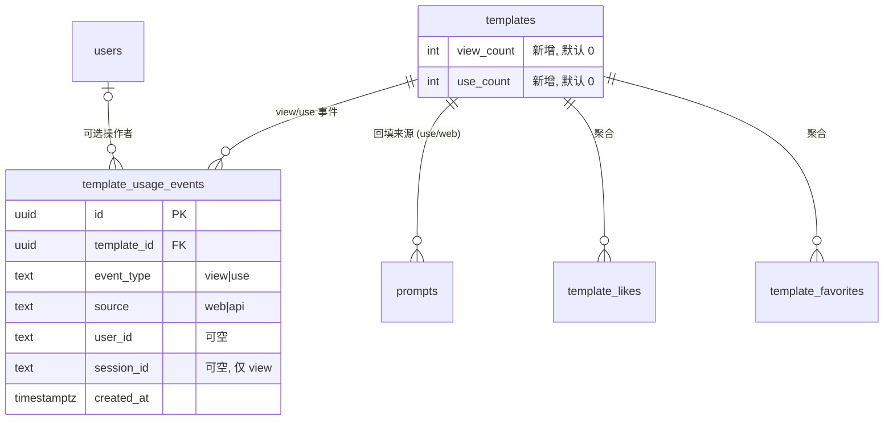

# 提示词分析 — 架构设计

| | |
|---|---|
| **Feature ID** | prompt-analytics |
| **Version** | 1.0 |
| **Status** | Approved for implementation |
| **Author** | Architect Agent |
| **Upstream** | [需求文档](../design/prompt-analytics-requirements-zh-CN.md), [UI/UX 设计](../design/prompt-analytics-ui-ux-design-zh-CN.md) |
| **Downstream** | [详细设计](prompt-analytics-detailed-design-zh-CN.md) |

## 1. 概述

提示词分析补上平台最大的度量空白。当前只有点赞和收藏可见；浏览量完全没有
记录，提示词实例化（`prompts` 表）与 API 别名获取作为指标不可见，创作者没有
仪表盘。本特性新增：

1. **事件采集** —— 一张极简的 `template_usage_events` 表记录 `view` 与
   `use` 事件（来源 `web`/`api`），全部在关键路径之外写入。
2. **公开计数** —— `templates` 上反规范化的 `view_count`/`use_count`，
   在详情页对所有访客展示。
3. **创作者仪表盘** —— `/analytics` 页面：KPI 卡片（含上一周期环比增量）、
   每日 SVG 图表、web/API 来源拆分、Top-10 模板表，支持 7/30/90 天范围。
4. **作者统计** —— 模板详情页上仅作者可见的统计区块。

点赞与收藏**直接从既有 `template_likes` / `template_favorites` 表聚合**
（两表均有 `created_at`）；不为它们引入重复事件。

本设计复用既有模式：Redis 固定窗口限流（`checkCommentRate` 形状）、网关
`/api/v1/templates/{id}/{subresource}` 分支风格、事务性计数维护约定，以及
懒加载路由 + 鉴权守卫的前端模式。

### 1.1 已决开放问题

| # | 问题 | 决策 |
|---|---|---|
| D-1 | 点赞/收藏时间戳 | **已确认。** `template_likes.created_at` 与 `template_favorites.created_at` 存在，索引足以支撑范围聚合；时间序列直接从这两张表聚合。 |
| D-2 | 历史使用量回填 | **通过幂等 `INSERT ... SELECT` 从 `prompts` 回填 `use` 事件**（每行 `prompts` 一条 `use`/`web` 事件，逐行 `NOT EXISTS` 守卫），随后从事件表收敛 `templates.use_count`。首日图表即有数据；`view_count` 从 0 开始（无历史浏览数据 —— 已接受）。 |
| D-4 | 汇总表/保留策略 | **v1 不做汇总表。** 原始事件不分区存储，配覆盖索引。已记录的未来路径：由定时任务维护 `template_usage_daily` 汇总表，原始事件 180 天后清理，读取切换到汇总表。现在不为其建任何 schema。 |
| D-5 | 图表库 | **自研轻量 SVG 组件**（DailyChart、Sparkline）。不新增前端依赖。 |
| D-6 | 会话 id | **localStorage 中的 `op_analytics_sid` UUID**，首次访问时创建；作为 view 事件的 `session_id` 发送；绝不与第三方共享。 |
| D-9 | 限流机制 | **服务层 Redis 固定窗口、按 IP**（键 `tpl_event_rate:{ip}`，默认 60/分钟，可用环境变量调节），复用既有 `checkCommentRate` 模式与网关 `x-client-ip` metadata 约定。Redis 故障时 fail-open。 |
| FR-23 | 非法 `days` | **HTTP 400 / `InvalidArgument`。** 仅接受 7、30、90；契约显式且可测试。前端对畸形 URL 值在调用前自行回退到 30。 |
| — | 浏览去重机制 | **Redis `SET NX` 风格键 + 30 分钟 TTL**（`tpl_view_dedup:{template_id}:{session_key}`）；Redis 不可用时回退到事件表上的索引存在性检查。 |
| — | use 事件埋点位置 | 网关 `POST /api/v1/prompts` 处理器绕过 `PromptService.CreatePrompt`（直接调用 `promptRepo.Create`），因此**由网关处理器在创建成功后用 goroutine 记录 `use` 事件**；别名 GET 处理器在 `GetPromptByAlias` 成功后同样处理。见 §4.3。 |
| — | `formatCount` 阈值 | EN：从 1,000 起紧凑显示（`1.2k`、`15.4k`、`2.1M`）；ZH：从 10,000 起紧凑显示（`1.2万`）；阈值以下用本地化千分位分隔符。解决 UI 文档的两种表述。 |

### 1.2 非目标

- 平台级/管理员分析（admin-user-management 的管理仪表盘已展示平台 KPI）。
- 地域、来源站点、设备拆分；超出浏览→使用比率的转化漏斗；按版本分析；
  实时流式。
- 邮件摘要、CSV 导出、A/B 测试。
- PromptCard 上展示浏览量（v1 仅详情页）。
- 事件保留/汇总任务（仅作为已记录的未来工作）。
- 带聚合统计的公开创作者主页。
- **任何形式的商业化** —— 支付、定价、购买、收益、销售、付费排名等均不在范围内，已从本架构中剔除。

## 2. 系统上下文

```mermaid
flowchart LR
    subgraph Client
        FE[React 前端<br/>AnalyticsPage / TemplateDetails]
    end
    subgraph Gateway
        GW[REST 网关 :8080<br/>/api/v1/templates/... /events /stats<br/>/api/v1/analytics/overview<br/>POST /api/v1/prompts (埋点)<br/>GET .../aliases/{a} (埋点)]
    end
    subgraph Backend
        PS[PromptService<br/>RecordTemplateEvent / RecordUseEvent<br/>GetTemplateStats / GetCreatorStats]
        AR[AnalyticsRepository<br/>事件写入 + 聚合]
        RD[(Redis<br/>去重 + 限流)]
    end
    subgraph Storage
        PG[(PostgreSQL<br/>template_usage_events<br/>templates.view/use_count)]
    end
    FE -->|POST events type=view| GW
    FE -->|GET stats / overview| GW
    GW --> PS
    PS --> AR
    PS --> RD
    AR --> PG
```

## 3. 涉及组件

| 层 | 组件 | 变更 |
|---|---|---|
| proto | `backend/api/proto/v1/prompt.proto` | 3 个新 RPC、10 个新消息、`Template` 字段 23/24 |
| repository | `backend/internal/repository/analytics_repository.go`（新增） | 事件写入、去重检查、每日序列、来源拆分、Top 模板、计数器自增 |
| service | `backend/internal/service/prompt.go` | `RecordTemplateEvent`、`RecordUseEvent`、`GetTemplateStats`、`GetCreatorStats`；Redis 去重 + 限流 |
| service | `backend/internal/service/auth.go` | 将 `RecordTemplateEvent` 加入 `publicRpcMethods` |
| gateway | `backend/cmd/server/main.go` | `POST /templates/{id}/events`、`GET /templates/{id}/stats`、`GET /api/v1/analytics/overview`；`POST /api/v1/prompts` 与别名 GET 中的 use 事件埋点 |
| models | `backend/internal/models/template.go` | `ViewCount`、`UseCount` 字段 |
| DB | `deployment/init.sql` + `deployment/chart/open-prompts/init.sql` | `template_usage_events` 表、3 个索引、`templates` ALTER、use 事件回填 |
| frontend | `frontend/src/pages/AnalyticsPage.js`（新增） | 仪表盘页面 |
| frontend | `frontend/src/components/analytics/*`（新增） | KpiCard、DailyChart、SourceSplit、TopTemplatesTable、RangeSelector、OwnerStatsSection、PublicCounters、Sparkline |
| frontend | `frontend/src/App.js`、`Sidebar.js`、`TemplateDetails.js`、`services/api.js`、`utils/formatCount.js`、语言包 | 路由、导航、计数器、API 客户端、格式化、i18n |

## 4. API 设计

### 4.1 gRPC 面（PromptService）

| RPC | 输入 | 输出 | 鉴权 |
|---|---|---|---|
| `RecordTemplateEvent` | template_id, event_type, session_id | 空确认 | 公开（允许匿名；身份可选） |
| `GetTemplateStats` | template_id, days | 当前 + 上一周期汇总、每日序列、来源拆分 | 仅作者 |
| `GetCreatorStats` | days | 当前 + 上一周期汇总、每日序列、来源拆分、Top 模板、template_count | 任意已登录用户 |

`days` 仅接受 7、30、90；其他值 → `InvalidArgument`。

### 4.2 REST 面

| 方法 | 路径 | 鉴权 | 成功 | 说明 |
|---|---|---|---|---|
| POST | `/api/v1/templates/{id}/events` | 允许匿名 | 200 `{}` | 请求体 `{"type":"view","session_id":"..."}`；限流 60/分钟/IP → 429 + `Retry-After` |
| GET | `/api/v1/templates/{id}/stats?days=30` | Bearer JWT | 200 | 仅作者；非作者 → 403 |
| GET | `/api/v1/analytics/overview?days=30` | Bearer JWT | 200 | 调用者自己的聚合数据 |

use 事件**不可**由客户端调用：它们在 web 创建路径与 API 别名获取路径内部由
服务端记录（见 §4.3）。

### 4.3 埋点位置（use 事件）

- **Web：** 网关 `POST /api/v1/prompts` 处理器（如今绕过
  `PromptService.CreatePrompt`、直接调用 `promptRepo.Create`）在创建成功后
  启动 `go svc.RecordUseEvent(ctx, templateID, ownerID, "web")`。响应路径
  不受影响。
- **API：** 网关 `GET /api/v1/templates/{id}/aliases/{alias}` 处理器在
  `GetPromptByAlias` 成功后启动 goroutine。goroutine 内部可选地校验
  `Authorization` 头（`ApiKey sk-...` 或 `Bearer`）以归属 `user_id`；校验
  失败则忽略（别名端点本身公开，事件仍以空 `user_id` 记录）。来源为
  `api`。

两个埋点均为 fire-and-forget：错误只记日志、绝不暴露给调用方，也绝不使用户
可见操作失败（FR-7）。

### 4.4 错误码

| 条件 | gRPC 码 | HTTP |
|---|---|---|
| 请求体非法 / `event_type` ≠ `view` / `days` ∉ {7,30,90} | `InvalidArgument` | 400 |
| stats/overview 缺少或无效 token | `Unauthenticated` | 401 |
| 被封禁调用方；非作者请求 stats | `PermissionDenied` | 403 |
| 模板不存在（或私有模板非作者） | `NotFound` | 404 |
| 事件限流超限 | `ResourceExhausted`（"retry after N seconds"） | 429 + `Retry-After` |

## 5. 数据模型

### 5.1 ER



### 5.2 DDL（幂等；应用于两份 init.sql 副本）

```sql
CREATE TABLE IF NOT EXISTS template_usage_events (
    id UUID PRIMARY KEY DEFAULT uuid_generate_v4(),
    template_id UUID NOT NULL REFERENCES templates(id) ON DELETE CASCADE,
    event_type TEXT NOT NULL CHECK (event_type IN ('view', 'use')),
    source TEXT NOT NULL CHECK (source IN ('web', 'api')),
    user_id TEXT REFERENCES users(id) ON DELETE SET NULL,
    session_id TEXT,
    created_at TIMESTAMPTZ NOT NULL DEFAULT NOW()
);

CREATE INDEX IF NOT EXISTS idx_tue_template_created
    ON template_usage_events(template_id, created_at);
CREATE INDEX IF NOT EXISTS idx_tue_user_created
    ON template_usage_events(user_id, created_at);
CREATE INDEX IF NOT EXISTS idx_tue_view_dedup
    ON template_usage_events(template_id, session_id, created_at)
    WHERE event_type = 'view';

DO $$
BEGIN
    IF NOT EXISTS (SELECT 1 FROM information_schema.columns
                   WHERE table_name = 'templates' AND column_name = 'view_count') THEN
        ALTER TABLE templates ADD COLUMN view_count INT NOT NULL DEFAULT 0;
        COMMENT ON COLUMN templates.view_count IS 'Denormalized view count (async maintained)';
    END IF;
    IF NOT EXISTS (SELECT 1 FROM information_schema.columns
                   WHERE table_name = 'templates' AND column_name = 'use_count') THEN
        ALTER TABLE templates ADD COLUMN use_count INT NOT NULL DEFAULT 0;
        COMMENT ON COLUMN templates.use_count IS 'Denormalized use count (async maintained)';
    END IF;
END $$;
```

### 5.3 回填（D-2，幂等）

```sql
-- 每行 prompts 一条历史 use/web 事件；逐行守卫使其可安全重跑，
-- 且在已有线上事件时依然安全。
INSERT INTO template_usage_events (template_id, event_type, source, user_id, created_at)
SELECT p.template_id, 'use', 'web', p.owner_id, p.created_at
FROM prompts p
WHERE NOT EXISTS (
    SELECT 1 FROM template_usage_events e
    WHERE e.event_type = 'use' AND e.template_id = p.template_id
      AND e.user_id IS NOT DISTINCT FROM p.owner_id
      AND e.created_at = p.created_at
);

-- 从事件表收敛反规范化计数器。
UPDATE templates t
SET use_count = sub.c
FROM (SELECT template_id, COUNT(*) AS c
      FROM template_usage_events WHERE event_type = 'use'
      GROUP BY template_id) sub
WHERE t.id = sub.template_id AND t.use_count <> sub.c;
```

`view_count` 无历史来源，从 0 开始。

### 5.4 写路径

每接受一个事件：一条 `INSERT` 进 `template_usage_events`，加一条计数器
`UPDATE templates SET view_count/use_count = view_count/use_count + 1`。
计数器与事件表最终一致（NFR-5）；事件表是时间序列的事实来源。

## 6. 鉴权与授权

| 面 | 规则 |
|---|---|
| `POST /templates/{id}/events` | 允许匿名。模板必须存在且公开（或调用者是作者）；否则 `NotFound`（不泄露存在性）。可选 `Authorization` 头用于归属 `user_id`。按 IP 限流。 |
| `GET /templates/{id}/stats` | 需要 Bearer JWT。被封禁 → 403。模板不存在或私有模板非作者 → 404；公开模板非作者 → 403（AC-9）。 |
| `GET /analytics/overview` | 需要 Bearer JWT。被封禁 → 403。始终是调用者自己的模板；无跨用户访问，管理员亦无例外（FR-26）。 |
| use 事件埋点 | 服务端内部；无客户端输入。 |

`RecordTemplateEvent` 加入 `publicRpcMethods`，使裸 gRPC 调用方与网关的
匿名允许行为一致。

## 7. 前端

- **路由：** `App.js` 中的 `/analytics`，懒加载、鉴权守卫
  （`!token → navigate('/login')`），范围镜像到 `?range=7|30|90`。
- **侧边栏：** 已登录区的 "数据分析" 项，位于 "我的收藏" 之下、分类区之上。
- **TemplateDetails：** 既有统计行中的公开浏览/使用计数（所有访客可见）；
  作者统计区块（计数器、浏览→使用比率、30 天迷你图）仅在 `isOwner` 时渲染；
  浏览事件每次挂载经 `useEffect` + ref 守卫触发一次（StrictMode 安全），
  会话 id 取自 localStorage `op_analytics_sid`，`catch(() => {})`。
- **组件：** `KpiCard`、`DailyChart`（自研 SVG、指标切换、无障碍表格视图）、
  `SourceSplit`、`TopTemplatesTable`、`RangeSelector`（分段控件）、
  `OwnerStatsSection`、`PublicCounters`、`Sparkline` —— 仅用 design token
  样式，适配两套主题。
- **i18n：** `analytics.*` 命名空间，EN/ZH 键集完全一致（AC-11）。
- **格式化：** 共享 `formatCount` 工具（EN 从 1,000 起紧凑；ZH 从 10,000 起
  紧凑；阈值以下本地化分隔符）。

## 8. 配置

| 环境变量 | 默认值 | 用途 |
|---|---|---|
| `TEMPLATE_EVENT_RATE_PER_MINUTE` | `60` | 按 IP 的浏览事件限流（fail-open） |

按既有 `KEY: ${KEY:-default}` 模式接入 `deployment/docker-compose.yml`、
`deployment/chart/open-prompts/values.yaml` 与后端部署清单。

## 9. 安全与隐私

- 事件不存储提示词内容、变量或除可选用户 id 与随机客户端会话 id 之外的
  任何 PII（NFR-3）；`user_id` 在用户删除时 `SET NULL`，计数得以保留。
- 所有聚合 SQL 均参数化；无字符串拼接。
- 统计端点在服务端强制归属权校验；客户端 `isOwner` 检查仅为 UX。
- 事件端点校验模板存在性并限流；浏览去重防止计数膨胀。
- 分析数据绝不向第三方暴露。

## 10. 部署说明

- DDL + 回填进入**两份** `deployment/init.sql` 与
  `deployment/chart/open-prompts/init.sql`（保持字节一致），与代码同一变更。
- 部署顺序：**先**应用 DDL/回填、**再**启动新二进制，使回填守卫看不到
  线上 `use` 事件、历史提示词恰好导入一次。迁移可安全重跑（逐行守卫）。
- 无迁出数据；回滚即删除新表/新列。

## 11. 测试策略

- **单元：** days 校验；事件类型校验；去重逻辑（Redis 命中、Redis 故障 →
  DB 回退）；限流窗口计算；增量计算输入（当前/上一周期汇总）；
  `formatCount` 边界（999、1000、9999、10000、1M；ZH 万级边界）。
- **FVT（`tests/fvt.py`，`test_template_analytics`）：** 浏览事件记录 +
  30 分钟内去重；经 `POST /api/v1/prompts` 的 web 使用；带 API key 的别名
  GET 的 API 使用；公开计数可见；作者 stats 200 vs 非作者 403 vs 匿名 401；
  overview KPI/序列/Top 列表；非法 `days` → 400；限流 → 429。
- **组件：** KpiCard/RangeSelector/TopTemplatesTable 渲染 + 无障碍；
  AnalyticsPage 加载 → 就绪、范围切换、空状态。
- **回归：** 点赞/收藏计数与流程不变（AC-12）。

## 12. 性能与缓存

- use 事件写入为 goroutine fire-and-forget：对 `POST /api/v1/prompts` 与
  别名 GET 响应**零附加延迟**。
- 浏览事件是独立的 beacon 请求，页面加载从不等待它；服务端路径为一次
  Redis 检查 + 一次 INSERT + 一次 UPDATE（进程内 p99 < 5 ms，NFR-1）。
- 读取：按 `GROUP BY date_trunc('day', ...)` 做每日聚合，走
  `(template_id, created_at)` / owner-join 变体索引；对拥有 ≤1,000 个模板、
  ≤1M 条事件的创作者 p95 < 800 ms（NFR-1）。
- v1 不加缓存层；仪表盘是私有低流量页面。若列表页将来需要按 `view_count`
  排序，届时再加复合索引。
- 汇总路径（未来，D-4）：由 cron 维护
  `template_usage_daily(template_id, day, views, uses)`；原始事件 180 天后
  清理；读取切换到汇总表，API 不变。
