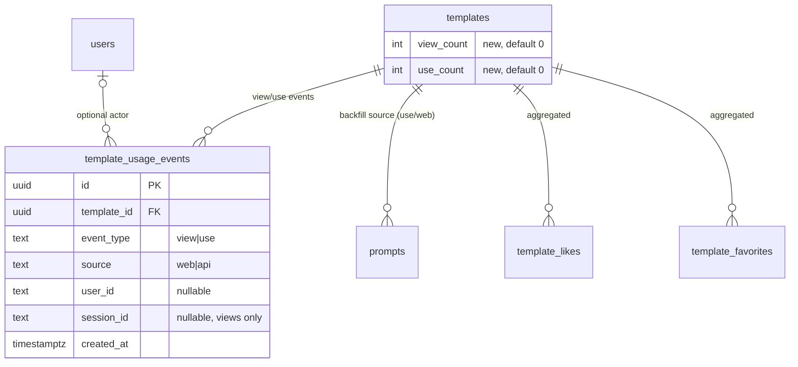

# Prompt Analytics — Architecture Design

| | |
|---|---|
| **Feature ID** | prompt-analytics |
| **Version** | 1.0 |
| **Status** | Approved for implementation |
| **Author** | Architect Agent |
| **Upstream** | [Requirements](../design/prompt-analytics-requirements.md), [UI/UX Design](../design/prompt-analytics-ui-ux-design.md) |
| **Downstream** | [Detailed Design](prompt-analytics-detailed-design.md) |

## 1. Overview

Prompt analytics closes the platform's biggest measurement gap. Today only
likes and favorites are visible; views are not tracked at all, prompt
instantiations (`prompts` table) and API alias fetches are invisible as
metrics, and creators have no dashboard. This feature adds:

1. **Event capture** — a minimal `template_usage_events` table records `view`
   and `use` events (source `web`/`api`), written off the critical path.
2. **Public counters** — denormalized `view_count`/`use_count` on
   `templates`, shown to every visitor on the detail page.
3. **Creator dashboard** — `/analytics` page with KPI cards (with
   previous-range deltas), a daily SVG chart, a web/API source split, and a
   top-10 templates table, over a 7/30/90-day range.
4. **Owner stats** — an owner-only stats section on the template detail page.

Likes and favorites are **aggregated from the existing `template_likes` /
`template_favorites` tables** (both carry `created_at`); no duplicate events
are introduced for them.

The design reuses established patterns: the Redis fixed-window rate limit
(`checkCommentRate` shape), the `/api/v1/templates/{id}/{subresource}`
gateway branch style, the transactional counter-maintenance convention, and
the lazy-route + auth-guard frontend pattern.

### 1.1 Resolved Open Questions

| # | Question | Decision |
|---|---|---|
| D-1 | Like/favorite timestamps | **Confirmed.** `template_likes.created_at` and `template_favorites.created_at` exist and are indexed enough for range aggregation; series are aggregated directly from these tables. |
| D-2 | Backfill historical uses | **Backfill `use` events from `prompts` via idempotent `INSERT ... SELECT`** (one `use`/`web` event per `prompts` row, per-row `NOT EXISTS` guard), then converge `templates.use_count` from the event table. Day-1 charts are populated; `view_count` starts at 0 (no historical view data exists — accepted). |
| D-4 | Rollup/retention | **No rollup in v1.** Raw events stay unpartitioned with covering indexes. The documented future path: a `template_usage_daily` rollup table maintained by a cron job, raw events pruned after 180 days, reads switching to the rollup. No schema is created for it now. |
| D-5 | Chart library | **Custom lightweight SVG components** (DailyChart, Sparkline). No new frontend dependency. |
| D-6 | Session id | **`op_analytics_sid` UUID in localStorage**, created on first visit; sent as `session_id` on view events; never shared with third parties. |
| D-9 | Rate-limit mechanism | **Redis fixed-window per IP** in the service layer (key `tpl_event_rate:{ip}`, default 60/min, env-tunable), using the existing `checkCommentRate` pattern and the gateway's `x-client-ip` metadata convention. Fail-open when Redis is down. |
| FR-23 | Invalid `days` | **HTTP 400 / `InvalidArgument`.** Only 7, 30, 90 are accepted; the contract is explicit and testable. The frontend itself falls back to 30 for malformed URL values before calling. |
| — | View dedup mechanism | **Redis `SET NX`-style key with 30-minute TTL** (`tpl_view_dedup:{template_id}:{session_key}`); when Redis is unavailable, fall back to an indexed DB existence check on the events table. |
| — | Use-event instrumentation point | The gateway `POST /api/v1/prompts` handler bypasses `PromptService.CreatePrompt` (it calls `promptRepo.Create` directly), so **the gateway handler records the `use` event in a goroutine after a successful create**; the alias GET handler does the same after a successful `GetPromptByAlias`. See §4.3. |
| — | `formatCount` thresholds | EN: compact from 1,000 (`1.2k`, `15.4k`, `2.1M`); ZH: compact from 10,000 (`1.2万`); below the threshold, locale thousands separators. Resolves the UI doc's two formulations. |

### 1.2 Non-Goals

- Platform-wide/admin analytics (the admin dashboard from
  admin-user-management already shows platform KPIs).
- Geography, referrers, device breakdowns; conversion funnels beyond the
  view→use ratio; per-version analytics; real-time streaming.
- Email digests, CSV export, A/B testing.
- PromptCard view-count display (detail page only in v1).
- Event retention/rollup jobs (documented future work only).
- Public creator profile pages with aggregate stats.
- **Monetization of any kind** — payments, pricing, purchases, earnings,
  sales, or paid-ranking surfaces are out of scope and excluded from this
  architecture.

## 2. System Context

```mermaid
flowchart LR
    subgraph Client
        FE[React Frontend<br/>AnalyticsPage / TemplateDetails]
    end
    subgraph Gateway
        GW[REST Gateway :8080<br/>/api/v1/templates/... /events /stats<br/>/api/v1/analytics/overview<br/>POST /api/v1/prompts (hook)<br/>GET .../aliases/{a} (hook)]
    end
    subgraph Backend
        PS[PromptService<br/>RecordTemplateEvent / RecordUseEvent<br/>GetTemplateStats / GetCreatorStats]
        AR[AnalyticsRepository<br/>event insert + aggregates]
        RD[(Redis<br/>dedup + rate limit)]
    end
    subgraph Storage
        PG[(PostgreSQL<br/>template_usage_events<br/>templates.view/use_count)]
    end
    FE -->|POST events type=view| GW
    FE -->|GET stats / overview| GW
    GW --> PS
    PS --> AR
    PS --> RD
    AR --> PG
```

## 3. Components Involved

| Layer | Component | Change |
|---|---|---|
| proto | `backend/api/proto/v1/prompt.proto` | 3 new RPCs, 10 new messages, `Template` fields 23/24 |
| repository | `backend/internal/repository/analytics_repository.go` (new) | Event insert, dedup check, daily series, source split, top templates, counter increments |
| service | `backend/internal/service/prompt.go` | `RecordTemplateEvent`, `RecordUseEvent`, `GetTemplateStats`, `GetCreatorStats`; Redis dedup + rate limit |
| service | `backend/internal/service/auth.go` | Add `RecordTemplateEvent` to `publicRpcMethods` |
| gateway | `backend/cmd/server/main.go` | `POST /templates/{id}/events`, `GET /templates/{id}/stats`, `GET /api/v1/analytics/overview`; use-event hooks in `POST /api/v1/prompts` and alias GET |
| models | `backend/internal/models/template.go` | `ViewCount`, `UseCount` fields |
| DB | `deployment/init.sql` + `deployment/chart/open-prompts/init.sql` | `template_usage_events` table, 3 indexes, `templates` ALTERs, use-event backfill |
| frontend | `frontend/src/pages/AnalyticsPage.js` (new) | Dashboard page |
| frontend | `frontend/src/components/analytics/*` (new) | KpiCard, DailyChart, SourceSplit, TopTemplatesTable, RangeSelector, OwnerStatsSection, PublicCounters, Sparkline |
| frontend | `frontend/src/App.js`, `Sidebar.js`, `TemplateDetails.js`, `services/api.js`, `utils/formatCount.js`, locales | Route, nav, counters, API client, formatting, i18n |

## 4. API Design

### 4.1 gRPC surface (PromptService)

| RPC | Input | Output | Auth |
|---|---|---|---|
| `RecordTemplateEvent` | template_id, event_type, session_id | empty ack | Public (anonymous allowed; optional identity) |
| `GetTemplateStats` | template_id, days | current + previous summaries, daily series, source split | Owner only |
| `GetCreatorStats` | days | current + previous summaries, daily series, source split, top templates, template_count | Any authenticated user |

`days` accepts only 7, 30, 90; anything else → `InvalidArgument`.

### 4.2 REST surface

| Method | Path | Auth | Success | Notes |
|---|---|---|---|---|
| POST | `/api/v1/templates/{id}/events` | Anonymous allowed | 200 `{}` | Body `{"type":"view","session_id":"..."}`; rate-limited 60/min/IP → 429 + `Retry-After` |
| GET | `/api/v1/templates/{id}/stats?days=30` | Bearer JWT | 200 | Owner only; non-owner → 403 |
| GET | `/api/v1/analytics/overview?days=30` | Bearer JWT | 200 | Caller's own aggregate |

Use events are **not** client-callable: they are recorded server-side inside
the web create-prompt and API alias-fetch paths (FR-22).

### 4.3 Instrumentation points (use events)

- **Web:** the gateway `POST /api/v1/prompts` handler (which today bypasses
  `PromptService.CreatePrompt` and calls `promptRepo.Create` directly) spawns
  `go svc.RecordUseEvent(ctx, templateID, ownerID, "web")` after a successful
  create. The response path is untouched.
- **API:** the gateway `GET /api/v1/templates/{id}/aliases/{alias}` handler
  spawns a goroutine after a successful `GetPromptByAlias`. Inside the
  goroutine it optionally verifies the `Authorization` header
  (`ApiKey sk-...` or `Bearer`) via `VerifyAnyToken` to attribute `user_id`;
  verification failure is ignored (the event is still recorded with an empty
  `user_id`, since the alias endpoint itself is public). Source is `api`.

Both hooks are fire-and-forget: errors are logged, never surfaced to the
caller, and never fail the user-facing operation (FR-7).

### 4.4 Error codes

| Condition | gRPC code | HTTP |
|---|---|---|
| Invalid body / `event_type` ≠ `view` / `days` ∉ {7,30,90} | `InvalidArgument` | 400 |
| Missing/invalid token on stats/overview | `Unauthenticated` | 401 |
| Banned caller; non-owner requesting stats | `PermissionDenied` | 403 |
| Template not found (or private non-owner) | `NotFound` | 404 |
| Event rate limit exceeded | `ResourceExhausted` ("retry after N seconds") | 429 + `Retry-After` |

## 5. Data Model

### 5.1 ER



### 5.2 DDL (idempotent; applied to BOTH init.sql copies)

```sql
CREATE TABLE IF NOT EXISTS template_usage_events (
    id UUID PRIMARY KEY DEFAULT uuid_generate_v4(),
    template_id UUID NOT NULL REFERENCES templates(id) ON DELETE CASCADE,
    event_type TEXT NOT NULL CHECK (event_type IN ('view', 'use')),
    source TEXT NOT NULL CHECK (source IN ('web', 'api')),
    user_id TEXT REFERENCES users(id) ON DELETE SET NULL,
    session_id TEXT,
    created_at TIMESTAMPTZ NOT NULL DEFAULT NOW()
);

CREATE INDEX IF NOT EXISTS idx_tue_template_created
    ON template_usage_events(template_id, created_at);
CREATE INDEX IF NOT EXISTS idx_tue_user_created
    ON template_usage_events(user_id, created_at);
CREATE INDEX IF NOT EXISTS idx_tue_view_dedup
    ON template_usage_events(template_id, session_id, created_at)
    WHERE event_type = 'view';

DO $$
BEGIN
    IF NOT EXISTS (SELECT 1 FROM information_schema.columns
                   WHERE table_name = 'templates' AND column_name = 'view_count') THEN
        ALTER TABLE templates ADD COLUMN view_count INT NOT NULL DEFAULT 0;
        COMMENT ON COLUMN templates.view_count IS 'Denormalized view count (async maintained)';
    END IF;
    IF NOT EXISTS (SELECT 1 FROM information_schema.columns
                   WHERE table_name = 'templates' AND column_name = 'use_count') THEN
        ALTER TABLE templates ADD COLUMN use_count INT NOT NULL DEFAULT 0;
        COMMENT ON COLUMN templates.use_count IS 'Denormalized use count (async maintained)';
    END IF;
END $$;
```

### 5.3 Backfill (D-2, idempotent)

```sql
-- One historical use/web event per prompts row; per-row guard makes it
-- safe to re-run and safe if live events already exist.
INSERT INTO template_usage_events (template_id, event_type, source, user_id, created_at)
SELECT p.template_id, 'use', 'web', p.owner_id, p.created_at
FROM prompts p
WHERE NOT EXISTS (
    SELECT 1 FROM template_usage_events e
    WHERE e.event_type = 'use' AND e.template_id = p.template_id
      AND e.user_id IS NOT DISTINCT FROM p.owner_id
      AND e.created_at = p.created_at
);

-- Converge the denormalized counter from the event table.
UPDATE templates t
SET use_count = sub.c
FROM (SELECT template_id, COUNT(*) AS c
      FROM template_usage_events WHERE event_type = 'use'
      GROUP BY template_id) sub
WHERE t.id = sub.template_id AND t.use_count <> sub.c;
```

`view_count` has no historical source and starts at 0.

### 5.4 Write path

On every accepted event: one `INSERT` into `template_usage_events` plus one
counter `UPDATE templates SET view_count/use_count = view_count/use_count + 1`.
Counters are eventually consistent with the event table (NFR-5); the event
table is the source of truth for time-series.

## 6. Auth & Authorization

| Surface | Rule |
|---|---|
| `POST /templates/{id}/events` | Anonymous allowed. Template must exist and be public (or caller is the owner); otherwise `NotFound` (no existence leak). Optional `Authorization` header attributes `user_id`. Per-IP rate limit. |
| `GET /templates/{id}/stats` | Bearer JWT required. Banned → 403. Template missing or private non-owner → 404; public non-owner → 403 (AC-9). |
| `GET /analytics/overview` | Bearer JWT required. Banned → 403. Always the caller's own templates; no cross-user access, admins get no exception (FR-26). |
| Use-event hooks | Server-internal; no client input. |

`RecordTemplateEvent` is added to `publicRpcMethods` so raw gRPC callers
match the gateway's anonymous-allowed behavior.

## 7. Frontend

- **Route:** `/analytics` in `App.js`, lazy-loaded, auth-guarded
  (`!token → navigate('/login')`), range mirrored in `?range=7|30|90`.
- **Sidebar:** "Analytics" item in the authenticated section, below
  "My Favorites", above Categories.
- **TemplateDetails:** public view/use counters in the existing stats row
  (all visitors); owner stats section (counters, view→use rate, 30-day
  sparkline) rendered only when `isOwner`; view event fired once per mount
  via `useEffect` with a ref guard (StrictMode-safe), session id from
  localStorage `op_analytics_sid`, `catch(() => {})`.
- **Components:** `KpiCard`, `DailyChart` (custom SVG, metric toggles,
  table view for a11y), `SourceSplit`, `TopTemplatesTable`,
  `RangeSelector` (segmented control), `OwnerStatsSection`,
  `PublicCounters`, `Sparkline` — token-only styling, both themes.
- **i18n:** `analytics.*` namespace, EN/ZH key sets identical (AC-11).
- **Formatting:** shared `formatCount` util (EN compact ≥1,000; ZH compact
  ≥10,000; locale separators below).

## 8. Configuration

| Env var | Default | Purpose |
|---|---|---|
| `TEMPLATE_EVENT_RATE_PER_MINUTE` | `60` | Per-IP view-event rate limit (fail-open) |

Wired in `deployment/docker-compose.yml`, `deployment/chart/open-prompts/values.yaml`,
and the backend deployment manifest, following the existing
`KEY: ${KEY:-default}` pattern.

## 9. Security & Privacy

- Events store no prompt content, variables, or PII beyond an optional user
  id and a random client session id (NFR-3); `user_id` is `SET NULL` on user
  deletion so counts survive.
- All aggregation SQL is parameterized; no string interpolation.
- Stats endpoints enforce ownership server-side; the client `isOwner` check
  is UX only.
- The event endpoint validates template existence and is rate-limited;
  view dedup prevents counter inflation.
- Analytics data is never exposed to third parties.

## 10. Deployment Notes

- DDL + backfill go into **both** `deployment/init.sql` and
  `deployment/chart/open-prompts/init.sql` (kept byte-identical) in the same
  change as the code.
- Deploy order: apply DDL/backfill **before** starting the new binary, so
  the backfill guard sees no live `use` events and historical prompts are
  imported exactly once. Re-running the migration is safe (per-row guard).
- No data migration out; no rollback beyond dropping the new table/columns.

## 11. Test Strategy

- **Unit:** days validation; event-type validation; dedup logic (Redis hit,
  Redis down → DB fallback); rate-limit window math; delta computation
  inputs (current/previous summaries); `formatCount` boundaries (999, 1000,
  9999, 10000, 1M; ZH 万 boundaries).
- **FVT (`tests/fvt.py`, `test_template_analytics`):** view event recorded +
  deduped within 30 min; web use via `POST /api/v1/prompts`; API use via
  alias GET with API key; public counters visible; owner stats 200 vs
  non-owner 403 vs anonymous 401; overview KPIs/series/top list; invalid
  `days` → 400; rate limit → 429.
- **Component:** KpiCard/RangeSelector/TopTemplatesTable render + a11y;
  AnalyticsPage loading → loaded, range switch, empty states.
- **Regression:** like/favorite counts and flows unchanged (AC-12).

## 12. Performance & Caching

- Use-event writes are goroutine-fire-and-forget: **zero added latency** to
  `POST /api/v1/prompts` and alias GET responses.
- View events are a separate beacon request the page load never awaits;
  server path is one Redis check + one INSERT + one UPDATE (p99 < 5 ms
  in-process, NFR-1).
- Reads: daily aggregation `GROUP BY date_trunc('day', ...)` over
  `(template_id, created_at)` / owner-join variants; p95 < 800 ms for a
  creator with ≤1,000 templates and ≤1M events (NFR-1).
- No cache layer in v1; the dashboard is private and low-traffic. If list
  pages later need `view_count` sorting, add a composite index then.
- Rollup path (future, D-4): `template_usage_daily(template_id, day, views,
  uses)` maintained by cron; raw events pruned after 180 days; reads switch
  to the rollup with no API change.
