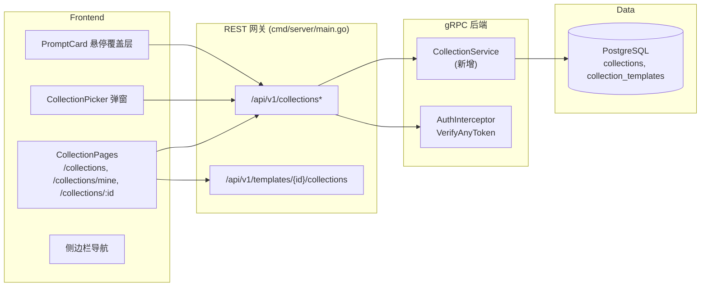
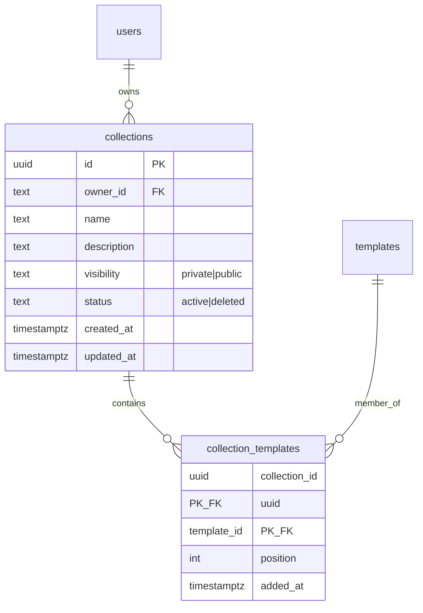

# 模板合集 — 架构设计

| | |
|---|---|
| **功能 ID** | template-collections |
| **版本** | 1.0 |
| **状态** | 已批准 |
| **作者** | Architect Agent |
| **上游** | [需求文档](../design/template-collections-requirements-zh-CN.md) · [UI/UX 设计](../design/template-collections-ui-ux-design-zh-CN.md) |
| **下游** | [详细设计](template-collections-detailed-design-zh-CN.md) · Developer Agent |

## 1. 概述

模板合集（Template Collections）让任何已登录用户可以策划有序的模板集合（"合集"），保持私有或公开发布，并浏览他人策划的合集。合集是一个一等公民的用户自有资源——类似收藏，但有序、可命名、可描述、可发布、可通过稳定 URL 分享。

合集是读多写少的：成员从模板详情页或卡片悬停时逐个添加，偶尔重排，由策划者、访客和匿名浏览者读取。因此本设计保持数据模型简单（两张表，无反规范化计数器），`template_count` 在读取时计算，公开/私有成员过滤在 SQL 层完成。

### 已解决的开放问题

| # | 问题（需求文档 §10） | 决策 |
|---|---|---|
| 1 | 新建 `CollectionService` 还是挂在 `PromptService` 上 | **新建 `CollectionService`**，放在新的 `backend/api/proto/v1/collection.proto` 中（与 `notification.proto` 同一先例）。合集是顶层的用户自有资源，不是模板的子资源；独立服务避免 `PromptService` 膨胀，并在 `/api/v1/collections` 下获得清晰的路由。 |
| 2 | 卡片上的所有者展示 | 在 `Collection` 中内嵌 `owner` 对象（`id` + `display_name`）；前端在显示名为空时回退到本地化的"匿名创作者"。`users.display_name` 为 `NOT NULL`，因此回退仅为防御性设计。 |
| 3 | 成员载荷 | 成员复用现有 `Template` 消息（id、title、description、visibility、tags、category、计数、时间戳——列表 UI 所需的一切）。增加包装 `CollectionMember`，含 `position` 和 `is_public`，让所有者能看到被标记的私有成员。 |
| 4 | 选择器数据源 | `ListMyCollections` 返回最多 50 个合集（每用户上限），因此选择器无需搜索或分页。 |
| 5 | 封面图 | 纯 CSS 2×2 拼贴：前四个成员的首字母配确定性背景色——无图片处理，无新存储。 |
| 6 | 复制链接 | `navigator.clipboard.writeText`，非安全上下文回退到 `execCommand("copy")`。 |
| 7 | 重排语义 | 客户端发送**完整的有序模板 ID 列表**；服务端在事务中应用（删除 + 重插位置）。简单、幂等，且与"保存/放弃"UI 匹配。 |
| 8 | 排序 | 服务端排序：`newest`（`created_at DESC`）或 `most templates`（`template_count DESC`），使用现有的 offset 字符串化 `page_token` 约定。 |

### 非目标

- 不支持协作/多策划者合集（单一所有者）。
- 不支持合集的合集，不支持嵌套合集。
- 不支持合集关注/订阅通知。
- 不存在任何形式的变现——合集的创建与发布完全免费（变现不在本项目范围内）。
- v1 不支持拖拽重排（上移/下移按钮 + 显式位置输入；拖拽可后续在不改 API 的情况下叠加）。
- 不支持批量添加模板到合集。
- 不支持 AI 生成或推荐合集。

## 2. 系统上下文



匿名用户可读取公开合集（`/collections` 探索页 + `/collections/:id`）；所有变更操作和私有读取都需要有效令牌。

## 3. 涉及组件

| 层 | 组件 | 变更 |
|---|---|---|
| proto | `backend/api/proto/v1/collection.proto` | **新增。** `CollectionService` 含 10 个 RPC 及消息；重新生成 `collection.pb.go` / `collection_grpc.pb.go`。 |
| repository | `backend/internal/repository/collection_repository.go` | **新增。** `CollectionRepository` 接口 + Postgres 实现（接口模式参照 `CommentRepository`）。 |
| service | `backend/internal/service/collection.go` | **新增。** `CollectionService` 结构体：校验、鉴权、限额、软删除、成员过滤。 |
| service | `backend/internal/service/auth.go` | 在 `publicRpcMethods` 中加入 `GetCollection` + `ListPublicCollections`（匿名读取）。 |
| gateway | `backend/cmd/server/main.go` | 接线 `NewCollectionService` + gRPC 注册；新增 `/api/v1/collections` 与 `/api/v1/collections/` 处理器；在 `/api/v1/templates/` 处理器中扩展 `/collections` 子资源。 |
| frontend | `frontend/src/pages/CollectionsPage.js`、`MyCollectionsPage.js`、`CollectionDetailPage.js` | **新增**页面（懒加载）。 |
| frontend | `frontend/src/components/collections/*` | **新增：** `CollectionCard`、`CollectionHeader`、`CollectionPicker`、`ReorderList`、`PublishToggle`、`CopyLinkButton`、`CollectionEmptyState`。 |
| frontend | `frontend/src/components/PromptCard.js` | 可选 `onAddToCollection` 属性 → 悬停覆盖层"添加到合集"（触屏为 ⋯ 菜单）。 |
| frontend | `frontend/src/components/Sidebar.js` | "我的合集"（已登录，位于我的收藏下方）/"探索合集"（匿名）。 |
| frontend | `frontend/src/services/api.js` | 10 个新客户端函数。 |
| frontend | `frontend/src/App.js` | 三个懒加载路由。 |
| frontend | `frontend/src/locales/{en,zh}/translation.json` | `collections.*` 命名空间（EN/ZH）。 |
| db | `deployment/init.sql` + `deployment/chart/open-prompts/init.sql` | 追加 `collections` + `collection_templates` DDL（幂等，两个文件字节一致）。 |
| tests | `tests/fvt.py` | `test_template_collections` 覆盖 AC-1–12。 |

## 4. API 设计

### 4.1 gRPC（`v1.CollectionService`）

| RPC | 输入 → 输出 | 鉴权 | 用途 |
|---|---|---|---|
| `CreateCollection` | `CreateCollectionRequest` → `Collection` | 用户 | 创建（名称/描述/可见性）。 |
| `UpdateCollection` | `UpdateCollectionRequest` → `Collection` | 所有者 | 编辑名称/描述/可见性。 |
| `DeleteCollection` | `DeleteCollectionRequest` → `DeleteCollectionResponse` | 所有者 | 软删除（`status='deleted'`）。 |
| `GetCollection` | `GetCollectionRequest` → `Collection` | 公开* | 完整合集含成员。 |
| `ListMyCollections` | `ListMyCollectionsRequest` → `ListMyCollectionsResponse` | 用户 | 调用者的合集（状态 ≠ deleted）。 |
| `ListPublicCollections` | `ListPublicCollectionsRequest` → `ListPublicCollectionsResponse` | 公开 | 探索流，分页 + 排序。 |
| `AddTemplateToCollection` | `AddTemplateToCollectionRequest` → `AddTemplateToCollectionResponse` | 所有者 | 添加成员（幂等）。 |
| `RemoveTemplateFromCollection` | `RemoveTemplateFromCollectionRequest` → `google.protobuf.Empty` | 所有者 | 移除成员。 |
| `ReorderCollectionTemplates` | `ReorderCollectionTemplatesRequest` → `google.protobuf.Empty` | 所有者 | 应用完整有序模板 ID 列表。 |
| `ListCollectionsContainingTemplate` | `ListCollectionsContainingTemplateRequest` → `ListCollectionsContainingTemplateResponse` | 用户 | **调用者自己的**哪些合集包含某模板（选择器勾选态）。 |

\* `GetCollection` 在拦截器层是公开 RPC；服务层强制可见性：私有或已删除合集对非所有者返回 `NotFound`（与不存在无法区分——不泄露存在性）。

### 4.2 REST

| 方法 | 路径 | gRPC | 鉴权 |
|---|---|---|---|
| GET | `/api/v1/collections` | `ListPublicCollections` | 匿名 |
| POST | `/api/v1/collections` | `CreateCollection` | 用户 |
| GET | `/api/v1/collections/mine` | `ListMyCollections` | 用户 |
| GET | `/api/v1/collections/{id}` | `GetCollection` | 匿名* |
| PATCH | `/api/v1/collections/{id}` | `UpdateCollection` | 所有者 |
| DELETE | `/api/v1/collections/{id}` | `DeleteCollection` | 所有者 |
| POST | `/api/v1/collections/{id}/templates` | `AddTemplateToCollection` | 所有者 |
| DELETE | `/api/v1/collections/{id}/templates/{template_id}` | `RemoveTemplateFromCollection` | 所有者 |
| PUT | `/api/v1/collections/{id}/templates` | `ReorderCollectionTemplates` | 所有者 |
| GET | `/api/v1/templates/{template_id}/collections` | `ListCollectionsContainingTemplate` | 用户 |

\* 匿名可读公开合集；私有/已删除对非所有者 → 404。

### 4.3 错误码

| 条件 | gRPC 码 | HTTP |
|---|---|---|
| 名称缺失 / >80 字符；描述 >500；可见性非法；排序非法；重排列表含重复；位置越界 | `InvalidArgument` | 400 |
| 未认证（无令牌的变更操作） | `Unauthenticated` | 401 |
| 操作他人合集；被封禁用户 | `PermissionDenied` | 403 |
| 合集/模板不存在；非所有者读取私有合集；已删除合集 | `NotFound` | 404 |
| 合集上限（50/用户）或成员上限（100/合集）超出 | `ResourceExhausted` | 429 |
| 路由上方法不允许 | — | 405 |
| 仓储层失败 | `Internal` | 500 |

限额错误使用 `ResourceExhausted`（429）而非 `InvalidArgument`，因为它们是配额式、依赖状态的失败——与 `CreateComment` 中的限流约定一致。错误消息会写明限额与当前数量，前端可在选择器中内联展示。

## 5. 数据模型



### DDL（幂等——追加到 `deployment/init.sql` 与 `deployment/chart/open-prompts/init.sql` 两份文件）

```sql
-- ============================================
-- Template Collections
-- ============================================
DO $$
BEGIN
    IF NOT EXISTS (SELECT 1 FROM information_schema.tables
                   WHERE table_name = 'collections') THEN
        CREATE TABLE collections (
            id UUID PRIMARY KEY DEFAULT uuid_generate_v4(),
            owner_id TEXT NOT NULL REFERENCES users(id) ON DELETE CASCADE,
            name TEXT NOT NULL,
            description TEXT,
            visibility TEXT NOT NULL CHECK (visibility IN ('private','public')) DEFAULT 'private',
            status TEXT NOT NULL CHECK (status IN ('active','deleted')) DEFAULT 'active',
            created_at TIMESTAMPTZ NOT NULL DEFAULT NOW(),
            updated_at TIMESTAMPTZ NOT NULL DEFAULT NOW()
        );
    END IF;
END $$;

DO $$
BEGIN
    IF NOT EXISTS (SELECT 1 FROM information_schema.tables
                   WHERE table_name = 'collection_templates') THEN
        CREATE TABLE collection_templates (
            collection_id UUID NOT NULL REFERENCES collections(id) ON DELETE CASCADE,
            template_id UUID NOT NULL REFERENCES templates(id) ON DELETE CASCADE,
            position INT NOT NULL,
            added_at TIMESTAMPTZ NOT NULL DEFAULT NOW(),
            PRIMARY KEY (collection_id, template_id)
        );
    END IF;
END $$;

DO $$
BEGIN
    IF NOT EXISTS (SELECT 1 FROM pg_indexes
                   WHERE indexname = 'idx_collection_templates_position') THEN
        CREATE INDEX idx_collection_templates_position
            ON collection_templates (collection_id, position);
    END IF;
END $$;

DO $$
BEGIN
    IF NOT EXISTS (SELECT 1 FROM pg_indexes
                   WHERE indexname = 'idx_collections_owner') THEN
        CREATE INDEX idx_collections_owner
            ON collections (owner_id) WHERE status = 'active';
    END IF;
END $$;

DO $$
BEGIN
    IF NOT EXISTS (SELECT 1 FROM pg_indexes
                   WHERE indexname = 'idx_collections_public') THEN
        CREATE INDEX idx_collections_public
            ON collections (visibility, created_at DESC) WHERE status = 'active' AND visibility = 'public';
    END IF;
END $$;
```

设计说明：

- **软删除**（`status='deleted'`）满足 FR-3/FR-26：行保留，所有读取都过滤掉，UUID 永不复用。硬删除用户时 FK 级联，其合集随之彻底移除。
- **`template_id` 上 `ON DELETE CASCADE`**（FR-16）：模板被永久删除时成员行自动消失；`template_count` 读取时计算，因此不存在计数漂移。
- **`template_count` 不落库**（NFR-1/2）：在 `(collection_id, position)` 索引上 `SELECT count(*)` 在此规模（≤100 成员）下开销极低，且消除所有一致性顾虑。
- **位置稠密但不强制**：重排 RPC 写入 0..n-1；单独添加追加 `max(position)+1`。移除造成的空洞可容忍——按 `position`、再按 `added_at` 排序。
- **`owner_id` 外键**（与 `templates.owner_id` 无外键不同）：合集是新表，第一天就可以安全加外键。

## 6. 鉴权与授权

| 操作 | 谁 | 规则 |
|---|---|---|
| 创建合集 | 任何已认证、未封禁用户 | ≤50 个活跃合集（FR-4）。 |
| 更新 / 删除 / 添加 / 移除 / 重排 | **仅所有者** | 非所有者 → `PermissionDenied`（403）；管理员通过用户路由亦无合集管理权限（v1 无管理员合集管理）。 |
| 读取公开合集 | 任何人（含匿名） | `visibility='public' AND status='active'`。 |
| 读取私有合集 | 仅所有者 | 非所有者 → `NotFound`（404）——与不存在无法区分（FR-25）。 |
| 读取已删除合集 | 任何人都是 404（含所有者） | 软删除的合集从所有 API 中消失。 |
| `ListMyCollections` | 调用者 | 仅自己的活跃合集。 |
| `ListCollectionsContainingTemplate` | 调用者 | 限定在调用者自己的合集——绝不暴露他人的私有合集。 |
| 被封禁用户 | — | 所有合集变更 → `PermissionDenied`（403），与评论/fork 约定一致。 |

成员可见性（FR-14/FR-15）：**非所有者**读取公开合集时，SQL join 过滤成员为 `templates.visibility='public'`。**所有者**始终看到全部成员，每个成员带 `is_public` 标记，UI 可为成员打上"私有"/"已不再公开"徽标。

> 细化：为保持公开视图简单可预测，公开成员过滤条件为 `templates.visibility='public' AND templates.status='active'`——所有者自己的私有模板**不会**展示给访客。所有者能看到它们（带"私有"徽标），并可在发布前移除。这避免通过公开合集泄露任何私有模板内容。

## 7. 前端

- **路由**（懒加载）：`/collections`（公开探索，无限滚动，每页 20）、`/collections/mine`（登录守卫，单页 ≤50）、`/collections/:id`（详情；私有/不存在/已删除 → 404 页）。
- **组件**（新增，位于 `frontend/src/components/collections/`）：`CollectionCard`（CSS 2×2 首字母拼贴、名称、数量、策划者、更新时间）、`CollectionHeader`（标题、描述、策划者、数量、复制链接/发布/取消发布/编辑/排序/删除操作）、`CollectionPicker`（带暂存语义的弹窗：勾选即添加、取消勾选即移除、保存时提交；内联创建；按合集显示成员数与限额内联报错）、`ReorderList`（本地顺序状态、上移/下移 + 位置输入、保存/放弃栏）、`PublishToggle`（确认弹窗）、`CopyLinkButton`（剪贴板 + 回退）、`CollectionEmptyState`。
- **修改**：`PromptCard` 增加可选 `onAddToCollection`（指针设备悬停覆盖层，触屏 ⋯ 菜单项）；`Sidebar` 增加合集导航项；`App.js` 路由；`api.js` 10 个函数；语言包。
- **状态**：纯 React 状态 + 现有 fetch 模式——不新增 Redux。选择器状态局限于弹窗内部。
- **i18n**：`collections.*` 命名空间，完整 EN/ZH 键集（见详细设计 §4.5）。

## 8. 配置

无新增配置。不使用 Redis（无计数器，v1 无缓存层）。服务的构造函数依赖与同类服务一致（仅仓储）。

## 9. 安全与隐私

- 私有合集及其成员列表不可枚举：非所有者读取 → 404；`ListCollectionsContainingTemplate` 限定调用者；探索流只列公开合集。
- 公开合集绝不暴露私有模板内容：公开成员 join 过滤 `templates.visibility='public'`。
- 所有输入有长度上限（名称 ≤80、描述 ≤500）并在服务端校验；可见性受 CHECK 约束。
- owner 对象除 `display_name`（在模板上本就公开）外不暴露任何 PII。
- v1 不加限流（创建受 50 合集上限约束，添加受 100 成员上限约束）。若出现滥用，可用现有 Redis 限流模式包裹 `CreateCollection`。

## 10. 部署说明

- DDL 幂等且纯增量——在既有环境上运行安全；两份 `init.sql` 必须保持字节一致。
- 无需数据回填（新表，为空）。
- proto 重新生成产生两个新 `.pb.go` 文件，与 `collection.proto` 一并提交。
- 发布顺序：DB 迁移 → 后端部署 → 前端部署。旧前端不会调用新路由，互不影响。

## 11. 测试策略

- **FVT**（`tests/fvt.py::test_template_collections`）：覆盖 AC-1–12——创建/校验限额、编辑、发布、匿名读公开、第二用户读私有 404、添加/移除/重排成员、成员上限、选择器端点、软删除 → 404、探索列表 + 排序、模板-合集交叉引用。使用现有 `get_auth_token` 辅助函数和两个用户（所有者 + 访客）。
- **单元测试**：仓储 SQL（成员过滤、按数量排序）、服务鉴权矩阵（所有者/匿名/第二用户/封禁）、限额强制、幂等添加。
- **组件测试**：选择器暂存语义、重排保存/放弃、发布确认弹窗、空状态、i18n 渲染。
- **手动/无障碍**：选择器与重排的键盘流程、弹窗焦点圈、拼贴对比度。

## 12. 性能与缓存

- 读取时通过索引 `count(*)` 计算 `template_count`——无反规范化、无漂移（NFR-1/2）。
- 探索流：`idx_collections_public` 部分索引服务默认的最新排序；按模板数排序聚合 ≤50 成员的表，当前规模可接受。若将来退化，物化计数列是后备方案（现在不需要）。
- 成员列表有界（≤100）且不分页——单查询、单往返。
- v1 无 Redis 缓存；合集读取是廉价的索引查询。匿名探索流量将来可在网关层缓存。
