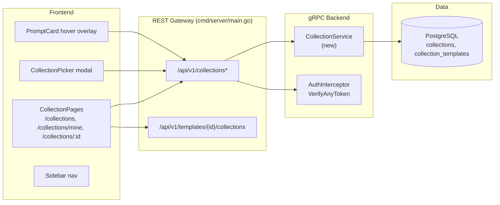
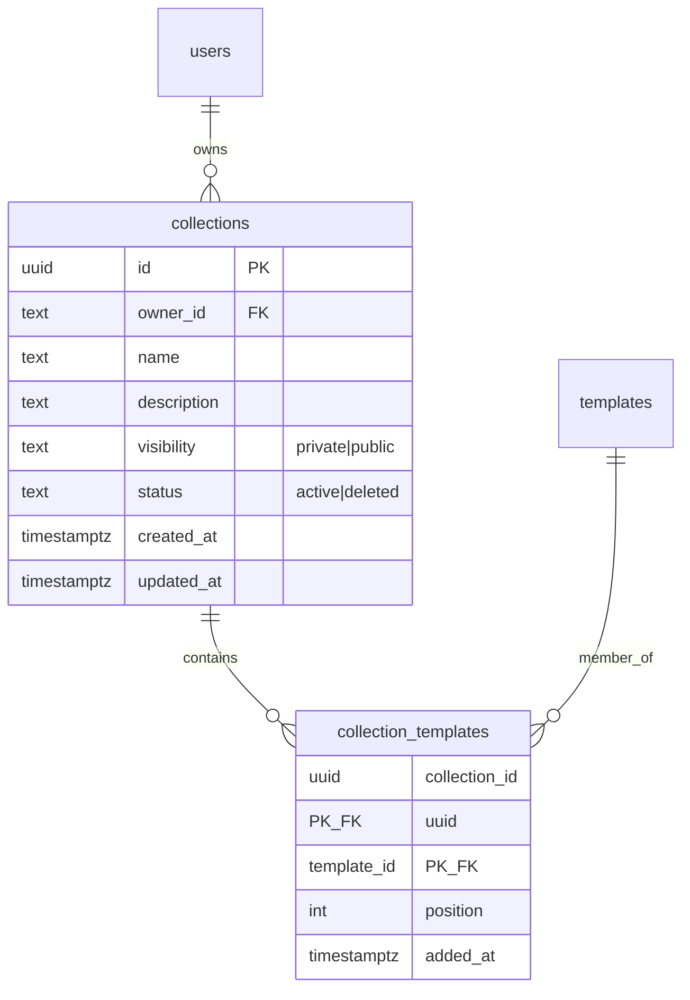

# Template Collections — Architecture Design

| | |
|---|---|
| **Feature ID** | template-collections |
| **Version** | 1.0 |
| **Status** | Approved |
| **Author** | Architect Agent |
| **Upstream** | [Requirements](../design/template-collections-requirements.md) · [UI/UX Design](../design/template-collections-ui-ux-design.md) |
| **Downstream** | [Detailed Design](template-collections-detailed-design.md) · Developer Agent |

## 1. Overview

Template Collections let any logged-in user curate ordered sets of templates ("collections"), keep them private or publish them, and browse collections curated by others. A collection is a first-class user-owned resource — like favorites, but ordered, named, described, publishable, and shareable via a stable URL.

Collections are read-heavy and write-light: members are added one at a time from the template detail page or card hover, reordered occasionally, and read by curators, visitors, and anonymous explorers. The design therefore keeps the data model simple (two tables, no denormalized counters), computes `template_count` at read time, and filters public/private membership in SQL.

### Resolved Open Questions

| # | Question (Requirements §10) | Decision |
|---|---|---|
| 1 | New `CollectionService` vs methods on `PromptService` | **New `CollectionService`** in a new `backend/api/proto/v1/collection.proto` (same precedent as `notification.proto`). Collections are top-level user-owned resources, not template subresources; a dedicated service keeps `PromptService` from growing and gives clean gateway routing under `/api/v1/collections`. |
| 2 | Owner display on cards | Embed `owner` object (`id` + `display_name`) in `Collection`; frontend falls back to localized "Anonymous creator" when display name is empty. `users.display_name` is `NOT NULL`, so the fallback is defensive only. |
| 3 | Member payload | Reuse the existing `Template` message for members (id, title, description, visibility, tags, category, counts, timestamps — everything the list UI needs). Add a wrapper `CollectionMember` with `position` and `is_public` so owners can see private members flagged. |
| 4 | Picker data source | `ListMyCollections` returns up to 50 collections (the per-user cap), so the picker needs no search or pagination. |
| 5 | Cover art | Pure CSS 2×2 collage of the first four members' initial letters on deterministic background colors — no image processing, no new storage. |
| 6 | Copy link | `navigator.clipboard.writeText` with an `execCommand("copy")` fallback for non-secure contexts. |
| 7 | Reorder semantics | Client sends the **full ordered list of template IDs**; the server applies it transactionally (delete + re-insert positions). Simple, idempotent, and matches the Save/Discard UI. |
| 8 | Sorting | Server-side: `newest` (`created_at DESC`) or `most templates` (`template_count DESC`), using the existing offset-as-string `page_token` convention. |

### Non-Goals

- No collaborative/multi-curator collections (single owner).
- No collection templates-of-collections, no nested collections.
- No collection following/subscription notifications.
- No monetization of any kind — collections are free to create and publish (monetization is out of scope for this project).
- No drag-and-drop reordering in v1 (up/down buttons + explicit position input; drag-and-drop may layer on later without API change).
- No bulk add of templates to a collection.
- No AI-generated or suggested collections.

## 2. System Context



Anonymous users can read public collections (`/collections` explore + `/collections/:id`); all mutations and private reads require a valid token.

## 3. Components Involved

| Layer | Component | Change |
|---|---|---|
| proto | `backend/api/proto/v1/collection.proto` | **New.** `CollectionService` with 10 RPCs + messages; regenerate `collection.pb.go` / `collection_grpc.pb.go`. |
| repository | `backend/internal/repository/collection_repository.go` | **New.** `CollectionRepository` interface + Postgres implementation (interface pattern per `CommentRepository`). |
| service | `backend/internal/service/collection.go` | **New.** `CollectionService` struct: validation, authz, limits, soft delete, member filtering. |
| service | `backend/internal/service/auth.go` | Add `GetCollection` + `ListPublicCollections` to `publicRpcMethods` (anonymous reads). |
| gateway | `backend/cmd/server/main.go` | Wire `NewCollectionService` + gRPC registration; new `/api/v1/collections` and `/api/v1/collections/` handlers; extend `/api/v1/templates/` handler with the `/collections` subresource. |
| frontend | `frontend/src/pages/CollectionsPage.js`, `MyCollectionsPage.js`, `CollectionDetailPage.js` | **New** pages (lazy-loaded). |
| frontend | `frontend/src/components/collections/*` | **New:** `CollectionCard`, `CollectionHeader`, `CollectionPicker`, `ReorderList`, `PublishToggle`, `CopyLinkButton`, `CollectionEmptyState`. |
| frontend | `frontend/src/components/PromptCard.js` | Optional `onAddToCollection` prop → hover overlay "Add to collection" (⋯ menu on touch). |
| frontend | `frontend/src/components/Sidebar.js` | "My Collections" (authenticated, below My Favorites) / "Explore Collections" (anonymous). |
| frontend | `frontend/src/services/api.js` | 10 new client functions. |
| frontend | `frontend/src/App.js` | Three lazy routes. |
| frontend | `frontend/src/locales/{en,zh}/translation.json` | `collections.*` namespace (EN/ZH). |
| db | `deployment/init.sql` + `deployment/chart/open-prompts/init.sql` | Append `collections` + `collection_templates` DDL (idempotent, byte-identical in both files). |
| tests | `tests/fvt.py` | `test_template_collections` covering AC-1–12. |

## 4. API Design

### 4.1 gRPC (`v1.CollectionService`)

| RPC | Input → Output | Auth | Purpose |
|---|---|---|---|
| `CreateCollection` | `CreateCollectionRequest` → `Collection` | user | Create (name/description/visibility). |
| `UpdateCollection` | `UpdateCollectionRequest` → `Collection` | owner | Edit name/description/visibility. |
| `DeleteCollection` | `DeleteCollectionRequest` → `DeleteCollectionResponse` | owner | Soft delete (`status='deleted'`). |
| `GetCollection` | `GetCollectionRequest` → `Collection` | public* | Full collection incl. members. |
| `ListMyCollections` | `ListMyCollectionsRequest` → `ListMyCollectionsResponse` | user | Caller's collections (any status ≠ deleted). |
| `ListPublicCollections` | `ListPublicCollectionsRequest` → `ListPublicCollectionsResponse` | public | Explore feed, paginated + sorted. |
| `AddTemplateToCollection` | `AddTemplateToCollectionRequest` → `AddTemplateToCollectionResponse` | owner | Add member (idempotent). |
| `RemoveTemplateFromCollection` | `RemoveTemplateFromCollectionRequest` → `google.protobuf.Empty` | owner | Remove member. |
| `ReorderCollectionTemplates` | `ReorderCollectionTemplatesRequest` → `google.protobuf.Empty` | owner | Apply full ordered template-id list. |
| `ListCollectionsContainingTemplate` | `ListCollectionsContainingTemplateRequest` → `ListCollectionsContainingTemplateResponse` | user | Which of **the caller's** collections contain a template (picker checkmarks). |

\* `GetCollection` is public-RPC at the interceptor level; the service enforces visibility: private or deleted collections return `NotFound` for non-owners (indistinguishable from nonexistent — no existence leak).

### 4.2 REST

| Method | Path | gRPC | Auth |
|---|---|---|---|
| GET | `/api/v1/collections` | `ListPublicCollections` | anonymous |
| POST | `/api/v1/collections` | `CreateCollection` | user |
| GET | `/api/v1/collections/mine` | `ListMyCollections` | user |
| GET | `/api/v1/collections/{id}` | `GetCollection` | anonymous* |
| PATCH | `/api/v1/collections/{id}` | `UpdateCollection` | owner |
| DELETE | `/api/v1/collections/{id}` | `DeleteCollection` | owner |
| POST | `/api/v1/collections/{id}/templates` | `AddTemplateToCollection` | owner |
| DELETE | `/api/v1/collections/{id}/templates/{template_id}` | `RemoveTemplateFromCollection` | owner |
| PUT | `/api/v1/collections/{id}/templates` | `ReorderCollectionTemplates` | owner |
| GET | `/api/v1/templates/{template_id}/collections` | `ListCollectionsContainingTemplate` | user |

\* Anonymous reads of public collections; private/deleted → 404 for non-owners.

### 4.3 Error Codes

| Condition | gRPC code | HTTP |
|---|---|---|
| Name missing / >80 chars; description >500; invalid visibility; invalid sort; reorder list contains duplicates; position out of range | `InvalidArgument` | 400 |
| Not authenticated (mutation without token) | `Unauthenticated` | 401 |
| Acting on another user's collection; banned user | `PermissionDenied` | 403 |
| Collection/template not found; private collection read by non-owner; deleted collection | `NotFound` | 404 |
| Collection limit (50/user) or member limit (100/collection) exceeded | `ResourceExhausted` | 429 |
| Method not allowed on a route | — | 405 |
| Repo failure | `Internal` | 500 |

Limit errors use `ResourceExhausted` (429) rather than `InvalidArgument` because they are quota-style, state-dependent failures — consistent with the rate-limit convention in `CreateComment`. The error message names the limit and current count so the frontend can render it inline in the picker.

## 5. Data Model



### DDL (idempotent — appended to BOTH `deployment/init.sql` and `deployment/chart/open-prompts/init.sql`)

```sql
-- ============================================
-- Template Collections
-- ============================================
DO $$
BEGIN
    IF NOT EXISTS (SELECT 1 FROM information_schema.tables
                   WHERE table_name = 'collections') THEN
        CREATE TABLE collections (
            id UUID PRIMARY KEY DEFAULT uuid_generate_v4(),
            owner_id TEXT NOT NULL REFERENCES users(id) ON DELETE CASCADE,
            name TEXT NOT NULL,
            description TEXT,
            visibility TEXT NOT NULL CHECK (visibility IN ('private','public')) DEFAULT 'private',
            status TEXT NOT NULL CHECK (status IN ('active','deleted')) DEFAULT 'active',
            created_at TIMESTAMPTZ NOT NULL DEFAULT NOW(),
            updated_at TIMESTAMPTZ NOT NULL DEFAULT NOW()
        );
    END IF;
END $$;

DO $$
BEGIN
    IF NOT EXISTS (SELECT 1 FROM information_schema.tables
                   WHERE table_name = 'collection_templates') THEN
        CREATE TABLE collection_templates (
            collection_id UUID NOT NULL REFERENCES collections(id) ON DELETE CASCADE,
            template_id UUID NOT NULL REFERENCES templates(id) ON DELETE CASCADE,
            position INT NOT NULL,
            added_at TIMESTAMPTZ NOT NULL DEFAULT NOW(),
            PRIMARY KEY (collection_id, template_id)
        );
    END IF;
END $$;

DO $$
BEGIN
    IF NOT EXISTS (SELECT 1 FROM pg_indexes
                   WHERE indexname = 'idx_collection_templates_position') THEN
        CREATE INDEX idx_collection_templates_position
            ON collection_templates (collection_id, position);
    END IF;
END $$;

DO $$
BEGIN
    IF NOT EXISTS (SELECT 1 FROM pg_indexes
                   WHERE indexname = 'idx_collections_owner') THEN
        CREATE INDEX idx_collections_owner
            ON collections (owner_id) WHERE status = 'active';
    END IF;
END $$;

DO $$
BEGIN
    IF NOT EXISTS (SELECT 1 FROM pg_indexes
                   WHERE indexname = 'idx_collections_public') THEN
        CREATE INDEX idx_collections_public
            ON collections (visibility, created_at DESC) WHERE status = 'active' AND visibility = 'public';
    END IF;
END $$;
```

Design notes:

- **Soft delete** (`status='deleted'`) satisfies FR-3/FR-26: rows are retained, all reads filter them out, and the UUID is never reused. Hard-deleting a user cascades (FK) and removes their collections entirely.
- **`ON DELETE CASCADE` on `template_id`** (FR-16): when a template is permanently deleted, its membership rows disappear automatically; `template_count` is computed at read time so no counter drift is possible.
- **`template_count` is not stored** (NFR-1/2): `SELECT count(*)` over the `(collection_id, position)` index is cheap at these sizes (≤100 members) and eliminates all consistency concerns.
- **Positions are dense but not enforced**: the reorder RPC writes 0..n-1; ad-hoc add appends `max(position)+1`. Gaps from removals are tolerated — ordering is by `position`, then `added_at`.
- **`owner_id` FK** (unlike `templates.owner_id`, which has none): collections are new, so the FK is safe to add from day one.

## 6. Auth & Authorization

| Action | Who | Rule |
|---|---|---|
| Create collection | any authenticated, non-banned user | ≤50 active collections (FR-4). |
| Update / delete / add / remove / reorder | **owner only** | Non-owner → `PermissionDenied` (403), even for admins acting via user routes (admin has no collection management in v1). |
| Read public collection | anyone (incl. anonymous) | `visibility='public' AND status='active'`. |
| Read private collection | owner only | Non-owner → `NotFound` (404) — indistinguishable from nonexistent (FR-25). |
| Read deleted collection | nobody (404 for everyone, incl. owner) | Soft-deleted collections are gone from all APIs. |
| `ListMyCollections` | caller | Own active collections only. |
| `ListCollectionsContainingTemplate` | caller | Scoped to the caller's own collections — never reveals other users' private collections. |
| Banned users | — | All collection mutations → `PermissionDenied` (403), consistent with the comment/fork convention. |

Member visibility (FR-14/FR-15): when a **non-owner** reads a public collection, the SQL join filters members to `templates.visibility='public'` (plus templates owned by the collection owner — owners may include their own private templates in a public collection; those remain visible to the collection owner only... see rule below). The **owner** always sees all members, each flagged `is_public` so the UI can badge "Private" / "No longer public" members.

> Refinement: to keep the public view simple and predictable, the public member filter is `templates.visibility='public' AND templates.status='active'` — the owner's own private templates are **not** shown to visitors. The owner sees them flagged with the "Private" badge and can remove them before publishing. This avoids leaking any private template content through a public collection.

## 7. Frontend

- **Routes** (lazy): `/collections` (public explore, infinite scroll, 20/page), `/collections/mine` (auth-guarded, single page ≤50), `/collections/:id` (detail; 404 page for private/nonexistent/deleted).
- **Components** (new, under `frontend/src/components/collections/`): `CollectionCard` (CSS 2×2 initials collage, name, count, curator, updated), `CollectionHeader` (title, description, curator, count, Copy link / Publish / Unpublish / Edit / Reorder / Delete actions), `CollectionPicker` (modal with staging semantics: checking adds, unchecking removes, commit on Save; inline create; per-collection member count + limit errors inline), `ReorderList` (local order state, up/down + position input, Save/Discard bar), `PublishToggle` (confirm modals), `CopyLinkButton` (clipboard + fallback), `CollectionEmptyState`.
- **Modified**: `PromptCard` gains optional `onAddToCollection` (hover overlay on pointer devices, ⋯ menu entry on touch); `Sidebar` gains the Collections nav entries; `App.js` routes; `api.js` 10 functions; locales.
- **State**: plain React state + existing fetch patterns — no Redux additions. Picker state is local to the modal.
- **i18n**: `collections.*` namespace, full EN/ZH key sets (see Detailed Design §4.5).

## 8. Configuration

No new configuration. No Redis usage (no counters, no caching layer in v1). The service takes the same constructor dependencies as its peers (repos only).

## 9. Security & Privacy

- Private collections and their member lists are never enumerable: non-owner reads → 404; `ListCollectionsContainingTemplate` is caller-scoped; the explore feed lists public collections only.
- Public collections never expose private template content: the public member join filters `templates.visibility='public'`.
- All input length-bounded (name ≤80, description ≤500) and validated server-side; visibility is CHECK-constrained.
- No PII beyond `display_name` (already public on templates) is exposed by the owner object.
- Rate limiting is not added in v1 (creation is bounded by the 50-collection cap; adds by the 100-member cap). If abuse emerges, the existing Redis limiter pattern can wrap `CreateCollection`.

## 10. Deployment Notes

- DDL is idempotent and additive — safe to run on existing environments; both `init.sql` copies must stay byte-identical.
- No data backfill needed (new tables, empty).
- Proto regeneration produces two new `.pb.go` files committed alongside `collection.proto`.
- Rollout order: DB migration → backend deploy → frontend deploy. Old frontends simply never call the new routes.

## 11. Test Strategy

- **FVT** (`tests/fvt.py::test_template_collections`): covers AC-1–12 — create/validate limits, edit, publish, anonymous read of public, 404 private for second user, add/remove/reorder members, member cap, picker endpoint, soft delete → 404, explore listing + sorting, template-collections cross-reference. Uses the existing `get_auth_token` helper and two users (owner + visitor).
- **Unit**: repository SQL (member filtering, sort by count), service authz matrix (owner/anonymous/second-user/banned), limit enforcement, idempotent add.
- **Component**: picker staging semantics, reorder Save/Discard, publish confirm modals, empty states, i18n rendering.
- **Manual/a11y**: keyboard flow through picker and reorder, focus trap in modals, collage contrast.

## 12. Performance & Caching

- Read-time `template_count` via indexed `count(*)` — no denormalization, no drift (NFR-1/2).
- Explore feed: `idx_collections_public` partial index serves the default newest sort; the most-templates sort aggregates ≤50-member tables and is acceptable at current scale. If it ever degrades, a materialized count column is the escape hatch (not needed now).
- Member lists are bounded (≤100) and unpaginated — single query, single round trip.
- No Redis caching in v1; collection reads are cheap indexed queries. Anonymous explore traffic can later be cached at the gateway if needed.
