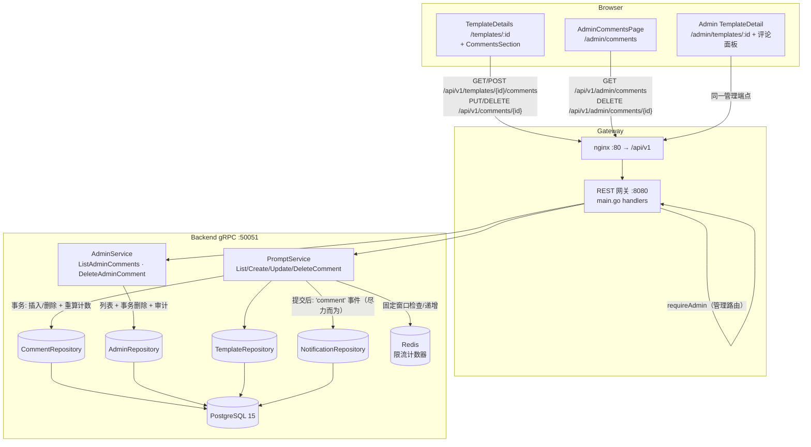

# 模板评论 — 架构设计

- **功能 ID：** `template-comments`
- **版本：** 1.0
- **状态：** 已批准进入实现
- **作者：** 架构 Agent
- **上游文档：**[需求分析](../design/template-comments-requirements-zh-CN.md) · [UI/UX 设计](../design/template-comments-ui-ux-design-zh-CN.md)
- **下游文档：**[详细设计（中文）](./template-comments-detailed-design-zh-CN.md) · [Detailed Design (EN)](./template-comments-detailed-design.md)

---

## 1. 概述

本功能为模板详情页增加**扁平、分页的评论区**——补齐模板作者与用户之间缺失的双向沟通渠道。范围：

1. **任何已认证用户均可评论**公开模板（被封禁用户返回 `403`）；私有模板仅允许所有者评论。
2. **作者可在 15 分钟窗口内编辑**自己的评论，并可随时删除自己的评论。
3. **模板所有者审核**自己的模板：可删除其模板上的任意评论（不写审计日志，简单确认即可）。
4. **管理员全平台审核**：`/admin/comments` 列表支持 `q`/模板/作者筛选，`/admin/templates/:id` 增加评论面板。管理员删除必须填写 3–500 字符的强制理由并写入 `admin_audit_logs`（`action='delete_comment'`）。
5. **反规范化 `templates.comment_count`** 在事务内维护（与 `like_count`/`favorite_count` 同一模式）。
6. **限流**：每账号每分钟 5 条、每天 50 条（Redis 固定窗口，可配置）。
7. **仅纯文本**：内容原样存储与返回；前端以 React 转义渲染（绝不使用 `dangerouslySetInnerHTML`）。
8. **公开可读**：公开模板的评论匿名可读，可见性与模板本身完全一致。
9. **通知集成（FR-17）**：`comment` 事件类型加入通知枚举；若通知功能尚未上线则顺延。

**已解决的开放问题**（来自需求 §10 / UI/UX 交接）：

| # | 问题 | 决策 |
|---|---|---|
| 1 | 分页风格：offset 还是 keyset | **Offset**（`page`/`page_size`，默认 20，上限 50）。与现有全部管理端列表一致；`total_count` 可直接供计数 UI 使用。单模板评论量在 v1 不构成 keyset 的必要性。 |
| 2 | 服务放置：扩展 `PromptService` 还是新建 `CommentService` | **扩展 `PromptService`**。评论是模板子资源；`PromptService` 已持有 `TemplateRepo`、`UserRepo`（封禁检查）与 `NotificationRepo`（事件钩子）。新建服务会重复全部装配。独立的 `CommentRepository` 仍可隔离 SQL。 |
| 3 | 限流位置 | **服务层 Redis 固定窗口计数器**，复用管理员登录限流模式（`Get`/`Sscanf`/`Set`——`RedisStore` 接口没有 `INCR`/`TTL`）。键为 `comment_rate_min:{user_id}` 与 `comment_rate_day:{user_id}`；值携带 `count:expires_unix` 以便计算 `Retry-After` 秒数。Redis 不可用时跳过（fail-open），与限流先例一致。 |
| 4 | `comment` 是否现在加入通知枚举 | **是——现在就把 `'comment'` 加入枚举、DDL CHECK 与 UI 文案**（通知功能正在并行落地）。若评论先于通知合并，则按需求顺延 FR-17：钩子调用点照写，但 `NotificationRepo` 字段为 nil 时辅助函数空操作。 |
| 5 | FR-10 表述冲突（所有者审核路径） | FR-10 第二句称所有者"经由管理端端点"操作，但 FR-16 要求 `/api/v1/admin/*` 必须为管理员角色——普通所有者无法调用，且 UI/UX §3.3 正确展示所有者使用 `DELETE /api/v1/comments/{id}` 加普通确认弹窗。**裁决：用户端点同时授权作者与模板所有者删除（不写审计）；管理端点保持仅管理员 + 强制理由 + 审计。** 该裁决满足 FR-10 第一句、FR-14/16 及全部 UI/UX 流程。 |

**非目标（v1）：** 盖楼/回复、@提及、表情回应、Markdown 渲染、投票/按热度排序、软删除占位、匿名评论、自动审核/敏感词过滤、超出所有者事件之外的评论通知，以及**一切变现相关表面**（变现在本项目范围之外，已从本设计中排除）。

## 2. 系统上下文



无新增基础设施。仅一张新 PostgreSQL 表、一个反规范化列、两个 Redis 计数键。Redis 本就为封禁执行与管理员限流所必需。

## 3. 组件

### 新增组件

| 组件 | 位置 | 职责 |
|---|---|---|
| 评论模型 | `backend/internal/models/comment.go` | `Comment` 结构体（表行 + 联表作者字段 + 计算的 `IsEdited`）与 `AdminComment`（含模板/作者上下文的审核视图）。 |
| 评论仓库 | `backend/internal/repository/comment_repository.go` | `CommentRepository`：列表（作者联表、`created_at DESC`、offset 分页 + 总数）、创建/更新/删除——创建与删除在重算 `templates.comment_count` 的事务中执行（ToggleLike 模式）。 |
| 评论区组件 | `frontend/src/components/comments/CommentsSection.js`（+ `CommentComposer`、`CommentItem`、`CommentEditForm`、SCSS） | 计数、列表、输入框、逐条操作、加载更多、区块级错误/重试。 |
| 管理端评论页 | `frontend/src/pages/admin/CommentsPage.js`（+ SCSS） | 全平台审核列表：`q`/模板/作者筛选、表格、分页、经 `ReasonModal` 的带理由删除。 |

### 修改组件

| 组件 | 变更 |
|---|---|
| `backend/api/proto/v1/prompt.proto` | `PromptService` 新增 4 个 RPC（`ListComments`、`CreateComment`、`UpdateComment`、`DeleteComment`）+ `Comment`/`CommentAuthor` 消息；`Template.comment_count = 17`。 |
| `backend/api/proto/v1/admin.proto` | `ListAdminComments` / `DeleteAdminComment` RPC + `AdminCommentEntry` 消息。 |
| `backend/internal/service/prompt.go` | 评论 RPC 实现：校验、封禁检查、可见性检查、15 分钟编辑窗口、作者/所有者授权、Redis 限流；提交后调用 `createEngagementNotification(ctx, "comment", …)` 钩子。`NewPromptService` 新增 `RedisStore` 参数（nil 安全）。 |
| `backend/internal/service/admin.go` | `ListAdminComments`（筛选校验 + 分页钳制，`ListTemplates` 模式）与 `DeleteAdminComment`（理由校验、审计写入、事务删除）。 |
| `backend/internal/repository/admin_repository.go` | `ListComments`（联表获取审核上下文）与 `DeleteComment`（事务删除 + 重算）。 |
| `backend/internal/repository/template_repository.go` | `Get`/`List` 的 SELECT 列表增加 `t.comment_count`（+ Scan 目标）。 |
| `backend/internal/models/template.go` | `CommentCount int32`。 |
| `backend/cmd/server/main.go` | 4 条用户路由（templates handler 内的评论子资源 + 新 `/api/v1/comments/` handler）与 2 条管理路由；429 时设置 `Retry-After` 头。 |
| `frontend/src/pages/TemplateDetails.js` | 在社交统计下方挂载 `CommentsSection`。 |
| `frontend/src/pages/admin/TemplateDetailPage.js` | 评论面板（读取 + 带理由删除）。 |
| `frontend/src/components/admin/AdminLayout.js` + `App.js` | `/admin/comments` 导航项 + 路由。 |
| `frontend/src/services/api.js` / `adminApi.js` | 4 个用户方法 + 2 个管理方法。 |
| `frontend/src/locales/{en,zh}/translation.json` | `comments.*` 与 `admin.comments.*` + `admin.nav.comments` 键（双语言）。 |
| `deployment/init.sql` + `deployment/chart/open-prompts/init.sql` | `template_comments` DDL 块、`templates.comment_count` 列、`admin_audit_logs` CHECK 扩展（两份保持同步）。 |
| `deployment/docker-compose.yml` + helm chart | 2 个限流环境变量（含默认值）。 |
| `tests/fvt.py` | `test_template_comments()`。 |

## 4. API 设计（摘要）

用户表面（读取遵循模板可见性；写操作需认证）：

| 方法 | 路径 | 用途 | 成功 |
|---|---|---|---|
| GET | `/api/v1/templates/{id}/comments` | 分页列表，`page`（默认 1）、`page_size`（默认 20，上限 50），按 `created_at DESC` 排序 | `200` `{comments, total_count, page, page_size}` |
| POST | `/api/v1/templates/{id}/comments` | 创建评论（`content` trim 后 1–2000 字符） | `200` `Comment` |
| PUT | `/api/v1/comments/{commentId}` | 作者在 `created_at` 起 15 分钟内编辑 | `200` `Comment` |
| DELETE | `/api/v1/comments/{commentId}` | 删除——调用者须为评论**作者**或**模板所有者** | `200` `{success: true}` |

管理表面（管理员 JWT，与现有 `/api/v1/admin/*` 完全一致）：

| 方法 | 路径 | 用途 | 成功 |
|---|---|---|---|
| GET | `/api/v1/admin/comments` | 全平台列表；筛选 `q`（内容 ILIKE）、`template_id`、`user_id`；`page`/`per_page`（默认 20，上限 100） | `200` `{entries, total, page, per_page}` |
| DELETE | `/api/v1/admin/comments/{commentId}` | 删除任意评论；请求体 `reason` 3–500 字符**必填**；写审计 | `200` `{success: true}` |

错误码：`400` 内容/分页参数/理由长度非法；`401` 写操作令牌缺失或无效；`403` 封禁用户发帖、非作者编辑、编辑窗口过期、非作者/非所有者删除、非管理员访问管理路由；`404` 模板/评论不存在（对非所有者，私有模板与不存在不可区分）；`429` 限流（含 `Retry-After`）；`500` 内部错误。完整契约见详细设计 §1。

## 5. 数据模型

新表（幂等 DDL，同步镜像到 helm chart 副本）：

```sql
CREATE TABLE IF NOT EXISTS template_comments (
    id UUID PRIMARY KEY DEFAULT uuid_generate_v4(),
    template_id UUID NOT NULL REFERENCES templates(id) ON DELETE CASCADE,
    user_id TEXT NOT NULL REFERENCES users(id) ON DELETE CASCADE,
    content TEXT NOT NULL CHECK (char_length(content) BETWEEN 1 AND 2000),
    created_at TIMESTAMPTZ NOT NULL DEFAULT NOW(),
    updated_at TIMESTAMPTZ NOT NULL DEFAULT NOW()
);

CREATE INDEX IF NOT EXISTS idx_template_comments_template_created
    ON template_comments (template_id, created_at DESC);
CREATE INDEX IF NOT EXISTS idx_template_comments_user_id ON template_comments (user_id);
```

- **`templates.comment_count INT NOT NULL DEFAULT 0`** 以既有 `DO $$ IF NOT EXISTS ALTER` 块添加；在创建/删除事务内维护（`SELECT COUNT(*)` → `UPDATE templates`），与 `ToggleLike` 完全一致。仅硬删除——无软删除行（FR-7）。
- **`admin_audit_logs` CHECK 扩展**：`action` 增加 `'delete_comment'`，`target_type` 增加 `'comment'`。CHECK 约束无法像列那样幂等追加，故用 `DO $$` 块检查 `pg_constraint`：若现存约束定义不含 `delete_comment` 则删除并重建约束（完整 DDL 见详细设计 §2）。存量行天然满足放宽后的约束。
- **级联（FR-18）**：删除模板连带删除其评论（计数随行消失）；删除用户连带删除其评论。当前无用户删除 API——详细设计为任何未来的用户删除功能记录了重算义务。
- **评论不含 PII**：作者身份在读取时联表（`display_name`、`avatar`——均已是公开信息）；邮箱仅出现在管理端审核列表。

## 6. 认证与授权

- **读取**遵循模板可见性：公开模板匿名可读（网关转发空 user ID，同 `GetTemplate`）；私有模板仅所有者可读；被封禁所有者的公开模板对所有人隐藏（既有 `templateRepository.Get` 规则）。
- **写操作**要求 `VerifyAnyToken` → `ContextWithUserID`；用户 ID 永远来自令牌，绝不来自请求体。
- **封禁用户**（`users.status = 'banned'`）创建时返回 `403`（经 `UserRepo.GetByID` 检查，与其他封禁执行一致）。
- **编辑**：仅作者，`created_at` 起 15 分钟内（服务器时钟）；超时返回 `403` 及"编辑窗口已过期"。编辑绝不改变列表位置（按 `created_at` 排序）。
- **删除（用户端点）**：评论作者或模板所有者——均在服务端对照数据库行验证，绝不信任客户端声明。按设计不写审计（FR-10）。
- **删除（管理端点）**：经 `requireAdmin` 的管理员角色（管理员 JWT，`role=admin`、`scope=admin`）；强制理由；每次删除均写审计。
- **限流**仅作用于评论创建，按认证用户 ID 而非 IP 计键——共享 NAT 不受影响，滥用者无法轮换 IP。

## 7. 前端架构

- **路由：** 无新用户路由——`CommentsSection` 挂载于 `/templates/:id` 社交统计下方。管理端新增 `/admin/comments`（懒加载，位于 `AdminLayout` 内）与 `/admin/templates/:id` 的评论面板。
- **状态：** 组件局部状态（列表、页码、`total_count`、草稿、编辑中 id）——评论是页面级作用域，与 `TemplateDetails` 既有局部状态模式一致；不新增 Redux slice。
- **渲染：** 仅纯文本——React 自动转义 + `white-space: pre-wrap`；禁止 `dangerouslySetInnerHTML`。`is_edited` 渲染为低调的"已编辑"标记。
- **韧性（NFR-8）：** 评论加载失败渲染区块级错误 + 重试，绝不阻塞模板本身；发帖失败显示内联错误并保留草稿；无乐观挂起行——列表以 POST 响应刷新。
- **分页 UI：** 加载更多按钮（非无限滚动），与通知页一致。
- **无障碍：** 语义化 `<ul>` 列表；带标签的 textarea 与实时字符计数（1–2000）；全部操作键盘可达且有可见焦点；删除确认沿用既有 Modal 模式并恢复焦点；所有者评论显示 `[CREATOR]` 徽章。
- **i18n：** 全部字符串位于双语言的 `comments.*` / `admin.comments.*` 之下；评论*内容*是用户内容，绝不翻译；时间戳使用共享相对时间工具。

## 8. 配置

| 变量 | 默认值 | 用途 |
|---|---|---|
| `COMMENT_RATE_PER_MINUTE` | `5` | 每用户每滚动分钟最大评论创建数。 |
| `COMMENT_RATE_PER_DAY` | `50` | 每用户每滚动天最大评论创建数。 |

经 `os.Getenv` 读取并带安全默认值（仓库惯例）；接入 `deployment/docker-compose.yml`（backend 环境）与 helm chart（`values.yaml` + deployment 模板），均为可选。15 分钟编辑窗口是服务常量（`commentEditWindow`），v1 不做配置化。

## 9. 安全考量

- **XSS：** 内容以纯文本存储/返回并作为 React 文本节点渲染；整条链路不存在 HTML 管道。Unicode 完整往返（FR-12）。
- **IDOR：** 每次变更都重新加载评论行并在服务端检查作者/所有者；私有模板的跨用户读取返回 `404` 式不可区分。
- **注入：** 全部 SQL 参数化；`q` 筛选使用转义 `%`/`_` 通配符的 ILIKE（管理端搜索先例）。
- **垃圾信息：** 每账号双重固定窗口限流；429 返回 `Retry-After`；仅当 Redis 完全不可用时 fail-open（可用性优先，与管理员登录限流一致）。
- **审计完整性：** 管理员删除缺少 3–500 字符理由即无法进行；审计行与删除同请求写入；`admin_audit_logs` 无外键，历史在评论/用户删除后仍存续。
- **内容大小：** 1–2000 字符由数据库 CHECK 作为服务层校验之后的纵深防御。

## 10. 部署说明

- DDL 幂等：`CREATE TABLE IF NOT EXISTS`、`CREATE INDEX IF NOT EXISTS`、列用 `DO $$ IF NOT EXISTS ALTER`、两个放宽的 CHECK 用 `pg_constraint` 守护的删除/重建——对全新与存量卷均安全。两份 `init.sql`（根目录 + helm chart）必须保持同步。
- 无新服务、端口或镜像。`NewPromptService` 新增 Redis 参数——`main.go` 一行装配变更；容忍 nil（限流停用）。
- `prompt.proto` 与 `admin.proto` 均需重新运行 `protoc`。
- 回滚：删除 `template_comments` 表与 `comment_count` 列即可；REST 端点会 404/500，其余不受影响。

## 11. 测试策略（摘要）

- **FVT（`tests/fvt.py`）：** `test_template_comments()`——发帖/读取/分页；窗口内编辑 + 过期窗口 403；作者删除；非作者 403；所有者删除他人评论；封禁用户 403；限流 429 + `Retry-After`；管理端列表筛选 + 带理由删除 + 审计行；删除模板级联删除评论。
- **后端单元测试：** 内容校验、编辑窗口边界、权限矩阵（作者/所有者/他人/封禁）、限流窗口数学（假 Redis）、事务重算、审计理由校验；为新列更新 `MockTemplateRepository`。
- **E2E（Nightwatch，test-agent）：** 详情页评论区渲染、发帖/编辑/删除流程、加载更多、所有者审核、管理端页面筛选 + 理由弹窗、EN/ZH 文案、键盘可达性。

详细契约、DDL、分层职责、i18n 键与测试钩子：见[详细设计](./template-comments-detailed-design-zh-CN.md)。
