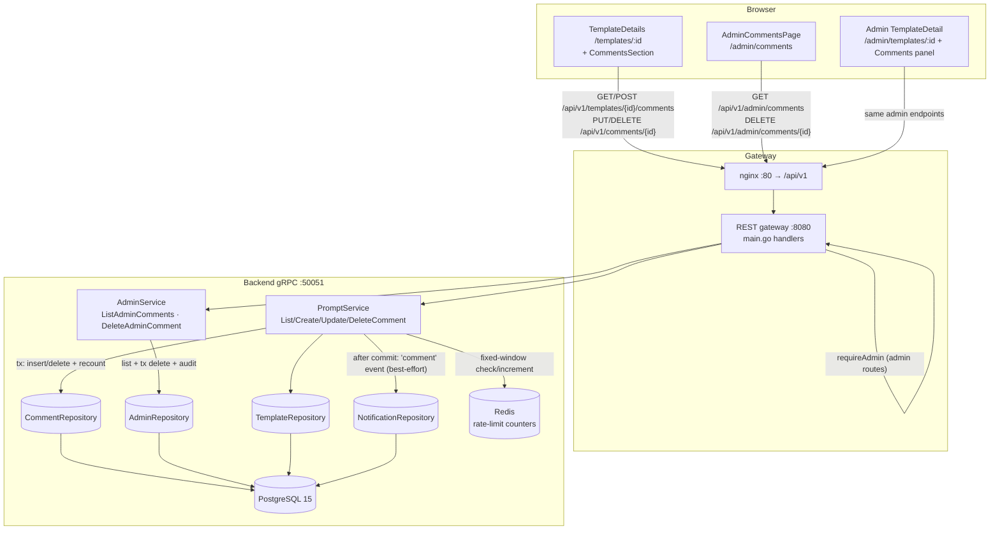

# Template Comments — Architecture Design

- **Feature ID:** `template-comments`
- **Version:** 1.0
- **Status:** Approved for implementation
- **Author:** Architect Agent
- **Upstream docs:** [Requirements](../design/template-comments-requirements.md) · [UI/UX Design](../design/template-comments-ui-ux-design.md)
- **Downstream docs:** [Detailed Design (EN)](./template-comments-detailed-design.md) · [详细设计（中文）](./template-comments-detailed-design-zh-CN.md)

---

## 1. Overview

This feature adds a **flat, paginated comment list** to the template detail page — the missing two-way communication channel between template authors and users. Scope:

1. **Any authenticated user can comment** on public templates (banned users get `403`); private templates accept comments only from their owner.
2. **Authors edit their own comments within a 15-minute window** and can delete their own comments at any time.
3. **Template owners moderate** their own template: they can delete any comment on it (un-audited, simple confirm).
4. **Admins moderate platform-wide**: `/admin/comments` list with `q`/`template`/`author` filters, plus a comments panel on `/admin/templates/:id`. Admin deletion requires a mandatory 3–500 char reason written to `admin_audit_logs` (`action='delete_comment'`).
5. **Denormalized `templates.comment_count`** maintained transactionally (same pattern as `like_count`/`favorite_count`).
6. **Rate limiting**: 5 comments/minute and 50/day per account (Redis fixed-window, configurable).
7. **Plain text only**: content is stored and returned as-is; the UI renders with React escaping (never `dangerouslySetInnerHTML`).
8. **Public read** on public templates (anonymous included), matching template visibility exactly.
9. **Notification integration (FR-17)**: a `comment` event type joins the notifications enum; deferred if notifications has not shipped.

**Resolved open questions** (from requirements §10 / UI/UX handoff):

| # | Question | Decision |
|---|---|---|
| 1 | Pagination style: offset vs keyset | **Offset** (`page`/`page_size`, default 20, max 50). Matches every existing admin list endpoint; `total_count` comes free for the counter UI. Comment volumes per template do not justify keyset complexity in v1. |
| 2 | Service placement: extend `PromptService` vs new `CommentService` | **Extend `PromptService`**. Comments are template sub-resources; `PromptService` already holds `TemplateRepo`, `UserRepo` (banned check) and `NotificationRepo` (event hook). A new service would duplicate all that wiring. A dedicated `CommentRepository` still keeps SQL isolated. |
| 3 | Rate-limit placement | **Service-level Redis fixed-window counters**, reusing the admin-login-throttle pattern (`Get`/`Sscanf`/`Set` — the `RedisStore` interface has no `INCR`/`TTL`). Keys `comment_rate_min:{user_id}` and `comment_rate_day:{user_id}`; values carry `count:expires_unix` so `Retry-After` seconds are computable. Skipped when Redis is unavailable (fail-open), matching the throttle precedent. |
| 4 | Does `comment` join the notifications enum now? | **Yes — add `'comment'` to the enum, DDL CHECK and UI copy now** (notifications is landing concurrently). If comments ships before notifications merges, FR-17 is deferred per requirements: the hook call site is written but the `NotificationRepo` field stays nil and the helper no-ops. |
| 5 | FR-10 wording conflict (owner moderation path) | FR-10's second sentence says owners act "through the admin-capable endpoint", but FR-16 requires the admin role on `/api/v1/admin/*` — a regular owner cannot call it, and UI/UX §3.3 correctly shows the owner using `DELETE /api/v1/comments/{id}` with a plain confirm modal. **Resolution: the user endpoint authorizes author *and* template-owner deletes (un-audited); the admin endpoint stays admin-only with mandatory reason + audit.** This satisfies FR-10's first sentence, FR-14/16, and all UI/UX flows. |

**Non-goals (v1):** threading/replies, mentions, reactions, Markdown rendering, voting/sorting-by-score, soft-delete placeholders, anonymous comments, automated moderation/profanity filters, comment notifications beyond the owner event, and **all monetization-adjacent surfaces** (monetization is out of scope for this project and excluded from this design).

## 2. System Context



No new infrastructure. One new PostgreSQL table, one denormalized column, and two Redis counter keys. Redis was already required for ban enforcement and admin throttling.

## 3. Components

### New components

| Component | Location | Responsibility |
|---|---|---|
| Comment model | `backend/internal/models/comment.go` | `Comment` struct (table row + joined author fields + `IsEdited` computed) and `AdminComment` (moderation view with template/author context). |
| Comment repository | `backend/internal/repository/comment_repository.go` | `CommentRepository`: list (author join, `created_at DESC`, offset pagination + total), create / update / delete — create & delete run in a transaction that recomputes `templates.comment_count` (ToggleLike pattern). |
| Comments section | `frontend/src/components/comments/CommentsSection.js` (+ `CommentComposer`, `CommentItem`, `CommentEditForm`, SCSS) | Counter, list, composer, per-item actions, load-more, section-level error/retry. |
| Admin comments page | `frontend/src/pages/admin/CommentsPage.js` (+ SCSS) | Platform-wide moderation list: `q`/template/author filters, table, pagination, delete-with-reason via `ReasonModal`. |

### Modified components

| Component | Change |
|---|---|
| `backend/api/proto/v1/prompt.proto` | 4 new RPCs on `PromptService` (`ListComments`, `CreateComment`, `UpdateComment`, `DeleteComment`) + `Comment`/`CommentAuthor` messages; `Template.comment_count = 17`. |
| `backend/api/proto/v1/admin.proto` | `ListAdminComments` / `DeleteAdminComment` RPCs + `AdminCommentEntry` message. |
| `backend/internal/service/prompt.go` | Comment RPC implementations: validation, banned check, visibility check, 15-min edit window, author/owner authorization, Redis rate limiting; `createEngagementNotification(ctx, "comment", …)` hook after commit. `NewPromptService` gains a `RedisStore` param (nil-safe). |
| `backend/internal/service/admin.go` | `ListAdminComments` (filter validation + pagination clamping, `ListTemplates` pattern) and `DeleteAdminComment` (reason validation, audit insert, transactional delete). |
| `backend/internal/repository/admin_repository.go` | `ListComments` (joins for moderation context) and `DeleteComment` (tx delete + recount). |
| `backend/internal/repository/template_repository.go` | `Get`/`List` SELECT lists gain `t.comment_count` (+ Scan targets). |
| `backend/internal/models/template.go` | `CommentCount int32`. |
| `backend/cmd/server/main.go` | 4 user routes (comments sub-resource on the templates handler + new `/api/v1/comments/` handler) and 2 admin routes; `Retry-After` header on 429. |
| `frontend/src/pages/TemplateDetails.js` | Mount `CommentsSection` below social stats. |
| `frontend/src/pages/admin/TemplateDetailPage.js` | Comments panel (read + delete with reason). |
| `frontend/src/components/admin/AdminLayout.js` + `App.js` | `/admin/comments` nav entry + route. |
| `frontend/src/services/api.js` / `adminApi.js` | 4 user methods + 2 admin methods. |
| `frontend/src/locales/{en,zh}/translation.json` | `comments.*` and `admin.comments.*` + `admin.nav.comments` keys (both locales). |
| `deployment/init.sql` + `deployment/chart/open-prompts/init.sql` | `template_comments` DDL block, `templates.comment_count` column, `admin_audit_logs` CHECK extension (both copies in sync). |
| `deployment/docker-compose.yml` + helm chart | 2 rate-limit env vars with defaults. |
| `tests/fvt.py` | `test_template_comments()`. |

## 4. API Design (summary)

Regular-user surface (template visibility applies to reads; writes require auth):

| Method | Path | Purpose | Success |
|---|---|---|---|
| GET | `/api/v1/templates/{id}/comments` | Paginated list, `page` (default 1), `page_size` (default 20, max 50), sorted `created_at DESC` | `200` `{comments, total_count, page, page_size}` |
| POST | `/api/v1/templates/{id}/comments` | Create comment (`content` 1–2000 after trim) | `200` `Comment` |
| PUT | `/api/v1/comments/{commentId}` | Author edit within 15 min of `created_at` | `200` `Comment` |
| DELETE | `/api/v1/comments/{commentId}` | Delete — caller must be comment **author** or **template owner** | `200` `{success: true}` |

Admin surface (admin JWT, exactly like existing `/api/v1/admin/*`):

| Method | Path | Purpose | Success |
|---|---|---|---|
| GET | `/api/v1/admin/comments` | Platform-wide list; filters `q` (content ILIKE), `template_id`, `user_id`; `page`/`per_page` (default 20, max 100) | `200` `{entries, total, page, per_page}` |
| DELETE | `/api/v1/admin/comments/{commentId}` | Delete any comment; body `reason` 3–500 chars **mandatory**; audited | `200` `{success: true}` |

Error codes: `400` invalid content/page params/reason length; `401` missing or invalid token on writes; `403` banned user posting, non-author edit, expired edit window, non-author/non-owner delete, non-admin on admin routes; `404` unknown template/comment (private templates indistinguishable from missing for non-owners); `429` rate limited (with `Retry-After`); `500` internal. Full contracts in the detailed design §1.

## 5. Data Model

New table (idempotent DDL, mirrored to the helm chart copy):

```sql
CREATE TABLE IF NOT EXISTS template_comments (
    id UUID PRIMARY KEY DEFAULT uuid_generate_v4(),
    template_id UUID NOT NULL REFERENCES templates(id) ON DELETE CASCADE,
    user_id TEXT NOT NULL REFERENCES users(id) ON DELETE CASCADE,
    content TEXT NOT NULL CHECK (char_length(content) BETWEEN 1 AND 2000),
    created_at TIMESTAMPTZ NOT NULL DEFAULT NOW(),
    updated_at TIMESTAMPTZ NOT NULL DEFAULT NOW()
);

CREATE INDEX IF NOT EXISTS idx_template_comments_template_created
    ON template_comments (template_id, created_at DESC);
CREATE INDEX IF NOT EXISTS idx_template_comments_user_id ON template_comments (user_id);
```

- **`templates.comment_count INT NOT NULL DEFAULT 0`** added via the established `DO $$ IF NOT EXISTS ALTER` block; maintained inside the create/delete transaction (`SELECT COUNT(*)` → `UPDATE templates`), exactly like `ToggleLike`. Hard delete only — no soft-delete rows (FR-7).
- **`admin_audit_logs` CHECK extension**: `action` gains `'delete_comment'`, `target_type` gains `'comment'`. CHECK constraints cannot be added idempotently like columns, so a `DO $$` block inspects `pg_constraint`: if the existing constraint definition does not contain `delete_comment`, it drops and re-adds the constraint (full DDL in detailed design §2). Existing rows satisfy the widened constraints trivially.
- **Cascades (FR-18)**: template deletion removes its comments (and the count dies with the row); user deletion removes the user's comments. No user-deletion API exists today — the detailed design records the recompute obligation for any future user-deletion feature.
- **No PII in comments**: author identity is joined at read time (`display_name`, `avatar` — both already public); emails appear only in the admin moderation list.

## 6. Authentication & Authorization

- **Reads** follow template visibility: public templates are anonymously readable (the gateway forwards an empty user ID, like `GetTemplate`); private templates are readable only by their owner; public templates of banned owners are hidden from everyone (existing `templateRepository.Get` rule).
- **Writes** require `VerifyAnyToken` → `ContextWithUserID`; the user ID always comes from the token, never the body.
- **Banned users** (`users.status = 'banned'`) get `403` on create (checked via `UserRepo.GetByID`, same as ban enforcement elsewhere).
- **Edit**: author only, within 15 minutes of `created_at` (server clock); afterwards `403` with "editable window expired". Edits never change list position (sort is `created_at`).
- **Delete (user endpoint)**: comment author or template owner — both verified server-side against the DB row, never client claims. Un-audited by design (FR-10).
- **Delete (admin endpoint)**: admin role via `requireAdmin` (admin JWT, `role=admin`, `scope=admin`); mandatory reason; every deletion audited.
- **Rate limit** applies to comment creation only, keyed by authenticated user ID — not IP — so shared NATs are unaffected and abusers cannot rotate IPs.

## 7. Frontend Architecture

- **Routing:** no new user route — `CommentsSection` mounts on `/templates/:id` below the social stats. Admin gains `/admin/comments` (lazy, inside `AdminLayout`) and a comments panel on `/admin/templates/:id`.
- **State:** local component state (list, page, `total_count`, composer draft, editing id) — comments are page-scoped, matching `TemplateDetails`' existing local-state pattern; no new Redux slice.
- **Rendering:** plain text only — React auto-escaping with `white-space: pre-wrap`; `dangerouslySetInnerHTML` is forbidden. `is_edited` renders a subtle "edited" marker.
- **Resilience (NFR-8):** comment load failure renders a section-level error + Retry and never blocks the template itself; posting failures show inline errors and preserve the drafted text; no optimistic pending row — the list refreshes from the POST response.
- **Pagination UI:** Load-more button (not infinite scroll), consistent with the notifications page.
- **A11y:** semantic `<ul>` list; labeled textarea with live character counter (1–2000); all actions keyboard-reachable with visible focus; delete confirm follows the existing Modal pattern with focus restoration; `[CREATOR]` badge on owner comments.
- **i18n:** all strings under `comments.*` / `admin.comments.*` in both locales; comment *content* is user content and never translated; timestamps via the shared relative-time util.

## 8. Configuration

| Variable | Default | Purpose |
|---|---|---|
| `COMMENT_RATE_PER_MINUTE` | `5` | Max comment creations per user per rolling minute. |
| `COMMENT_RATE_PER_DAY` | `50` | Max comment creations per user per rolling day. |

Read via `os.Getenv` with safe defaults (repo convention); wired into `deployment/docker-compose.yml` (backend environment) and the helm chart (`values.yaml` + deployment template), both optional. The 15-minute edit window is a service constant (`commentEditWindow`), not configurable in v1.

## 9. Security Considerations

- **XSS:** content is stored/returned as plain text and rendered as React text nodes; no HTML pipeline exists anywhere in the path. Unicode round-trips intact (FR-12).
- **IDOR:** every mutation re-loads the comment row and checks author/owner server-side; cross-user access yields `404`-style indistinguishability for reads of private templates.
- **Injection:** all SQL parameterized; `q` filter uses ILIKE with escaped `%`/`_` wildcards (admin search precedent).
- **Spam:** dual fixed-window rate limits per account; `Retry-After` returned on 429; fail-open only if Redis is entirely unavailable (availability over strictness, matching the admin-login throttle).
- **Audit integrity:** admin deletions cannot proceed without a 3–500 char reason; the audit row is written in the same request; `admin_audit_logs` has no FK so history survives comment/user deletion.
- **Content size:** 1–2000 chars enforced by DB CHECK as defense-in-depth behind service validation.

## 10. Deployment Notes

- DDL is idempotent: `CREATE TABLE IF NOT EXISTS`, `CREATE INDEX IF NOT EXISTS`, `DO $$ IF NOT EXISTS ALTER` for the column, and a `pg_constraint`-guarded drop/re-add for the two widened CHECKs — safe on fresh and existing volumes alike. Both `init.sql` copies (root + helm chart) must stay in sync.
- No new services, ports, or images. `NewPromptService` gains a Redis parameter — a one-line wiring change in `main.go`; nil is tolerated (rate limiting disabled).
- `protoc` regeneration required for both `prompt.proto` and `admin.proto`.
- Rollback: dropping `template_comments` and the `comment_count` column is sufficient; REST endpoints would 404/500 but nothing else degrades.

## 11. Test Strategy (summary)

- **FVT (`tests/fvt.py`):** `test_template_comments()` — post/read/paginate; edit within window + expired-window 403; author delete; non-author 403; owner deletes another's comment; banned user 403; rate limit 429 + `Retry-After`; admin list filters + delete-with-reason + audit row; template deletion cascades comments.
- **Backend unit tests:** content validation, edit-window boundary, permission matrix (author/owner/other/banned), rate-limit window math (fake Redis), transactional recount, audit reason validation; update `MockTemplateRepository` for the new column.
- **E2E (Nightwatch, test-agent):** section renders on detail page, post/edit/delete flows, load-more, owner moderation, admin page filters + reason modal, EN/ZH strings, keyboard access.

Detailed contracts, DDL, layer responsibilities, i18n keys, and test hooks: see the [detailed design](./template-comments-detailed-design.md).
