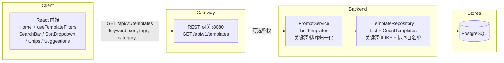

# 模板搜索与筛选 — 架构设计

| | |
|---|---|
| **Feature ID** | template-search-filtering |
| **Version** | 1.0 |
| **Status** | Approved for implementation（已批准实施） |
| **Author** | Architect Agent |
| **Upstream** | [需求文档](../design/template-search-filtering-requirements-zh-CN.md), [UI/UX 设计](../design/template-search-filtering-ui-ux-design-zh-CN.md) |
| **Downstream** | [详细设计](template-search-filtering-detailed-design-zh-CN.md) |

## 1. 概述

模板搜索与筛选补上平台最大的发现性缺口：对标题/描述/标签/分类/最新版本内容的
关键词搜索、多选标签筛选（AND 语义）、四种排序（`newest`、`most_liked`、
`most_favorited`、`trending`）、结果计数，以及主页上与 URL 同步的筛选状态。
设计刻意保持**纯增量**：不新增端点、不改表结构、不加服务。`ListTemplates`
新增 `keyword`/`sort` 请求字段与 `total_count` 响应字段；仓储层 `List` 新增
参数化关键词条件与白名单 `ORDER BY`；前端把所有筛选来源（搜索框、侧栏、
chips、建议、URL）收拢到一个新 hook，并将状态镜像到 URL。

### 1.1 已决开放问题

| # | 问题（来自需求 §9） | 决策 |
|---|---|---|
| D-2 | 最新版本内容匹配 | **v1 纳入。** 用 `EXISTS` 子查询检查每模板最新的 `template_versions` 行（最新 = `ORDER BY version DESC LIMIT 1`，由现有 `idx_template_versions_template_id` 支撑）。若列表延迟超出 NFR-1 预算，已记录的回退方案是去掉内容分支——标题/描述/标签/分类匹配保留。 |
| D-3 | 趋势窗口数据源 | **确认可行。** `template_likes.created_at` 与 `template_favorites.created_at` 均为 `TIMESTAMPTZ NOT NULL`。趋势 = 对两张表做窗口内 `COUNT(*)`，以派生表形式一次性 JOIN（不做逐行相关子查询），7 天常量窗口，`created_at DESC` 决胜。 |
| D-9 | ILIKE 性能 | **v1 直接用 ILIKE，不加 trigram 索引** —— `ILIKE '%kw%'` 无法走 btree，当前规模下顺序扫描可接受（NFR-1 预算：≤10 万模板 p95 < 500ms）。`title`/`description` 上的 `pg_trgm` GIN 索引是已记录的升级路径，仅在 p95 超预算时启用。为趋势排序，互动表上的两个覆盖索引**会**加上（§5.2）。 |

### 1.2 非目标

- 全文检索（tsvector/GIN、Meilisearch、Elastic）—— v1 仅 ILIKE。
- 搜索高亮/摘要、相关性排序（BM25 类）。
- 保存的搜索 / 按用户搜索历史。
- 按作者名搜索；日期范围筛选。
- 管理员搜索 UI（管理员审核列表日后可*复用*仓储能力 —— FR-33 —— 但本特性不改管理员界面）。
- 模糊/音近匹配；CJK 分词（ILIKE 子串匹配对 CJK 已可用）。
- 物化趋势汇总表（v1 从原始表计算）。
- **任何形式的商业化** —— 付费置顶、推广结果、排名售卖等界面一律排除在本架构之外。

## 2. 系统上下文



## 3. 涉及组件

| 组件 | 变更 |
|---|---|
| `backend/api/proto/v1/prompt.proto` | `ListTemplatesRequest` 新增 `keyword = 10`、`sort = 11`；`ListTemplatesResponse` 新增 `total_count = 5`、`private_total_count = 6`（均为 `int32`）。 |
| `backend/internal/repository/template_repository.go` | 抽取共享条件构建器；新增关键词 `ILIKE` 条件（含 LIKE 元字符转义）、排序白名单 `ORDER BY` 分支（含趋势派生表 JOIN）、新方法 `CountTemplates`。 |
| `backend/internal/service/prompt.go` | 关键词/排序归一化（trim、折叠空白、100 rune 截断；白名单校验）；接入**全部四条**列表路径（my-likes/my-favorites、匿名、指定可见性、混合视图）；填充 `total_count`/`private_total_count`；可观测性日志（只记关键词*长度*，绝不记内容）。 |
| `backend/cmd/server/main.go` | `GET /api/v1/templates` 将 `keyword`（接受 `q` 别名）与 `sort` 查询参数映射到 proto 字段。 |
| `frontend/src/hooks/useTemplateFilters.js` | **新增。** 筛选状态唯一所有者：URL 同步（`useSearchParams`）、300ms 防抖、请求竞态守卫、取数编排。 |
| `frontend/src/components/{SearchBar,SortDropdown,FilterChipRow,SuggestionsDropdown,ResultCount,EmptyState,SkeletonCards}.js` | **新增。** 搜索界面组件（Aurora 风格，仅用 token）。 |
| `frontend/src/pages/Home.js` | 列表状态委托给 `useTemplateFilters`；渲染搜索行、chips、计数、骨架屏、空态/错误态；保留无限滚动。 |
| `frontend/src/components/Sidebar.js` | 标签行增加多选复选框；分类法数据（分类/标签）提升到页面层，建议下拉共享数据、不重复请求。 |
| `frontend/src/locales/{en,zh}/translation.json` | 新增 `search.*` 命名空间，中英同步。 |
| `deployment/init.sql`（+ chart 副本） | 两个幂等性能索引（服务趋势排序）。**无表/列变更。** |

## 4. API 设计

### 4.1 查询参数（现有端点 `GET /api/v1/templates`）

| 参数 | 类型 | 默认 | 说明 |
|---|---|---|---|
| `keyword` | string，≤100 字符 | 空 | 对 `title`、`description`、`category`、各 `tags` 值、最新版本 `content` 做**短语**级不区分大小写匹配。先 trim、内部空白折叠；空/纯空白 = 无关键词筛选。接受 `q` 作为别名。 |
| `sort` | 枚举字符串 | `newest` | `newest` \| `most_liked` \| `most_favorited` \| `trending` 之一。非法值静默回退 `newest`（FR-12）—— 绝不报错。 |

现有全部参数（`page_size`、`page_token`、`visibility`、`owner_id`、
`category`、`language`、`tags`、`my_likes`、`my_favorites`）不变，并可与新参数
自由组合（FR-15）。

### 4.2 响应新增

| 字段 | 类型 | 说明 |
|---|---|---|
| `total_count` | `int32` | 当前筛选条件下公共/单流匹配的模板总数。每次响应都返回（空结果为 0）。 |
| `private_total_count` | `int32` | 私有流匹配总数 —— 仅登录混合视图填充；其余为 0。UI 将两者相加（UI/UX §6.5）。 |

`int32` 遵循项目对 proto 计数字段的约定（protojson 会把 `int64` 序列化成
字符串，破坏 JS 客户端）。

### 4.3 排序语义

| 取值 | ORDER BY |
|---|---|
| `newest`（默认） | `created_at DESC` —— 与今天完全一致 |
| `most_liked` | `like_count DESC, created_at DESC` |
| `most_favorited` | `favorite_count DESC, created_at DESC` |
| `trending` | （近 7 天点赞 + 收藏数）`DESC, created_at DESC` |

排序统一作用于所有列表上下文 —— 公共、私有、混合、my-likes、my-favorites
（FR-11）。白名单即扩展点：template-ratings 设计落地时在此追加 `top_rated`
（其架构文档 §4.3）。

### 4.4 兼容性（NFR-3）

不发送 `keyword`/`sort` 的客户端获得与今天逐字节一致的行为：无关键词条件、
默认 `newest` 排序。新增响应字段为增量；现有客户端忽略未知字段。混合视图
分页 token 格式 `public:private` 不动（FR-28a）。

### 4.5 错误码

不引入新错误条件 —— 搜索是现有端点的只读扩展：

| HTTP | gRPC | 条件（均为既有） |
|---|---|---|
| 401 | `UNAUTHENTICATED` | Bearer token 存在但无效（可选鉴权路径）。 |
| 500 | `INTERNAL` | 仓储层失败。 |
| — | — | 非法 `sort` → 静默回退 `newest`；超长关键词 → 截断到 100 rune。两者都不是错误。 |

## 5. 数据模型

### 5.1 无表结构变更

v1 不需要新表或新列（NFR-8）：关键词匹配跑在现有 `templates` 列与
`template_versions.content` 上；趋势用现有 `template_likes`/
`template_favorites` 时间戳；排序用现有反规范化 `like_count`/`favorite_count`。

### 5.2 性能索引（幂等，两份 init.sql 同步）

```sql
CREATE INDEX IF NOT EXISTS idx_template_likes_template_created
    ON template_likes(template_id, created_at);
CREATE INDEX IF NOT EXISTS idx_template_favorites_template_created
    ON template_favorites(template_id, created_at);
```

服务趋势窗口聚合。关键词 ILIKE 的 `pg_trgm` GIN 升级路径（D-9）在 v1
**刻意不**启用。

### 5.3 关键词条件形状

一个参数化模式 `%<转义后关键词>%`（转义 `\`、`%`、`_`，保证用户输入永远是
字面量）在各字段间 OR 匹配；任一字段包含该短语即命中（FR-2/FR-2a/FR-3）：

```sql
AND (
    t.title ILIKE $n
 OR t.description ILIKE $n
 OR t.category ILIKE $n
 OR EXISTS (SELECT 1 FROM unnest(t.tags) AS tg WHERE tg ILIKE $n)
 OR EXISTS (SELECT 1 FROM template_versions tv
            WHERE tv.id = (SELECT tv2.id FROM template_versions tv2
                           WHERE tv2.template_id = t.id
                           ORDER BY tv2.version DESC LIMIT 1)
              AND tv.content ILIKE $n)
)
```

### 5.4 趋势形状

窗口聚合**一次性**作为派生表 JOIN —— 不做逐行相关子查询：

```sql
LEFT JOIN (SELECT template_id, COUNT(*) AS cnt FROM template_likes
           WHERE created_at > now() - interval '7 days'
           GROUP BY template_id) el ON el.template_id = t.id
LEFT JOIN (SELECT template_id, COUNT(*) AS cnt FROM template_favorites
           WHERE created_at > now() - interval '7 days'
           GROUP BY template_id) ef ON ef.template_id = t.id
...
ORDER BY (COALESCE(el.cnt, 0) + COALESCE(ef.cnt, 0)) DESC, t.created_at DESC
```

## 6. 鉴权与授权

- 只读；现有可选鉴权流程（匿名 → 仅公共；登录 → 混合或指定可见性）不变。
- **可见性规则由每条路径相同的 `WHERE` 子句强制** —— 关键词与排序是纯增量
  条件，不可能泄露私有模板（AC-7/AC-8）。服务端绝不信任客户端身份；
  `current_user_id` 仍只来自 context。
- 封禁用户排除条件（`NOT EXISTS ... users.status = 'banned'`）保留在共享条件
  构建器中，对关键词结果同样生效（US-S12a）。
- `total_count` 用与列表*完全相同*的条件计算 —— 可见性、封禁、关键词、筛选
  —— 计数与结果永不矛盾。

## 7. 前端

- **`useTemplateFilters` hook**（新）：keyword/category/tags/sort/visibility
  状态的唯一所有者。主页 URL 契约：`?q=`、`?category=`、`?tags=a,b`（逗号
  分隔）、`?sort=`、`?visibility=`。关键词输入用 `replace` 更新 URL（不刷
  历史记录）；离散筛选变更用 push（FR-18a）。加载时恢复顺序：URL 优先 →
  localStorage 可见性默认 → 登录态默认（D-10）。300ms 尾随防抖；Enter 直达；
  单调递增 `requestId` 丢弃过期响应。`my_likes`/`my_favorites`/`owner_id`
  保持瞬态（不进 URL）。
- **SearchBar** 带 SuggestionsDropdown（≥2 字符、最多 5 行、先分类后标签、
  数据来自 Sidebar 已取的分类法 —— 零额外请求，FR-20/NFR-2）。
- **SortDropdown**（4 选项）、**FilterChipRow**（可移除 chips + 全部清除）、
  **ResultCount**（`aria-live="polite"`）、**EmptyState**（搜索变体，回显
  关键词）、**SkeletonCards**（仅新查询时 8 张 shimmer 卡）。
- **Sidebar**：标签行改为多选复选框（AND 语义）；分类点击仍重置标签（保留
  现有行为）。
- **Home**：保留无限滚动与混合视图双流处理；结果计数 = `total_count +
  private_total_count`。
- **i18n**：`search.*` 命名空间，中英同步；排序 API 值是 ASCII slug，绝不用
  本地化标签。

## 8. 配置

无新增环境变量。趋势窗口是服务端 Go 常量（`7 days`，FR-10）—— v1 刻意不
对用户或运维开放配置。

## 9. 安全考量

- **注入**：关键词是绑定参数；`%`/`_`/`\` 被转义，输入永远是字面量。排序值
  通过白名单 switch 映射到硬编码 `ORDER BY` —— 用户输入绝不拼进 SQL
  （FR-26、NFR-7）。
- **隐私**：日志只记关键词*长度*与排序值，绝不记关键词内容（NFR-9）。无新
  PII 面。
- **访问控制**：无新授权决策；现有可见性与封禁规则天然覆盖新筛选（§6）。
- **滥用**：只读端点、沿用现有分页；无需新限流。

## 10. 部署说明

- 两个索引为增量且幂等；两份 init.sql（`deployment/init.sql` 与
  `deployment/chart/open-prompts/init.sql`）同一提交内同步。
- 无新服务、端口、Redis key；除索引外无迁移。
- `backend/server` 是被跟踪的构建产物 —— 绝不提交对它的修改。

## 11. 测试策略

- **FVT**（`tests/fvt.py`）：`test_template_search_filtering` —— 关键词在
  标题/描述/标签/分类/最新版本内容上的匹配（不区分大小写、CJK 子串、多词
  短语、旧版本内容不命中）；LIKE 元字符字面性；多标签 AND；四种排序（趋势
  排除 7 天前的互动）；`total_count` 正确性；关键词+排序下的分页；混合视图
  含自己的私有命中而匿名绝看不到；非法排序回退；纯空白关键词 = 无筛选；
  100 rune 截断；封禁用户排除；my-likes + 关键词组合。
- **单元**：服务归一化（trim/折叠/截断，含 CJK rune vs byte、排序白名单）；
  仓储条件构建器（参数编号、转义、排序分支选择）；`MockTemplateRepository`
  增加 `CountTemplates` 桩。
- **E2E**（test-agent）：搜索框防抖/Enter、建议行为与 a11y、排序下拉键盘
  导航、chip 移除/全部清除、URL 深链恢复、前进/后退、空态、结果计数、骨架
  屏、错误+重试保留旧结果、i18n 中英一致。
