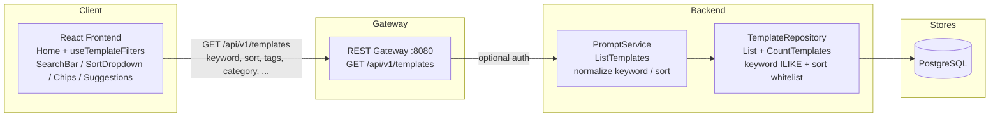

# Template Search & Filtering — Architecture Design

| | |
|---|---|
| **Feature ID** | template-search-filtering |
| **Version** | 1.0 |
| **Status** | Approved for implementation |
| **Author** | Architect Agent |
| **Upstream** | [Requirements](../design/template-search-filtering-requirements.md), [UI/UX Design](../design/template-search-filtering-ui-ux-design.md) |
| **Downstream** | [Detailed Design](template-search-filtering-detailed-design.md) |

## 1. Overview

Template search & filtering closes the platform's biggest discovery gap:
keyword search over title/description/tags/category/latest-version content,
multi-select tag filtering (AND), four sort orders (`newest`, `most_liked`,
`most_favorited`, `trending`), result counts, and URL-synced filter state on
the home page. The design is deliberately **additive**: no new endpoints, no
schema change, no new services. `ListTemplates` gains `keyword`/`sort`
request fields and `total_count` response fields; the repository `List`
gains a parameterized keyword condition and a whitelisted `ORDER BY`; the
frontend funnels every filter source (search bar, sidebar, chips,
suggestions, URL) through one new hook that mirrors state to the URL.

### 1.1 Resolved Open Questions

| # | Question (from requirements §9) | Decision |
|---|---|---|
| D-2 | Latest-version content match | **Included in v1.** An `EXISTS` subquery checks the latest `template_versions` row per template (latest = `ORDER BY version DESC LIMIT 1`, served by the existing `idx_template_versions_template_id`). If list latency degrades beyond the NFR-1 budget, the documented fallback is dropping the content branch — title/description/tags/category matching remains. |
| D-3 | Trending window source | **Confirmed feasible.** `template_likes.created_at` and `template_favorites.created_at` are `TIMESTAMPTZ NOT NULL`. Trending = windowed `COUNT(*)` over both tables, joined once as derived tables (not per-row correlated subqueries), 7-day constant window, tie-break `created_at DESC`. |
| D-9 | ILIKE performance | **v1 ships plain ILIKE without trigram indexes** — `ILIKE '%kw%'` cannot use btree, and a seq scan is acceptable at the current scale (NFR-1 budget: p95 < 500ms at ≤100k templates). `pg_trgm` GIN indexes on `title`/`description` are the documented upgrade path, to be applied only if p95 exceeds budget. Two covering indexes on the engagement tables *are* added for trending (§5.2). |

### 1.2 Non-Goals

- Full-text search (tsvector/GIN, Meilisearch, Elastic) — ILIKE only in v1.
- Search highlighting/snippets, relevance ranking (BM25-style).
- Saved searches / per-user search history.
- Author/owner name search; date-range filters.
- Admin search UI (the admin moderation list may *reuse* the repository
  capabilities later — FR-33 — but no admin surface changes here).
- Fuzzy/phonetic matching; CJK word segmentation (ILIKE substring match
  already works for CJK).
- Materialized trending rollup (v1 computes from raw tables).
- **Monetization of any kind** — no paid placement, promoted results, or
  ranking-for-sale surfaces; excluded from this architecture entirely.

## 2. System Context



## 3. Components Involved

| Component | Change |
|---|---|
| `backend/api/proto/v1/prompt.proto` | `ListTemplatesRequest` gains `keyword = 10`, `sort = 11`; `ListTemplatesResponse` gains `total_count = 5`, `private_total_count = 6` (both `int32`). |
| `backend/internal/repository/template_repository.go` | Extract a shared condition builder; add the keyword `ILIKE` condition (with LIKE-metacharacter escaping), the sort whitelist `ORDER BY` branches (incl. trending derived-table joins), and a new `CountTemplates` method. |
| `backend/internal/service/prompt.go` | Keyword/sort normalization (trim, collapse whitespace, 100-rune cap; whitelist validation); wire both into **all four** listing paths (my-likes/my-favorites, anonymous, specific-visibility, mixed); populate `total_count`/`private_total_count`; observability logging (keyword *length*, never content). |
| `backend/cmd/server/main.go` | `GET /api/v1/templates` maps `keyword` (with `q` accepted as alias) and `sort` query parameters onto the proto fields. |
| `frontend/src/hooks/useTemplateFilters.js` | **New.** Owns filter state, URL sync (`useSearchParams`), 300ms debounce, request race guard, and fetch orchestration. |
| `frontend/src/components/{SearchBar,SortDropdown,FilterChipRow,SuggestionsDropdown,ResultCount,EmptyState,SkeletonCards}.js` | **New.** Search surface components (Aurora-styled, token-only). |
| `frontend/src/pages/Home.js` | Delegates listing state to `useTemplateFilters`; renders the search row, chips, count, skeletons, empty/error states; keeps infinite scroll. |
| `frontend/src/components/Sidebar.js` | Tag rows gain multi-select checkbox affordance; taxonomy data (categories/tags) lifted to the page so suggestions share it without refetch. |
| `frontend/src/locales/{en,zh}/translation.json` | New `search.*` namespace, EN/ZH parity. |
| `deployment/init.sql` (+ chart copy) | Two idempotent performance indexes for trending. **No table/column changes.** |

## 4. API Design

### 4.1 Query Parameters (existing endpoint `GET /api/v1/templates`)

| Param | Type | Default | Description |
|---|---|---|---|
| `keyword` | string, ≤100 chars | empty | Case-insensitive **phrase** match against `title`, `description`, `category`, individual `tags` values, and latest-version `content`. Trimmed; internal whitespace collapsed; empty/whitespace-only = no keyword filter. `q` is accepted as an alias. |
| `sort` | enum string | `newest` | One of `newest` \| `most_liked` \| `most_favorited` \| `trending`. Invalid values silently fall back to `newest` (FR-12) — never an error. |

All existing parameters (`page_size`, `page_token`, `visibility`, `owner_id`,
`category`, `language`, `tags`, `my_likes`, `my_favorites`) are unchanged and
combine freely with the new ones (FR-15).

### 4.2 Response Additions

| Field | Type | Description |
|---|---|---|
| `total_count` | `int32` | Total templates matching the current filters in the public/single stream. Present on every response (0 when empty). |
| `private_total_count` | `int32` | Total matches in the private stream — populated only in logged-in mixed view; 0 otherwise. The UI sums both counts (UI/UX §6.5). |

`int32` follows the project convention for proto count fields (protojson
serializes `int64` as a string, which breaks JS clients).

### 4.3 Sort Semantics

| Value | ORDER BY |
|---|---|
| `newest` (default) | `created_at DESC` — identical to today's behavior |
| `most_liked` | `like_count DESC, created_at DESC` |
| `most_favorited` | `favorite_count DESC, created_at DESC` |
| `trending` | `(likes + favorites in trailing 7 days) DESC, created_at DESC` |

The sort applies uniformly to all listing contexts — public, private,
mixed, my-likes, my-favorites (FR-11). The whitelist is the extension
point: the template-ratings design adds `top_rated` here when it lands
(its architecture §4.3).

### 4.4 Compatibility (NFR-3)

Clients that omit `keyword`/`sort` receive byte-identical behavior to
today: no keyword condition, default `newest` order. The new response
fields are additive; existing clients ignore unknown fields. The mixed-view
pagination token format `public:private` is untouched (FR-28a).

### 4.5 Error Codes

No new error conditions are introduced — search is a read-only extension of
an existing endpoint:

| HTTP | gRPC | Condition (all pre-existing) |
|---|---|---|
| 401 | `UNAUTHENTICATED` | Bearer token present but invalid (optional-auth path). |
| 500 | `INTERNAL` | Repository failure. |
| — | — | Invalid `sort` → silent fallback to `newest`; over-length keyword → truncated to 100 runes. Neither is an error. |

## 5. Data Model

### 5.1 No Schema Change

v1 needs no new tables or columns (NFR-8): keyword matching runs over
existing `templates` columns and `template_versions.content`; trending uses
existing `template_likes`/`template_favorites` timestamps; sorts use the
existing denormalized `like_count`/`favorite_count`.

### 5.2 Performance Indexes (idempotent, both init.sql copies)

```sql
CREATE INDEX IF NOT EXISTS idx_template_likes_template_created
    ON template_likes(template_id, created_at);
CREATE INDEX IF NOT EXISTS idx_template_favorites_template_created
    ON template_favorites(template_id, created_at);
```

These serve the trending windowed aggregates. The `pg_trgm` GIN upgrade
path for keyword ILIKE (D-9) is deliberately **not** applied in v1.

### 5.3 Keyword Condition Shape

One parameterized pattern `%<escaped keyword>%` (escaping `\`, `%`, `_` so
user input is always literal) is OR-matched across fields; a template
matches if **any** field contains the phrase (FR-2/FR-2a/FR-3):

```sql
AND (
    t.title ILIKE $n
 OR t.description ILIKE $n
 OR t.category ILIKE $n
 OR EXISTS (SELECT 1 FROM unnest(t.tags) AS tg WHERE tg ILIKE $n)
 OR EXISTS (SELECT 1 FROM template_versions tv
            WHERE tv.id = (SELECT tv2.id FROM template_versions tv2
                           WHERE tv2.template_id = t.id
                           ORDER BY tv2.version DESC LIMIT 1)
              AND tv.content ILIKE $n)
)
```

### 5.4 Trending Shape

Windowed aggregates computed **once** as derived tables and joined — no
per-row correlated subqueries:

```sql
LEFT JOIN (SELECT template_id, COUNT(*) AS cnt FROM template_likes
           WHERE created_at > now() - interval '7 days'
           GROUP BY template_id) el ON el.template_id = t.id
LEFT JOIN (SELECT template_id, COUNT(*) AS cnt FROM template_favorites
           WHERE created_at > now() - interval '7 days'
           GROUP BY template_id) ef ON ef.template_id = t.id
...
ORDER BY (COALESCE(el.cnt, 0) + COALESCE(ef.cnt, 0)) DESC, t.created_at DESC
```

## 6. Auth & Authorization

- Read-only; the existing optional-auth dance (anonymous → public only;
  logged-in → mixed or explicit visibility) is unchanged.
- **Visibility rules are enforced by the same `WHERE` clause in every
  path** — keyword and sort are purely additive conditions and cannot leak
  private templates (AC-7/AC-8). The service never trusts client-supplied
  identity; `current_user_id` still comes from context only.
- The banned-owner exclusion (`NOT EXISTS ... users.status = 'banned'`)
  stays in the shared condition builder, so it applies to keyword results
  identically (US-S12a).
- `total_count` is computed with the *same* conditions as the list —
  visibility, banned-owner, keyword, filters — so counts can never disagree
  with results.

## 7. Frontend

- **`useTemplateFilters` hook** (new): single owner of
  keyword/category/tags/sort/visibility state. URL contract on the home
  route: `?q=`, `?category=`, `?tags=a,b` (comma-separated),
  `?sort=`, `?visibility=`. Keyword typing updates the URL with
  `replace` (no history spam); discrete filter changes push (FR-18a).
  Restore order on load: URL wins → localStorage visibility default →
  auth-state default (D-10). 300ms trailing debounce; Enter bypasses;
  monotonically increasing `requestId` discards stale responses.
  `my_likes`/`my_favorites`/`owner_id` remain transient (not URL-synced).
- **SearchBar** with SuggestionsDropdown (≥2 chars, max 5 rows, categories
  then tags, derived from taxonomy data already fetched for the Sidebar —
  zero extra requests, FR-20/NFR-2).
- **SortDropdown** (4 options), **FilterChipRow** (removable chips + Clear
  all), **ResultCount** (`aria-live="polite"`), **EmptyState** (search
  variant with echoed keyword), **SkeletonCards** (8 shimmer cards on new
  queries only).
- **Sidebar**: tag rows become multi-select checkboxes (AND semantics);
  category click still resets tags (existing behavior kept).
- **Home**: keeps infinite scroll and the mixed-view two-stream handling;
  result count = `total_count + private_total_count`.
- **i18n**: `search.*` namespace, EN/ZH parity; sort API values are ASCII
  slugs, never localized labels.

## 8. Configuration

No new environment variables. The trending window is a server-side Go
constant (`7 days`, FR-10) — deliberately not user- or operator-tunable in
v1.

## 9. Security Considerations

- **Injection**: keyword is a bound parameter; `%`/`_`/`\` are escaped so
  input is literal. Sort values map to hardcoded `ORDER BY` clauses via a
  whitelist switch — user input is never interpolated into SQL (FR-26,
  NFR-7).
- **Privacy**: logs record keyword *length* and sort value only, never
  keyword content (NFR-9). No new PII surface.
- **Access control**: no new authz decisions; existing visibility and
  banned-owner rules cover the new filters by construction (§6).
- **Abuse**: read-only endpoint behind existing pagination; no new rate
  limit needed.

## 10. Deployment Notes

- The two indexes are additive and idempotent; both init.sql copies
  (`deployment/init.sql` and `deployment/chart/open-prompts/init.sql`)
  updated in the same commit.
- No new services, ports, Redis keys, or migrations beyond the indexes.
- `backend/server` is a tracked build artifact — never commit changes to it.

## 11. Test Strategy

- **FVT** (`tests/fvt.py`): `test_template_search_filtering` — keyword
  match across title/description/tags/category/latest-version content
  (case-insensitive, CJK substring, multi-word phrase, stale-version
  content excluded); LIKE-metacharacter literalness; multi-tag AND; all
  four sorts (trending excludes >7-day-old engagement); `total_count`
  correctness; pagination with keyword+sort; mixed view includes own
  private matches while anonymous never sees them; invalid sort fallback;
  whitespace-only keyword = no filter; 100-rune cap; banned-owner
  exclusion; my-likes + keyword combination.
- **Unit**: service normalization (trim/collapse/cap incl. CJK rune vs
  byte, sort whitelist); repository condition builder (parameter
  numbering, escaping, sort branch selection); `MockTemplateRepository`
  gains a `CountTemplates` stub.
- **E2E** (test-agent): search bar debounce/Enter, suggestions behavior
  and a11y, sort dropdown keyboard nav, chip remove/clear-all, URL
  deep-link restore, back/forward, empty state, result count, skeleton
  loading, error+retry keeps last results, i18n EN/ZH parity.
