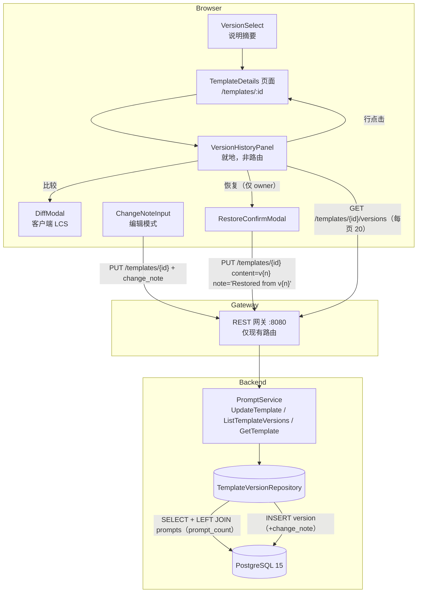

# 模板版本管理 UX — 架构设计

- **功能 ID：** `template-versioning`
- **版本：** 1.0
- **状态：** 已批准进入实现
- **作者：** 架构 Agent
- **上游文档：**[需求分析](../design/template-versioning-requirements-zh-CN.md) · [UI/UX 设计](../design/template-versioning-ui-ux-design-zh-CN.md)
- **下游文档：**[详细设计（中文）](./template-versioning-detailed-design-zh-CN.md) · [Detailed Design (EN)](./template-versioning-detailed-design.md)

---

## 1. 概述

后端早已完成版本管理中最困难的部分：每次内容有变化的 `UpdateTemplate` 都会向 `template_versions` 追加一行（`UNIQUE(template_id, version)`），提示词被固定到具体的 `version_id`，别名将名称映射到版本。缺失的完全是 UX 层，外加一个可空列。本功能新增：

1. **可选变更说明** —— `template_versions` 上可空的 `change_note TEXT`（≤ 200 字符），贯穿 `UpdateTemplateRequest`，并在所有返回 `TemplateVersion` 的位置暴露。
2. **版本历史面板** —— 模板详情页上的就地折叠面板（非路由），按时间倒序列出版本：说明、相对时间、内容长度、提示词使用数、逐行操作，每页 20 条分页。
3. **客户端 diff 弹窗** —— 任意两个版本之间的统一行 diff（A/B 选择器、交换、+N/−M 统计）。无服务端 diff 端点。
4. **非破坏性恢复** —— 复用现有 `UpdateTemplate`：恢复 v3 会以 v3 的内容写入一个**新**版本，并带自动说明 `Restored from v3`。历史只追加；不删除、不重排。
5. **VersionSelect 增强** —— 现有下拉选项的副行显示说明摘要。

**不新增端点、不新增表，仅对 proto/REST 做增量字段扩展。** 模板详情页上的普通用户界面；无管理控制台页面、无管理 API（FR-21/FR-22）。

**已裁决的开放问题**（来自需求 §10）：

| # | 问题 | 决策 |
|---|---|---|
| 1 | `prompt_count`：内联 LEFT JOIN 还是批量二次查询 | **内联 LEFT JOIN + COUNT**，放在 `ListTemplateVersions` 中（单查询，按版本主键 `GROUP BY`）。当前规模下完全够用；由 `prompts(version_id)` 上的新索引支撑。 |
| 2 | Diff：npm `diff` 包还是手写 LCS | **手写 LCS，放在 `utils/diff.js`**（约 60 行，零新依赖）。内容 ≤ 32 KB 且行数很小，按行做 O(n·m) 毫无压力；仓库依赖足迹保持最小。若模板规模显著增长，`diff` npm 包是未来的升级路径。 |
| 3 | `CreateTemplate` 是否接受 `change_note` | **v1 不加。** v1 是初始版本，说明是隐含的。加字段会牵动 `CreateTemplateRequest`、创建服务路径和创建弹窗，收益有限。若用户提出，后续可增量补充。 |
| 4 | 迁移 / 回填 | **确认：无需回填。** `change_note TEXT NULL` 采用仓库既有的幂等 `DO $$ ... IF NOT EXISTS ... ALTER` 模式；存量行保持 NULL，渲染为"无说明"。 |

**非目标（v1）：** 并排双栏 diff、版本删除（历史只追加）、版本分支/标签、按版本署名、元数据 diff、服务端 diff 端点、管理控制台版本管理、版本变更通知。

## 2. 系统上下文



不新增基础设施、服务、端口或环境变量。唯一的数据变更是一个可空列加一个索引。

## 3. 组件

### 新增组件

| 组件 | 位置 | 职责 |
|---|---|---|
| `VersionHistoryPanel`（含内联 `VersionRow`） | `frontend/src/components/VersionHistoryPanel.js` | 倒序列表：版本号、最新徽标、说明、相对时间、字符/行数、提示词数、比较/恢复操作；每页 20 条加载更多。 |
| `DiffModal` | `frontend/src/components/DiffModal.js` | A/B 版本选择器、交换、统一 diff 渲染、+N/−M 统计、复制 diff、并排回退。 |
| `RestoreConfirmModal` | `frontend/src/components/RestoreConfirmModal.js` | 确认文案（"创建新版本，不删除任何内容"），进行中禁用。 |
| `ChangeNoteInput` | `frontend/src/components/ChangeNoteInput.js` | 可选说明输入，maxlength 200，实时计数（180+ 警告色）。 |
| Diff 工具 | `frontend/src/utils/diff.js` | 手写 LCS 行 diff；归一化输出 `{type: 'add'\|'remove'\|'context', text, aLine, bLine}`。 |
| 相对时间工具 | `frontend/src/utils/time.js` | `formatRelativeTime(date, t)` —— 与通知功能共享（谁先发布谁引入）。 |

### 修改组件

| 组件 | 变更 |
|---|---|
| `backend/api/proto/v1/prompt.proto` | `TemplateVersion` 新增 `change_note`（6）与 `prompt_count`（7）；`UpdateTemplateRequest` 新增 `change_note`（10）。仅增量。 |
| `backend/internal/models/template.go` | `TemplateVersion` 结构体新增 `ChangeNote sql.NullString` 与 `PromptCount int`（读取时计算，不落库）。 |
| `backend/internal/repository/template_version_repository.go` | `Create` 插入 `change_note`；`List` 改为 LEFT JOIN + COUNT 查询；`Get`/`GetLatest` 查询该列。 |
| `backend/internal/service/prompt.go` | `UpdateTemplate` 校验说明长度（≤ 200，否则 `InvalidArgument`）并在新版本上持久化；`versionModelToProto` 映射 `change_note`/`prompt_count`；`ListTemplateVersions` 映射计数。 |
| `frontend/src/pages/TemplateDetails.js` | 历史开关 + 面板状态（`isHistoryOpen`、分页 token）、分页式版本拉取（替换一次性 `page_size: 100`）、编辑模式说明输入、恢复流程、diff 弹窗接线。 |
| `frontend/src/components/VersionSelect.js` | 选项副行在存在说明时显示摘要（约 40 字符）。 |
| `frontend/src/locales/{en,zh}/translation.json` | `versioning.*` 命名空间（两种语言）+ 共享 `time.*` 键。 |
| `deployment/init.sql` + `deployment/chart/open-prompts/init.sql` | 幂等 `change_note` 列块 + `idx_prompts_version_id`（两份副本，字节一致）。 |

**保持不变（重要）：** `backend/cmd/server/main.go` **零改动** —— PUT handler 已将整个 JSON body 反序列化为 `UpdateTemplateRequest`（proto 字段存在后 `change_note` 自动流入），versions GET handler 已透传 `page_size`/`page_token`。`frontend/src/services/api.js` **零改动** —— `updateTemplate(id, data)` 与 `listTemplateVersions(id, params)` 是通用透传。无新 RPC、无新路由。

## 4. API 设计（摘要）

不新增端点。对现有契约的增量变更：

| 端点 | 变更 |
|---|---|
| `PUT /api/v1/templates/{id}` | 请求体新增可选 `change_note`（字符串，≤ 200 字符；> 200 → `400 InvalidArgument`）。响应 `new_version` 新增 `change_note`。 |
| `GET /api/v1/templates/{id}/versions` | 每个版本新增 `change_note`（NULL 时为空字符串）与 `prompt_count`（整数；无提示词时为 0）。 |
| `GET /api/v1/templates/{id}` | `latest_version` 新增 `change_note`（`prompt_count` 仅在版本列表中有意义；此处输出 0，应忽略）。 |

向后兼容（FR-20）：所有新字段均为增量；忽略它们的旧客户端行为与今天完全一致。旧**后端**只是不输出这些字段，前端按响应检测并隐藏使用数列（NFR-6）。别名映射与提示词 `version_id` 固定不受影响。

## 5. 数据模型

一个列 + 一个索引，以仓库既有的幂等模式追加到两份 `init.sql` 副本：

```sql
DO $$
BEGIN
    IF NOT EXISTS (SELECT 1 FROM information_schema.columns
                   WHERE table_name='template_versions' AND column_name='change_note') THEN
        ALTER TABLE template_versions ADD COLUMN change_note TEXT;
        COMMENT ON COLUMN template_versions.change_note IS 'Optional user-provided change note (max 200 chars, enforced in service layer)';
    END IF;
END $$;

CREATE INDEX IF NOT EXISTS idx_prompts_version_id ON prompts(version_id);
```

设计要点：

- **可空、无回填** —— 存量行保持 NULL，渲染为"无说明"（开放问题 #4 已裁决）。
- **长度上限在服务层强制**（`InvalidArgument`），而非 DB CHECK —— 与仓库先例一致（templates 的 visibility/type、users 的 role/status 均为服务层校验）。`char_length` CHECK 需要额外的 `pg_constraint` 幂等守卫，相比服务层校验 + 客户端 maxlength 收益甚微。
- **`idx_prompts_version_id`** 支撑 `prompt_count` 的 LEFT JOIN；目前 `prompts` 上只有 `template_id` 索引，否则 JOIN 会走哈希扫描。廉价、幂等，对任何未来的按版本使用量查询都有用。
- **恢复说明是存储数据** —— 规范英文字符串 `Restored from v{n}`（渲染时绝不翻译，NFR-5/D-7）；周围的弹窗文案完全本地化。

## 6. 认证与授权

- **查看历史/diff** 完全遵循模板可见性：公开 → 任何人（含匿名），私有 → owner。`ListTemplateVersions` 与 `GetTemplate` 已通过仓储层的可见性过滤强制执行；无变更。
- **恢复仅限 owner**，且复用现有 `UpdateTemplate` 授权：网关要求有效 JWT，服务层保留既有的 owner 一致性检查。不引入也不削弱任何授权面。
- **说明为纯文本** —— 通过 React 插值渲染（自动转义），绝不使用 `dangerouslySetInnerHTML`；200 字符上限约束存储。
- 既有观察（明确不在范围内）：`UpdateTemplate` 的 owner 校验比较的是客户端提供的 `owner_id` 字段而非认证用户。这是今天所有模板编辑的既有行为；收紧它是一个独立的平台级变更，不得夹带进本功能。

## 7. 前端架构

- **不新增路由。** 一切都在 `/templates/:id` 上：面板打开时就地替换预览区（相同最小高度，无布局跳动）；diff 与恢复确认弹窗复用现有 `Modal`。
- **状态**保留在 `TemplateDetails`（不新增 Redux slice —— 版本历史是页面局部的，非跨页）：在既有 `versions` 状态上扩展 `isHistoryOpen`、`historyPageToken`、`diffState {aId, bId}`；保持单一 `setSelectedVersionId` 处理器作为面板行、下拉与恢复后选择的唯一事实来源。
- **分页：** 将一次性 `page_size: 100` 拉取替换为 `page_size: 20` + token 累积（"加载更多"追加）。下拉消费累积后的列表 —— UX 不变。
- **Diff：** `utils/diff.js`（按行 LCS）→ 归一化行；弹窗渲染单一行类型；交换翻转并重新归一化 A=旧/B=新；统计芯片来自增/删计数；计算抛错时走并排原始内容回退路径。
- **恢复：** `updateTemplate(id, { ...currentMetadata, content: oldVersion.content, change_note: 'Restored from v{n}' })` —— 后端的内容差异检查保证创建新版本；成功后重新拉取第 1 页、选中 `new_version.id`、toast。悲观式（转圈、无乐观插入）以避免幻影版本号。
- **i18n：** 新 `versioning.*` 命名空间（键在 UI/UX 文档 §9 中逐字给出）进入**两种**语言包；相对时间走共享 `time.*` 工具键。存储的说明在两种语言下均原样渲染。

## 8. 配置

无。不新增环境变量、不改动 compose/helm、无特性开关。

## 9. 安全考量

- **无新攻击面：** 无新端点，除长度受限的纯文本说明外无新参数，除既有参数化查询外无客户端可控 SQL。
- **XSS：** 说明与内容作为 React 文本节点渲染；diff 视图在 `pre-wrap` 等宽块中渲染行，不做任何 HTML 解释。
- **授权：** 查看遵循模板可见性；恢复复用既有 owner 校验（§6）。非 owner 可见面板与比较，但无恢复操作（隐藏而非禁用）。
- **数据完整性：** 历史构造上只追加（恢复即追加；不存在删除路径）；`UNIQUE(template_id, version)` 防止编号冲突；`latest` 别名 upsert 保证恢复后别名映射一致。

## 10. 部署说明

- DDL 幂等（`DO $$` 列守卫 + `CREATE INDEX IF NOT EXISTS`），全新卷与存量部署均安全；存量行无需回填。
- 相同的块必须追加到 `deployment/chart/open-prompts/init.sql`。
- 后端二进制与前端包照常重建；无迁移工具、无停机（列为可空，且代码只在"旧后端"方向容忍其缺失 —— 新代码配旧 schema 会在新增 SELECT 列上失败，因此 **DDL 需先于或随后端一起部署**，与任何增量列的排序规则相同）。
- 回滚：若代码回滚，该列与索引是无害的孤儿；删除它们是可选的。

## 11. 测试策略（摘要）

- **FVT（`tests/fvt.py`）：** 带说明更新 → `new_version.change_note` 已存储；列出版本 → `change_note` + `prompt_count`（创建固定到 v1 的提示词并断言计数）；说明 > 200 字符 → 400；内容不变 + 说明 → 无新版本、说明未存储；恢复（PUT 旧内容 + `Restored from v1`）→ 新版本追加、所有先前版本完好、`latest` 别名已移动。
- **后端单元测试：** 说明长度校验、说明仅在内容变化时持久化、`versionModelToProto` NULL→空映射、LEFT JOIN 计数正确性（mock 行）。
- **前端单元测试：** diff 工具（增/删/上下文/空/相同）、说明计数/maxlength、恢复 payload 构造器、面板渲染/选择/分页/owner 门控、DiffModal 默认值/交换/统计、i18n 键对齐。
- **E2E（Nightwatch，test-agent）：** 面板开关 + 列表渲染、行选择、加载更多、比较弹窗（高亮、统计、交换）、恢复确认 → toast → 列表刷新 → 新版本选中、非 owner/匿名门控、说明输入流、EN/ZH 字符串。

完整契约、DDL、分层职责、i18n 键与测试挂钩：见[详细设计](./template-versioning-detailed-design-zh-CN.md)。
