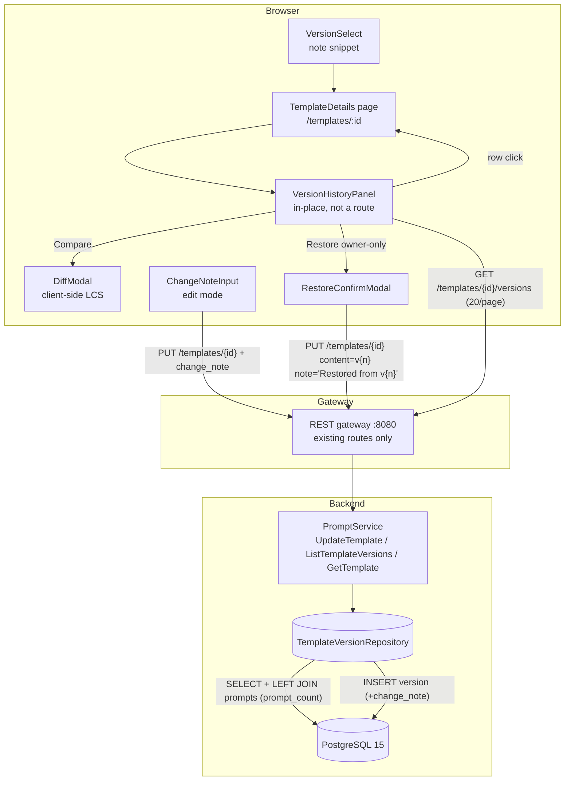

# Template Versioning UX — Architecture Design

- **Feature ID:** `template-versioning`
- **Version:** 1.0
- **Status:** Approved for implementation
- **Author:** Architect Agent
- **Upstream docs:** [Requirements](../design/template-versioning-requirements.md) · [UI/UX Design](../design/template-versioning-ui-ux-design.md)
- **Downstream docs:** [Detailed Design (EN)](./template-versioning-detailed-design.md) · [详细设计（中文）](./template-versioning-detailed-design-zh-CN.md)

---

## 1. Overview

The backend already does the hard part of versioning: every `UpdateTemplate` with changed content appends a new row to `template_versions` (`UNIQUE(template_id, version)`), prompts are pinned to specific `version_id`s, and aliases map names to versions. What is missing is entirely the UX layer plus one nullable column. This feature adds:

1. **Optional change notes** — nullable `change_note TEXT` (≤ 200 chars) on `template_versions`, threaded through `UpdateTemplateRequest` and exposed on `TemplateVersion` everywhere it is returned.
2. **Version history panel** — an in-place collapsible panel on the template details page (not a route) listing versions newest-first with note, relative time, content length, prompt usage count, and per-row actions, paginated 20/page.
3. **Client-side diff modal** — unified line diff between any two versions (A/B selectors, swap, +N/−M stats). No server diff endpoint.
4. **Non-destructive restore** — reuses the existing `UpdateTemplate`: restoring v3 writes a **new** version with v3's content and the auto-note `Restored from v3`. History is append-only; nothing is deleted or renumbered.
5. **VersionSelect enhancement** — the existing dropdown option sub-line gains a note snippet.

**No new endpoints, no new tables, additive proto/REST fields only.** Regular-user surface on the template details page; no admin console pages and no admin APIs (FR-21/FR-22).

**Resolved open questions** (from requirements §10):

| # | Question | Decision |
|---|---|---|
| 1 | `prompt_count`: inline LEFT JOIN vs batched second query | **Inline LEFT JOIN + COUNT** in `ListTemplateVersions` (single query, `GROUP BY` the version PK). Fine at current scale; supported by a new index on `prompts(version_id)`. |
| 2 | Diff: npm `diff` package vs hand-rolled LCS | **Hand-rolled LCS in `utils/diff.js`** (~60 lines, zero new dependencies). Content is ≤ 32 KB and line counts are small, so O(n·m) on lines is trivial; the repo's dependency footprint stays minimal. The `diff` npm package remains a future upgrade path if templates grow very large. |
| 3 | `change_note` on `CreateTemplate` | **No for v1.** v1 is the initial version; a note is implied. Adding the field would touch `CreateTemplateRequest`, the create service path, and the create modal for marginal value. It can be added additively later if users ask. |
| 4 | Migration / backfill | **Confirmed: no backfill.** `change_note TEXT NULL` via the repo's idempotent `DO $$ ... IF NOT EXISTS ... ALTER` pattern; existing rows stay NULL and render as "No note". |

**Non-goals (v1):** side-by-side two-column diff, version deletion (history is append-only), version branching/labels, per-version author attribution, metadata diff, server-side diff endpoint, admin console version management, notifications on version changes.

## 2. System Context



No new infrastructure, services, ports, or environment variables. The only data change is one nullable column plus one index.

## 3. Components

### New components

| Component | Location | Responsibility |
|---|---|---|
| `VersionHistoryPanel` (+ inline `VersionRow`) | `frontend/src/components/VersionHistoryPanel.js` | Newest-first list: number, Latest badge, note, relative time, chars/lines, prompt count, Compare/Restore actions; 20/page Load more. |
| `DiffModal` | `frontend/src/components/DiffModal.js` | A/B version selectors, swap, unified diff rendering, +N/−M stats, copy-diff, side-by-side fallback. |
| `RestoreConfirmModal` | `frontend/src/components/RestoreConfirmModal.js` | Confirmation copy ("creates a new version, nothing is deleted"), in-flight disable. |
| `ChangeNoteInput` | `frontend/src/components/ChangeNoteInput.js` | Optional note input, maxlength 200, live counter (warning at 180+). |
| Diff util | `frontend/src/utils/diff.js` | Hand-rolled LCS line diff; normalized `{type: 'add'\|'remove'\|'context', text, aLine, bLine}` output. |
| Relative-time util | `frontend/src/utils/time.js` | `formatRelativeTime(date, t)` — shared with the notifications feature (whichever ships first introduces it). |

### Modified components

| Component | Change |
|---|---|
| `backend/api/proto/v1/prompt.proto` | `TemplateVersion` gains `change_note` (6) and `prompt_count` (7); `UpdateTemplateRequest` gains `change_note` (10). Additive only. |
| `backend/internal/models/template.go` | `TemplateVersion` struct gains `ChangeNote sql.NullString` and `PromptCount int` (computed, not stored). |
| `backend/internal/repository/template_version_repository.go` | `Create` inserts `change_note`; `List` becomes the LEFT JOIN + COUNT query; `Get`/`GetLatest` select `change_note`. |
| `backend/internal/service/prompt.go` | `UpdateTemplate` validates note length (≤ 200 → else `InvalidArgument`) and persists the note on new versions; `versionModelToProto` maps `change_note`/`prompt_count`; `ListTemplateVersions` maps counts. |
| `frontend/src/pages/TemplateDetails.js` | History toggle + panel state (`isHistoryOpen`, pagination token), paginated version fetch (replaces one-shot `page_size: 100`), note input in edit mode, restore flow, diff modal wiring. |
| `frontend/src/components/VersionSelect.js` | Option sub-line shows note snippet (~40 chars) when present. |
| `frontend/src/locales/{en,zh}/translation.json` | `versioning.*` namespace (both locales) + shared `time.*` keys. |
| `deployment/init.sql` + `deployment/chart/open-prompts/init.sql` | Idempotent `change_note` column block + `idx_prompts_version_id` (both copies, byte-identical). |

**Unchanged (important):** `backend/cmd/server/main.go` needs **zero changes** — the PUT handler already unmarshals the whole JSON body into `UpdateTemplateRequest` (so `change_note` flows once the proto field exists), and the versions GET handler already passes `page_size`/`page_token` through. `frontend/src/services/api.js` needs **zero changes** — `updateTemplate(id, data)` and `listTemplateVersions(id, params)` are generic pass-throughs. No new RPCs, no new routes.

## 4. API Design (summary)

No new endpoints. Additive changes to existing contracts:

| Endpoint | Change |
|---|---|
| `PUT /api/v1/templates/{id}` | Request body gains optional `change_note` (string, ≤ 200 chars; > 200 → `400 InvalidArgument`). Response `new_version` gains `change_note`. |
| `GET /api/v1/templates/{id}/versions` | Each version gains `change_note` (empty string when NULL) and `prompt_count` (int; 0 when no prompts). |
| `GET /api/v1/templates/{id}` | `latest_version` gains `change_note` (`prompt_count` is only meaningful in the versions list; it is emitted as 0 here and must be ignored). |

Backwards compatibility (FR-20): all new fields are additive; older clients that ignore them behave exactly as today. Older *backends* simply omit the fields, which the frontend detects per-response to hide the usage column (NFR-6). Alias mapping and prompt `version_id` pinning are untouched.

## 5. Data Model

One column + one index, appended to both `init.sql` copies using the repo's established idempotent patterns:

```sql
DO $$
BEGIN
    IF NOT EXISTS (SELECT 1 FROM information_schema.columns
                   WHERE table_name='template_versions' AND column_name='change_note') THEN
        ALTER TABLE template_versions ADD COLUMN change_note TEXT;
        COMMENT ON COLUMN template_versions.change_note IS 'Optional user-provided change note (max 200 chars, enforced in service layer)';
    END IF;
END $$;

CREATE INDEX IF NOT EXISTS idx_prompts_version_id ON prompts(version_id);
```

Design notes:

- **Nullable, no backfill** — existing rows stay NULL and render as "No note" (open question #4 resolved).
- **Length cap enforced in the service layer** (`InvalidArgument`), not a DB CHECK — consistent with the repo precedent (visibility/type on templates, role/status on users are service-validated). A `char_length` CHECK would need its own `pg_constraint` guard for idempotency and buys little over the service check + client maxlength.
- **`idx_prompts_version_id`** supports the `prompt_count` LEFT JOIN; today only `template_id` is indexed on `prompts`, so the JOIN would otherwise hash-scan. Cheap, idempotent, useful for any future per-version usage queries.
- **Restore notes are stored data** — the canonical English string `Restored from v{n}` (never translated at render time, NFR-5/D-7); the surrounding modal chrome is fully localized.

## 6. Authentication & Authorization

- **Viewing history/diff** follows template visibility exactly as today: public → anyone (anonymous included), private → owner. `ListTemplateVersions` and `GetTemplate` already enforce this via the repository's visibility filtering; no change.
- **Restore is owner-only** and rides the existing `UpdateTemplate` authorization: the gateway requires a valid JWT, and the service keeps its existing owner consistency check. No new authorization surface is introduced or weakened.
- **Notes are plain text** — rendered through React interpolation (auto-escaped), never `dangerouslySetInnerHTML`; 200-char cap bounds storage.
- Pre-existing observation (explicitly out of scope): `UpdateTemplate`'s owner check compares the client-supplied `owner_id` field rather than the authenticated user. This is today's behavior for all template edits; tightening it is a separate, platform-wide change that must not be smuggled into this feature.

## 7. Frontend Architecture

- **No new routes.** Everything lives on `/templates/:id`: the panel replaces the preview area in-place while open (same min-height, no layout jump); the diff and restore confirm modals reuse the existing `Modal`.
- **State** stays in `TemplateDetails` (no new Redux slice — version history is page-local, not cross-page): extend the existing `versions` state with `isHistoryOpen`, `historyPageToken`, `diffState {aId, bId}`; keep the single `setSelectedVersionId` handler as the selection source of truth for panel rows, dropdown, and post-restore selection.
- **Pagination:** replace the one-shot `page_size: 100` fetch with `page_size: 20` + token accumulation ("Load more" appends). The dropdown consumes the accumulated list — unchanged UX.
- **Diff:** `utils/diff.js` (LCS on lines) → normalized rows; the modal renders one row type; swap flips and re-normalizes A=older/B=newer; stats chip from add/remove counts; side-by-side raw panes as the fallback path if computation throws.
- **Restore:** `updateTemplate(id, { ...currentMetadata, content: oldVersion.content, change_note: 'Restored from v{n}' })` — the backend's content-diff check guarantees a new version; on success re-fetch page 1, select `new_version.id`, toast. Pessimistic (spinner, no optimistic insert) to avoid phantom version numbers.
- **i18n:** new `versioning.*` namespace (keys specified verbatim in the UI/UX doc §9) in **both** locales; relative times via the shared `time.*` util keys. Stored notes render verbatim in both locales.

## 8. Configuration

None. No new environment variables, no compose/helm changes, no feature flags.

## 9. Security Considerations

- **No new attack surface:** no new endpoints, no new parameters beyond a length-capped plain-text note, no client-controlled SQL beyond existing parameterized queries.
- **XSS:** notes and content render as React text nodes; the diff view renders lines in a `pre-wrap` monospace block with no HTML interpretation.
- **Authorization:** viewing follows template visibility; restore rides the existing owner check (§6). Non-owners see the panel and Compare but no Restore action (hidden, not disabled).
- **Data integrity:** history is append-only by construction (restore appends; no delete path exists); `UNIQUE(template_id, version)` prevents numbering collisions; the `latest` alias upsert keeps the alias mapping consistent after restore.

## 10. Deployment Notes

- DDL is idempotent (`DO $$` column guard + `CREATE INDEX IF NOT EXISTS`), safe on fresh volumes and existing deployments alike; existing rows need no backfill.
- The identical block must be appended to `deployment/chart/open-prompts/init.sql`.
- Backend binary and frontend bundle rebuild as usual; no migration tooling, no downtime (the column is nullable and the code tolerates its absence only in the "old backend" direction — new code with an old schema would fail on the new SELECT column, so **deploy DDL before or with the backend**, the same ordering rule as any additive column).
- Rollback: the column and index are harmless orphans if the code is rolled back; dropping them is optional.

## 11. Test Strategy (summary)

- **FVT (`tests/fvt.py`):** update with note → `new_version.change_note` stored; list versions → `change_note` + `prompt_count` (create prompts pinned to v1, assert count); note > 200 chars → 400; unchanged content + note → no new version, note not stored; restore (PUT old content + `Restored from v1`) → new version appended, all prior versions intact, `latest` alias moved.
- **Backend unit tests:** note-length validation, note persisted only on content change, `versionModelToProto` NULL→empty mapping, LEFT JOIN count correctness (mocked rows).
- **Frontend unit tests:** diff util (add/remove/context/empty/identical), note counter/maxlength, restore payload builder, panel render/select/pagination/owner gating, DiffModal defaults/swap/stats, i18n key parity.
- **E2E (Nightwatch, test-agent):** panel toggle + list rendering, row select, Load more, Compare modal (highlighting, stats, swap), restore confirm → toast → list refresh → new version selected, non-owner/anonymous gating, note input flow, EN/ZH strings.

Detailed contracts, DDL, layer responsibilities, i18n keys, and test hooks: see the [detailed design](./template-versioning-detailed-design.md).
