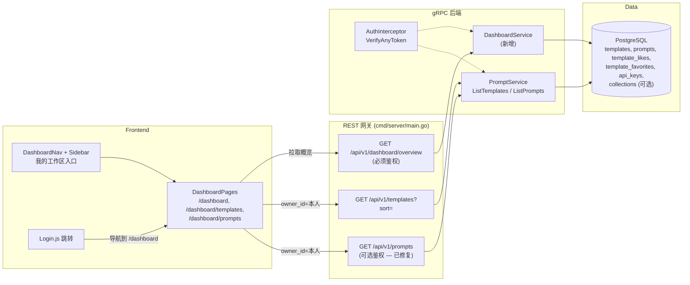
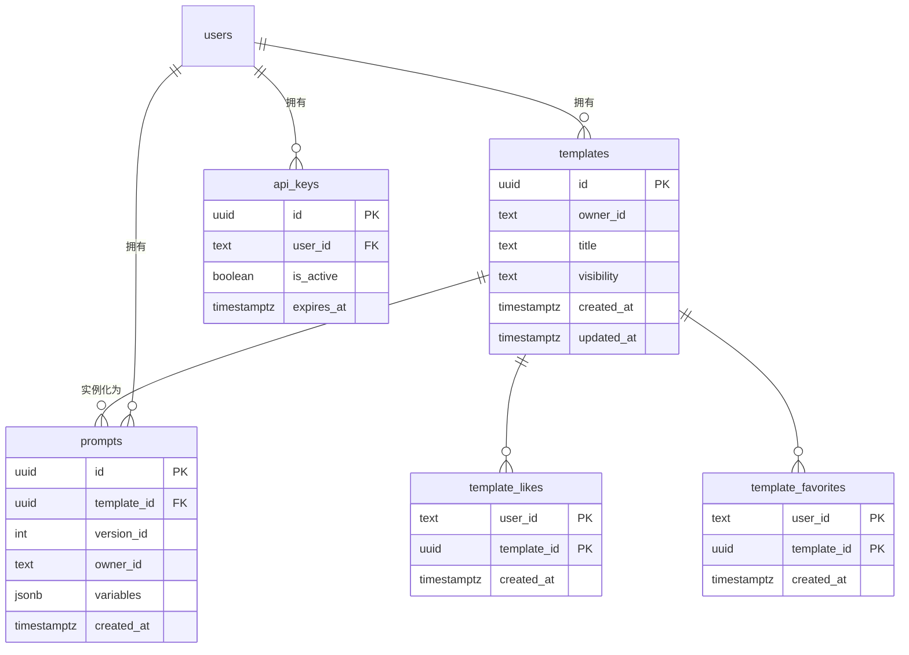

# 用户仪表盘 — 架构设计

| | |
|---|---|
| **功能 ID** | user-dashboard |
| **版本** | 1.0 |
| **状态** | 已批准 |
| **作者** | 架构 Agent |
| **上游** | [需求文档](../design/user-dashboard-requirements-zh-CN.md) · [UI/UX 设计](../design/user-dashboard-ui-ux-design-zh-CN.md) |
| **下游** | [详细设计](user-dashboard-detailed-design-zh-CN.md) · 开发 Agent |

## 1. 概述

用户仪表盘为每个已登录用户提供个人工作区：`/dashboard` 概览页（四个统计卡片：模板、提示词、合集、活跃 API 密钥）、最近动态流和快捷操作，以及两个专属管理页 —— 我的模板（`/dashboard/templates`）和我的提示词（`/dashboard/prompts`）。目前用户自己的内容分散在首页“我的模板”标签、API 密钥页和个人资料页中 —— 仪表盘将所有权集中到一处。

本功能**以读为主、纯聚合**：仅新增一个 RPC（`GetDashboardOverview`），从既有表计算四个 `COUNT` 和最多 10 条的最近动态。模板与提示词管理页复用既有 `ListTemplates` / `ListPrompts` RPC 并传 `owner_id = 本人`。**无需任何新表或新列。**

随本功能一并交付两个紧密耦合的修正：

1. **`ListPrompts` 越权漏洞（安全修复）。** `PromptService.ListPrompts`（`backend/internal/service/prompt.go:754`）应用 `req.OwnerId` 过滤时不校验调用者身份，且 REST 路由 `GET /api/v1/prompts`（`backend/cmd/server/main.go:1331`）为匿名可访问 —— 任何客户端都能枚举任意用户的已实例化提示词（含私有变量值）。修复后，服务端对 `owner_id != 调用者` 返回 `PermissionDenied`，网关路由改用可选鉴权模式，合法调用方（模板详情页本就传 `owner_id`）不受影响。
2. **自有模板按 `updated_at` 排序。** `TemplateRepository.List` 目前仅按 `created_at DESC` 排序（`backend/internal/repository/template_repository.go:180`），而 FR-7 要求管理页按最近*更新*优先展示。在 `ListTemplatesRequest` 上新增可加性字段 `sort`（`""` = 默认 `created`，`"updated"` = `t.updated_at DESC`），经 service → repository 贯通，不影响既有调用方。

### 已解决的开放问题

| # | 问题（需求 §10 / 设计决策） | 决策 |
|---|---|---|
| 1 | `GetDashboardOverview` 放在哪里？ | **新建 `DashboardService`**，位于新文件 `backend/api/proto/v1/dashboard.proto`（与 `notification.proto` 同样的“一服务一 proto”先例）。仪表盘是跨域聚合（模板、提示词、合集、API 密钥），挂在 `PromptService` 上会造成无关仓库耦合。一个 RPC、一个仓库。 |
| 2 | D-3 — 合集特性探测 | **双层优雅降级。** 后端：概览 SQL 读取 `collections` 中 `status='active'` 的行；遇到 `42P01 undefined_table`（特性尚未迁移）时仓库返回 `collection_count = 0` 并记录警告。前端：`hasCollections()` 模块级缓存探测 `GET /api/v1/collections`；404 时隐藏“我的合集”导航项与统计卡片。对 template-collections 是否先上线无硬依赖。 |
| 3 | FR-20 — 提示词查看弹窗的客户端变量替换 | **直接使用服务端渲染好的 `Prompt.content`。** `promptModelToProto`（`prompt.go:896`）在读取时已将 `${var}` 替换进模板内容；弹窗直接展示 `content`。设计稿中的客户端替换工具不再需要 —— 作为有意偏离记录在案。 |
| 4 | `ListPrompts` owner 过滤的鉴权 | **服务端强制。** 当 `owner_id` 已设置且与已认证调用者不同时，`ListPrompts` 返回 `PermissionDenied`。不带 `owner_id` 的匿名 REST 调用保持公开列表行为（所有提示词都是公开模板的公开产物）；带 `owner_id` 的匿名调用返回 `Unauthenticated`。 |
| 5 | FR-7 排序 | `ListTemplatesRequest` 新增 `sort` 字段（字段号 10）：`""`/`"created"` → `t.created_at DESC`（默认不变），`"updated"` → `t.updated_at DESC`。可加性变更；既有调用方不受影响。网关透传 `?sort=`。 |
| 6 | 动态流“创建 vs 更新”标签 | SQL 只产出一种 `template` 动态类型，取 `templates.updated_at`；前端在 `created_at == updated_at`（模板插入时两者相同）时标注 `template_created`，否则 `template_updated`。无 schema 变更，符合 D-2（v1 中 updated_at 是代理）。 |
| 7 | D-4 — 登录后跳转 | `Login.js` 成功后导航到 `/dashboard`，若存在 `?next=` 参数则优先跳转该地址（需要登录的重定向本就会附加该参数）。 |
| 8 | D-6 — 相对时间工具 | **已存在**：`frontend/src/utils/time.js` 中的 `formatRelativeTime` / `useRelativeTime`，以及两种语言的 `time.justNow/minutesAgo/hoursAgo/daysAgo` 键。直接复用。 |
| 9 | 计数用 int64 还是 int32 | 四个计数与动态列表均为 **int32**（protojson 会把 int64 序列化为 JSON 字符串；前端与 FVT 以数字比较计数）。 |
| 10 | 既有 `dashboard.*` i18n 键 | 既有 `dashboard.*` 命名空间（`translation.json:82` —— "Explore Templates"、`my_templates`、`all_mine`、`favorites`、`my_likes`）属于首页 Sidebar 过滤面板，**保持不动**。所有新键位于 `dashboard_v2.*` 之下。 |
| 11 | 提示词行上的来源模板标题 | `Prompt` 消息缺少来源模板标题（"from {{title}}" 与弹窗标题需要）。新增可加性字段 `Prompt.template_title`（字段 8）：`models.Prompt` 增加 `TemplateTitle`，`PromptRepository.List` JOIN `templates` 并选择 `t.title`，`promptModelToProto` 负责映射。无需客户端模板查找。 |

### 非目标

- 不新建事件/动态表 —— 动态流是对既有时间戳的 UNION（D-2：`updated_at` 是代理；v1 除上述启发式外不区分创建与更新）。
- 不缓存概览计数（D-8：每次请求精确 COUNT；在预期规模下查询有索引支撑且开销低）。
- 不做分析 —— 互动指标属于 `prompt-analytics` 功能。
- 不做仪表盘行批量操作（批量 RPC 属于 bulk-operations 功能）。
- 不做仪表盘搜索或跨用户视图 —— 严格限定 `owner_id = 调用者`。
- 不做管理员仪表盘或管理员 API（FR-21/22：管理员只看到自己的个人仪表盘）。
- 不做任何形式的变现（变现不在本项目范围内）。

## 2. 系统上下文

## 3. 涉及组件

| 层 | 组件 | 变更 |
|---|---|---|
| proto | `backend/api/proto/v1/dashboard.proto` | **新增** —— `DashboardService`、`GetDashboardOverview` RPC、动态消息 |
| proto | `backend/api/proto/v1/prompt.proto` | `ListTemplatesRequest.sort` 字段 10；`Prompt.template_title` 字段 8（均为可加性） |
| repository | `backend/internal/repository/dashboard_repository.go` | **新增** —— `GetOverview(ctx, userID)`（4 个 COUNT + UNION 动态） |
| repository | `backend/internal/repository/api_key_repository.go` | **新方法** `CountActiveByUserID` |
| repository | `backend/internal/repository/template_repository.go` | `List` 的 `ORDER BY` 增加 `sort` 分支 |
| service | `backend/internal/service/dashboard.go` | **新增** —— `DashboardService.GetDashboardOverview` |
| service | `backend/internal/service/prompt.go` | `ListPrompts` owner_id 鉴权检查 |
| gateway | `backend/cmd/server/main.go` | `GET /api/v1/dashboard/overview`（必须鉴权）；`GET /api/v1/prompts` 可选鉴权；`/templates` 透传 `sort` |
| frontend | `frontend/src/pages/dashboard/*` | **新增** —— `DashboardLayout`、`OverviewPage`、`TemplatesPage`、`PromptsPage` |
| frontend | `frontend/src/components/dashboard/*` | **新增** —— `StatCard`、`ActivityFeed`、`QuickActions`、`TemplateManageRow`、`PromptRow`、`PromptViewModal`、`FilterChips` |
| frontend | `frontend/src/services/api.js` | `getDashboardOverview()`；`getTemplates({ sort })` 透传 |
| frontend | `frontend/src/App.js`、`Login.js`、`Sidebar.js` | 路由、登录后跳转、“我的工作区”入口 |
| i18n | `frontend/src/locales/{en,zh}/translation.json` | `dashboard_v2.*` + `time.*`（已存在） |
| 测试 | `tests/fvt.py` | `test_user_dashboard`（AC-1–12） |

## 4. API 设计

### 4.1 gRPC（`v1.DashboardService`）

| RPC | 请求 | 响应 | 鉴权 |
|---|---|---|---|
| `GetDashboardOverview` | `GetDashboardOverviewRequest`（空） | `GetDashboardOverviewResponse` | 必须（用户 token） |

`DashboardService` **不**加入 `publicRpcMethods`（`auth.go:73–81`）；`AuthInterceptor` 在服务执行前对匿名调用返回 `Unauthenticated`。

管理页复用的既有 RPC：

| RPC | 变更 | 使用方 |
|---|---|---|
| `ListTemplates` | 新增 `sort` 字段（`""`/`"created"`/`"updated"`） | `/dashboard/templates` 传 `owner_id=本人`、`sort=updated` |
| `ListPrompts` | **鉴权修复**：`owner_id` 必须等于调用者 | `/dashboard/prompts` 传 `owner_id=本人` |

### 4.2 REST

| 方法 | 路径 | 鉴权 | 处理行为 |
|---|---|---|---|
| GET | `/api/v1/dashboard/overview` | **必须**（无/无效 token → 401；封禁用户 → 403） | 调用 `DashboardService.GetDashboardOverview`；返回计数 + 动态 |
| GET | `/api/v1/prompts` | **可选**（模式来自 `main.go:281`） | 匿名且无 `owner_id` → 公开列表；有 `owner_id` → 必须 token 且与调用者一致 |
| GET | `/api/v1/templates` | 可选（不变） | 新增 `?sort=updated` 透传 |

### 4.3 错误码

| 条件 | gRPC 码 | HTTP |
|---|---|---|
| 概览无/无效 token | `Unauthenticated` | 401 |
| 封禁用户 | `PermissionDenied` | 403 |
| `ListPrompts` 的 `owner_id != 调用者` | `PermissionDenied` | 403 |
| `ListPrompts` 匿名但带 `owner_id` | `Unauthenticated` | 401 |
| `sort` 值非法 | `InvalidArgument` | 400 |
| 后端故障 | `Internal` | 500 |

## 5. 数据模型

**无新表、无新列。** 概览是对既有表的只读聚合：

计数规则：

- `template_count` —— `templates WHERE owner_id = $1`（所有可见性与类型；管理页展示用户拥有的全部内容）。
- `prompt_count` —— `prompts WHERE owner_id = $1`。
- `collection_count` —— `collections WHERE owner_id = $1 AND status = 'active'`；`42P01` → 0（特性探测，已解决 #2）。
- `api_key_count` —— `api_keys WHERE user_id = $1 AND is_active = true AND (expires_at IS NULL OR expires_at > NOW())`。

动态流（UNION ALL，`ORDER BY timestamp DESC LIMIT 10`）：模板更新（`templates.updated_at`）、提示词实例化（`prompts.created_at`，JOIN `templates` 取来源标题）、收到的赞（用户模板上的 `template_likes.created_at`）、收到的收藏（用户模板上的 `template_favorites.created_at`）。

既有索引全部够用：`idx_templates_owner_id`、`idx_prompts_owner_id`、`template_likes/template_favorites (user_id, template_id)` 主键、`idx_api_keys_user_id`。

## 6. 鉴权与授权

- **概览**：必须用户 token。网关通过 `VerifyAnyToken`（必须鉴权模式，`main.go:334`）提取调用者，服务端所有查询均基于该身份 —— 请求**不携带任何用户标识**，天然 token 作用域（NFR-7）。
- **管理页**：以 `owner_id = <调用者>` 调用 `ListTemplates`/`ListPrompts`。`ListTemplates` 已在服务端强制私有流可见性（仅 `owner_id == 调用者` 时返回私有模板）；`ListPrompts` 补齐同样的强制（已解决 #4）。
- **封禁用户**：`VerifyAnyToken` 返回 `PermissionDenied` → 网关映射为 **403**（绝不 401）。
- **匿名访问** `/dashboard*` 由页面级守卫重定向到 `/login?next=/dashboard…`（与 `APIKeys.js:16–20` 相同的自守卫模式）；API 本身返回 401。

## 7. 前端

- **路由**（`App.js`，lazy + Suspense）：`/dashboard`（布局）→ 索引 `OverviewPage`、`templates` → `TemplatesPage`、`prompts` → `PromptsPage`。均位于既有 `Layout` 下，按页设置 `showSidebar`。
- **`DashboardLayout`** 渲染 `DashboardNav`（概览 · 我的模板 · 我的提示词 · 我的合集* · API 密钥；* 在 `hasCollections()` 为假时隐藏）和 `<Outlet/>`。页面在缺失 token 时自守卫。
- **概览**：4 个 `StatCard`（整卡为链接，`aria-label` 含计数）、`ActivityFeed`（语义化 `<ul>`，按类型图标，`useRelativeTime` 相对时间，`title` 为绝对时间）、`QuickActions`（新建模板 → 既有 `CreateTemplateModal`；新建 API 密钥 → `/api-keys`）。
- **TemplatesPage**：合并 `ListTemplates(owner_id=本人, sort=updated)` 的双流 —— 公开 `templates` + 私有 `private_templates` 数组客户端按 `updated_at` 降序合并排序，分页 token 组合为 `${next_page_token}:${private_next_page_token}`（与 Home.js 相同约定）。行：标题链接、可见性/类型徽章、分类、前 3 个标签、赞/收藏数、更新日期；操作：编辑 / 删除（回显名称的确认弹窗）/ 切换可见性（乐观更新 + 回滚 + toast）。`FilterChips`（全部/公开/私有/系统/用户）v1 客户端过滤。
- **PromptsPage**：`ListPrompts(owner_id=本人)` 每页 20 条，`created_at` 降序；行展示变量摘要（前 2 个 `k=v` 等宽芯片）、来源模板标题（链接）、创建日期；`PromptViewModal` 在等宽块中展示服务端渲染的 `content`，含复制/删除。按来源模板客户端过滤。
- **导航**：`Sidebar` 为已登录用户在顶部增加“我的工作区”入口（位于“提示词广场”之上；既有条目不变，见 D-7）。`Login.js` 跳转到 `/dashboard`（尊重 `?next=`）。
- **i18n**：所有新键位于 `dashboard_v2.*`（EN + ZH，来自 UI/UX 设计 §9）；既有 `dashboard.*` 键不动。相对时间复用既有 `time.*` 键。

## 8. 配置

无新增配置。仪表盘使用既有网关→后端 gRPC 连接、Redis 会话/鉴权设施与 i18n 配置。

## 9. 安全与隐私

- 概览请求不携带用户标识 —— 身份仅来自 token（无 IDOR 攻击面）。
- `ListPrompts` 修复关闭了一处信息泄露：此前任何匿名客户端都可通过 `GET /api/v1/prompts?owner_id=<受害者>` 枚举其私有变量值。
- 动态项只暴露所有者本就可见的实体 ID/标题（自己的模板、自己模板上的提示词、自己模板收到的赞/收藏）。
- 无新增 PII，除标准请求日志外无新增日志。

## 10. 部署说明

- 无 DDL 迁移 —— 两个 `deployment/init.sql` 均不改动。
- proto 重新生成（`dashboard.proto` + `prompt.proto` 字段 10）是唯一的后端构建步骤。
- 可在 template-collections 之前或之后安全上线（已解决 #2 的降级机制）。

## 11. 测试策略

- **FVT**（`tests/fvt.py::test_user_dashboard`）：覆盖 AC-1–12 —— 匿名重定向、统计计数与种子数据一致、动态排序、模板页按 `updated_at` 排序、可见性切换 + 回滚、删除确认、提示词页 + 查看弹窗、`ListPrompts` 跨用户 403、`sort=updated` REST 透传、i18n 键存在性。
- **单元**：仓库 SQL（计数、UNION 排序、42P01 回退）、服务鉴权分支、`sort` 校验。
- **手工**：三个页面的 EN/ZH 视觉走查、空状态、错误状态。

## 12. 性能与缓存

- 每次概览请求为 4 个索引支撑的 `COUNT` + 1 个有界的 `UNION ... LIMIT 10`；在预期的单用户数据量（几十到几百行）下 p95 < 400 ms（NFR-1）。
- 不缓存（D-8）—— 计数必须精确且查询开销低。
- 管理页复用既有分页；模板双流合并不增加额外请求。
