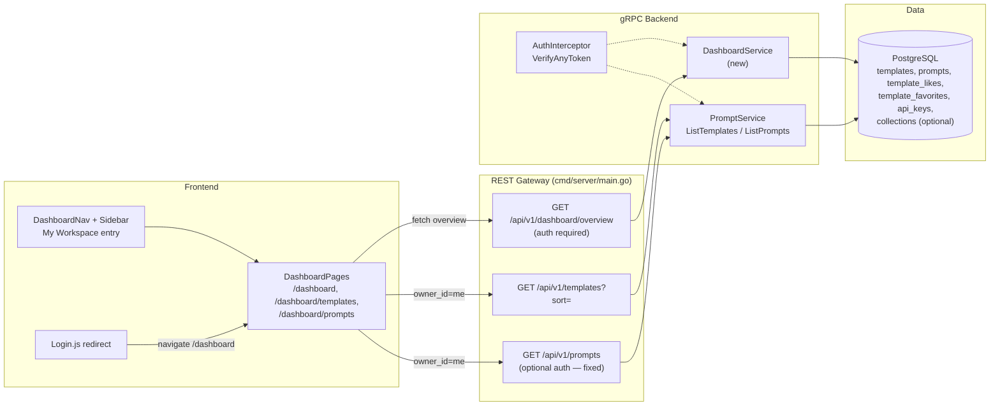
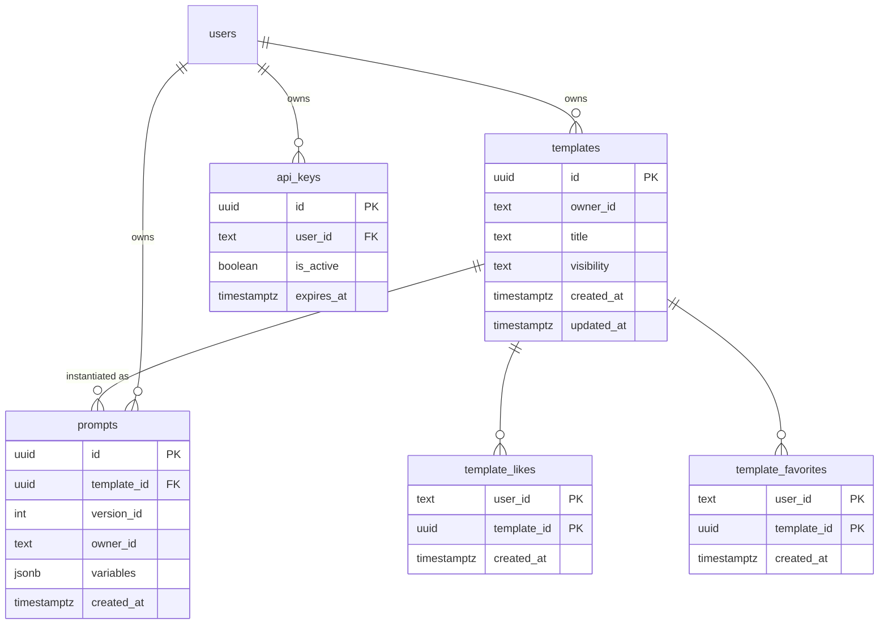

# User Dashboard — Architecture Design

| | |
|---|---|
| **Feature ID** | user-dashboard |
| **Version** | 1.0 |
| **Status** | Approved |
| **Author** | Architect Agent |
| **Upstream** | [Requirements](../design/user-dashboard-requirements.md) · [UI/UX Design](../design/user-dashboard-ui-ux-design.md) |
| **Downstream** | [Detailed Design](user-dashboard-detailed-design.md) · Developer Agent |

## 1. Overview

The User Dashboard gives every authenticated user a personal workspace: a single `/dashboard` overview page with four stat cards (templates, prompts, collections, active API keys), a recent-activity feed, and quick actions, plus dedicated management pages for the user's own templates (`/dashboard/templates`) and instantiated prompts (`/dashboard/prompts`). Today a user's own content is scattered across the Home page's "My Templates" tab, the API Keys page, and the profile page — the dashboard consolidates ownership into one place.

The feature is **read-heavy and aggregation-only**: it introduces exactly one new RPC (`GetDashboardOverview`) that computes four `COUNT`s and a bounded 10-item activity feed from existing tables. The template and prompt management pages reuse the existing `ListTemplates` / `ListPrompts` RPCs with `owner_id = me`. **No new database tables or columns are required.**

Two tightly-coupled corrections ship with this feature:

1. **`ListPrompts` authorization gap (security fix).** `PromptService.ListPrompts` (`backend/internal/service/prompt.go:754`) applies `req.OwnerId` with no caller check, and the REST route `GET /api/v1/prompts` (`backend/cmd/server/main.go:1331`) is anonymous — any client can enumerate any user's instantiated prompts, including private variable values. The service now rejects `owner_id != caller` with `PermissionDenied`, and the gateway route adopts the optional-auth pattern so legitimate callers (the template detail page already sends `owner_id`) keep working.
2. **`updated_at` sorting for owned templates.** `TemplateRepository.List` orders by `created_at DESC` only (`backend/internal/repository/template_repository.go:180`), but FR-7 requires the management page to show most-recently-*updated* first. A new additive `sort` field on `ListTemplatesRequest` (`""` = default `created`, `"updated"` = `t.updated_at DESC`) plumbs through service → repository without breaking existing callers.

### Resolved Open Questions

| # | Question (Requirements §10 / design decisions) | Decision |
|---|---|---|
| 1 | Where does `GetDashboardOverview` live? | **New `DashboardService`** in a new `backend/api/proto/v1/dashboard.proto` (same one-proto-per-service precedent as `notification.proto`). A dashboard is an aggregation across domains (templates, prompts, collections, API keys) — bolting it onto `PromptService` would couple unrelated repositories. One RPC, one repository. |
| 2 | D-3 — collections feature detection | **Both layers degrade gracefully.** Backend: the overview SQL reads `collections` with `status='active'`; on `42P01 undefined_table` (feature not yet migrated) the repository returns `collection_count = 0` and logs a warning. Frontend: `hasCollections()` module-cache probes `GET /api/v1/collections`; a 404 hides the "My Collections" nav entry and stat card. No hard dependency on template-collections shipping first. |
| 3 | FR-20 — client-side variable substitution in the prompt view modal | **Use the server-rendered `Prompt.content`.** `promptModelToProto` (`prompt.go:896`) already substitutes `${var}` into the template content at read time; the modal displays `content` directly. The design's client-side substitution util is unnecessary — documented as a deliberate deviation. |
| 4 | `ListPrompts` owner filter authorization | **Service-side enforcement.** `ListPrompts` returns `PermissionDenied` when `owner_id` is set and differs from the authenticated caller. Anonymous REST calls without `owner_id` remain public-listing behavior (all prompts are public artifacts of public templates); anonymous calls *with* `owner_id` are rejected `Unauthenticated`. |
| 5 | FR-7 ordering | **New `sort` field** on `ListTemplatesRequest` (field 10): `""`/`"created"` → `t.created_at DESC` (unchanged default), `"updated"` → `t.updated_at DESC`. Additive; existing callers unaffected. Gateway passes `?sort=` through. |
| 6 | Activity feed "created vs updated" labeling | The SQL emits one `template` activity type using `templates.updated_at`; the frontend labels it `template_created` when `created_at == updated_at` (templates set both on insert), else `template_updated`. No schema change, per D-2 (updated_at is a proxy in v1). |
| 7 | D-4 — post-login redirect | `Login.js` navigates to `/dashboard` on success, honoring an existing `?next=` query param when present (login-required redirects already append it). |
| 8 | D-6 — relative-time util | **Already exists**: `formatRelativeTime` / `useRelativeTime` in `frontend/src/utils/time.js` with `time.justNow/minutesAgo/hoursAgo/daysAgo` keys in both locales. Reused as-is. |
| 9 | Counts as int64 vs int32 | All four counts and the activity list are **int32** (protojson serializes int64 as a JSON string; the frontend and FVT compare counts as numbers). |
| 10 | Existing `dashboard.*` i18n keys | The existing `dashboard.*` namespace (`translation.json:82` — "Explore Templates", `my_templates`, `all_mine`, `favorites`, `my_likes`) belongs to the Home page's Sidebar filter panel and **stays untouched**. All new keys live under `dashboard_v2.*`. |
| 11 | Source template title on prompt rows | The `Prompt` message lacks the source template's title (needed for "from {{title}}" and the modal title). Additive `Prompt.template_title` field 8: `models.Prompt` gains `TemplateTitle`, `PromptRepository.List` JOINs `templates` and selects `t.title`, `promptModelToProto` maps it. No client-side template lookup. |

### Non-Goals

- No new event/activity table — the feed is a UNION over existing timestamps (D-2: `updated_at` is a proxy; v1 does not distinguish created vs updated beyond the heuristic above).
- No caching of overview counts (D-8: exact COUNTs on every request; the queries are index-backed and cheap at expected scale).
- No analytics — engagement metrics belong to the `prompt-analytics` feature.
- No bulk operations on dashboard rows (bulk-operations feature owns batch RPCs).
- No dashboard search or cross-user views — strictly `owner_id = caller`.
- No admin dashboards or admin APIs (FR-21/22: admins see their own personal dashboard only).
- No monetization of any kind (monetization is out of scope for this project).

## 2. System Context

## 3. Components Involved

| Layer | Component | Change |
|---|---|---|
| proto | `backend/api/proto/v1/dashboard.proto` | **New** — `DashboardService`, `GetDashboardOverview` RPC, activity messages |
| proto | `backend/api/proto/v1/prompt.proto` | `ListTemplatesRequest.sort` field 10; `Prompt.template_title` field 8 (both additive) |
| repository | `backend/internal/repository/dashboard_repository.go` | **New** — `GetOverview(ctx, userID)` (4 COUNTs + UNION activity) |
| repository | `backend/internal/repository/api_key_repository.go` | **New method** `CountActiveByUserID` |
| repository | `backend/internal/repository/template_repository.go` | `List` gains `sort` branch in `ORDER BY` |
| service | `backend/internal/service/dashboard.go` | **New** — `DashboardService.GetDashboardOverview` |
| service | `backend/internal/service/prompt.go` | `ListPrompts` owner_id authorization check |
| gateway | `backend/cmd/server/main.go` | `GET /api/v1/dashboard/overview` (required auth); `GET /api/v1/prompts` optional-auth + `sort` passthrough on `/templates` |
| frontend | `frontend/src/pages/dashboard/*` | **New** — `DashboardLayout`, `OverviewPage`, `TemplatesPage`, `PromptsPage` |
| frontend | `frontend/src/components/dashboard/*` | **New** — `StatCard`, `ActivityFeed`, `QuickActions`, `TemplateManageRow`, `PromptRow`, `PromptViewModal`, `FilterChips` |
| frontend | `frontend/src/services/api.js` | `getDashboardOverview()`; `getTemplates({ sort })` passthrough |
| frontend | `frontend/src/App.js`, `Login.js`, `Sidebar.js` | Routes, post-login redirect, "My Workspace" entry |
| i18n | `frontend/src/locales/{en,zh}/translation.json` | `dashboard_v2.*` + `time.*` (already present) |
| tests | `tests/fvt.py` | `test_user_dashboard` (AC-1–12) |

## 4. API Design

### 4.1 gRPC (`v1.DashboardService`)

| RPC | Request | Response | Auth |
|---|---|---|---|
| `GetDashboardOverview` | `GetDashboardOverviewRequest` (empty) | `GetDashboardOverviewResponse` | Required (user token) |

`DashboardService` is **not** added to `publicRpcMethods` (`auth.go:73–81`); the `AuthInterceptor` rejects anonymous calls with `Unauthenticated` before the service runs.

Existing RPCs reused by the management pages:

| RPC | Change | Consumer |
|---|---|---|
| `ListTemplates` | new `sort` field (`""`/`"created"`/`"updated"`) | `/dashboard/templates` sends `owner_id=me`, `sort=updated` |
| `ListPrompts` | **authorization fix**: `owner_id` must equal caller | `/dashboard/prompts` sends `owner_id=me` |

### 4.2 REST

| Method | Path | Auth | Handler behavior |
|---|---|---|---|
| GET | `/api/v1/dashboard/overview` | **Required** (401 without/invalid token; banned → 403) | Calls `DashboardService.GetDashboardOverview`; returns counts + activity |
| GET | `/api/v1/prompts` | **Optional** (pattern from `main.go:281`) | Anonymous without `owner_id` → public listing; `owner_id` present → token required, must match caller |
| GET | `/api/v1/templates` | Optional (unchanged) | New `?sort=updated` passthrough |

### 4.3 Error Codes

| Condition | gRPC code | HTTP |
|---|---|---|
| No/invalid token on overview | `Unauthenticated` | 401 |
| Banned user | `PermissionDenied` | 403 |
| `ListPrompts` with `owner_id != caller` | `PermissionDenied` | 403 |
| `ListPrompts` anonymous with `owner_id` | `Unauthenticated` | 401 |
| Invalid `sort` value | `InvalidArgument` | 400 |
| Backend failure | `Internal` | 500 |

## 5. Data Model

**No new tables or columns.** The overview is a read-only aggregation over existing tables:

Counting rules:

- `template_count` — `templates WHERE owner_id = $1` (all visibilities and types; the management page shows everything the user owns).
- `prompt_count` — `prompts WHERE owner_id = $1`.
- `collection_count` — `collections WHERE owner_id = $1 AND status = 'active'`; `42P01` → 0 (feature-detection, Resolved #2).
- `api_key_count` — `api_keys WHERE user_id = $1 AND is_active = true AND (expires_at IS NULL OR expires_at > NOW())`.

Activity feed (UNION ALL, `ORDER BY timestamp DESC LIMIT 10`): template updates (`templates.updated_at`), prompt instantiations (`prompts.created_at`, joined to `templates` for the source title), likes received (`template_likes.created_at` on the user's templates), favorites received (`template_favorites.created_at` on the user's templates).

All existing indexes suffice: `idx_templates_owner_id`, `idx_prompts_owner_id`, `template_likes/template_favorites (user_id, template_id)` PKs, `idx_api_keys_user_id`.

## 6. Auth & Authorization

- **Overview**: user token required. The gateway extracts the caller via `VerifyAnyToken` (required-auth pattern, `main.go:334`) and the service derives every query from that identity — the request carries **no user identifier**, so it is inherently token-scoped (NFR-7).
- **Management pages**: `ListTemplates`/`ListPrompts` are called with `owner_id = <caller>`. `ListTemplates` already enforces private-stream visibility server-side (private templates are only returned when `owner_id == caller`); `ListPrompts` gains the same enforcement (Resolved #4).
- **Banned users**: `VerifyAnyToken` returns `PermissionDenied` → gateway maps to **403** (never 401).
- **Anonymous visitors** to `/dashboard*` are redirected to `/login?next=/dashboard…` by the page-level guard (same self-guard pattern as `APIKeys.js:16–20`); the API itself returns 401.

## 7. Frontend

- **Routes** (`App.js`, lazy + Suspense): `/dashboard` (layout) → index `OverviewPage`, `templates` → `TemplatesPage`, `prompts` → `PromptsPage`. All under the existing `Layout` with `showSidebar` per page.
- **`DashboardLayout`** renders `DashboardNav` (Overview · My Templates · My Prompts · My Collections* · API Keys; * hidden when `hasCollections()` is false) and an `<Outlet/>`. Pages self-guard on missing token.
- **Overview**: 4 `StatCard`s (whole card is a link, `aria-label` includes the count), `ActivityFeed` (semantic `<ul>`, icon per type, relative time via `useRelativeTime`, absolute timestamp in `title`), `QuickActions` (New template → existing `CreateTemplateModal`; New API key → `/api-keys`).
- **TemplatesPage**: dual-stream merge of `ListTemplates(owner_id=me, sort=updated)` — public `templates` + `private_templates` arrays merged and sorted client-side by `updated_at` desc, pagination tokens combined as `${next_page_token}:${private_next_page_token}` (same convention as Home.js). Rows: title link, visibility/type badges, category, first 3 tags, like/favorite counts, updated date; actions Edit / Delete (confirm modal echoing the name) / Toggle visibility (optimistic + rollback + toast). `FilterChips` (All/Public/Private/System/User) filter client-side in v1.
- **PromptsPage**: `ListPrompts(owner_id=me)` 20/page, `created_at` desc; rows show variables summary (first 2 `k=v` monospace chips), source template title (link), created date; `PromptViewModal` displays the server-rendered `content` in a monospace block with Copy/Delete. Filter by source template client-side.
- **Navigation**: `Sidebar` gains a "My Workspace" entry at the top for authenticated users (above "Prompt Square"; existing entries unchanged per D-7). `Login.js` redirects to `/dashboard` (honoring `?next=`).
- **i18n**: all new keys under `dashboard_v2.*` (EN + ZH, from UI/UX design §9); existing `dashboard.*` keys untouched. Relative time reuses the existing `time.*` keys.

## 8. Configuration

No new configuration. The dashboard uses the existing gateway→backend gRPC connection, Redis session/auth infrastructure, and i18n setup.

## 9. Security & Privacy

- The overview request carries no user identifier — identity comes exclusively from the token (no IDOR surface).
- The `ListPrompts` fix closes an information disclosure: private variable values were enumerable by any anonymous client via `GET /api/v1/prompts?owner_id=<victim>`.
- Activity items expose only entity IDs/titles already visible to the owner (their own templates, prompts on their templates, likes/favorites received on their own templates).
- No new PII, no new logs beyond standard request logging.

## 10. Deployment Notes

- No DDL migration — both `deployment/init.sql` files are untouched.
- Proto regeneration (`dashboard.proto` + `prompt.proto` field 10) is the only backend build step.
- Ships safely before or after template-collections (Resolved #2 degradation).

## 11. Test Strategy

- **FVT** (`tests/fvt.py::test_user_dashboard`): covers AC-1–12 — anonymous redirect, stat counts vs seeded data, activity ordering, templates page ordering by `updated_at`, visibility toggle + rollback, delete confirm, prompts page + view modal, `ListPrompts` cross-owner 403, `sort=updated` REST passthrough, i18n key presence.
- **Unit**: repository SQL (counts, UNION ordering, 42P01 fallback), service authz branches, `sort` validation.
- **Manual**: EN/ZH visual pass on all three pages, empty states, error states.

## 12. Performance & Caching

- Four index-backed `COUNT`s + one bounded `UNION ... LIMIT 10` per overview request; p95 < 400 ms (NFR-1) at expected per-user data volumes (a user's own rows number in the tens-to-hundreds).
- No caching (D-8) — counts must be exact and the queries are cheap.
- Management pages reuse existing pagination; the dual-stream template merge adds no extra request.
