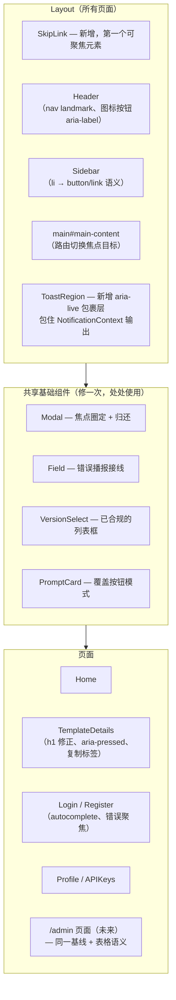
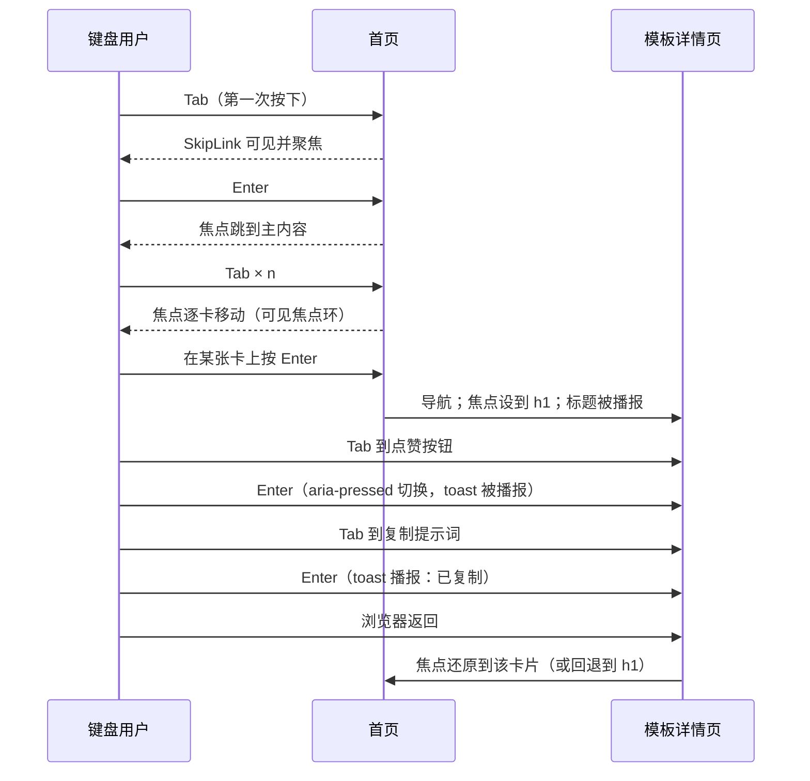
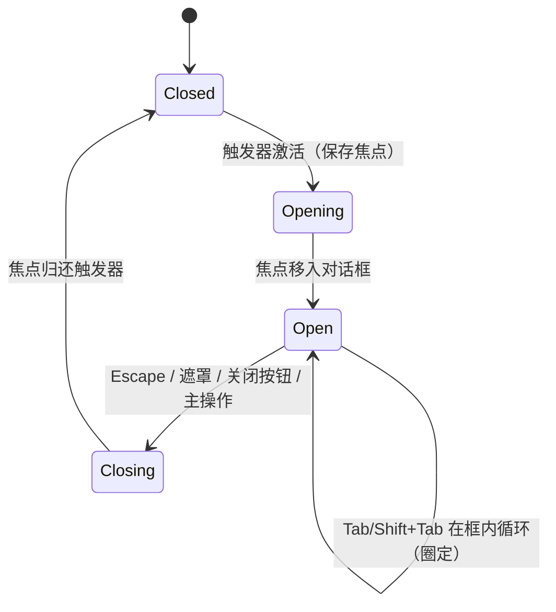

# 无障碍（WCAG 2.1 AA）— UI/UX 设计

- **Feature ID:** accessibility
- **Version:** 1.0
- **Status:** Proposed（待架构评审）
- **Author:** ui-ux-agent
- **Date:** 2026-10-10

## 1. 设计原则

1. **做得好就不可见。** 无障碍修复不得添加可见的界面元素。唯一有意的视觉变化是跳转链接（仅聚焦时可见）、略大的点击区和两处 token 对比度调整。其余全部是 ARIA/HTML 语义。
2. **共享基础组件修一次。** `Modal`、`Field`、toast、`PromptCard` 和下拉模式被每个页面（以及未来的管理控制台 + 通知特性）消费。先修它们能让修复的价值成倍放大。
3. **原生 HTML 优先于 ARIA。** 优先使用真正的 `<button>`、`<a>`、`<label>`，而不是用 `role` + `tabIndex` 重新造轮子。ARIA 只在 HTML 没有等价物时使用（`aria-live`、`aria-pressed`、`aria-expanded`）。
4. **双主题、双语言，始终如一。** 每个对比度/焦点决策都要在明暗两主题下验证；每个可访问名称都要中英 i18n。
5. **键盘对等是验收底线。** 如果一个流程无法仅用键盘完成，就不算完成 —— 无论加了多少 ARIA 属性。

## 2. 信息架构

不改动导航或页面结构。本特性作用于现有组件树：



## 3. 用户流程

### 3.1 纯键盘浏览流程（核心验收路径）



### 3.2 模态框焦点生命周期



### 3.3 语言切换播报流程

```mermaid
flowchart LR
    A[用户在语言切换中点击中文] --> B[i18n.changeLanguage('zh')]
    B --> C[document.documentElement.lang = 'zh']
    C --> D[Toast：'语言已切换' 经 aria-live 播报]
    D --> E[所有标签以中文重新渲染]
```

## 4. 页面布局

布局不变；以下标注展示无障碍元素的挂载位置。

### 4.1 全局布局（所有页面）

```text
┌────────────────────────────────────────────────────────────┐
│ [SkipLink：聚焦前隐藏 — DOM 中第一个元素]                    │
┌────────────────────────────────────────────────────────────┐
│ header.app-header                                          │
│  logo(链接) | nav.main-nav | 主题按钮 | 语言按钮 | 头像      │
│              ▲ 所有纯图标按钮加 aria-label                  │
├──────────┬─────────────────────────────────────────────────┤
│ aside    │ main#main-content  ← SkipLink 目标               │
│ (侧栏)   │  每页一个 h1（详情页从 h2 修正）                  │
│  列表项  │  ...页面内容...                                  │
│  改为    │                                                 │
│  button  │                                                 │
├──────────┴─────────────────────────────────────────────────┤
│ [ToastRegion aria-live=polite — 视觉上与现有 toast 一致]    │
└────────────────────────────────────────────────────────────┘
```

### 4.2 SkipLink 状态

```text
默认（不可见）：
┌────────────────────────────────────────────┐
│ （无可见元素 — 1px，裁剪出屏）              │
└────────────────────────────────────────────┘

聚焦时：
┌────────────────────────────────────────────┐
│ ┌──────────────────────────────┐           │
│ │ ⏭ 跳转到主内容               │ ← surface-2 卡片、shadow-md、
│ └──────────────────────────────┘   左上角、radius-12
└────────────────────────────────────────────┘
```

### 4.3 PromptCard 焦点与点击区标注

```text
┌───────────────────────────────┐
│ ┌─────────────────────────┐   │   卡片 = 单一 Tab 停靠点。
│ │ [覆盖 <button>          │   │   覆盖层铺满整卡，
│ │  绝对定位，             │   │   z-index 低于内部按钮。
│ │  aria-label = 标题]     │   │   内部点赞/收藏按钮
│ └─────────────────────────┘   │   叠在覆盖层之上
│ 标题                     ♥ 12 │   （更高 z-index），保留
│ 分类 · 标签 标签               │   自己的焦点停靠。
│ ┌──────┐ ♥(≥24px) ★(≥24px)   │
│ └──────┘                     │   卡片焦点环：
└───────────────────────────────┘   2px --accent、偏移 2px
```

### 4.4 TemplateDetails 头部（修正后的语义）

```text
┌──────────────────────────────────────────────────────┐
│ h1: 模板标题                 （原为 h2 — 已修正）      │
│ [♥ 点赞 (aria-pressed)] [★ 收藏 (aria-pressed)]       │
│  ↑ 各 44px 点击区，图标填充 = 状态提示                 │
│ [复制代码 (aria-label)] [分享] [Fork] [删除]           │
└──────────────────────────────────────────────────────┘
```

## 5. 组件规格

### 5.1 SkipLink（新组件）

| 属性 | 值 |
|---|---|
| 位置 | `Layout` 的第一个子元素，位于 `Header` 之前 |
| 标记 | `<a href="#main-content" className="skip-link">` |
| 默认样式 | `position: absolute; clip-path/transform 移出屏幕;` 不用 `display:none` |
| 聚焦样式 | `top: 8px; left: 8px; background: var(--surface-2); border: 1px solid var(--border); border-radius: var(--radius-12); box-shadow: var(--shadow-md); padding: 8px 14px; z-index: 1000` |
| 目标 | `main` 加 `id="main-content"` + `tabIndex={-1}`；点击移动焦点（不只是滚动） |
| i18n | `a11y.skip_to_content` — EN "Skip to main content" / ZH "跳转到主内容" |

### 5.2 Modal（现有组件 — 增补）

| 属性 | 值 |
|---|---|
| 焦点圈定 | keydown 处理器：Tab 在 `dialogRef` 内可聚焦元素间循环；首尾相接 |
| 初始焦点 | 保留现有行为（对话框容器）；若存在主输入框则聚焦第一个输入框 |
| 焦点归还 | 打开时保存 `document.activeElement`；关闭时对其 `.focus()` |
| Escape | 已实现 — 保留 |
| 遮罩点击 | 已实现 — 保留 |
| `aria-labelledby` | 给 `.modal-title` 加 `id` 并引用（替代 `aria-label` 字符串重复） |

### 5.3 Toast 区域（NotificationContext — 增补）

| 属性 | 值 |
|---|---|
| 包裹层 | `.notification-container` 外包 `<div role="region" aria-label={t('a11y.notifications_region')}>` |
| live 语义 | 容器：`aria-live="polite"`；错误 toast 额外 `role="alert"` |
| 关闭按钮 | 已有 `aria-label` — 保留 |
| 焦点策略 | toast 绝不抢焦点；被动播报 |

### 5.4 PromptCard（现有 — 变更）

| 属性 | 值 |
|---|---|
| 卡片根节点 | 保持 `div.prompt-card`（网格布局不变） |
| 覆盖层 | `<button className="card-overlay" aria-label={template.title} onClick={navigate}>` 绝对定位 `inset: 0`，`z-index: 1` |
| 内部按钮 | 点赞/收藏加 `position: relative; z-index: 2`，保持可直接点击/聚焦 |
| 点击区 | `.stat-item` / 社交按钮：`min-width/height: 44px`（移动端）/ `36px`（桌面网格密度），通过 padding 实现 |
| 焦点环 | `.card-overlay:focus-visible { outline: 2px solid var(--accent); outline-offset: 2px; border-radius: var(--radius-12); }` |

### 5.5 侧栏列表项（现有 — 变更）

| 属性 | 值 |
|---|---|
| 分类/特殊项 | `<li>` 保留列表语义；内部内容改为 `<button>`（全宽、text-align 继承） |
| 标签 chip | `<span class="tag">` → `<button class="tag">`（保留胶囊样式） |
| 激活态 | 除 `.active` 类外加 `aria-current="true"` |
| 计数 | `(count)` 文本保留在按钮标签内（一起播报） |

### 5.6 头部图标按钮（现有 — 增补）

| 按钮 | 可访问名称（i18n key） | 状态暴露 |
|---|---|---|
| 主题切换 | `header.switch_to_dark` / `header.switch_to_light`（已有） | 无需 |
| 语言切换 | `header.switchLanguage`（已有） | 下拉时 `aria-haspopup="menu"` |
| 菜单开关（移动端） | `common.toggle_menu`（已有） | `aria-expanded` |
| 头像按钮 | `header.open_user_menu` — 新 key | `aria-haspopup="menu"` + `aria-expanded` |
| 点赞（详情页） | `template_details.like` / `unlike`（已有） | `aria-pressed={isLiked}` |
| 收藏（详情页） | `template_details.favorite` / `unfavorite`（已有） | `aria-pressed={isFavorited}` |
| 复制代码 | `template_details.copy_code` — 新 key | 无 |
| 复制提示词 | `card.copy`（已有） | 无 |

### 5.7 全局 focus-visible 样式（index.scss — 增补）

```scss
// 通用焦点指示 — 绝不在无替代的情况下移除 outline
a:focus-visible,
button:focus-visible,
[tabindex]:focus-visible,
input:focus-visible,
select:focus-visible,
textarea:focus-visible {
  outline: 2px solid var(--accent);
  outline-offset: 2px;
}

// 输入框保留柔和光环 + 可见 outline
.input:focus-visible,
.textarea:focus-visible,
.select:focus-visible {
  outline: 2px solid var(--accent);
  outline-offset: 1px;
  border-color: var(--accent);
  box-shadow: 0 0 0 3px var(--accent-soft);
}

// forced-colors（Windows 高对比度）
@media (forced-colors: active) {
  .btn-primary { border: 1px solid ButtonText; }
  .card-overlay:focus-visible { outline: 3px solid Highlight; }
  .social-btn.active { border: 1px solid Highlight; } /* 颜色之外的状态提示 */
}
```

### 5.8 Token 对比度调整（index.scss — 唯一的视觉变化）

| Token | 主题 | 当前值 | 对比度 | 新值 | 对比度 |
|---|---|---|---|---|---|
| `--text-3` | 暗色 | `#6e768c` 于 `#171b26` | ≈4.0:1 | `#8b92a8` | ≈5.4:1 |
| `--text-3` | 亮色 | `#8b92a8` 于 `#ffffff` | ≈3.1:1 | `#767e93` | ≈4.5:1 |

其余文本 token 均已达标（已验证：`--text-1`/`--text-2` 两主题分别 ≥7:1 / ≥4.5:1）。调整后 `--text-3` 在两主题下正文均符合 AA；使用指引：正文优先 `--text-2`，次要/元信息用 `--text-3`。

## 6. 交互细节

1. **跳转链接激活：** 在链接上按 Enter → 浏览器默认锚点行为把焦点移到 `#main-content`（因目标有 `tabIndex={-1}`）；链接失焦。下一次 Tab 从主内容内部继续。
2. **卡片覆盖层激活：** 在 `.card-overlay` 上按 Enter/Space → `navigate(/templates/:id)`（与现有 `onClick` 相同的处理函数）。内部点赞/收藏按钮需 Tab *越过* 覆盖层停靠点后到达。
3. **模态框圈定机制：** 最后一个可聚焦元素激活时按 `Tab` → 聚焦第一个；第一个激活时按 `Shift+Tab` → 聚焦最后一个。可聚焦集合 = 对话框内查询的 `a[href], button:not([disabled]), input, select, textarea, [tabindex]:not([tabindex="-1"])`。
4. **路由切换：** 新的 `usePageAnnouncement` hook（位于 `utils/`）在 location 变化时运行：设置 `document.title = t(pageTitleKey)`，找到 `main h1`（或 `main`），设 `tabIndex=-1` 并聚焦。在渲染后运行（useEffect）。
5. **语言切换：** 现有处理函数额外设置 `document.documentElement.lang = lng` 并触发一条 info toast（经新 live region 播报）。
6. **点赞/收藏切换：** 按钮加 `aria-pressed`；已实现的实心图标同时充当 FR-24 要求的非颜色状态提示。
7. **表单错误聚焦：** 提交出错时，`CreateTemplateModal`/Login/Register 聚焦第一个 `.field-invalid .input`（或错误摘要）—— `Field` 组件已渲染 `aria-invalid` 和错误文本；焦点移动后播报自然产生。
8. **删除流程：** 删除提示词/模板后，焦点移到下一个列表项或容器标题 —— 绝不停留在已移除节点上。

## 7. 状态汇总

| 状态 | 行为 |
|---|---|
| SkipLink 默认 | 视觉隐藏（移出屏幕，非 `display:none`） |
| SkipLink 聚焦 | 卡片式胶囊，左上角，shadow-md |
| 焦点环（所有交互元素） | 2px `--accent` 轮廓 + 2px 偏移，双主题 |
| 模态框打开 | 焦点圈定；body 滚动锁定（现有）；遮罩变暗 |
| 模态框关闭 | 焦点归还触发器 |
| toast 出现/消失 | 不改变焦点；经 aria-live 播报；自动隐藏不变（3s） |
| 点赞/收藏激活 | 实心图标 + `aria-pressed="true"` +（forced-colors 下）边框提示 |
| 减少动效 | 所有动画 ≈0ms（现有全局守卫；验证无绕过） |
| 200% 缩放 / 320px | Reflow：网格收为单列（现有断点），除代码块外无横向滚动 |
| forced-colors | 系统配色；焦点 = `Highlight`；状态提示用边框 |

## 8. 视觉风格（Aurora 合规）

- **不新增颜色。** 仅 `--text-3` 的值变化（两主题）以满足 AA；其他 token 一律不动。
- **SkipLink** 复用 `--surface-2`、`--border`、`--radius-12`、`--shadow-md` —— 看起来像一张小型 Aurora 卡片，与下拉菜单一致。
- **焦点环** 使用 `--accent`（与今天 `.btn:focus-visible` 的紫色相同）—— 一致，且对两种背景都有 3:1+ 对比。
- **点击区扩大** 用 padding 而非加大图标 —— 保持网格的视觉密度。
- **明暗两主题** 对每项变更分别验证（NFR-6）。

## 9. i18n 考量（中/英）

新增 key（在同一次变更中加入 `en` 与 `zh` 两个翻译文件）：

```json
{
  "a11y": {
    "skip_to_content": "Skip to main content",
    "notifications_region": "Notifications",
    "page_home": "Open Prompts — Explore Templates",
    "page_template_details": "{{title}} — Open Prompts",
    "page_login": "Sign in — Open Prompts",
    "page_register": "Create account — Open Prompts",
    "page_profile": "Profile — Open Prompts",
    "page_api_keys": "API Keys — Open Prompts",
    "language_switched": "Language switched"
  },
  "header": {
    "open_user_menu": "Open user menu"
  },
  "template_details": {
    "copy_code": "Copy code sample"
  }
}
```

```json
{
  "a11y": {
    "skip_to_content": "跳转到主内容",
    "notifications_region": "通知",
    "page_home": "Open Prompts — 探索模板",
    "page_template_details": "{{title}} — Open Prompts",
    "page_login": "登录 — Open Prompts",
    "page_register": "创建账号 — Open Prompts",
    "page_profile": "个人资料 — Open Prompts",
    "page_api_keys": "API 密钥 — Open Prompts",
    "language_switched": "语言已切换"
  },
  "header": {
    "open_user_menu": "打开用户菜单"
  },
  "template_details": {
    "copy_code": "复制代码示例"
  }
}
```

- `document.documentElement.lang` 与 `i18n.language`（`en`/`zh`）同步 —— 这正是让中文标签被中文 TTS 语音正确朗读的关键。
- 插值页面标题（`{{title}}`）在两种语言中都保留产品名后缀以提供上下文。
- 所有现有 `aria-label` 已通过 `t()` 走 i18n —— 新增的遵循同一模式（NFR-7）。

## 10. 无障碍

本文档*就是*无障碍规格；需求文档（FR-1..28）是规范性清单。映射摘要：

| WCAG 2.1 AA 条款 | 覆盖项 |
|---|---|
| 1.4.3 对比度（最低） | FR-20、§5.8 token 调整 |
| 1.4.10 Reflow | FR-23 |
| 1.4.11 非文本对比度 | FR-17 焦点环、FR-24 状态提示 |
| 1.4.12 文本间距 | 原生 HTML 文本（无固定高度文本容器） |
| 2.1.1 键盘 | FR-1..7 |
| 2.4.1 绕过区块 | FR-4 SkipLink |
| 2.4.2 页面标题 | FR-12 |
| 2.4.3 焦点顺序 | FR-5 |
| 2.4.7 焦点可见 | FR-17 |
| 3.3.1 错误识别 | FR-14（Field 已渲染错误） |
| 3.3.2 标签或说明 | 现有 `Field` 组件 |
| 4.1.2 名称、角色、值 | FR-9、FR-10、FR-11 |
| 4.1.3 状态消息 | FR-11 aria-live toast |
| 2.3.3 交互动画 | FR-22（现有守卫） |
| 1.4.1 颜色使用 | FR-24（图标填充 + forced-colors 边框） |

## 11. 给开发者的实现说明

1. **工作顺序（每步可独立交付）：**
   1. 全局 `:focus-visible` 样式 + token 对比度修复（§5.7、§5.8）— 最小 diff、最大覆盖。
   2. `Modal` 焦点圈定 + 归还（§5.2）。
   3. Toast aria-live 区域（§5.3）。
   4. `PromptCard` 覆盖按钮 + 点击区（§5.4）。
   5. 侧栏按钮语义（§5.5）。
   6. 头部按钮标签 + 详情页 `aria-pressed`（§5.6）。
   7. SkipLink + `main` id（§5.1）。
   8. `usePageAnnouncement` hook + `document.title` + `lang` 同步（§6.4、§6.5）。
   9. TemplateDetails 标题层级修正（`h2` → `h1`）。
   10. axe-core CI 门禁 + 键盘冒烟脚本（FR-25、FR-26）。
2. **涉及文件：** `frontend/src/index.scss`、`frontend/src/components/ui/Modal.jsx`、`frontend/src/context/NotificationContext.js(x)`、`frontend/src/components/PromptCard.js(+scss)`、`frontend/src/components/Sidebar.js(+scss)`、`frontend/src/components/Header.js`、`frontend/src/components/Layout.js`、`frontend/src/pages/TemplateDetails.js(+scss)`、`frontend/src/pages/Home.js`（标题）、认证页面（autocomplete + 错误聚焦）、`frontend/src/i18n.js`（lang 同步）、两个 `translation.json`、新增 `frontend/src/utils/a11y.js` + `frontend/src/components/SkipLink.jsx`。
3. **无后端改动**（NFR-3）。无新增运行时 npm 依赖；`axe-core`（如需开发期检查可加 `@axe-core/react`）是 devDependency。
4. **测试：** 按 FR-25 在 Jest/RTL（或 Playwright）中跑 axe；按 FR-26 做手动键盘通过；对 AC-2..AC-8 验证双主题与双语言。
5. **注意事项：** (a) 覆盖按钮不得吞掉内部点赞/收藏的点击 — 按 §5.4 分层 z-index；(b) 焦点圈定不得破坏现有 Escape 处理器；(c) `--text-3` 变化影响很多界面 — 对两个主题做一次视觉回归检查；(d) 点赞/收藏的 `aria-pressed` 必须在重新拉取后随服务端状态更新，而不只是本地切换。
