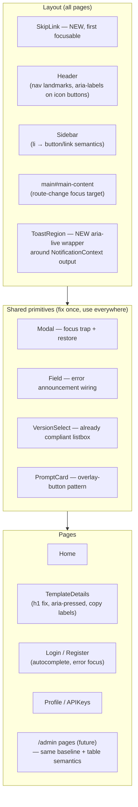
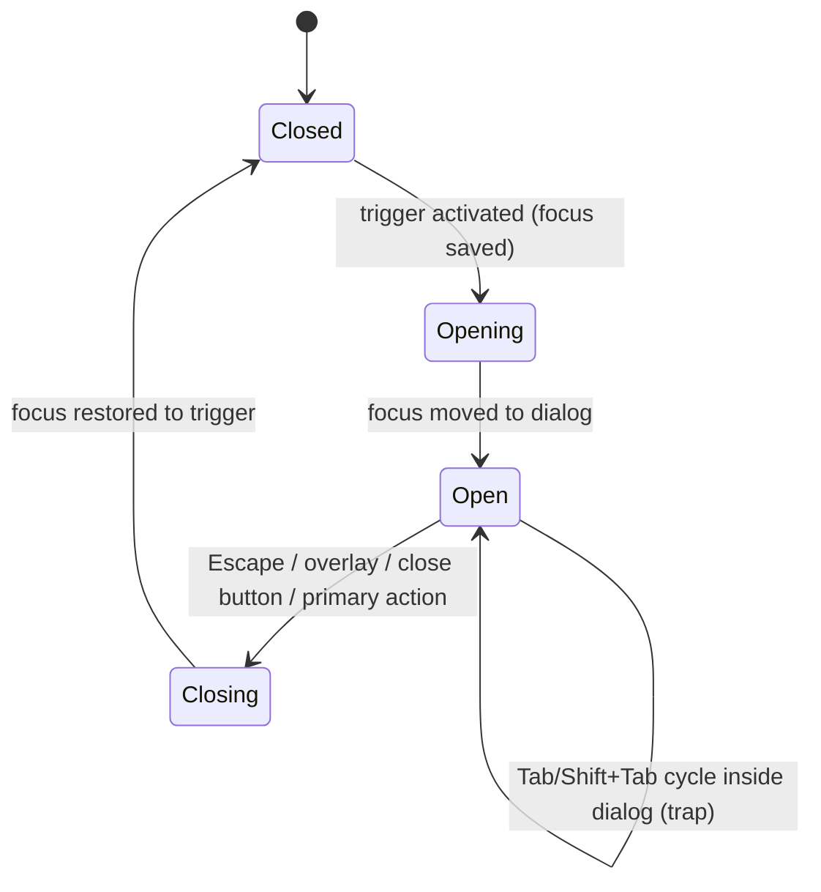

# Accessibility (WCAG 2.1 AA) — UI/UX Design

- **Feature ID:** accessibility
- **Version:** 1.0
- **Status:** Proposed (for architecture review)
- **Author:** ui-ux-agent
- **Date:** 2026-10-10

## 1. Design Principles

1. **Invisible when done well.** Accessibility fixes must not add visible chrome. The only intentional visual changes are the skip link (visible on focus only), slightly larger hit areas, and two token contrast adjustments. Everything else is ARIA/HTML semantics.
2. **Fix shared primitives once.** `Modal`, `Field`, toasts, `PromptCard`, and dropdown patterns are consumed by every page (and by future admin console + notifications features). Fixing them first multiplies the benefit.
3. **Native HTML over ARIA.** Prefer real `<button>`, `<a>`, `<label>` over `role` + `tabIndex` re-creations. ARIA is used only where HTML has no equivalent (`aria-live`, `aria-pressed`, `aria-expanded`).
4. **Both themes, both languages, always.** Every contrast/focus decision is verified in light + dark; every accessible name is i18n'd EN/ZH.
5. **Keyboard parity is the acceptance bar.** If a flow cannot be completed with keyboard only, it is not done — regardless of how many ARIA attributes were added.

## 2. Information Architecture

No navigation or page-structure changes. The feature touches the existing component tree:



## 3. User Flows

### 3.1 Keyboard-only browse flow (the core acceptance path)

```mermaid
sequenceDiagram
    participant K as Keyboard user
    participant App as Home page
    participant TD as TemplateDetails
    K->>App: Tab (first press)
    App-->>K: SkipLink visible + focused
    K->>App: Enter
    App-->>K: focus jumps to main content
    K->>App: Tab × n
    App-->>K: focus moves card to card (visible ring)
    K->>App: Enter on a card
    App->>TD: navigate; focus set to h1; title announced
    K->>TD: Tab to Like button
    K->>TD: Enter (aria-pressed toggles, toast announced)
    K->>TD: Tab to Copy prompt
    K->>TD: Enter (toast announced: copied)
    K->>TD: Browser back
    TD->>App: focus restored to the card (or h1 fallback)
```

### 3.2 Modal focus lifecycle



### 3.3 Language switch announcement flow

```mermaid
flowchart LR
    A[User clicks ZH in language toggle] --> B[i18n.changeLanguage('zh')]
    B --> C[document.documentElement.lang = 'zh']
    C --> D[Toast: 'Language switched' announced via aria-live]
    D --> E[All labels re-render in ZH]
```

## 4. Page Layouts

Layouts are unchanged; the annotations below show where a11y elements attach.

### 4.1 Global layout (all pages)

```text
┌────────────────────────────────────────────────────────────┐
│ [SkipLink: hidden until focused — first element in DOM]    │
┌────────────────────────────────────────────────────────────┐
│ header.app-header                                          │
│  logo(link) | nav.main-nav | theme btn | lang btn | avatar │
│              ▲ all icon-only buttons get aria-label        │
├──────────┬─────────────────────────────────────────────────┤
│ aside    │ main#main-content  ← SkipLink target            │
│ (sidebar)│  h1 per page (details page fixed from h2)       │
│  items   │  ...page content...                             │
│  become  │                                                 │
│  buttons │                                                 │
├──────────┴─────────────────────────────────────────────────┤
│ [ToastRegion aria-live=polite — visually identical toasts] │
└────────────────────────────────────────────────────────────┘
```

### 4.2 SkipLink states

```text
Default (invisible):
┌────────────────────────────────────────────┐
│ (no visual element — 1px, clipped)         │
└────────────────────────────────────────────┘

Focused:
┌────────────────────────────────────────────┐
│ ┌──────────────────────────────┐           │
│ │ ⏭ Skip to main content      │ ← surface-2 card, shadow-md,
│ └──────────────────────────────┘   top-left, radius-12
└────────────────────────────────────────────┘
```

### 4.3 PromptCard focus + hit-area annotation

```text
┌───────────────────────────────┐
│ ┌─────────────────────────┐   │   Card = single tab stop.
│ │ [overlay <button>       │   │   Overlay covers whole card,
│ │  absolutely positioned, │   │   z-index below inner buttons.
│ │  aria-label = title]    │   │   Inner like/favorite buttons
│ └─────────────────────────┘   │   sit ABOVE the overlay
│ Title                    ♥ 12 │   (higher z-index) and keep
│ category · tag tag            │   their own focus stops.
│ ┌──────┐ ♥(≥24px) ★(≥24px)   │
│ └──────┘                     │   Focus ring on card:
└───────────────────────────────┘   2px --accent, offset 2px
```

### 4.4 TemplateDetails header (corrected semantics)

```text
┌──────────────────────────────────────────────────────┐
│ h1: Template Title            (was h2 — fixed)       │
│ [♥ Like (aria-pressed)] [★ Favorite (aria-pressed)]  │
│  ↑ 44px hit area each, icon fill = state cue         │
│ [Copy code (aria-label)] [Share] [Fork] [Delete]     │
└──────────────────────────────────────────────────────┘
```

## 5. Component Specifications

### 5.1 SkipLink (new component)

| Property | Value |
|---|---|
| Location | First child of `Layout`, before `Header` |
| Markup | `<a href="#main-content" className="skip-link">` |
| Default style | `position: absolute; clip-path/transform off-screen;` not `display:none` |
| Focused style | `top: 8px; left: 8px; background: var(--surface-2); border: 1px solid var(--border); border-radius: var(--radius-12); box-shadow: var(--shadow-md); padding: 8px 14px; z-index: 1000` |
| Target | `main` gets `id="main-content"` + `tabIndex={-1}`; click moves focus (not just scroll) |
| i18n | `a11y.skip_to_content` — EN "Skip to main content" / ZH "跳转到主内容" |

### 5.2 Modal (existing component — additions)

| Property | Value |
|---|---|
| Focus trap | Keydown handler: Tab cycles within `dialogRef` query of focusable elements; wrap first↔last |
| Initial focus | Keep current behavior (dialog container) unless a primary input exists — then first input |
| Focus restore | On open, save `document.activeElement`; on close, `.focus()` it |
| Escape | Already implemented — keep |
| Overlay click | Already implemented — keep |
| `aria-labelledby` | Add `id` to `.modal-title` and reference it (replaces `aria-label` string duplication) |

### 5.3 Toast region (NotificationContext — additions)

| Property | Value |
|---|---|
| Wrapper | `<div role="region" aria-label={t('a11y.notifications_region')}>` around `.notification-container` |
| Live semantics | Container: `aria-live="polite"`; error toasts additionally `role="alert"` |
| Close button | Already has `aria-label` — keep |
| Focus policy | Toasts never steal focus; they are announced passively |

### 5.4 PromptCard (existing — changes)

| Property | Value |
|---|---|
| Card root | Stays `div.prompt-card` (grid layout unchanged) |
| Overlay | `<button className="card-overlay" aria-label={template.title} onClick={navigate}>` absolutely positioned `inset: 0`, `z-index: 1` |
| Inner buttons | like/favorite get `position: relative; z-index: 2` so they remain directly clickable/focusable |
| Hit areas | `.stat-item` / social buttons: `min-width/height: 44px` (mobile) / `36px` (desktop grid density), via padding |
| Focus ring | `.card-overlay:focus-visible { outline: 2px solid var(--accent); outline-offset: 2px; border-radius: var(--radius-12); }` |

### 5.5 Sidebar items (existing — changes)

| Property | Value |
|---|---|
| Category/special items | `<li>` keeps list semantics; inner content becomes `<button>` (full-width, text-align inherit) |
| Tag chips | `<span class="tag">` → `<button class="tag">` (keeps pill styling) |
| Active state | `aria-current="true"` in addition to `.active` class |
| Counts | Keep `(count)` text inside the button label (announced together) |

### 5.6 Header icon buttons (existing — additions)

| Button | Accessible name (i18n key) | State exposure |
|---|---|---|
| Theme toggle | `header.switch_to_dark` / `header.switch_to_light` (exists) | none needed |
| Language toggle | `header.switchLanguage` (exists) | `aria-haspopup="menu"` when dropdown |
| Menu toggle (mobile) | `common.toggle_menu` (exists) | `aria-expanded` |
| Avatar button | `header.open_user_menu` — NEW key | `aria-haspopup="menu"` + `aria-expanded` |
| Like (details) | `template_details.like` / `unlike` (exists) | `aria-pressed={isLiked}` |
| Favorite (details) | `template_details.favorite` / `unfavorite` (exists) | `aria-pressed={isFavorited}` |
| Copy code | `template_details.copy_code` — NEW key | none |
| Copy prompt | `card.copy` (exists) | none |

### 5.7 Focus-visible global styles (index.scss — additions)

```scss
// Universal focus indicator — never remove outlines without replacement
a:focus-visible,
button:focus-visible,
[tabindex]:focus-visible,
input:focus-visible,
select:focus-visible,
textarea:focus-visible {
  outline: 2px solid var(--accent);
  outline-offset: 2px;
}

// Inputs keep their soft ring AND a visible outline
.input:focus-visible,
.textarea:focus-visible,
.select:focus-visible {
  outline: 2px solid var(--accent);
  outline-offset: 1px;
  border-color: var(--accent);
  box-shadow: 0 0 0 3px var(--accent-soft);
}

// Forced-colors (Windows High Contrast)
@media (forced-colors: active) {
  .btn-primary { border: 1px solid ButtonText; }
  .card-overlay:focus-visible { outline: 3px solid Highlight; }
  .social-btn.active { border: 1px solid Highlight; } /* state cue beyond color */
}
```

### 5.8 Token contrast adjustments (index.scss — the only visual changes)

| Token | Theme | Current | Ratio | New | Ratio |
|---|---|---|---|---|---|
| `--text-3` | dark | `#6e768c` on `#171b26` | ≈4.0:1 | `#8b92a8` | ≈5.4:1 |
| `--text-3` | light | `#8b92a8` on `#ffffff` | ≈3.1:1 | `#767e93` | ≈4.5:1 |

All other text tokens already pass (verified: `--text-1`/`--text-2` both themes ≥7:1 / ≥4.5:1). After adjustment, `--text-3` is AA-compliant for normal text in both themes; usage guidance: prefer `--text-2` for body copy, `--text-3` for secondary/meta text.

## 6. Interaction Details

1. **Skip link activation:** Enter on the link → browser default anchor behavior moves focus to `#main-content` (because target has `tabIndex={-1}`); the link blurs. Next Tab continues from inside main content.
2. **Card overlay activation:** Enter/Space on `.card-overlay` → `navigate(/templates/:id)` (same handler as the current `onClick`). Inner like/favorite buttons are reached by tabbing *past* the overlay stop.
3. **Modal trap mechanics:** on `Tab` when the last focusable element is active → focus first; on `Shift+Tab` when first is active → focus last. Focusable set = `a[href], button:not([disabled]), input, select, textarea, [tabindex]:not([tabindex="-1"])` queried inside the dialog.
4. **Route change:** a `usePageAnnouncement` hook (new, in `utils/`) runs on location change: sets `document.title = t(pageTitleKey)`, finds `main h1` (or `main`), sets `tabIndex=-1`, focuses it. Runs after render (useEffect).
5. **Language switch:** existing handler additionally sets `document.documentElement.lang = lng` and fires an info toast (announced via the new live region).
6. **Like/favorite toggle:** button gains `aria-pressed`; the visible filled icon (already implemented) doubles as the non-color state cue required by FR-24.
7. **Form error focus:** on submit with errors, `CreateTemplateModal`/Login/Register focus the first `.field-invalid .input` (or the error summary) — the `Field` component already renders `aria-invalid` and error text; the announcement comes free once focus moves.
8. **Delete flows:** after deleting a prompt/template, focus moves to the next list item or the container heading — never left on a removed node.

## 7. States Summary

| State | Behavior |
|---|---|
| SkipLink default | Visually hidden (off-screen, not `display:none`) |
| SkipLink focused | Card-style pill, top-left, shadow-md |
| Focus ring (all interactive) | 2px `--accent` outline + 2px offset, both themes |
| Modal open | Focus trapped; body scroll locked (existing); overlay dims |
| Modal closed | Focus restored to trigger |
| Toast appear/disappear | No focus change; announced via aria-live; auto-hide unchanged (3s) |
| Like/favorite active | Filled icon + `aria-pressed="true"` + (forced-colors) border cue |
| Reduced motion | All animations ≈0ms (existing global guard; verified no bypasses) |
| 200% zoom / 320px | Reflow: grid collapses to 1 column (existing breakpoints), no horizontal scroll except code blocks |
| Forced-colors | System palette; focus = `Highlight`; state cues via borders |

## 8. Visual Style (Aurora compliance)

- **No new colors.** Only `--text-3` values change (both themes) to meet AA; every other token untouched.
- **SkipLink** reuses `--surface-2`, `--border`, `--radius-12`, `--shadow-md` — it looks like a small Aurora card, consistent with dropdowns.
- **Focus ring** uses `--accent` (the same purple as `.btn:focus-visible` today) — consistent, and 3:1+ against both backgrounds.
- **Hit-area growth** uses padding, not larger icons — visual density of the grid is preserved.
- **Dark and light themes** verified separately for every change (NFR-6).

## 9. i18n Considerations (EN/ZH)

New keys (added to both `en` and `zh` translation files in the same change):

```json
{
  "a11y": {
    "skip_to_content": "Skip to main content",
    "notifications_region": "Notifications",
    "page_home": "Open Prompts — Explore Templates",
    "page_template_details": "{{title}} — Open Prompts",
    "page_login": "Sign in — Open Prompts",
    "page_register": "Create account — Open Prompts",
    "page_profile": "Profile — Open Prompts",
    "page_api_keys": "API Keys — Open Prompts",
    "language_switched": "Language switched"
  },
  "header": {
    "open_user_menu": "Open user menu"
  },
  "template_details": {
    "copy_code": "Copy code sample"
  }
}
```

```json
{
  "a11y": {
    "skip_to_content": "跳转到主内容",
    "notifications_region": "通知",
    "page_home": "Open Prompts — 探索模板",
    "page_template_details": "{{title}} — Open Prompts",
    "page_login": "登录 — Open Prompts",
    "page_register": "创建账号 — Open Prompts",
    "page_profile": "个人资料 — Open Prompts",
    "page_api_keys": "API 密钥 — Open Prompts",
    "language_switched": "语言已切换"
  },
  "header": {
    "open_user_menu": "打开用户菜单"
  },
  "template_details": {
    "copy_code": "复制代码示例"
  }
}
```

- `document.documentElement.lang` syncs with `i18n.language` (`en`/`zh`) — this is what makes ZH labels pronounced correctly by Chinese TTS voices.
- Interpolated page titles (`{{title}}`) keep the product name suffix for context in both languages.
- All existing `aria-label`s already route through `t()` — the new ones follow the same pattern (NFR-7).

## 10. Accessibility

This document *is* the accessibility specification; the requirements doc (FR-1..28) is the normative list. Mapping summary:

| WCAG 2.1 AA criterion | Covered by |
|---|---|
| 1.4.3 Contrast (Minimum) | FR-20, §5.8 token adjustments |
| 1.4.10 Reflow | FR-23 |
| 1.4.11 Non-text Contrast | FR-17 focus ring, FR-24 state cues |
| 1.4.12 Text Spacing | native HTML text (no fixed-height text containers) |
| 2.1.1 Keyboard | FR-1..7 |
| 2.4.1 Bypass Blocks | FR-4 SkipLink |
| 2.4.2 Page Titled | FR-12 |
| 2.4.3 Focus Order | FR-5 |
| 2.4.7 Focus Visible | FR-17 |
| 3.3.1 Error Identification | FR-14 (Field already renders errors) |
| 3.3.2 Labels or Instructions | existing `Field` component |
| 4.1.2 Name, Role, Value | FR-9, FR-10, FR-11 |
| 4.1.3 Status Messages | FR-11 aria-live toasts |
| 2.3.3 Animation from Interactions | FR-22 (existing guard) |
| 1.4.1 Use of Color | FR-24 (icon fill + forced-colors borders) |

## 11. Implementation Notes for Developer

1. **Order of work (each step independently shippable):**
   1. Global `:focus-visible` styles + token contrast fix (§5.7, §5.8) — smallest diff, biggest coverage.
   2. `Modal` focus trap + restore (§5.2).
   3. Toast aria-live region (§5.3).
   4. `PromptCard` overlay button + hit areas (§5.4).
   5. Sidebar button semantics (§5.5).
   6. Header button labels + `aria-pressed` on details page (§5.6).
   7. SkipLink + `main` id (§5.1).
   8. `usePageAnnouncement` hook + `document.title` + `lang` sync (§6.4, §6.5).
   9. Heading hierarchy fix on TemplateDetails (`h2` → `h1`).
   10. axe-core CI gate + keyboard smoke script (FR-25, FR-26).
2. **Files touched:** `frontend/src/index.scss`, `frontend/src/components/ui/Modal.jsx`, `frontend/src/context/NotificationContext.js(x)`, `frontend/src/components/PromptCard.js(+scss)`, `frontend/src/components/Sidebar.js(+scss)`, `frontend/src/components/Header.js`, `frontend/src/components/Layout.js`, `frontend/src/pages/TemplateDetails.js(+scss)`, `frontend/src/pages/Home.js` (title), auth pages (autocomplete + error focus), `frontend/src/i18n.js` (lang sync), both `translation.json` files, new `frontend/src/utils/a11y.js` + `frontend/src/components/SkipLink.jsx`.
3. **No backend changes** (NFR-3). No new npm runtime dependencies; `axe-core` (+ `@axe-core/react` if desired for dev-only) is a devDependency.
4. **Testing:** axe in Jest/RTL (or Playwright) per FR-25; manual keyboard pass per FR-26; verify both themes and both languages for AC-2..AC-8.
5. **Watch-outs:** (a) the overlay button must not swallow clicks on inner like/favorite — z-index layering per §5.4; (b) focus trap must not break the existing Escape handler; (c) `--text-3` change affects many surfaces — do a visual regression pass of both themes; (d) `aria-pressed` on like/favorite must update from server state after refetch, not just local toggle.
