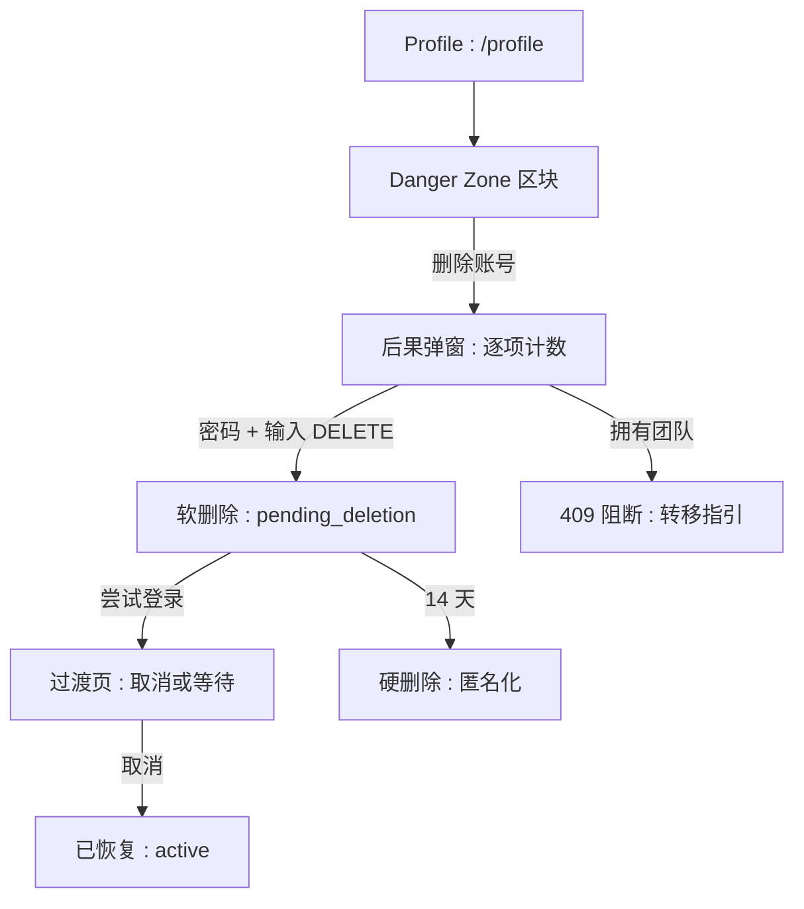
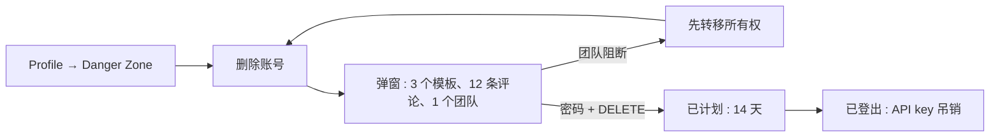
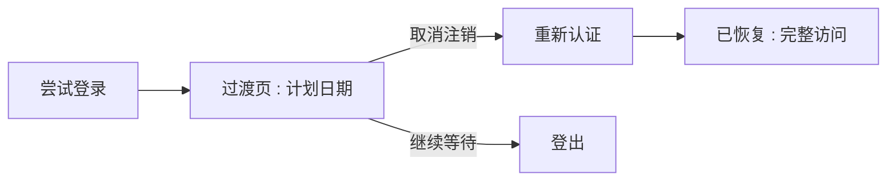

# 账号注销 — UI/UX 设计

- **功能 ID：** account-deletion
- **版本：** 1.0
- **状态：** Proposed（待架构评审）
- **作者：** ui-ux-agent
- **日期：** 2026-10-13
- **配套文档：** `account-deletion-requirements-zh-CN.md`

## 1. 设计原则

1. **坦诚而非恐吓。** Danger Zone 用平实语言逐项说明会发生什么。没有黑暗模式，没有内疚诱导，没有挽留优惠。
2. **摩擦与不可逆性成正比。** 确认需密码 + 输入 `DELETE`；宽限期内一键取消。破坏很难，恢复很容易。
3. **出口是门，不是陷阱。** 导出链接、团队转移指引、14 天撤销窗口都是流程的一部分，而非脚注。
4. **社区比成员活得久。** 评论与评分变为"已注销用户" —— 对话保持完整，人消失。

## 2. 信息架构



| 界面 | 位置 | 受众 | 目的 |
|---|---|---|---|
| Danger Zone | Profile 页底部 | 所有用户 | 可发现、刻意的位置 |
| 后果弹窗 | Danger Zone 弹出层 | 待注销用户 | 知情同意 |
| 注销过渡页 | 待注销用户的登录路径 | 待注销用户 | 取消或等待 |
| 管理员待删列表 | `/admin/users` + 状态筛选 | 管理员 | 恢复 / 强制删除 |
| "已注销用户"墓碑 | 评论、评分、谱系 | 社区 | 无身份的完整历史 |

## 3. 用户流程

### 3.1 全摩擦注销



### 3.2 宽限期取消



## 4. 页面布局

### 4.1 Profile — Danger Zone

```
+----------------------------------------------------------------------+
|  Profile                                                              |
|  [头像]  显示名称  ·  简介                                             |
|  …… 现有资料表单 ……                                                   |
+----------------------------------------------------------------------+
|  ⚠ 危险操作区                                                          |
|  ┌------------------------------------------------------------------┐|
|  | 删除账号                                                           ||
|  | 永久移除你的账号、模板、提示词与合集。你的评论和评分会保留但变为匿名。   ||
|  |                                          [删除账号]                ||
|  └------------------------------------------------------------------┐|
+----------------------------------------------------------------------+
```

危险色边框，独立置于页面底部。

### 4.2 后果弹窗

```
+----------------------------------------------------------------------+
|  删除你的账号？                                                        |
|                                                                      |
|  这将被永久删除：                                                      |
|    • 3 个模板（2 公开，1 私有）  • 27 个提示词                        |
|    • 1 个合集  • 5 个预设  • 2 个 API key                              |
|                                                                      |
|  这将被匿名化（内容保留，移除你的名字）：                                |
|    • 其他模板下的 12 条评论  • 9 条评分                                |
|                                                                      |
|  📦 [先导出你的模板]          👥 [转移团队所有权]                       |
|                                                                      |
|  为确认，请输入密码并输入 DELETE：                                      |
|  [密码                ]   [DELETE          ]                          |
|                                                                      |
|  账号将在 14 天宽限期后移除。期间随时可登录取消。                         |
|                                                                      |
|                        [取消]  [永久删除]（禁用）                       |
+----------------------------------------------------------------------+
```

### 4.3 注销过渡页（登录路径）

```
+----------------------------------------------------------------------+
|                                                                      |
|          你的账号已计划注销                                            |
|          于 2026 年 10 月 27 日                                       |
|                                                                      |
|          如果你改主意了，现在可以取消。                                 |
|                                                                      |
|          [取消注销]              [退出登录]                            |
+----------------------------------------------------------------------+
```

整页路由（`/account/pending-deletion`），无应用外壳。

### 4.4 管理员 — 待注销行

```
+----------------------------------------------------------------------+
|  用户  [状态 ▾: 待注销]                                               |
+----------------------------------------------------------------------+
|  alice@…  Alice  pending_deletion  注销：10月27日   [恢复][立即删除]    |
|  bob@…    Bob    pending_deletion  注销：10月29日   [恢复][立即删除]    |
+----------------------------------------------------------------------+
```

"立即删除"打开标准原因弹窗（3–500 字符）。

### 4.5 "已注销用户"墓碑（评论）

```
+----------------------------------------------------------------------+
|  [∅] 已注销用户 · 2 个月前                                             |
|      This prompt saved me hours — the follow-up section is gold.     |
+----------------------------------------------------------------------+
```

灰色头像占位，无主页链接。

### 4.6 移动端

Danger Zone 在资料表单下方全宽渲染。弹窗变为底部抽屉，两个确认输入堆叠排列；删除按钮全宽。过渡页本身就是移动优先（单列、两个按钮）。

## 5. 组件规格

| 组件 | 行为 | 状态 |
|---|---|---|
| DangerZone | 独立区块，危险色边框，标题 + 描述 + 操作 | 默认 |
| ConsequenceModal | 拉取计数；删除 vs. 匿名化分组；导出/团队链接；密码 + DELETE 输入；启用逻辑 | 加载中 / 已加载 / 阻断(团队) / 密码错误 / 提交中 / 错误 |
| DeletionInterstitial | 整页；日期、取消（重新认证）、退出登录 | 默认 / 重新认证中 / 已恢复 |
| PendingDeletionRow（管理员） | 状态 chip + 计划日期 + 恢复/删除操作 | 默认 / 操作中 |
| DeletedUserTombstone | 灰色头像、"已注销用户"、无链接 | 默认 |
| GraceCountdownChip | 过渡页上的"剩余 13 天" | 14→0 |

## 6. 交互细节

1. **启用逻辑：** 删除按钮仅在密码校验通过（失焦时防抖服务端校验）且文本输入精确等于 `DELETE` 时启用。任何变化重新禁用。
2. **团队阻断：** 若计数响应包含拥有的团队，弹窗显示阻断横幅（"你拥有 1 个团队 —— 请先转移所有权或解散"）并附链接；删除按钮保持禁用。
3. **OAuth 账号：** 密码字段替换为"通过 {provider} 重新认证"按钮，运行现有 OAuth 流程后返回弹窗并显示已验证徽标。
4. **确认后：** 立即登出，重定向首页并弹最终 toast（"账号已计划注销 —— 你有 14 天时间可以取消"）。
5. **取消流程：** 过渡页 → 取消 → 重新认证（密码或 OAuth）→ 确认对话框（"恢复你的账号？"）→ 恢复 → 落到仪表盘并弹欢迎回来 toast。
6. **管理员操作：** 恢复需确认（无需原因）；立即删除打开标准原因弹窗；二者均显示结果 toast 并刷新列表。
7. **墓碑渲染：** 任何作者 `status='deleted'` 的评论/评分/谱系渲染墓碑 —— 一个共享组件，无逐界面逻辑。
8. **宽限倒计时：** 过渡页根据 `deletion_scheduled_at` 计算剩余天数；最后一天显示"明天"。

## 7. 状态汇总

| 界面 | 加载中 | 空态 | 错误 |
|---|---|---|---|
| DangerZone | — | — | — |
| ConsequenceModal | 骨架计数 | —（始终有计数） | 重试；删除禁用 |
| DeletionInterstitial | — | — | 重新认证失败行内提示 |
| 管理员行 | 表格骨架 | "没有待注销的账号" | toast + 重试 |
| 墓碑 | — | — | — |

## 8. 国际化（i18n）

| Key | 中文 | 英文 |
|---|---|---|
| `delete.zone.title` | 危险操作区 | Danger Zone |
| `delete.zone.description` | 永久移除你的账号、模板、提示词与合集。你的评论和评分会保留但变为匿名。 | Permanently remove your account, templates, prompts, and collections. Your comments and ratings stay but become anonymous. |
| `delete.action` | 删除账号 | Delete account |
| `delete.modal.title` | 删除你的账号？ | Delete your account? |
| `delete.modal.deleteGroup` | 这将被永久删除 | This will permanently delete |
| `delete.modal.anonymizeGroup` | 这将被匿名化（内容保留，移除你的名字） | This will anonymize (content stays, your name removed) |
| `delete.modal.templates` | {{count}} 个模板（{{public}} 公开，{{private}} 私有） | {{count}} templates ({{public}} public, {{private}} private) |
| `delete.modal.prompts` | {{count}} 个提示词 | {{count}} prompts |
| `delete.modal.collections` | {{count}} 个合集 | {{count}} collections |
| `delete.modal.presets` | {{count}} 个预设 | {{count}} presets |
| `delete.modal.apiKeys` | {{count}} 个 API key | {{count}} API keys |
| `delete.modal.comments` | 其他模板下的 {{count}} 条评论 | {{count}} comments on other templates |
| `delete.modal.ratings` | {{count}} 条评分 | {{count}} ratings |
| `delete.modal.exportFirst` | 先导出你的模板 | Export your templates first |
| `delete.modal.teamBlocker` | 你拥有 {{count}} 个团队 —— 请先转移所有权或解散 | You own {{count}} team(s) — transfer ownership or dissolve them first |
| `delete.modal.teamBlockerLink` | 转移团队所有权 | Transfer team ownership |
| `delete.modal.password` | 密码 | Password |
| `delete.modal.typeDelete` | 输入 DELETE 以确认 | Type DELETE to confirm |
| `delete.modal.graceNote` | 账号将在 14 天宽限期后移除。期间随时可登录取消。 | Your account is removed after a 14-day grace period. You can cancel any time by logging in. |
| `delete.modal.confirm` | 永久删除 | Permanently delete |
| `delete.toast.scheduled` | 账号已计划注销 —— 你有 14 天时间可以取消 | Account scheduled for deletion — you have 14 days to cancel |
| `delete.interstitial.title` | 你的账号已计划注销 | Your account is scheduled for deletion |
| `delete.interstitial.date` | 于 {{date}} | on {{date}} |
| `delete.interstitial.hint` | 如果你改主意了，现在可以取消。 | If you changed your mind, you can cancel now. |
| `delete.interstitial.cancel` | 取消注销 | Cancel deletion |
| `delete.interstitial.signOut` | 退出登录 | Sign out |
| `delete.interstitial.daysLeft` | 剩余 {{count}} 天 | {{count}} days left |
| `delete.interstitial.tomorrow` | 明天 | Tomorrow |
| `delete.admin.restore` | 恢复 | Restore |
| `delete.admin.deleteNow` | 立即删除 | Delete now |
| `delete.admin.scheduled` | 注销计划：{{date}} | Deletion: {{date}} |
| `delete.admin.empty` | 没有待注销的账号 | No pending deletions |
| `delete.tombstone.name` | 已注销用户 | Deleted user |
| `delete.error.wrongPassword` | 密码错误 | Incorrect password |
| `delete.error.notAllowed` | 该账号无法删除 | This account cannot be deleted |

## 9. 无障碍

- Danger Zone 是带 `aria-labelledby` 的 `<section>`；删除操作打开 `role=dialog` 弹窗，含焦点陷阱与 Esc 取消（现有弹窗语义）。
- 确认输入有显式标签；禁用的删除按钮带 `aria-disabled`，并有说明区域（`aria-live=polite`）陈述缺少什么（"请输入密码并输入 DELETE"）。
- 过渡页是单焦点页：两个按钮、合理 Tab 顺序、无应用外壳困扰屏幕阅读器。
- 墓碑头像为装饰性（`aria-hidden`）；"已注销用户"名称是真实文本。
- 管理员操作沿用现有原因弹窗的无障碍模式（带标签的 textarea、必填状态播报）。

## 10. 数据埋点（可选）

- `delete_flow_started`、`delete_confirmed`、`delete_cancelled`（来源：过渡页）、`delete_export_link_clicked`、`delete_team_blocker_shown` —— 仅产品使用事件。

## 11. 不在范围内

- 邮件通知；选择性删除；导出打包；DSR 工单。
- 挽留优惠（"确定吗 —— 给你个折扣"）—— 无黑暗模式，且任何形式的变现本产品永久不做。
