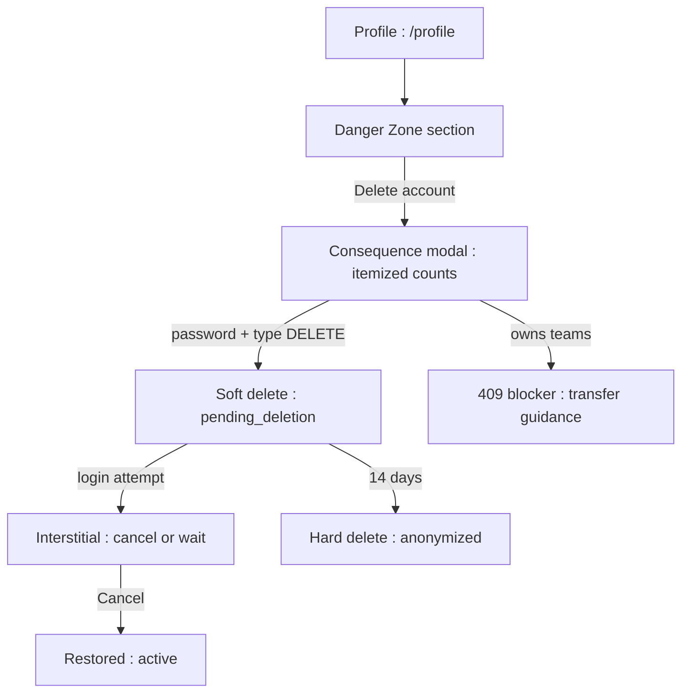
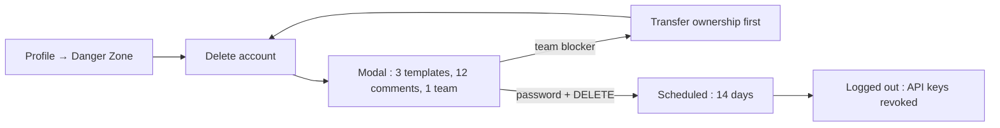
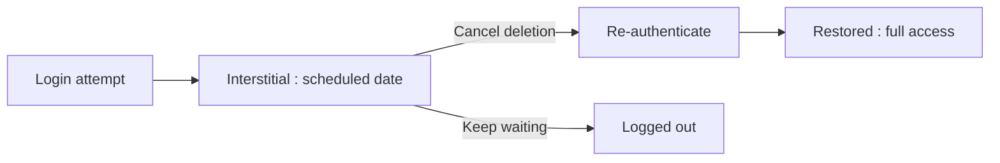

# Account Deletion — UI/UX Design

- **Feature ID:** account-deletion
- **Version:** 1.0
- **Status:** Proposed (for architecture review)
- **Author:** ui-ux-agent
- **Date:** 2026-10-13
- **Companion doc:** `account-deletion-requirements.md`

## 1. Design Principles

1. **Honest, not scary.** The Danger Zone states exactly what happens — itemized, grouped, plain language. No dark patterns, no guilt trips, no retention offers.
2. **Friction proportional to irreversibility.** Password + type-`DELETE` for the confirmation; one click to cancel during grace. Hard to destroy, easy to recover.
3. **The exit is a door, not a trap.** Export link, team-transfer guidance, and a 14-day undo window are part of the flow, not footnotes.
4. **Community outlives the member.** Comments and ratings become "Deleted user" — conversations stay coherent; the person disappears.

## 2. Information Architecture



| Surface | Location | Audience | Purpose |
|---|---|---|---|
| Danger Zone | Profile page bottom | All users | Discoverable, deliberate placement |
| Consequence modal | Overlay from Danger Zone | Deletion candidate | Informed consent |
| Deletion interstitial | Login path for pending users | Pending-deletion users | Cancel or wait |
| Admin pending list | `/admin/users` + status filter | Admins | Restore / force-delete |
| "Deleted user" tombstone | Comments, ratings, lineage | Community | Coherent history without identity |

## 3. User Flows

### 3.1 Delete with full friction



### 3.2 Grace-period cancel



## 4. Page Layouts

### 4.1 Profile — Danger Zone

```
+----------------------------------------------------------------------+
|  Profile                                                              |
|  [avatar]  Display name  ·  Bio                                       |
|  ... existing profile form ...                                        |
+----------------------------------------------------------------------+
|  ⚠ Danger Zone                                                        |
|  ┌------------------------------------------------------------------┐|
|  | Delete account                                                    ||
|  | Permanently remove your account, templates, prompts, and          ||
|  | collections. Your comments and ratings stay but become anonymous. ||
|  |                                         [Delete account]          ||
|  └------------------------------------------------------------------┐|
+----------------------------------------------------------------------+
```

Danger-tinted border, isolated at page bottom.

### 4.2 Consequence modal

```
+----------------------------------------------------------------------+
|  Delete your account?                                                 |
|                                                                      |
|  This will permanently delete:                                       |
|    • 3 templates (2 public, 1 private)  • 27 prompts                 |
|    • 1 collection  • 5 presets  • 2 API keys                          |
|                                                                      |
|  This will anonymize (content stays, your name removed):             |
|    • 12 comments on other templates  • 9 ratings                     |
|                                                                      |
|  📦 [Export your templates first]     👥 [Transfer team ownership]    |
|                                                                      |
|  To confirm, enter your password and type DELETE:                    |
|  [Password            ]   [DELETE          ]                          |
|                                                                      |
|  Your account is removed after a 14-day grace period. You can        |
|  cancel any time by logging in.                                      |
|                                                                      |
|                        [Cancel]  [Permanently delete]  (disabled)    |
+----------------------------------------------------------------------+
```

### 4.3 Deletion interstitial (login path)

```
+----------------------------------------------------------------------+
|                                                                      |
|          Your account is scheduled for deletion                      |
|          on October 27, 2026                                         |
|                                                                      |
|          If you changed your mind, you can cancel now.               |
|                                                                      |
|          [Cancel deletion]        [Sign out]                         |
+----------------------------------------------------------------------+
```

Full-page route (`/account/pending-deletion`), no app chrome.

### 4.4 Admin — pending-deletion row

```
+----------------------------------------------------------------------+
|  Users  [Status ▾: Pending deletion]                                 |
+----------------------------------------------------------------------+
|  alice@…  Alice  pending_deletion  Deletion: Oct 27   [Restore][Delete]|
|  bob@…    Bob    pending_deletion  Deletion: Oct 29   [Restore][Delete]|
+----------------------------------------------------------------------+
```

Delete opens the standard reason modal (3–500 chars).

### 4.5 "Deleted user" tombstone (comment)

```
+----------------------------------------------------------------------+
|  [∅] Deleted user · 2 months ago                                     |
|      This prompt saved me hours — the follow-up section is gold.     |
+----------------------------------------------------------------------+
```

Gray avatar placeholder, no profile link.

### 4.6 Mobile

The Danger Zone renders full-width below the profile form. The modal becomes a bottom sheet with the two confirmation inputs stacked; the delete button spans full width. The interstitial is already mobile-first (single column, two buttons).

## 5. Component Specs

| Component | Behavior | States |
|---|---|---|
| DangerZone | Isolated section, danger border, title + description + action | Default |
| ConsequenceModal | Fetches counts; deleted vs. anonymized groups; export/team links; password + DELETE inputs; enable logic | Loading / loaded / blocker(teams) / wrong-password / submitting / error |
| DeletionInterstitial | Full-page; date, cancel (re-auth), sign out | Default / re-authenticating / restored |
| PendingDeletionRow (admin) | Status chip + scheduled date + Restore/Delete actions | Default / acting |
| DeletedUserTombstone | Gray avatar, "Deleted user", no link | Default |
| GraceCountdownChip | "13 days left" on interstitial | 14→0 |

## 6. Interaction Details

1. **Enable logic:** the delete button enables only when password validation passes server-side (debounced check on blur) AND the text input equals `DELETE` exactly. Any change disables it again.
2. **Team blocker:** if the counts response includes owned teams, the modal shows a blocking banner ("You own 1 team — transfer ownership or dissolve it first") with a link; the delete button stays disabled.
3. **OAuth accounts:** the password field is replaced by a "Re-authenticate with {provider}" button that runs the existing OAuth flow and returns to the modal with a verified badge.
4. **After confirm:** immediate logout, redirect to home with a final toast ("Account scheduled for deletion — you have 14 days to cancel").
5. **Cancel flow:** interstitial → Cancel → re-auth (password or OAuth) → confirm dialog ("Restore your account?") → restored → land on dashboard with a welcome-back toast.
6. **Admin actions:** Restore asks for confirmation (no reason); Delete now opens the standard reason modal; both show a result toast and refresh the list.
7. **Tombstone rendering:** any comment/rating/lineage whose author is `status='deleted'` renders the tombstone — one shared component, no per-surface logic.
8. **Grace countdown:** the interstitial computes days remaining from `deletion_scheduled_at`; the final day shows "Tomorrow".

## 7. States Summary

| Surface | Loading | Empty | Error |
|---|---|---|---|
| DangerZone | — | — | — |
| ConsequenceModal | Skeleton counts | — (always has counts) | Retry; delete disabled |
| DeletionInterstitial | — | — | Re-auth failure inline |
| Admin rows | Table skeleton | "No pending deletions" | Toast + retry |
| Tombstone | — | — | — |

## 8. i18n

| Key | EN | ZH |
|---|---|---|
| `delete.zone.title` | Danger Zone | 危险操作区 |
| `delete.zone.description` | Permanently remove your account, templates, prompts, and collections. Your comments and ratings stay but become anonymous. | 永久移除你的账号、模板、提示词与合集。你的评论和评分会保留但变为匿名。 |
| `delete.action` | Delete account | 删除账号 |
| `delete.modal.title` | Delete your account? | 删除你的账号？ |
| `delete.modal.deleteGroup` | This will permanently delete | 这将被永久删除 |
| `delete.modal.anonymizeGroup` | This will anonymize (content stays, your name removed) | 这将被匿名化（内容保留，移除你的名字） |
| `delete.modal.templates` | {{count}} templates ({{public}} public, {{private}} private) | {{count}} 个模板（{{public}} 公开，{{private}} 私有） |
| `delete.modal.prompts` | {{count}} prompts | {{count}} 个提示词 |
| `delete.modal.collections` | {{count}} collections | {{count}} 个合集 |
| `delete.modal.presets` | {{count}} presets | {{count}} 个预设 |
| `delete.modal.apiKeys` | {{count}} API keys | {{count}} 个 API key |
| `delete.modal.comments` | {{count}} comments on other templates | 其他模板下的 {{count}} 条评论 |
| `delete.modal.ratings` | {{count}} ratings | {{count}} 条评分 |
| `delete.modal.exportFirst` | Export your templates first | 先导出你的模板 |
| `delete.modal.teamBlocker` | You own {{count}} team(s) — transfer ownership or dissolve them first | 你拥有 {{count}} 个团队 —— 请先转移所有权或解散 |
| `delete.modal.teamBlockerLink` | Transfer team ownership | 转移团队所有权 |
| `delete.modal.password` | Password | 密码 |
| `delete.modal.typeDelete` | Type DELETE to confirm | 输入 DELETE 以确认 |
| `delete.modal.graceNote` | Your account is removed after a 14-day grace period. You can cancel any time by logging in. | 账号将在 14 天宽限期后移除。期间随时可登录取消。 |
| `delete.modal.confirm` | Permanently delete | 永久删除 |
| `delete.toast.scheduled` | Account scheduled for deletion — you have 14 days to cancel | 账号已计划注销 —— 你有 14 天时间可以取消 |
| `delete.interstitial.title` | Your account is scheduled for deletion | 你的账号已计划注销 |
| `delete.interstitial.date` | on {{date}} | 于 {{date}} |
| `delete.interstitial.hint` | If you changed your mind, you can cancel now. | 如果你改主意了，现在可以取消。 |
| `delete.interstitial.cancel` | Cancel deletion | 取消注销 |
| `delete.interstitial.signOut` | Sign out | 退出登录 |
| `delete.interstitial.daysLeft` | {{count}} days left | 剩余 {{count}} 天 |
| `delete.interstitial.tomorrow` | Tomorrow | 明天 |
| `delete.admin.restore` | Restore | 恢复 |
| `delete.admin.deleteNow` | Delete now | 立即删除 |
| `delete.admin.scheduled` | Deletion: {{date}} | 注销计划：{{date}} |
| `delete.admin.empty` | No pending deletions | 没有待注销的账号 |
| `delete.tombstone.name` | Deleted user | 已注销用户 |
| `delete.error.wrongPassword` | Incorrect password | 密码错误 |
| `delete.error.notAllowed` | This account cannot be deleted | 该账号无法删除 |

## 9. Accessibility

- The Danger Zone is a labelled `<section>` with `aria-labelledby`; the delete action opens a modal with `role=dialog`, focus trap, and Esc-to-cancel (existing modal semantics).
- The confirmation inputs have explicit labels; the disabled delete button has `aria-disabled` and an explanation region (`aria-live=polite`) stating what's missing ("Enter your password and type DELETE").
- The interstitial is a single-focus page: two buttons, logical tab order, no app chrome to trap screen readers.
- The tombstone avatar is decorative (`aria-hidden`); the name "Deleted user" is real text.
- Admin actions use the existing reason-modal accessibility pattern (labelled textarea, required-state announced).

## 10. Analytics (optional)

- `delete_flow_started`, `delete_confirmed`, `delete_cancelled` (source: interstitial), `delete_export_link_clicked`, `delete_team_blocker_shown` — product usage events only.

## 11. Out of Scope

- Email notifications; selective deletion; export bundling; DSR ticketing.
- Retention offers ("are you sure — here's a discount") — no dark patterns, and no monetization of any kind, permanently out of scope for this product.
