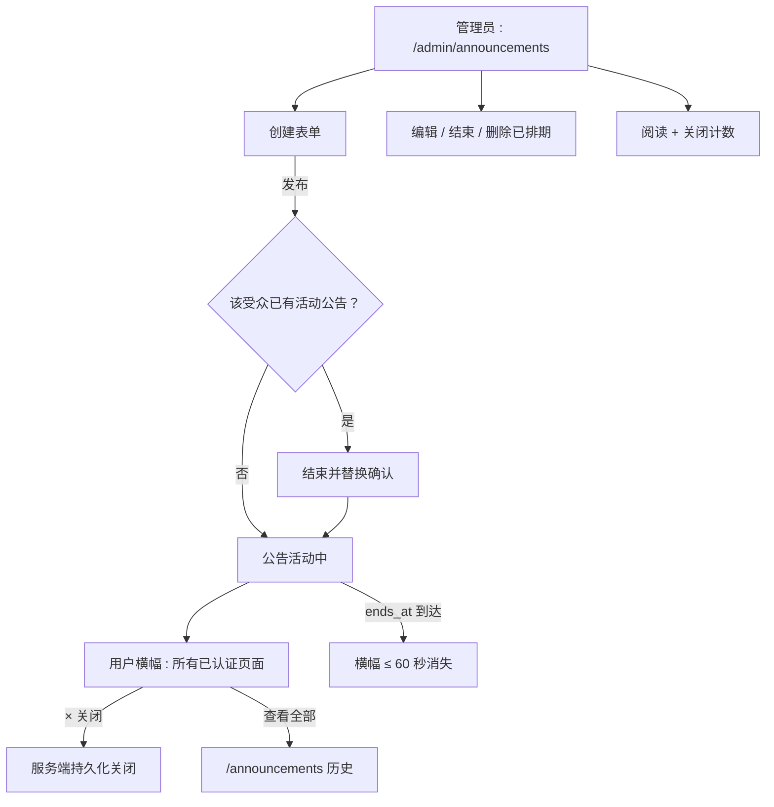

# 管理员公告 — UI/UX 设计

- **功能 ID：** admin-announcements
- **版本：** 1.0
- **状态：** Proposed（待架构评审）
- **作者：** ui-ux-agent
- **日期：** 2026-10-13
- **配套文档：** `admin-announcements-requirements-zh-CN.md`

## 1. 设计原则

1. **一条横幅，零纠缠。** 每个受众单一活动横幅；关闭对用户永久生效；紧急通知罕见且醒目。
2. **设计上即限时。** 每条公告都有结束时间；窗口关闭横幅即消失 —— 无需手动清理。
3. **历史是一等页面。** 用户随时可在 `/announcements` 补看；横幅只是指针。
4. **管理流与控制台一致。** 创建/编辑/结束遵循 `/admin` 其余部分的列表 + 表单 + 审计模式。

## 2. 信息架构



| 界面 | 位置 | 受众 | 目的 |
|---|---|---|---|
| 公告横幅 | 已认证应用顶部 | 按公告受众 | 活动通知 |
| /announcements | 用户路由 | 按查看者受众 | 历史列表 |
| /admin/announcements | 管理控制台 | 管理员 | 管理全部 |
| /admin/announcements/new、/:id/edit | 管理控制台 | 管理员 | 创建/编辑表单 |

## 3. 用户流程

### 3.1 发布维护通知


### 3.2 紧急事故通知


## 4. 页面布局

### 4.1 用户横幅（普通）

```
+----------------------------------------------------------------------+
| 📣 10月20日 02:00–04:00 UTC 计划维护。只读模式。                       |
|    详情…                                                [×]            |
+----------------------------------------------------------------------+
|  （应用 header …）                                                     |
```

紧急变体：红色左边框、无 ×、`role=alert`。

### 4.2 /announcements（历史）

```
+----------------------------------------------------------------------+
|  公告                                                                  |
+----------------------------------------------------------------------+
|  [紧急] 计划维护                        10月20日 · 10月20日结束        |
|  10月20日计划维护…（正文摘录）                                          |
|  [普通] 新导出格式                      10月12日 · 10月19日结束        |
|  Markdown、YAML、纯文本导出已上线…                                      |
|                                              [加载更多]                |
```

### 4.3 /admin/announcements（列表）

```
+----------------------------------------------------------------------+
|  公告                                            [+ 新建]              |
+----------------------------------------------------------------------+
|  标题             受众       级别     状态      窗口         阅读数   |
|  计划维护         all_users  普通     活动中    10月20→21    812     |
|  部署窗口         admins     普通     已排期    10月22→22     —      |
|  新格式           all_users  普通     已结束    10月12→19   1204     |
+----------------------------------------------------------------------+
```

### 4.4 管理表单（/admin/announcements/new）

```
+----------------------------------------------------------------------+
|  新建公告                                                              |
|  标题 [                                    ] (120)                     |
|  正文 [                                    ] (2000)                    |
|        [                             ]                                 |
|  链接 URL [https://…    ]  链接文字 [详情…  ]                           |
|  受众 ( all_users | admins_only )                                     |
|  级别 ( 普通 | 紧急 )                                                  |
|  开始 [2026-10-20 02:00]  结束 [2026-10-21 02:00]                      |
|                              [取消]  [发布]                            |
+----------------------------------------------------------------------+
```

### 4.5 移动端

横幅全宽、× 右对齐；正文摘录钳制为 2 行。`/announcements` 与管理列表变为单列卡片；管理表单字段堆叠、输入全宽。

## 5. 组件规格

| 组件 | 行为 | 状态 |
|---|---|---|
| AnnouncementBanner | 标题 + 正文摘录 + 可选链接 + ×（仅普通）；预留高度 | 普通 / 紧急 / 已关闭 / 已结束 |
| AnnouncementHistoryList | 反向时间卡片，含级别 chip、窗口、正文 | 加载中 / 空态 / 已加载 / 错误 |
| AdminAnnouncementList | 表格，含状态 chip、窗口、阅读/关闭计数、行操作 | 加载中 / 空态 / 已加载 / 错误 |
| AnnouncementForm | 校验字段（标题 ≤120、正文 ≤2000、http(s) 链接、ends_at > starts_at）；发布触发结束并替换检查 | 空闲 / 无效 / 提交中 / 冲突（结束并替换） |
| EndReplaceDialog | "结束活动公告并发布这条？"并显示旧标题 | 确认 / 取消 |
| SeverityChip | 带文字标签的着色 chip | 普通 / 紧急 |
| StateChip | 已排期 / 活动中 / 已结束 | 3 种状态 |

## 6. 交互细节

1. **横幅渲染：** 已认证页面加载时获取；可见期间每 60 秒轮询，使结束无需刷新即生效。加载前预留高度避免偏移。
2. **关闭：** × 调用 `POST /announcements/{id}/dismiss`；乐观隐藏，出错回滚。紧急横幅不渲染 ×。
3. **浏览 beacon：** 横幅首次渲染触发每公告一次的 beacon（template-watch 模式）；历史项浏览同样只计一次。
4. **结束并替换：** 向已有活动公告的受众发布时打开确认对话框并显示活动标题；确认后原子调用创建 + 结束（单一 API 事务，FR-9）。
5. **编辑限制：** 已发布公告的表单禁用受众与级别（FR-12）；ends_at 可编辑以延长/缩短。
6. **立即结束：** 行操作 + 详情操作调用 `/end`；管理列表状态 chip 立即翻转为 `已结束`。
7. **删除：** 仅已排期行显示删除；活动行显示结束；已结束行两者皆无（仅审计历史）。
8. **链接安全：** 链接 URL 在表单时校验 http(s)；渲染的链接以 `target=_blank rel="noopener noreferrer"` 打开。
9. **登录页：** 横幅仅挂载于已认证外壳 —— 登录/注册/管理员登录永不显示（FR-15）。

## 7. 状态汇总

| 界面 | 加载中 | 空态 | 错误 |
|---|---|---|---|
| AnnouncementBanner | 预留高度空白 | 无横幅（无活动） | 静默（下次轮询重试） |
| AnnouncementHistoryList | 卡片骨架 | "暂无公告" | 重试 |
| AdminAnnouncementList | 表格骨架 | "暂无公告" | toast + 重试 |
| AnnouncementForm | — | — | 字段错误行内；冲突 → EndReplaceDialog |
| EndReplaceDialog | — | — | 行内错误，保持打开 |

## 8. 国际化（i18n）

| Key | 中文 | 英文 |
|---|---|---|
| `ann.banner.dismiss` | 关闭 | Dismiss |
| `ann.banner.viewAll` | 查看全部公告 | View all announcements |
| `ann.history.title` | 公告 | Announcements |
| `ann.history.empty` | 暂无公告 | No announcements yet |
| `ann.history.loadMore` | 加载更多 | Load more |
| `ann.severity.standard` | 普通 | Standard |
| `ann.severity.critical` | 紧急 | Critical |
| `ann.state.scheduled` | 已排期 | Scheduled |
| `ann.state.active` | 活动中 | Active |
| `ann.state.ended` | 已结束 | Ended |
| `ann.admin.list.title` | 公告 | Announcements |
| `ann.admin.list.new` | 新建公告 | New announcement |
| `ann.admin.list.empty` | 暂无公告 | No announcements |
| `ann.admin.list.reads` | 阅读数 | Reads |
| `ann.admin.list.dismissals` | 关闭数 | Dismissals |
| `ann.admin.form.title` | 新建公告 | New announcement |
| `ann.admin.form.editTitle` | 编辑公告 | Edit announcement |
| `ann.admin.form.titleLabel` | 标题 | Title |
| `ann.admin.form.bodyLabel` | 正文 | Body |
| `ann.admin.form.linkUrl` | 链接 URL（可选） | Link URL (optional) |
| `ann.admin.form.linkLabel` | 链接文字（可选） | Link label (optional) |
| `ann.admin.form.audience` | 受众 | Audience |
| `ann.admin.form.audience.all` | 全体用户 | All users |
| `ann.admin.form.audience.admins` | 仅管理员 | Admins only |
| `ann.admin.form.severity` | 级别 | Severity |
| `ann.admin.form.startsAt` | 开始时间 | Starts at |
| `ann.admin.form.endsAt` | 结束时间 | Ends at |
| `ann.admin.form.publish` | 发布 | Publish |
| `ann.admin.form.endNow` | 立即结束 | End now |
| `ann.admin.form.delete` | 删除 | Delete |
| `ann.admin.form.endsAfterStarts` | 结束时间必须晚于开始时间 | End time must be after start time |
| `ann.admin.form.invalidUrl` | 链接必须是合法的 http(s) URL | Link must be a valid http(s) URL |
| `ann.admin.replace.title` | 替换活动公告？ | Replace active announcement? |
| `ann.admin.replace.body` | "{{title}}" 当前活动中。发布后将结束它。 | "{{title}}" is currently active. Publishing this will end it. |
| `ann.admin.replace.confirm` | 结束并发布 | End & publish |
| `ann.admin.toast.published` | 公告已发布 | Announcement published |
| `ann.admin.toast.ended` | 公告已结束 | Announcement ended |
| `ann.admin.toast.deleted` | 公告已删除 | Announcement deleted |

## 9. 无障碍

- 横幅是带 `aria-label="公告"` 标签的 `region`；紧急横幅首次渲染带 `role=alert`，屏幕阅读器会播报。
- × 关闭按钮有可访问名称（"关闭公告"）且可 Tab 触达；Enter/Space 激活。
- 级别/状态 chip 始终颜色配文字标签 —— 绝不仅靠颜色。
- 管理表单用带标签的输入，行内错误文字通过 `aria-describedby` 绑定；结束并替换对话框是标准焦点陷阱弹窗，Esc 取消。
- 历史卡片为语义列表项；"加载更多"按钮通过 live region 播报加载数量。

## 10. 数据埋点（可选）

- `ann_banner_viewed`、`ann_banner_dismissed`、`ann_link_clicked`、`ann_history_opened` —— 仅产品使用事件（阅读计数已在服务端）。

## 11. 不在范围内

- 邮件/推送送达；通知中心集成；富文本正文；群组定向；重复；翻译流程。
- 任何形式的变现 —— 本产品永久不做。
