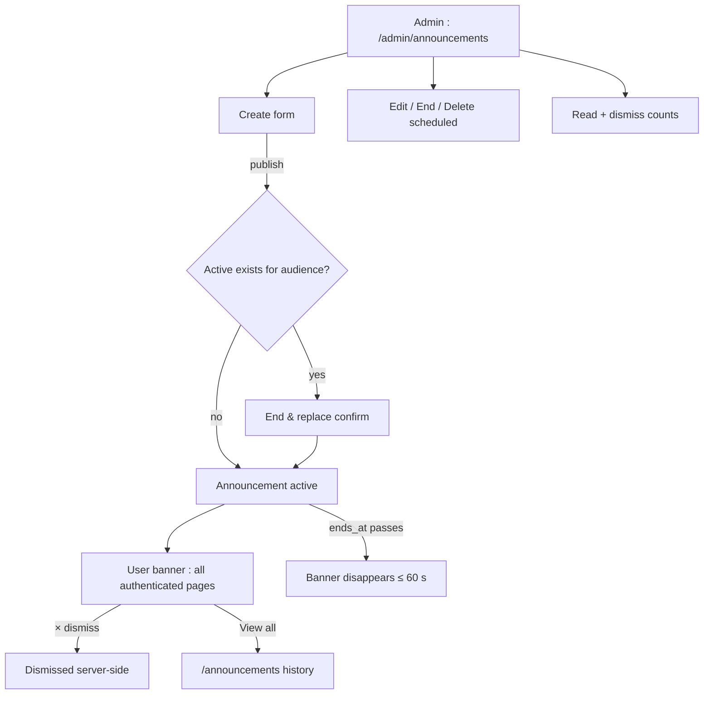
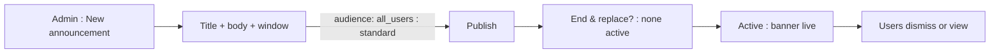
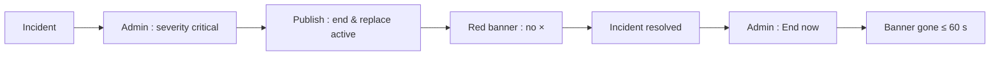

# Admin Announcements — UI/UX Design

- **Feature ID:** admin-announcements
- **Version:** 1.0
- **Status:** Proposed (for architecture review)
- **Author:** ui-ux-agent
- **Date:** 2026-10-13
- **Companion doc:** `admin-announcements-requirements.md`

## 1. Design Principles

1. **One banner, zero nagging.** A single active banner per audience; dismissal is permanent per user; critical notices are rare and unmistakable.
2. **Time-boxed by design.** Every announcement has an end; the banner leaves when the window closes — no manual cleanup required.
3. **History is a first-class page.** Users can always catch up at `/announcements`; the banner is just the pointer.
4. **Admin flow mirrors the console.** Create/edit/end follows the same list + form + audit patterns as the rest of `/admin`.

## 2. Information Architecture



| Surface | Location | Audience | Purpose |
|---|---|---|---|
| Announcement banner | Top of authenticated app | Per announcement audience | Active notice |
| /announcements | User route | Per viewer audience | History list |
| /admin/announcements | Admin console | Admins | Manage all |
| /admin/announcements/new, /:id/edit | Admin console | Admins | Create/edit form |

## 3. User Flows

### 3.1 Publish a maintenance notice



### 3.2 Critical incident notice



## 4. Page Layouts

### 4.1 User banner (standard)

```
+----------------------------------------------------------------------+
| 📣 Scheduled maintenance Oct 20, 02:00–04:00 UTC. Read-only mode.     |
|    Details…                                              [×]          |
+----------------------------------------------------------------------+
|  (app header …)                                                       |
```

Critical variant: red left border, no ×, `role=alert`.

### 4.2 /announcements (history)

```
+----------------------------------------------------------------------+
|  Announcements                                                        |
+----------------------------------------------------------------------+
|  [CRITICAL] Scheduled maintenance          Oct 20 · ended Oct 20     |
|  Scheduled maintenance Oct 20… (body excerpt)                         |
|  [STANDARD] New export formats            Oct 12 · ends Oct 19       |
|  Markdown, YAML, plain text export is live…                           |
|                                              [Load more]              |
```

### 4.3 /admin/announcements (list)

```
+----------------------------------------------------------------------+
|  Announcements                                    [+ New]             |
+----------------------------------------------------------------------+
|  Title            Audience   Severity  State      Window      Reads  |
|  Maintenance      all_users  standard  active     Oct 20→21    812   |
|  Deploy window    admins     standard  scheduled  Oct 22→22     —    |
|  New formats      all_users  standard  ended      Oct 12→19   1204   |
+----------------------------------------------------------------------+
```

### 4.4 Admin form (/admin/announcements/new)

```
+----------------------------------------------------------------------+
|  New announcement                                                     |
|  Title [                                    ] (120)                   |
|  Body  [                                    ] (2000)                  |
|        [                             ]                                 |
|  Link URL [https://…    ]  Link label [Details…  ]                    |
|  Audience ( all_users | admins_only )                                 |
|  Severity ( standard | critical )                                     |
|  Starts at [2026-10-20 02:00]  Ends at [2026-10-21 02:00]             |
|                              [Cancel]  [Publish]                      |
+----------------------------------------------------------------------+
```

### 4.5 Mobile

The banner spans full width with the × right-aligned; body excerpt clamps to 2 lines. `/announcements` and the admin list become single-column cards; the admin form stacks fields with full-width inputs.

## 5. Component Specs

| Component | Behavior | States |
|---|---|---|
| AnnouncementBanner | Title + body excerpt + optional link + × (standard only); reserved height | standard / critical / dismissed / ended |
| AnnouncementHistoryList | Reverse-chronological cards with severity chip, window, body | loading / empty / loaded / error |
| AdminAnnouncementList | Table with state chip, window, read/dismiss counts, row actions | loading / empty / loaded / error |
| AnnouncementForm | Validated fields (title ≤120, body ≤2000, http(s) link, ends_at > starts_at); publish triggers end-&-replace check | idle / invalid / submitting / conflict (end & replace) |
| EndReplaceDialog | "End the active announcement and publish this one?" with old title shown | confirm / cancel |
| SeverityChip | Colored chip with text label | standard / critical |
| StateChip | scheduled / active / ended | 3 states |

## 6. Interaction Details

1. **Banner render:** fetched on authenticated page load; while visible, polled every 60 s so endings take effect without refresh. Height is reserved pre-load to avoid shift.
2. **Dismiss:** × posts `POST /announcements/{id}/dismiss`; optimistic hide with rollback on error. Critical banners render no ×.
3. **Read beacon:** first banner render fires a once-per-announcement beacon (template-watch pattern); history-item views also count once.
4. **End & replace:** publishing to an audience with an active announcement opens the confirm dialog showing the active title; confirming calls create + end atomically (single API transaction, FR-9).
5. **Edit limits:** the form disables audience and severity for published announcements (FR-12); ends_at is editable to extend/shorten.
6. **End now:** row action + detail action posts `/end`; the list state chip flips to `ended` immediately for the admin.
7. **Delete:** only scheduled rows show Delete; active rows show End instead; ended rows show neither (audit-only history).
8. **Link safety:** link URLs validated http(s) at form time; rendered links open `target=_blank rel="noopener noreferrer"`.
9. **Login pages:** the banner is mounted only in the authenticated shell — login/register/admin-login never show it (FR-15).

## 7. States Summary

| Surface | Loading | Empty | Error |
|---|---|---|---|
| AnnouncementBanner | Reserved-height blank | No banner (no active) | Silent (retry next poll) |
| AnnouncementHistoryList | Card skeletons | "No announcements yet" | Retry |
| AdminAnnouncementList | Table skeleton | "No announcements" | Toast + retry |
| AnnouncementForm | — | — | Field errors inline; conflict → EndReplaceDialog |
| EndReplaceDialog | — | — | Inline error, stay open |

## 8. i18n

| Key | EN | ZH |
|---|---|---|
| `ann.banner.dismiss` | Dismiss | 关闭 |
| `ann.banner.viewAll` | View all announcements | 查看全部公告 |
| `ann.history.title` | Announcements | 公告 |
| `ann.history.empty` | No announcements yet | 暂无公告 |
| `ann.history.loadMore` | Load more | 加载更多 |
| `ann.severity.standard` | Standard | 普通 |
| `ann.severity.critical` | Critical | 紧急 |
| `ann.state.scheduled` | Scheduled | 已排期 |
| `ann.state.active` | Active | 活动中 |
| `ann.state.ended` | Ended | 已结束 |
| `ann.admin.list.title` | Announcements | 公告 |
| `ann.admin.list.new` | New announcement | 新建公告 |
| `ann.admin.list.empty` | No announcements | 暂无公告 |
| `ann.admin.list.reads` | Reads | 阅读数 |
| `ann.admin.list.dismissals` | Dismissals | 关闭数 |
| `ann.admin.form.title` | New announcement | 新建公告 |
| `ann.admin.form.editTitle` | Edit announcement | 编辑公告 |
| `ann.admin.form.titleLabel` | Title | 标题 |
| `ann.admin.form.bodyLabel` | Body | 正文 |
| `ann.admin.form.linkUrl` | Link URL (optional) | 链接 URL（可选） |
| `ann.admin.form.linkLabel` | Link label (optional) | 链接文字（可选） |
| `ann.admin.form.audience` | Audience | 受众 |
| `ann.admin.form.audience.all` | All users | 全体用户 |
| `ann.admin.form.audience.admins` | Admins only | 仅管理员 |
| `ann.admin.form.severity` | Severity | 级别 |
| `ann.admin.form.startsAt` | Starts at | 开始时间 |
| `ann.admin.form.endsAt` | Ends at | 结束时间 |
| `ann.admin.form.publish` | Publish | 发布 |
| `ann.admin.form.endNow` | End now | 立即结束 |
| `ann.admin.form.delete` | Delete | 删除 |
| `ann.admin.form.endsAfterStarts` | End time must be after start time | 结束时间必须晚于开始时间 |
| `ann.admin.form.invalidUrl` | Link must be a valid http(s) URL | 链接必须是合法的 http(s) URL |
| `ann.admin.replace.title` | Replace active announcement? | 替换活动公告？ |
| `ann.admin.replace.body` | "{{title}}" is currently active. Publishing this will end it. | "{{title}}" 当前活动中。发布后将结束它。 |
| `ann.admin.replace.confirm` | End & publish | 结束并发布 |
| `ann.admin.toast.published` | Announcement published | 公告已发布 |
| `ann.admin.toast.ended` | Announcement ended | 公告已结束 |
| `ann.admin.toast.deleted` | Announcement deleted | 公告已删除 |

## 9. Accessibility

- The banner is a labelled `region` with `aria-label="Announcement"`; critical banners get `role=alert` on first render so screen readers announce them.
- The × dismiss button has an accessible name ("Dismiss announcement") and is reachable via Tab; Enter/Space activates.
- Severity/state chips always pair color with a text label — never color alone.
- The admin form uses labelled inputs with inline error text tied via `aria-describedby`; the end-&-replace dialog is a standard focus-trapped modal with Esc to cancel.
- History cards are semantic list items; the "Load more" button announces loaded count via live region.

## 10. Analytics (optional)

- `ann_banner_viewed`, `ann_banner_dismissed`, `ann_link_clicked`, `ann_history_opened` — product usage events only (read counts are already server-side).

## 11. Out of Scope

- Email/push delivery; notification-center integration; rich text bodies; cohort targeting; recurrence; translation workflows.
- Monetization of any kind — permanently out of scope for this product.
