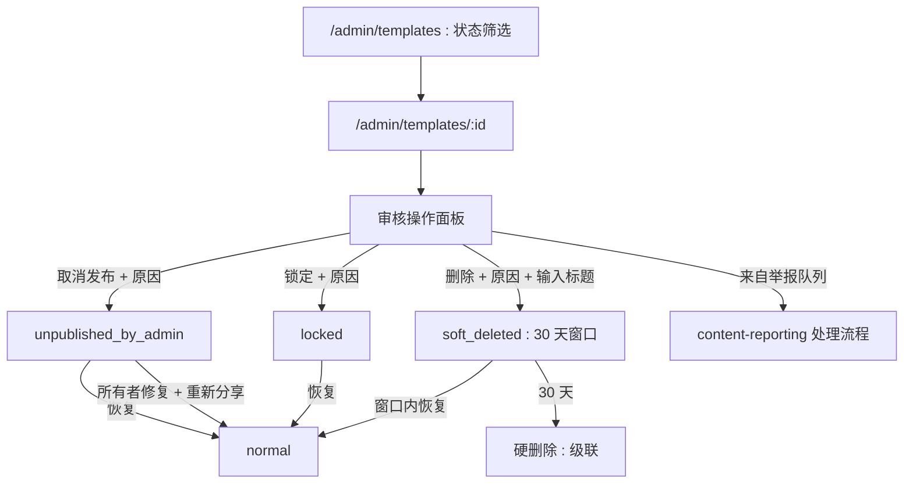
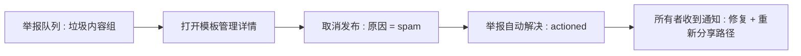
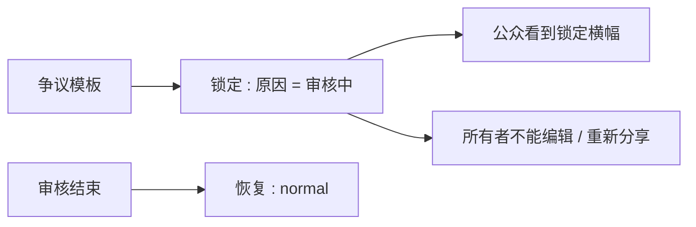

# 管理员模板审核 — UI/UX 设计

- **功能 ID：** admin-template-moderation
- **版本：** 1.0
- **状态：** Proposed（待架构评审）
- **作者：** ui-ux-agent
- **日期：** 2026-10-13
- **配套文档：** `admin-template-moderation-requirements-zh-CN.md`

## 1. 设计原则

1. **分级力度，后果可见。** 三个操作，每个在提交前都有平实语言的后果清单 —— 管理员永远知道自己将做什么。
2. **默认可逆。** 取消发布与锁定一键撤销；删除有 30 天窗口。没有瞬间不可逆的操作。
3. **对创作者透明。** 每个操作都带原因通知所有者并给出前进路径（修复 → 重新发布）。审核是纠正，不是让内容无声消失。
4. **与举报一个闭环。** 举报队列的"处理"直接落到本面板 —— 无上下文切换。

## 2. 信息架构



| 界面 | 位置 | 受众 | 目的 |
|---|---|---|---|
| 审核操作面板 | 管理员模板详情页 | 管理员 | 选择 + 执行操作 |
| 状态筛选 + chip | 管理员模板列表 | 管理员 | 复查已处置内容 |
| 管理员通告横幅 | 模板详情页（所有者视图） | 所有者 | 解释 + 前进路径 |
| 锁定横幅 | 模板详情页（公开） | 浏览者 | 通用通告 |
| 移除通告页 | 模板详情页（所有者，软删除） | 所有者 | 原因 + 申诉提示 |
| 审核通知 | 通知中心 | 所有者 | 操作、原因、深链 |

## 3. 用户流程

### 3.1 处置被举报模板



### 3.2 审核期间锁定



## 4. 页面布局

### 4.1 管理员模板详情 — 审核面板

```
+----------------------------------------------------------------------+
|  ← 模板 / Cold Email Template                                         |
|  by Alice · v6 · public · ★128 · 创建于 2026-08-01                    |
+----------------------------------------------------------------------+
|  ⚖ 审核                                          [ normal ● ]         |
|  ┌------------------------------------------------------------------┐|
|  | 当前状态：正常                                                     ||
|  |                                                                   ||
|  | [取消发布]  [锁定]  [删除]                                         ||
|  |                                                                   ||
|  | 审核历史：                                                         ||
|  |  2026-10-13  admin2  unpublish  "spam — off-platform links"       ||
|  |  2026-10-13  admin1  restore   "false positive, restored"         ||
|  └------------------------------------------------------------------┐|
+----------------------------------------------------------------------+
```

### 4.2 操作弹窗（取消发布）

```
+----------------------------------------------------------------------+
|  取消发布该模板？                                                      |
|                                                                      |
|  将会发生什么：                                                        |
|    • 从公开界面移除（首页、搜索、嵌入、API）                            |
|    • 所有者保留访问权限并可编辑                                         |
|    • 所有者将收到含你原因的通知                                         |
|    • 可逆：随时可恢复                                                  |
|                                                                      |
|  原因（必填，对所有者可见）：                                           |
|  [                                                             ]     |
|                                                                      |
|                            [取消]  [取消发布]                          |
+----------------------------------------------------------------------+
```

删除变体额外要求："输入模板标题以确认：[Cold Email Template]"。

### 4.3 管理员列表 — 状态筛选

```
+----------------------------------------------------------------------+
|  模板   [状态 ▾: 全部]  [搜索…]                                       |
+----------------------------------------------------------------------+
|  Cold Email Template   Alice   locked ●        10月13日  [详情 →]     |
|  Spam Promo            bob12   soft_deleted ●  10月12日  [详情 →]     |
|  Logo Pack             Carol  normal          10月10日  [详情 →]     |
+----------------------------------------------------------------------+
```

软删除行显示恢复倒计时（"剩余 22 天"）。

### 4.4 所有者视图横幅

```
已取消发布： ⚠ 管理员已取消发布该模板：{原因}。
             你可以编辑后再次分享。  [编辑模板]

已锁定：     🔒 该模板已被管理员锁定。审核期间编辑与新互动被禁用。

已软删除：   ⛔ 该模板已被管理员移除：{原因}。
             如果你认为是误判，请通过通知回复或联系支持。
```

### 4.5 移动端

审核面板堆叠在模板元数据下方；操作按钮全宽。原因弹窗变为底部抽屉。所有者横幅全宽展示，CTA 为块级按钮。

## 5. 组件规格

| 组件 | 行为 | 状态 |
|---|---|---|
| ModerationPanel | 状态 chip + 操作 + 历史列表；操作打开原因弹窗 | normal / unpublished / locked / soft_deleted / self(403) |
| ActionReasonModal | 后果清单 + 原因 textarea（3–500）+ 可选输入标题确认（删除） | 空闲 / 无效 / 提交中 / 错误 |
| StatusChip | 按 moderation_status 着色的 chip | normal / locked / unpublished / soft_deleted |
| RestoreCountdown | 软删除行上的"剩余 N 天" | 30→0 / 已过期 |
| OwnerModerationBanner | 三种变体（取消发布/锁定/移除）含原因 + CTA | 3 种变体 |
| LockBanner（公开） | 通用锁定通告，无原因 | 1 种变体 |
| ModerationNotification | 图标 + 操作 + 标题 + 原因摘录 | 未读 / 已读 |

## 6. 交互细节

1. **操作启用：** 原因有效时启用取消发布/锁定；删除额外要求标题精确匹配（区分大小写）。提交按钮在调用期间显示 spinner。
2. **自我防护：** 管理员拥有该模板时操作禁用并显示提示（"你不能审核自己的模板"）。
3. **状态感知面板：** 状态非 `normal` 时，面板主操作变为**恢复**（需原因）；其他操作仍可用（如将已取消发布升级为软删除）。
4. **历史：** 审核历史来自按目标模板过滤的审计日志，最新在前，显示操作者、动作、原因、时间戳 —— 只读。
5. **举报队列交接：** 队列的"处理 → 取消发布"打开本面板的取消发布弹窗并预填首要举报原因；成功后队列行解决并弹 toast 双重确认。
6. **所有者重新发布：** 取消发布横幅的 CTA 以编辑模式打开模板；正常分享流程完成重新发布；状态回到 `normal` 后横幅消失。
7. **锁定强制 UX：** 被阻断的操作（评论、fork、点赞、编辑保存）显示行内解释性错误（"该模板已被管理员锁定"）—— 绝不静默失败。
8. **恢复倒计时：** 由 `deleted_at + 30 天` 计算；最后 3 天渲染为琥珀色；过期行从列表消失（被 ticker 硬删除）。

## 7. 状态汇总

| 界面 | 加载中 | 空态 | 错误 |
|---|---|---|---|
| ModerationPanel | 骨架 | 历史："暂无审核操作" | 重试 |
| ActionReasonModal | — | — | 行内错误 + 保留输入 |
| 管理员列表 | 表格骨架 | "没有匹配的模板" | toast + 重试 |
| 所有者横幅 | — | 隐藏（状态 normal） | — |
| 审核通知 | — | — | 现有渲染 |

## 8. 国际化（i18n）

| Key | 中文 | 英文 |
|---|---|---|
| `mod.panel.title` | 审核 | Moderation |
| `mod.panel.status` | 当前状态 | Current status |
| `mod.status.normal` | 正常 | Normal |
| `mod.status.locked` | 已锁定 | Locked |
| `mod.status.unpublished` | 已被管理员取消发布 | Unpublished by admin |
| `mod.status.soft_deleted` | 已移除 | Removed |
| `mod.action.unpublish` | 取消发布 | Unpublish |
| `mod.action.lock` | 锁定 | Lock |
| `mod.action.delete` | 删除 | Delete |
| `mod.action.restore` | 恢复 | Restore |
| `mod.modal.unpublish.title` | 取消发布该模板？ | Unpublish this template? |
| `mod.modal.lock.title` | 锁定该模板？ | Lock this template? |
| `mod.modal.delete.title` | 删除该模板？ | Delete this template? |
| `mod.modal.restore.title` | 恢复该模板？ | Restore this template? |
| `mod.modal.consequence.public` | 从公开界面移除（首页、搜索、嵌入、API） | Removed from public surfaces (home, search, embeds, API) |
| `mod.modal.consequence.ownerKeeps` | 所有者保留访问权限并可编辑 | The owner keeps access and can edit |
| `mod.modal.consequence.frozen` | 编辑与新互动被冻结 | Editing and new interactions are frozen |
| `mod.modal.consequence.notified` | 所有者将收到含原因的通知 | The owner is notified with your reason |
| `mod.modal.consequence.reversible` | 可逆：随时可恢复 | Reversible: restore any time |
| `mod.modal.consequence.window` | 处处隐藏；30 天恢复窗口 | Hidden everywhere; 30-day restore window |
| `mod.modal.reason` | 原因（必填，对所有者可见） | Reason (required, visible to the owner) |
| `mod.modal.typeTitle` | 输入模板标题以确认 | Type the template title to confirm |
| `mod.modal.daysLeft` | 剩余 {{count}} 天 | {{count}} days left |
| `mod.history.title` | 审核历史 | Moderation history |
| `mod.history.empty` | 暂无审核操作 | No moderation actions yet |
| `mod.selfGuard` | 你不能审核自己的模板 | You cannot moderate your own template |
| `mod.banner.unpublished` | 管理员已取消发布该模板：{{reason}}。你可以编辑后再次分享。 | An administrator unpublished this template: {{reason}}. You can edit it and share it again. |
| `mod.banner.locked` | 该模板已被管理员锁定。审核期间编辑与新互动被禁用。 | This template is locked by moderators. Editing and new interactions are disabled while under review. |
| `mod.banner.removed` | 该模板已被管理员移除：{{reason}}。如果你认为是误判，请通过通知回复或联系支持。 | This template was removed by moderators: {{reason}}. If you believe this is a mistake, reply via your notification or contact support. |
| `mod.banner.editCta` | 编辑模板 | Edit template |
| `mod.lock.public` | 该模板已被管理员锁定 | This template is locked by moderators |
| `mod.lock.blocked` | 该模板已被管理员锁定 | This template is locked by moderators |
| `mod.notif.unpublish` | 你的模板"{{title}}"已被取消发布：{{reason}} | Your template "{{title}}" was unpublished: {{reason}} |
| `mod.notif.lock` | 你的模板"{{title}}"已被锁定：{{reason}} | Your template "{{title}}" was locked: {{reason}} |
| `mod.notif.delete` | 你的模板"{{title}}"已被移除：{{reason}} | Your template "{{title}}" was removed: {{reason}} |
| `mod.notif.restore` | 你的模板"{{title}}"已恢复 | Your template "{{title}}" was restored |
| `mod.filter.status` | 状态 | Status |
| `mod.filter.empty` | 没有匹配的模板 | No templates match |
| `mod.toast.actioned` | 模板已取消发布；举报已解决 | Template unpublished; report resolved |

## 9. 无障碍

- 审核面板是带标签的 `<section>`；状态 chip 含文字（绝不只靠颜色），历史为语义列表。
- 原因弹窗复用现有管理员原因弹窗模式：带标签的 textarea、必填状态播报、焦点陷阱、Esc 取消。
- 输入确认框有显式标签与 `aria-describedby` 提示；不匹配时按钮保持禁用并带 `aria-disabled`。
- 所有者横幅首次渲染时为 `role=alert`（它们解释所有者未发起的状态变化）；CTA 是带描述性名称的真实链接/按钮。
- 锁定下被阻断的互动通过绑定到控件的行内错误文字（`aria-describedby`）播报原因，而非仅靠颜色。

## 10. 数据埋点（可选）

- `mod_action_taken`（action、来源：面板/举报队列）、`mod_restore_used`、`mod_owner_republished` —— 仅产品使用事件。

## 11. 不在范围内

- 批量审核；发布前审核队列；应用内申诉；管理员编辑内容。
- 年龄限制遮罩；影子封禁；仅搜索除名的可见性。
- 任何形式的变现 —— 本产品永久不做。
