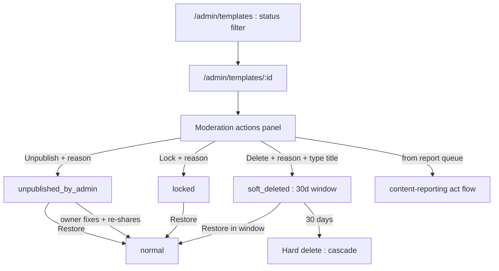
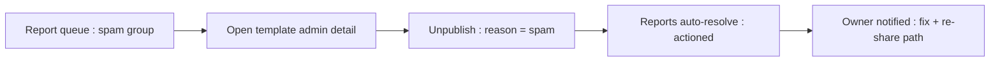
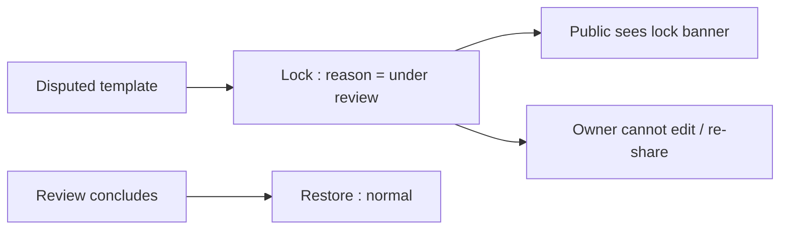

# Admin Template Moderation — UI/UX Design

- **Feature ID:** admin-template-moderation
- **Version:** 1.0
- **Status:** Proposed (for architecture review)
- **Author:** ui-ux-agent
- **Date:** 2026-10-13
- **Companion doc:** `admin-template-moderation-requirements.md`

## 1. Design Principles

1. **Graduated force, visible consequences.** Three actions, each with a plain-language consequence checklist before commit — the admin always knows what they're about to do.
2. **Reversible by default.** Unpublish and lock are one click to undo; delete has a 30-day window. Nothing is instantly permanent.
3. **Transparent to the creator.** Every action notifies the owner with the reason and a path forward (fix → re-publish). Moderation corrects; it doesn't vanish content silently.
4. **One loop with reporting.** The report queue's "act" lands directly in this panel — no context switch.

## 2. Information Architecture



| Surface | Location | Audience | Purpose |
|---|---|---|---|
| Moderation actions panel | Admin template detail | Admins | Choose + execute action |
| Status filter + chips | Admin templates list | Admins | Review actioned content |
| Admin-notice banner | Template detail (owner view) | Owner | Explain + path forward |
| Lock banner | Template detail (public) | Viewers | Generic notice |
| Removed-notice page | Template detail (owner, soft-deleted) | Owner | Reason + appeal hint |
| Moderation notification | Notification center | Owner | Action, reason, deep link |

## 3. User Flows

### 3.1 Act on a reported template



### 3.2 Lock during review



## 4. Page Layouts

### 4.1 Admin template detail — moderation panel

```
+----------------------------------------------------------------------+
|  ← Templates / Cold Email Template                                    |
|  by Alice · v6 · public · ★128 · created 2026-08-01                   |
+----------------------------------------------------------------------+
|  ⚖ Moderation                                    [ normal ● ]         |
|  ┌------------------------------------------------------------------┐|
|  | Current status: Normal                                            ||
|  |                                                                   ||
|  | [Unpublish]  [Lock]  [Delete]                                     ||
|  |                                                                   ||
|  | Moderation history:                                               ||
|  |  2026-10-13  admin2  unpublish  "spam — off-platform links"       ||
|  |  2026-10-13  admin1  restore   "false positive, restored"         ||
|  └------------------------------------------------------------------┐|
+----------------------------------------------------------------------+
```

### 4.2 Action modal (unpublish)

```
+----------------------------------------------------------------------+
|  Unpublish this template?                                             |
|                                                                      |
|  What happens:                                                       |
|    • Removed from public surfaces (home, search, embeds, API)        |
|    • The owner keeps access and can edit                             |
|    • The owner is notified with your reason                          |
|    • Reversible: restore any time                                    |
|                                                                      |
|  Reason (required, visible to the owner):                            |
|  [                                                             ]     |
|                                                                      |
|                            [Cancel]  [Unpublish]                     |
+----------------------------------------------------------------------+
```

Delete variant adds: "Type the template title to confirm: [Cold Email Template]".

### 4.3 Admin list — status filter

```
+----------------------------------------------------------------------+
|  Templates   [Status ▾: All]  [Search…]                              |
+----------------------------------------------------------------------+
|  Cold Email Template   Alice   locked ●        Oct 13   [Detail →]   |
|  Spam Promo            bob12   soft_deleted ●  Oct 12   [Detail →]   |
|  Logo Pack             Carol  normal          Oct 10   [Detail →]   |
+----------------------------------------------------------------------+
```

Soft-deleted rows show a restore countdown ("22 days left").

### 4.4 Owner-view banners

```
Unpublished:  ⚠ An administrator unpublished this template: {reason}.
              You can edit it and share it again.  [Edit template]

Locked:       🔒 This template is locked by moderators. Editing and
              new interactions are disabled while under review.

Soft-deleted: ⛔ This template was removed by moderators: {reason}.
              If you believe this is a mistake, reply via your
              notification or contact support.
```

### 4.5 Mobile

The moderation panel stacks below the template metadata; action buttons are full-width. The reason modal becomes a bottom sheet. Owner banners span full width with the CTA as a block button.

## 5. Component Specs

| Component | Behavior | States |
|---|---|---|
| ModerationPanel | Status chip + actions + history list; actions open reason modals | normal / unpublished / locked / soft_deleted / self(403) |
| ActionReasonModal | Consequence checklist + reason textarea (3–500) + optional type-to-confirm (delete) | idle / invalid / submitting / error |
| StatusChip | Colored chip per moderation_status | normal / locked / unpublished / soft_deleted |
| RestoreCountdown | "N days left" on soft-deleted rows | 30→0 / expired |
| OwnerModerationBanner | Three variants (unpublished/locked/removed) with reason + CTA | 3 variants |
| LockBanner (public) | Generic lock notice, no reason | 1 variant |
| ModerationNotification | Icon + action + title + reason excerpt | unread / read |

## 6. Interaction Details

1. **Action enablement:** Unpublish/Lock enable with a valid reason; Delete additionally requires the title to match exactly (case-sensitive). Submit buttons show a spinner during the call.
2. **Self-guard:** if the admin owns the template, actions render disabled with a tooltip ("You cannot moderate your own template").
3. **Status-aware panel:** when status is not `normal`, the panel's primary action becomes **Restore** (with reason); the other actions remain available (e.g., escalate unpublished → soft-deleted).
4. **History:** the moderation history reads from audit logs filtered by target template, newest first, showing actor, action, reason, timestamp — read-only.
5. **Report-queue handoff:** the queue's "Act → unpublish" opens this panel's unpublish modal pre-filled with the top report reason; on success the queue row resolves and a toast confirms both.
6. **Owner re-publish:** the unpublished banner's CTA opens the template in edit mode; the normal share flow completes the re-publish; the banner disappears once status is `normal`.
7. **Lock enforcement UX:** blocked actions (comment, fork, like, edit-save) show inline explanatory errors ("This template is locked by moderators") — never a silent failure.
8. **Restore countdown:** computed from `deleted_at + 30d`; the final 3 days render amber; expired rows disappear from the list (hard-deleted by the ticker).

## 7. States Summary

| Surface | Loading | Empty | Error |
|---|---|---|---|
| ModerationPanel | Skeleton | History: "No moderation actions yet" | Retry |
| ActionReasonModal | — | — | Inline error + keep input |
| Admin list | Table skeleton | "No templates match" | Toast + retry |
| Owner banners | — | Hidden (status normal) | — |
| ModerationNotification | — | — | Existing rendering |

## 8. i18n

| Key | EN | ZH |
|---|---|---|
| `mod.panel.title` | Moderation | 审核 |
| `mod.panel.status` | Current status | 当前状态 |
| `mod.status.normal` | Normal | 正常 |
| `mod.status.locked` | Locked | 已锁定 |
| `mod.status.unpublished` | Unpublished by admin | 已被管理员取消发布 |
| `mod.status.soft_deleted` | Removed | 已移除 |
| `mod.action.unpublish` | Unpublish | 取消发布 |
| `mod.action.lock` | Lock | 锁定 |
| `mod.action.delete` | Delete | 删除 |
| `mod.action.restore` | Restore | 恢复 |
| `mod.modal.unpublish.title` | Unpublish this template? | 取消发布该模板？ |
| `mod.modal.lock.title` | Lock this template? | 锁定该模板？ |
| `mod.modal.delete.title` | Delete this template? | 删除该模板？ |
| `mod.modal.restore.title` | Restore this template? | 恢复该模板？ |
| `mod.modal.consequence.public` | Removed from public surfaces (home, search, embeds, API) | 从公开界面移除（首页、搜索、嵌入、API） |
| `mod.modal.consequence.ownerKeeps` | The owner keeps access and can edit | 所有者保留访问权限并可编辑 |
| `mod.modal.consequence.frozen` | Editing and new interactions are frozen | 编辑与新互动被冻结 |
| `mod.modal.consequence.notified` | The owner is notified with your reason | 所有者将收到含原因的通知 |
| `mod.modal.consequence.reversible` | Reversible: restore any time | 可逆：随时可恢复 |
| `mod.modal.consequence.window` | Hidden everywhere; 30-day restore window | 处处隐藏；30 天恢复窗口 |
| `mod.modal.reason` | Reason (required, visible to the owner) | 原因（必填，对所有者可见） |
| `mod.modal.typeTitle` | Type the template title to confirm | 输入模板标题以确认 |
| `mod.modal.daysLeft` | {{count}} days left | 剩余 {{count}} 天 |
| `mod.history.title` | Moderation history | 审核历史 |
| `mod.history.empty` | No moderation actions yet | 暂无审核操作 |
| `mod.selfGuard` | You cannot moderate your own template | 你不能审核自己的模板 |
| `mod.banner.unpublished` | An administrator unpublished this template: {{reason}}. You can edit it and share it again. | 管理员已取消发布该模板：{{reason}}。你可以编辑后再次分享。 |
| `mod.banner.locked` | This template is locked by moderators. Editing and new interactions are disabled while under review. | 该模板已被管理员锁定。审核期间编辑与新互动被禁用。 |
| `mod.banner.removed` | This template was removed by moderators: {{reason}}. If you believe this is a mistake, reply via your notification or contact support. | 该模板已被管理员移除：{{reason}}。如果你认为是误判，请通过通知回复或联系支持。 |
| `mod.banner.editCta` | Edit template | 编辑模板 |
| `mod.lock.public` | This template is locked by moderators | 该模板已被管理员锁定 |
| `mod.lock.blocked` | This template is locked by moderators | 该模板已被管理员锁定 |
| `mod.notif.unpublish` | Your template "{{title}}" was unpublished: {{reason}} | 你的模板"{{title}}"已被取消发布：{{reason}} |
| `mod.notif.lock` | Your template "{{title}}" was locked: {{reason}} | 你的模板"{{title}}"已被锁定：{{reason}} |
| `mod.notif.delete` | Your template "{{title}}" was removed: {{reason}} | 你的模板"{{title}}"已被移除：{{reason}} |
| `mod.notif.restore` | Your template "{{title}}" was restored | 你的模板"{{title}}"已恢复 |
| `mod.filter.status` | Status | 状态 |
| `mod.filter.empty` | No templates match | 没有匹配的模板 |
| `mod.toast.actioned` | Template unpublished; report resolved | 模板已取消发布；举报已解决 |

## 9. Accessibility

- The moderation panel is a labelled `<section>`; status chips carry text (never color-only) and the history is a semantic list.
- Reason modals reuse the existing admin reason-modal pattern: labelled textarea, required-state announced, focus trap, Esc to cancel.
- The type-to-confirm input has an explicit label and an `aria-describedby` hint; mismatch keeps the button disabled with `aria-disabled`.
- Owner banners are `role=alert` on first render (they explain a state change the owner didn't initiate); the CTA is a real link/button with a descriptive name.
- Blocked interactions under lock announce the reason via inline error text tied to the control (`aria-describedby`), not color alone.

## 10. Analytics (optional)

- `mod_action_taken` (action, source: panel/report-queue), `mod_restore_used`, `mod_owner_republished` — product usage events only.

## 11. Out of Scope

- Bulk moderation; pre-publication review queue; in-app appeals; admin content editing.
- Age-restriction overlays; shadow-banning; search-delisting-only visibility.
- Monetization of any kind — permanently out of scope for this product.
