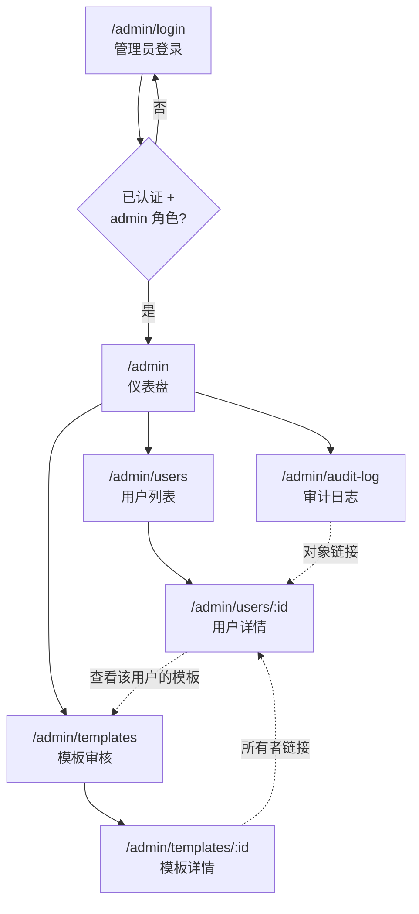
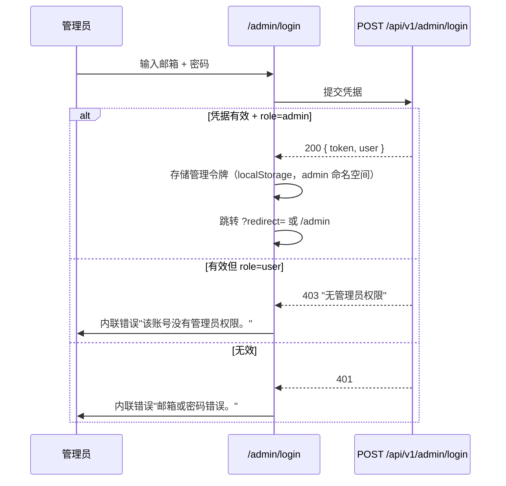
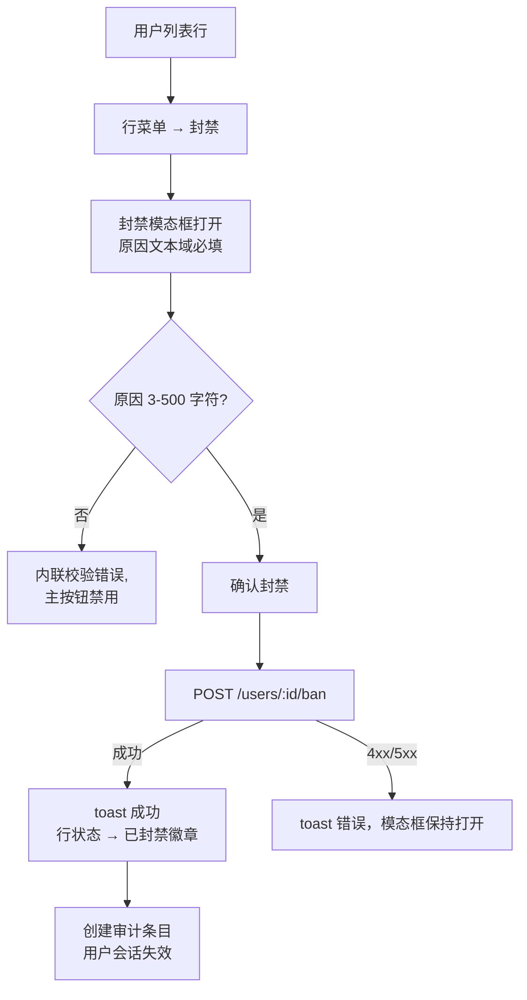

# 管理员用户管理系统 — UI/UX 设计

- **功能编号：** `admin-user-management`
- **版本：** 1.0
- **设计系统：** Aurora（现有）— 相同令牌、明暗主题
- **相关文档：** [需求分析](./admin-user-management-requirements-zh-CN.md)

---

## 1. 设计原则

1. **独立空间，同一语言。** 管理控制台是独立路由空间（`/admin/*`），拥有自己的外壳（不使用主应用的侧边栏/头部），但使用 Aurora 设计语言，保持同一产品的感觉。
2. **仪表盘优先。** 管理员先看指标再下钻。每个列表行都链接到详情页；每个详情页都能返回列表。
3. **破坏性操作必须慎重。** 封禁/降级需要在模态框中填写原因并明确列出后果。任何破坏性操作都不是单击完成。
4. **可审计性可见。** 审计日志是一级导航项；用户详情页展示该用户的操作历史。
5. **复用优于重造。** 复用现有代码库中的 `Modal`、`Field`、`Spinner`、`Icons`、通知 toast，以及 Aurora 令牌/类名（`btn`、`btn-primary`、`btn-ghost`、`btn-danger`、徽章、表格）。

## 2. 信息架构



**路由表**

| 路由 | 页面 | 用途 |
|---|---|---|
| `/admin/login` | 管理员登录 | 管理员专用凭据入口 |
| `/admin` | 仪表盘 | KPI 卡片 + 最近注册 + 最近公开模板 |
| `/admin/users` | 用户列表 | 搜索/筛选/排序/分页；行操作 |
| `/admin/users/:id` | 用户详情 | 档案、统计、身份、API Key、模板、操作历史 |
| `/admin/templates` | 模板审核 | 全部模板（含私有）；搜索/筛选/排序 |
| `/admin/templates/:id` | 模板详情 | 完整元数据 + 版本，只读 |
| `/admin/audit-log` | 审计日志 | 只追加的管理操作历史 |

## 3. 用户流程

### 3.1 管理员登录



### 3.2 封禁用户



解禁与角色变更遵循相同的模态框模式（必填原因、记录审计）。角色变更额外在服务端阻止自我降级，并以错误 toast 提示。

### 3.3 调查被举报的模板

管理员打开 `/admin/templates`，按标题或所有者搜索，筛选可见性，打开详情（只读查看所有版本），通过所有者链接进入用户详情，查看该用户历史，必要时封禁。

## 4. 布局与外壳

管理控制台使用**专用外壳**（`AdminLayout`），与主应用区分：固定左侧导航栏 + 顶栏，不含主应用 Header/Sidebar，也没有浮动创建按钮。

```text
┌──────────────────────────────────────────────────────────────────────┐
│ ◆ Open Prompts 管理端       [搜索…] [中|EN] [☀/☾] [管理员 ▾]          │  顶栏 (56px)
├──────────────┬───────────────────────────────────────────────────────┤
│ 导航 (232px) │  内容区（最大 1240px，内边距 28px 32px）                │
│              │                                                       │
│ ▦ 仪表盘     │   页面标题 + 面包屑                                    │
│ ○ 用户       │   [工具栏：搜索 / 筛选 / 操作]                          │
│ ○ 模板       │   ┌─────────────────────────────────────────────┐    │
│ ○ 审计日志   │   │  表格 / 卡片 / 详情内容                        │    │
│              │   └─────────────────────────────────────────────┘    │
│              │   [分页]                                              │
│ ──────────── │                                                       │
│ ⌂ 返回主应用 │                                                       │
└──────────────┴───────────────────────────────────────────────────────┘
```

- **顶栏：** 品牌标识 + "管理端"标签、全局搜索（跳转到带查询词的用户列表）、语言切换、主题切换、管理员头像下拉（个人资料 → 用户资料页、退出登录）。
- **左侧导航：** 仪表盘、用户、模板、审计日志；激活项使用 `--accent-soft` 背景 + 强调色文字；底部"返回主应用"链接回到 `/`。
- **响应式：** ≥ 1024px 完整布局；768–1024px 导航折叠为图标栏（64px）带提示；< 768px 导航变为滑出抽屉（顶栏汉堡按钮）—— 尽力而为。
- **路由守卫：** `AdminLayout` 在挂载时和每次路由变化时校验管理令牌/角色；未认证 → 重定向 `/admin/login?redirect=<path>`；已认证非管理员 → 403 页面。

## 5. 页面设计

### 5.1 管理员登录（`/admin/login`）

居中卡片，标准认证背景（复用 `AuthBackground`），最大宽度 400px。

```text
┌────────────────────────────────────┐
│         [logo]                     │
│   Open Prompts 管理端               │
│   登录管理控制台                     │
│                                    │
│   邮箱                              │
│   ┌────────────────────────────┐   │
│   │ admin@example.com          │   │
│   └────────────────────────────┘   │
│   密码                              │
│   ┌────────────────────────────┐   │
│   │ ••••••••        [👁]       │   │
│   └────────────────────────────┘   │
│   ⚠ 该账号没有管理员权限。           │  ← 内联错误（danger 色）
│                                    │
│   [         登 录          ]       │  ← btn-primary，全宽
│                                    │
│   ← 返回 Open Prompts               │
└────────────────────────────────────┘
```

- 字段复用 `Field` 组件；密码有显示/隐藏切换（现有模式）。
- 错误以表单下方内联形式展示（不用 toast）—— 与登录页行为一致。
- 加载态：按钮显示 spinner + "登录中…"，禁用。
- 不提供"注册"或"忘记密码"链接（管理员由系统配置产生，不自助注册）。

### 5.2 仪表盘（`/admin`）

```text
仪表盘
──────────────────────────────────────────────────────────────────────
┌──────────┐ ┌──────────┐ ┌──────────┐ ┌──────────┐ ┌──────────┐ ┌──────────┐
│ 总用户数  │ │ 活跃用户  │ │ 封禁用户  │ │ 总模板数  │ │ 公开模板  │ │ 创建的    │
│          │ │          │ │          │ │          │ │          │ │ Prompt   │
│  1,248   │ │  1,231   │ │    17    │ │   3,902  │ │   2,845  │ │  12,004  │
└──────────┘ └──────────┘ └──────────┘ └──────────┘ └──────────┘ └──────────┘

┌───────────────────────────────┐  ┌───────────────────────────────┐
│ 最近注册 (10)                  │  │ 最近公开模板 (10)              │
│ ● 张三  @jane  jane@x.com     │  │ 《SQL 优化器》  作者 @jane      │
│   2026-10-09 14:22    [查看]  │  │   2026-10-10 09:12    [查看]  │
│ ● 李四  @bob   bob@y.com      │  │ 《React 审查员》 作者 @bob      │
│   2026-10-09 11:03    [查看]  │  │   2026-10-10 08:55    [查看]  │
│ …                             │  │ …                             │
└───────────────────────────────┘  └───────────────────────────────┘
```

- KPI 卡片：`--surface` 背景、`--radius-lg`、`--shadow-sm`；标签 `--text-3` 13px；数值 `--font-heading` 28px `--text-1`；右上角小图标在 `--accent-soft` 圆形中。封禁用户卡片图标用 `--warning-soft` 色调。
- 卡片可点击：用户卡片 → `/admin/users`（带对应筛选），模板卡片 → `/admin/templates`，Prompt 卡片 → 不可点击（v1 无 Prompt 页面）。
- 列表：紧凑行（头像/首字母、名称、ID、邮箱 / 标题+作者、相对时间、查看链接）。空态："暂无注册用户。" / "暂无公开模板。"
- 加载态：6 个骨架卡片 + 2 个骨架列表（`--surface-2` 上微光动画）。
- 错误态：内联横幅 + 重试按钮（重新拉取统计）。

### 5.3 用户列表（`/admin/users`）

```text
用户                                                                    [↻ 刷新]
────────────────────────────────────────────────────────────────────────────
┌──────────────────────────────────────────────────────────────────────────┐
│ 🔍 搜索 ID、邮箱或名称…   状态 [全部 ▾]  角色 [全部 ▾]  排序 [最新 ▾]      │
└──────────────────────────────────────────────────────────────────────────┘
┌──────────────────────────────────────────────────────────────────────────┐
│ 用户                     角色      状态      模板数   创建时间     操作     │
│ ● 张三                  user     ● 正常       12    2026-09-01   [⋯]    │
│   @jane · jane@x.com                                                     │
│ ● 李四                  admin    ● 正常        3    2026-08-14   [⋯]    │
│   @bob · bob@y.com                                                       │
│ ● Spam Bot              user     ⛔ 已封禁     47    2026-10-02   [⋯]    │
│   @spam1 · spam@z.com                                                     │
└──────────────────────────────────────────────────────────────────────────┘
‹ 上一页  第 2 / 63 页  (共 1,248 位用户)  每页 20 条 [20 ▾]  下一页 ›
```

- **工具栏：** 搜索输入（300ms 防抖，回车提交）、状态选择（全部/正常/封禁）、角色选择（全部/管理员/用户）、排序选择（最新/最早/最近更新）。筛选立即生效；搜索回车或 300ms 防抖后生效。
- **表格：** 滚动时表头吸顶；行悬停 `--surface-2`；整行可点击 → 用户详情；操作列有 `⋯` 溢出菜单（查看 / 封禁… 或 解禁… / 设为管理员… 或 降级为用户…）。
- **徽章：** 角色 — `admin` = accent-soft 背景 + 强调色文字，`user` = 中性（`--surface-3` 背景 + `--text-2`）；状态 — 正常 = success-soft + success，已封禁 = danger-soft + danger，带小圆点图标。
- **分页：** 服务端驱动；显示总数；每页条数选择器 10/20/50/100。
- **状态：** 加载 = 8 行骨架；空（无匹配用户）= 居中提示"没有符合筛选条件的用户" + "清除筛选"按钮；错误 = 横幅 + 重试。
- **URL 状态：** 搜索/筛选/排序/页码持久化在查询串（`?q=&status=&role=&sort=&page=&per_page=`），使视图可分享、前进后退可用。

### 5.4 用户详情（`/admin/users/:id`）

```text
‹ 返回用户列表        用户 @jane
────────────────────────────────────────────────────────────────────────────
┌──────────────────────────────────────────────────────────────────────────┐
│  (头像 72px)  张三              角色: [user]   状态: [● 正常]             │
│               @jane · jane@example.com                                   │
│               注册于 2026-09-01 · 更新于 2026-10-08                       │
│                                          [ 封禁… ]  [ 设为管理员… ]       │
└──────────────────────────────────────────────────────────────────────────┘
┌─────────────┐ ┌─────────────┐ ┌─────────────┐ ┌─────────────┐
│ 模板数       │ │ 获赞数       │ │ 被收藏数     │ │ Prompt 数    │
│     12      │ │     340     │ │      89     │ │     56      │
└─────────────┘ └─────────────┘ └─────────────┘ └─────────────┘
┌──────────────────────────────────────┐  ┌──────────────────────────────┐
│ OAuth 身份                            │  │ API Key (2)                  │
│ ✔ Google（绑定于 2026-09-01）         │  │ prod-key   op_9f2a…  ● 启用  │
│ ✚ github — 未绑定                     │  │ dev-key     op_31bd…  ● 启用 │
│                                      │  │ (名称、前缀、状态、最近使用    │
│                                      │  │  —— 绝不显示密钥)             │
└──────────────────────────────────────┘  └──────────────────────────────┘
┌──────────────────────────────────────────────────────────────────────────┐
│ 模板 (12)                                                 [查看全部 →]    │
│ 《SQL 优化器》  公开 · 120 赞 · 2026-10-08                  [查看]        │
│ 《私人笔记》    私有 · 0 赞 · 2026-10-01                    [查看]        │
└──────────────────────────────────────────────────────────────────────────┘
┌──────────────────────────────────────────────────────────────────────────┐
│ 管理操作历史                                                              │
│ 2026-10-10 10:00  admin@x.com 封禁了该用户 — "spam"                      │
│ 2026-10-11 09:30  admin@x.com 解禁了该用户 — "申诉通过"                   │
└──────────────────────────────────────────────────────────────────────────┘
```

- 头部卡片：头像（或首字母占位）、显示名、ID、邮箱、角色/状态徽章、日期；右侧主操作 — 正常时显示 **封禁…**（danger ghost），封禁时显示 **解禁…**（success ghost）；**设为管理员… / 降级为用户…** 为次要操作。自己的行隐藏"降级"（服务端同样拒绝）。
- 统计行：4 个 KPI 迷你卡片（与仪表盘同款，更小）。
- OAuth 身份：提供商徽标 + 绑定日期；未绑定的提供商置灰显示。
- API Key：名称/前缀/状态/最近使用时间的表格；明确不显示密钥明文。
- 模板列表：最新 5 条，"查看全部 →" 链接到 `/admin/templates?owner_id=…`。
- 操作历史：针对该用户的审计条目，最新优先。
- 状态：各区块独立加载骨架；404（未知用户）→ "用户不存在"页面带返回链接；各区块独立错误重试。

### 5.5 模板审核（`/admin/templates`）

```text
模板
────────────────────────────────────────────────────────────────────────────
🔍 搜索标题或所有者…  可见性 [全部 ▾]  排序 [最近更新 ▾]
┌──────────────────────────────────────────────────────────────────────────┐
│ 模板                     所有者       可见性    点赞   收藏   更新时间     │
│ 《SQL 优化器》            张三        ● 公开     120    45   10-10       │
│  system · en · [sql][db] @jane                                            │
│ 《私人笔记》              李四        🔒 私有      0     0    10-09       │
│  user · zh · [笔记]      @bob                                            │
└──────────────────────────────────────────────────────────────────────────┘
‹ 上一页  第 1 / 12 页  (共 231 个模板)  每页 20 条  下一页 ›
```

- 工具栏：搜索（标题/所有者）、可见性筛选（全部/公开/私有）、排序（最近更新/最新/最早/最多点赞）。支持来自用户详情的 `?owner_id=` 深链接。
- 行：标题（链接到详情）、类型/语言/标签元信息行、所有者名称+ID（链接到用户详情）、可见性徽章（公开 = secondary-soft，私有 = warning-soft 带锁图标）、点赞/收藏数、更新日期。
- 状态：骨架行；空态"没有符合筛选条件的模板" + 清除；错误横幅 + 重试；分页同用户列表。

### 5.6 模板详情（`/admin/templates/:id`）

```text
‹ 返回模板列表        模板《SQL 优化器》
────────────────────────────────────────────────────────────────────────────
┌──────────────────────────────────────────────────────────────────────────┐
│ 《SQL 优化器》   ● 公开   system · en · [sql][db]                         │
│ 所有者：张三 (@jane) →                          创建于 09-01 更新于 10-10 │
│ 描述文本…                                                                │
│ ♥ 120 赞   ★ 45 收藏                                                     │
└──────────────────────────────────────────────────────────────────────────┘
┌──────────────────────────────────────────────────────────────────────────┐
│ 版本 (3)                                                                  │
│ v3 · 创建于 2026-10-10 · 别名: latest          [查看内容 ▾]               │
│ v2 · 创建于 2026-10-05 · 别名: —               [查看内容 ▾]               │
│ v1 · 创建于 2026-09-01 · 别名: —               [查看内容 ▾]               │
└──────────────────────────────────────────────────────────────────────────┘
```

- 元数据卡片：标题、可见性徽章、类型/语言/标签、所有者链接、日期、描述、点赞/收藏数。**只读** — v1 不提供编辑/删除。
- 版本：可展开行，展开后在 `<pre>` 块中显示版本内容（等宽字体、`--surface-2` 背景）；设置了别名时显示。
- 状态：骨架；404 → "模板不存在"；错误重试。

### 5.7 审计日志（`/admin/audit-log`）

```text
审计日志
────────────────────────────────────────────────────────────────────────────
动作 [全部 ▾]  操作者搜索…
┌──────────────────────────────────────────────────────────────────────────┐
│ 时间             操作者           动作     对象              原因          │
│ 2026-10-10 10:00 admin@x.com     封禁     用户 @spam1       "spam"       │
│ 2026-10-10 09:12 admin@x.com     角色     用户 @jane → admin "可信"       │
│ 2026-10-09 18:44 ops@x.com       解禁     用户 @spam1       "申诉"        │
└──────────────────────────────────────────────────────────────────────────┘
‹ 上一页  第 1 / 4 页  (共 78 条)  下一页 ›
```

- 筛选：动作类型（全部/封禁/解禁/角色）、操作者搜索。最新优先，分页。
- 对象是链接（用户详情）。原因以引号显示；过长截断并带提示。
- 空态："暂无管理操作记录。"

## 6. 组件规格

所有组件位于 `frontend/src/pages/admin/` 与 `frontend/src/components/admin/`，使用 Aurora 令牌的专用 SCSS 样式。

| 组件 | Props | 说明 |
|---|---|---|
| `AdminLayout` | `children` | 外壳：顶栏 + 左侧导航 + `<Outlet/>`；路由守卫；主题/语言切换复用现有逻辑 |
| `AdminLoginPage` | — | 居中卡片；调用管理员登录 API；存储管理令牌 |
| `DashboardPage` | — | KPI 卡片 + 两个最近列表 |
| `UsersPage` | — | 工具栏 + 表格 + 分页；URL 同步状态 |
| `UserDetailPage` | `match.params.id` | 按线框图的各区块；操作模态框 |
| `TemplatesPage` | — | 工具栏 + 表格 + 分页 |
| `TemplateDetailPage` | `match.params.id` | 元数据 + 版本手风琴 |
| `AuditLogPage` | — | 筛选 + 表格 |
| `AdminTable` | `columns, rows, loading, empty, error, onRetry` | 通用表格：骨架、吸顶表头、行点击 |
| `KpiCard` | `label, value, icon, to?, tone?` | 仪表盘/统计迷你卡片 |
| `Badge` | `tone: 'accent'\|'success'\|'danger'\|'warning'\|'neutral', children` | 角色/状态/可见性徽章 |
| `Pagination` | `page, perPage, total, onChange` | 上一页/下一页 + 总数 + 每页条数选择器 |
| `ReasonModal` | `open, title, description, confirmLabel, danger, onConfirm(reason), onClose` | 封禁/解禁/角色复用；文本域 3–500 字符、字数统计、后果列表 |
| `AdminSearchInput` | `value, onChange, placeholder` | 防抖搜索带清除按钮 |
| `AdminSelect` | `value, options, onChange` | 样式化原生 select（键盘/无障碍友好） |
| `EmptyState` | `icon, title, description, action?` | 共享空态模式 |
| `ErrorBanner` | `message, onRetry` | 共享错误模式 |

**ReasonModal 细节**（安全关键组件）：

- 标题示例："封禁 @spam1"、"解禁 @spam1"、"将 @jane 设为管理员"。
- 正文：后果列表（如"该用户将无法登录。"、"其公开模板将被隐藏。"、"活动会话与 API Key 立即失效。"），随后是必填原因文本域，带实时字数统计 `n / 500`。
- 原因长度合法前主按钮禁用；封禁/降级用 danger 样式，解禁/提升用 primary 样式。
- API 错误时模态框保持打开，toast 显示服务端消息。

## 7. 交互细节

- **搜索防抖：** 最后一次按键后 300ms；回车立即提交；清除（×）后回到第 1 页。
- **筛选/排序变化**总是重置到第 1 页。
- **行点击 vs 菜单：** 点击行任意位置打开详情；`⋯` 菜单阻止事件冒泡。菜单项：查看、封禁…/解禁…、设为管理员…/降级为用户…（按上下文显示）。
- **模态框：** 焦点圈定、Escape 关闭、焦点返回触发元素；复用现有 `Modal` 组件。
- **Toast：** 每次变更成功后显示成功（绿色）toast；失败显示错误（红色）toast 带服务端消息。复用 `NotificationContext`。
- **乐观更新：** 变更操作不做乐观更新 —— 始终等待服务端确认（审计正确性优先）。
- **刷新：** 列表页有刷新图标按钮，保留所有筛选重新拉取。
- **键盘：** 表格可聚焦；聚焦行按回车打开详情；菜单支持方向键导航。
- **会话过期：** 任何管理端 API 返回 401 时，清除管理令牌、toast"会话已过期"、重定向到 `/admin/login?redirect=<当前路径>`。
- **空闲超时：** 客户端在 25 分钟时 toast 提醒；30 分钟自动登出（与 FR-8 对齐；服务端会话生命周期为权威）。

## 8. 状态汇总

| 场景 | 加载 | 空 | 错误 |
|---|---|---|---|
| 仪表盘 | 6 个骨架卡片 + 2 个骨架列表 | "暂无注册用户。" / "暂无公开模板。" | 横幅 + 重试 |
| 用户列表 | 8 行骨架 | "没有符合筛选条件的用户" + 清除筛选 | 横幅 + 重试 |
| 用户详情 | 各区块独立骨架 | 各区块显示"暂无" | 各区块重试；404 页面 |
| 模板列表 | 8 行骨架 | "没有符合筛选条件的模板" + 清除 | 横幅 + 重试 |
| 模板详情 | 骨架卡片 + 版本 | "暂无版本"（罕见） | 横幅 + 重试；404 页面 |
| 审计日志 | 8 行骨架 | "暂无管理操作记录。" | 横幅 + 重试 |
| 变更操作 | 按钮 spinner + 禁用 | — | 模态框保持打开 + 错误 toast |

## 9. 视觉风格（Aurora 合规）

- **颜色：** 全部来自 CSS 变量 — 表面 `--surface/-2/-3`、边框 `--border/-strong`、文字 `--text-1/2/3`、强调 `--accent`、反馈 `--success/--danger/--warning/--info` + `*-soft` 变体。管理端 SCSS 中不出现硬编码色值。
- **字体：** 标题 `--font-heading`（Outfit）、正文 `--font-body`（Work Sans）；页面标题 22px/650、区块标题 16px/600、表头 12px 大写 `--text-3` 字距 0.04em、正文 14px。
- **形状与高度：** 卡片 `--radius-lg` + `--shadow-sm`（悬停 `--shadow-md`）；表格 `--radius` 且行分隔用 `--border`；徽章 `--radius-pill`；按钮沿用现有 `.btn` 类。
- **间距：** 8px 网格 — 页面内边距 28/32px、卡片内边距 20px、表格单元格 12px 16px、区块间距 24px。
- **明暗主题：** 两主题完全由现有令牌驱动（`html.light-theme`）；管理端不新增令牌。已验证两主题下表面文字对比度 ≥ 4.5:1。
- **图标：** 复用 `components/ui/Icons.jsx` 图标集；以相同 1.5px 描边风格新增管理端图标（盾牌、用户、文件、历史）。

## 10. 国际化考量（中/英）

- 所有文案通过 `locales/{en,zh}/translation.json` 中新增的 `admin` 命名空间的 `t('admin.*')` 键，例如：

```json
{
  "admin": {
    "nav": { "dashboard": "仪表盘", "users": "用户", "templates": "模板", "audit_log": "审计日志", "back_to_app": "返回主应用" },
    "login": { "title": "Open Prompts 管理端", "subtitle": "登录管理控制台", "no_admin_access": "该账号没有管理员权限。" },
    "users": { "title": "用户", "search_placeholder": "搜索 ID、邮箱或名称…", "ban": "封禁", "unban": "解禁", "reason_label": "原因", "reason_required": "必须填写原因（3–500 字符）。" }
  }
}
```

- 每个键都提供中文翻译（如英文版 `nav.dashboard: "Dashboard"`、`users.ban: "Ban"`、`login.no_admin_access: "This account does not have admin access."`）。
- 日期/时间按当前语言环境格式化；相对时间（"3 小时前" / "3 hours ago"）通过小工具函数实现。
- 数字使用语言环境的千分位格式（1,248 / 1,248）。
- 语言与主题切换位于管理端顶栏，行为与主应用头部一致。

## 11. 可访问性

- 所有交互元素都是真实的按钮/链接/输入框并带可访问名称；纯图标按钮有 `aria-label`。
- 表格使用 `<table>/<thead>/<tbody>` 与 `<th scope="col">`；行点击同时通过"查看"链接暴露给屏幕阅读器。
- 模态框：`role="dialog"`、`aria-modal`、焦点圈定、Escape 关闭、焦点恢复（现有 `Modal` 已实现）。
- 颜色不是唯一信号 — 徽章将颜色与文字（及圆点/锁图标）配对。
- 两主题下焦点环可见（`--accent` 2px 轮廓、偏移 2px）。
- 最小触控目标 32×32px；动画遵循 `prefers-reduced-motion`。

## 12. 给开发者的实现说明

- 在 `App.js` 中以嵌套的 `/admin` 布局路由添加路由；管理端页面懒加载（`React.lazy`），避免管理端包拖慢主应用。
- 管理令牌单独存储（如 `localStorage.op_admin_token`），使管理员会话与用户会话可以并存、互不覆盖。
- API 客户端：在 `services/api.js` 中扩展 `adminApi` 实例（独立 axios 实例，带管理令牌拦截器与 `/api/v1/admin` baseURL）。
- 列表页 URL 状态通过 `useSearchParams`（react-router-dom v6）实现。
- SCSS 文件按页面同目录存放（`AdminLayout.scss`、`UsersPage.scss`…），只使用令牌（变量来自 `:root`），不引入其他内容。
- 复用 `Modal`、`Field`、`Spinner`、`Icons`、`NotificationContext` — 不要分叉复制。
