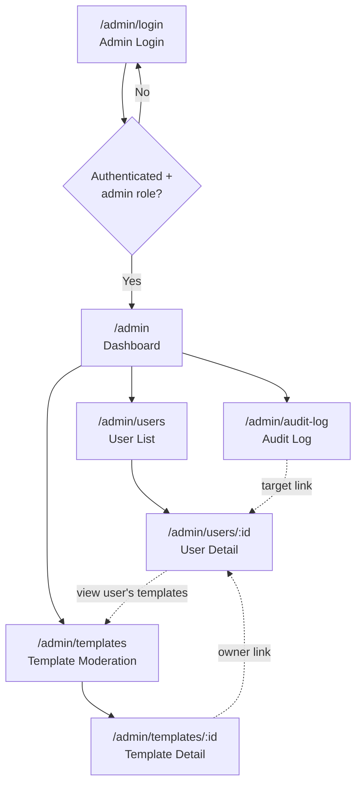
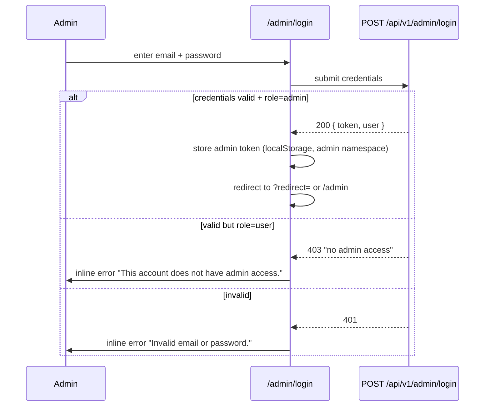
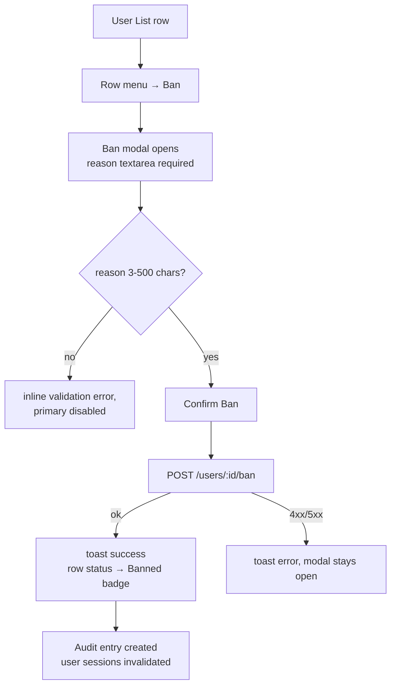

# Admin User Management System — UI/UX Design

- **Feature ID:** `admin-user-management`
- **Version:** 1.0
- **Design system:** Aurora (existing) — same tokens, light/dark themes
- **Related docs:** [Requirements](./admin-user-management-requirements.md)

---

## 1. Design Principles

1. **Separate realm, same language.** The admin console is a distinct route space (`/admin/*`) with its own shell (no main-app sidebar/header), but it speaks the Aurora design language so it feels like one product.
2. **Dashboard-first.** Admins land on metrics, then drill down. Every list row links to a detail page; every detail page links back to its list.
3. **Destructive actions are deliberate.** Ban/demote require a typed reason in a modal with explicit consequences listed. Nothing destructive is a single click.
4. **Auditability is visible.** The audit log is a first-class nav item, and user detail shows the action history for that user.
5. **Reuse over reinvent.** Reuse `Modal`, `Field`, `Spinner`, `Icons`, notification toasts, and Aurora tokens/classes (`btn`, `btn-primary`, `btn-ghost`, `btn-danger`, badges, tables) from the existing codebase.

## 2. Information Architecture



**Route table**

| Route | Page | Purpose |
|---|---|---|
| `/admin/login` | Admin Login | Separate credential entry for admins |
| `/admin` | Dashboard | KPI cards + recent signups + recent public templates |
| `/admin/users` | User List | Search/filter/sort/paginate; row actions |
| `/admin/users/:id` | User Detail | Profile, stats, identities, API keys, templates, action history |
| `/admin/templates` | Template Moderation | All templates incl. private; search/filter/sort |
| `/admin/templates/:id` | Template Detail | Full metadata + versions, read-only |
| `/admin/audit-log` | Audit Log | Append-only admin action history |

## 3. User Flows

### 3.1 Admin login



### 3.2 Ban a user



Unban and role-change follow the same modal pattern (reason required, audit recorded). Role change additionally blocks self-demotion server-side with an error toast.

### 3.3 Investigate a reported template

Admin opens `/admin/templates`, searches by title or owner, filters visibility, opens detail (sees all versions read-only), follows owner link to user detail, reviews the user's history, and bans if warranted.

## 4. Layout & Shell

The admin console uses a **dedicated shell** (`AdminLayout`) distinct from the main app: a fixed left nav rail + top bar, no main-app Header/Sidebar, no floating create button.

```text
┌──────────────────────────────────────────────────────────────────────┐
│ ◆ Open Prompts Admin          [search…] [EN|ZH] [☀/☾] [Admin ▾]      │  top bar (56px)
├──────────────┬───────────────────────────────────────────────────────┤
│ NAV (232px)  │  content (max 1240px, padding 28px 32px)              │
│              │                                                       │
│ ▦ Dashboard  │   Page title + breadcrumb                             │
│ ○ Users      │   [toolbar: search / filters / actions]               │
│ ○ Templates  │   ┌─────────────────────────────────────────────┐    │
│ ○ Audit Log  │   │  table / cards / detail content              │    │
│              │   └─────────────────────────────────────────────┘    │
│              │   [pagination]                                        │
│ ──────────── │                                                       │
│ ⌂ Back to App│                                                       │
└──────────────┴───────────────────────────────────────────────────────┘
```

- **Top bar:** brand mark + "Admin" label, global search (routes to user list with query), language toggle, theme toggle, admin avatar dropdown (Profile → user profile page, Logout).
- **Left nav:** Dashboard, Users, Templates, Audit Log; active item uses `--accent-soft` background + accent text; bottom "Back to App" link returns to `/`.
- **Responsive:** ≥ 1024px full layout; 768–1024px nav collapses to icon rail (64px) with tooltips; < 768px nav becomes a slide-over drawer (hamburger in top bar) — best effort.
- **Route guard:** `AdminLayout` checks the admin token/role on mount and on every route change; unauthenticated → redirect `/admin/login?redirect=<path>`; authenticated non-admin → 403 page.

## 5. Page Designs

### 5.1 Admin Login (`/admin/login`)

Centered card on the standard auth background (reuse `AuthBackground`), max-width 400px.

```text
┌────────────────────────────────────┐
│         [logo]                     │
│   Open Prompts Admin               │
│   Sign in to the admin console     │
│                                    │
│   Email                            │
│   ┌────────────────────────────┐   │
│   │ admin@example.com          │   │
│   └────────────────────────────┘   │
│   Password                        │
│   ┌────────────────────────────┐   │
│   │ ••••••••        [👁]       │   │
│   └────────────────────────────┘   │
│   ⚠ This account does not have    │  ← inline error (danger color)
│     admin access.                  │
│                                    │
│   [       Sign in        ]        │  ← btn-primary, full width
│                                    │
│   ← Back to Open Prompts           │
└────────────────────────────────────┘
```

- Fields reuse `Field` component; password has show/hide toggle (existing pattern).
- Errors are inline under the form (not toast) — matches Login page behavior.
- Loading state: button shows spinner + "Signing in…", disabled.
- No "register" or "forgot password" links (admins are provisioned, not self-served).

### 5.2 Dashboard (`/admin`)

```text
Dashboard
──────────────────────────────────────────────────────────────────────
┌──────────┐ ┌──────────┐ ┌──────────┐ ┌──────────┐ ┌──────────┐ ┌──────────┐
│ Total    │ │ Active   │ │ Banned   │ │ Total    │ │ Public   │ │ Prompts  │
│ Users    │ │ Users    │ │ Users    │ │ Templates│ │ Templates│ │ Created  │
│  1,248   │ │  1,231   │ │    17    │ │   3,902  │ │   2,845  │ │   12,004 │
└──────────┘ └──────────┘ └──────────┘ └──────────┘ └──────────┘ └──────────┘

┌───────────────────────────────┐  ┌───────────────────────────────┐
│ Recent Signups (10)           │  │ Recent Public Templates (10)  │
│ ● Jane Doe  @jane  jane@x.com │  │ "SQL Optimizer"  by @jane     │
│   2026-10-09 14:22    [View]  │  │   2026-10-10 09:12    [View]  │
│ ● Bob Lee   @bob   bob@y.com  │  │ "React Reviewer" by @bob      │
│   2026-10-09 11:03    [View]  │  │   2026-10-10 08:55    [View]  │
│ …                             │  │ …                             │
└───────────────────────────────┘  └───────────────────────────────┘
```

- KPI cards: `--surface` background, `--radius-lg`, `--shadow-sm`; label in `--text-3` 13px; value in `--font-heading` 28px `--text-1`; small icon top-right in `--accent-soft` circle. Banned Users card uses `--warning-soft` icon tint.
- Cards are links: Users cards → `/admin/users` (with matching filter), Templates cards → `/admin/templates`, Prompts card → non-link (no prompts page in v1).
- Lists: compact rows (avatar/initial, name, ID, email / title+owner, relative time, View link). Empty state: "No signups yet." / "No public templates yet."
- Loading: 6 skeleton cards + 2 skeleton lists (shimmer on `--surface-2`).
- Error: inline banner with retry button (re-fetches stats).

### 5.3 User List (`/admin/users`)

```text
Users                                                                    [↻ Refresh]
────────────────────────────────────────────────────────────────────────────
┌──────────────────────────────────────────────────────────────────────────┐
│ 🔍 Search ID, email, or name…   Status [All ▾]  Role [All ▾]  Sort [Newest ▾] │
└──────────────────────────────────────────────────────────────────────────┘
┌──────────────────────────────────────────────────────────────────────────┐
│ USER                    ROLE     STATUS   TEMPLATES  CREATED      ACTIONS │
│ ● Jane Doe              user     ● Active     12     2026-09-01   [⋯]    │
│   @jane · jane@x.com                                                     │
│ ● Bob Lee               admin    ● Active      3     2026-08-14   [⋯]    │
│   @bob · bob@y.com                                                       │
│ ● Spam Bot              user     ⛔ Banned     47     2026-10-02   [⋯]    │
│   @spam1 · spam@z.com                                                     │
└──────────────────────────────────────────────────────────────────────────┘
‹ Prev  Page 2 of 63  (1,248 users)  20/page [20 ▾]  Next ›
```

- **Toolbar:** search input (debounced 300ms, submits on Enter), Status select (All/Active/Banned), Role select (All/Admin/User), Sort select (Newest/Oldest/Recently updated). Filters apply immediately; search applies on Enter or 300ms debounce.
- **Table:** sticky header on scroll; row hover `--surface-2`; entire row clickable → user detail; Actions column has a `⋯` overflow menu (View / Ban… or Unban… / Make admin… or Demote to user…).
- **Badges:** role — `admin` = accent-soft bg + accent text, `user` = neutral (`--surface-3` bg + `--text-2`); status — Active = success-soft + success, Banned = danger-soft + danger, with a small dot icon.
- **Pagination:** server-driven; shows total count; page-size selector 10/20/50/100.
- **States:** loading = 8 skeleton rows; empty (no users match) = centered illustration text "No users match your filters" + "Clear filters" button; error = banner + retry.
- **URL state:** search/filter/sort/page persist in query string (`?q=&status=&role=&sort=&page=&per_page=`) so views are shareable and back/forward works.

### 5.4 User Detail (`/admin/users/:id`)

```text
‹ Back to Users        User @jane
────────────────────────────────────────────────────────────────────────────
┌──────────────────────────────────────────────────────────────────────────┐
│  (avatar 72px)  Jane Doe        role: [user]   status: [● Active]        │
│                 @jane · jane@example.com                                 │
│                 Registered 2026-09-01 · Updated 2026-10-08               │
│                                            [ Ban… ]  [ Make admin… ]     │
└──────────────────────────────────────────────────────────────────────────┘
┌─────────────┐ ┌─────────────┐ ┌─────────────┐ ┌─────────────┐
│ Templates   │ │ Likes recv. │ │ Favs recv.  │ │ Prompts     │
│     12      │ │     340     │ │      89     │ │     56      │
└─────────────┘ └─────────────┘ └─────────────┘ └─────────────┘
┌──────────────────────────────────────┐  ┌──────────────────────────────┐
│ OAuth Identities                     │  │ API Keys (2)                 │
│ ✔ Google (linked 2026-09-01)         │  │ prod-key   op_9f2a…  ● Active│
│ ✚ github — not linked                │  │ dev-key     op_31bd…  ● Active│
│                                      │  │ (name, prefix, status, last  │
│                                      │  │  used — never the key)       │
└──────────────────────────────────────┘  └──────────────────────────────┘
┌──────────────────────────────────────────────────────────────────────────┐
│ Templates (12)                                            [View all →]    │
│ "SQL Optimizer"  public · 120 likes · 2026-10-08            [View]       │
│ "Private notes"  private · 0 likes · 2026-10-01             [View]       │
└──────────────────────────────────────────────────────────────────────────┘
┌──────────────────────────────────────────────────────────────────────────┐
│ Admin Action History                                                    │
│ 2026-10-10 10:00  admin@x.com banned this user — "spam"                 │
│ 2026-10-11 09:30  admin@x.com unbanned this user — "appeal accepted"    │
└──────────────────────────────────────────────────────────────────────────┘
```

- Header card: avatar (or initial placeholder), display name, ID, email, role/status badges, dates; primary actions on the right — **Ban…** (danger ghost) when active, **Unban…** (success ghost) when banned; **Make admin…** / **Demote to user…** secondary. Self row hides Demote (server also rejects).
- Stats row: 4 KPI mini-cards (same style as dashboard, smaller).
- OAuth identities: provider chips with linked date; unlinked providers shown muted.
- API keys: table of name/prefix/status/last-used; explicitly no secret values.
- Templates list: latest 5 with "View all →" linking to `/admin/templates?owner_id=…`.
- Action history: audit entries targeting this user, newest first.
- States: loading skeleton for each section independently; 404 (unknown user) → "User not found" page with back link; error per-section retry.

### 5.5 Template Moderation (`/admin/templates`)

```text
Templates
────────────────────────────────────────────────────────────────────────────
🔍 Search title or owner…  Visibility [All ▾]  Sort [Recently updated ▾]
┌──────────────────────────────────────────────────────────────────────────┐
│ TEMPLATE                    OWNER        VISIBILITY  LIKES  FAVS  UPDATED│
│ "SQL Optimizer"             Jane Doe     ● Public     120    45   10-10 │
│  system · en · [sql][db]    @jane                                            │
│ "Private notes"             Bob Lee      🔒 Private     0     0    10-09 │
│  user · zh · [notes]        @bob                                            │
└──────────────────────────────────────────────────────────────────────────┘
‹ Prev  Page 1 of 12  (231 templates)  20/page  Next ›
```

- Toolbar: search (title/owner), Visibility filter (All/Public/Private), Sort (Recently updated/Newest/Oldest/Most likes). Supports `?owner_id=` deep link from user detail.
- Row: title (links to detail), type/language/tags meta line, owner name+ID (links to user detail), visibility badge (Public = secondary-soft, Private = warning-soft with lock icon), like/favorite counts, updated date.
- States: skeleton rows; empty "No templates match your filters" + clear; error banner + retry; pagination as user list.

### 5.6 Template Detail (`/admin/templates/:id`)

```text
‹ Back to Templates        Template "SQL Optimizer"
────────────────────────────────────────────────────────────────────────────
┌──────────────────────────────────────────────────────────────────────────┐
│ "SQL Optimizer"   ● Public   system · en · [sql][db]                     │
│ Owner: Jane Doe (@jane) →                          Created 09-01 Updated 10-10 │
│ Description text…                                                        │
│ ♥ 120 likes   ★ 45 favorites                                            │
└──────────────────────────────────────────────────────────────────────────┘
┌──────────────────────────────────────────────────────────────────────────┐
│ Versions (3)                                                             │
│ v3 · created 2026-10-10 · alias: latest        [View content ▾]          │
│ v2 · created 2026-10-05 · alias: —            [View content ▾]          │
│ v1 · created 2026-09-01 · alias: —            [View content ▾]          │
└──────────────────────────────────────────────────────────────────────────┘
```

- Metadata card: title, visibility badge, type/language/tags, owner link, dates, description, like/favorite counts. **Read-only** — no edit/delete in v1.
- Versions: expandable rows revealing the version content in a `<pre>` block (monospace, `--surface-2` bg); alias shown when set.
- States: skeleton; 404 → "Template not found"; error retry.

### 5.7 Audit Log (`/admin/audit-log`)

```text
Audit Log
────────────────────────────────────────────────────────────────────────────
Action [All ▾]  Actor search… 
┌──────────────────────────────────────────────────────────────────────────┐
│ TIMESTAMP        ACTOR            ACTION   TARGET            REASON      │
│ 2026-10-10 10:00 admin@x.com      ban      user @spam1       "spam"      │
│ 2026-10-10 09:12 admin@x.com      role     user @jane → admin "trusted"  │
│ 2026-10-09 18:44 ops@x.com        unban    user @spam1       "appeal"    │
└──────────────────────────────────────────────────────────────────────────┘
‹ Prev  Page 1 of 4  (78 entries)  Next ›
```

- Filters: action type (All/ban/unban/role), actor search. Newest first, paginated.
- Target is a link (user detail). Reason shown in quotes; long reasons truncate with tooltip.
- Empty state: "No admin actions recorded yet."

## 6. Component Specifications

All components live under `frontend/src/pages/admin/` and `frontend/src/components/admin/`, styled with dedicated SCSS using Aurora tokens.

| Component | Props | Notes |
|---|---|---|
| `AdminLayout` | `children` | Shell: top bar + left nav + `<Outlet/>`; route guard; theme/lang toggles reuse existing logic |
| `AdminLoginPage` | — | Centered card; calls admin login API; stores admin token |
| `DashboardPage` | — | KPI cards + two recent lists |
| `UsersPage` | — | Toolbar + table + pagination; URL-synced state |
| `UserDetailPage` | `match.params.id` | Sections per wireframe; action modals |
| `TemplatesPage` | — | Toolbar + table + pagination |
| `TemplateDetailPage` | `match.params.id` | Metadata + versions accordion |
| `AuditLogPage` | — | Filters + table |
| `AdminTable` | `columns, rows, loading, empty, error, onRetry` | Generic table w/ skeleton, sticky header, row click |
| `KpiCard` | `label, value, icon, to?, tone?` | Dashboard/stat mini-cards |
| `Badge` | `tone: 'accent'\|'success'\|'danger'\|'warning'\|'neutral', children` | Role/status/visibility badges |
| `Pagination` | `page, perPage, total, onChange` | Prev/Next + count + size selector |
| `ReasonModal` | `open, title, description, confirmLabel, danger, onConfirm(reason), onClose` | Reused by Ban/Unban/Role; textarea 3–500 chars, char counter, consequence list |
| `AdminSearchInput` | `value, onChange, placeholder` | Debounced search with clear button |
| `AdminSelect` | `value, options, onChange` | Styled native select (keyboard/a11y friendly) |
| `EmptyState` | `icon, title, description, action?` | Shared empty pattern |
| `ErrorBanner` | `message, onRetry` | Shared error pattern |

**ReasonModal detail** (the safety-critical component):

- Title examples: "Ban @spam1", "Unban @spam1", "Make @jane an admin".
- Body: consequence list (e.g. "The user cannot log in.", "Their public templates are hidden.", "Active sessions and API keys stop working.") followed by required reason textarea with live char counter `n / 500`.
- Primary button disabled until reason length is valid; danger styling for ban/demote, primary for unban/promote.
- On API error the modal stays open and a toast shows the server message.

## 7. Interaction Details

- **Search debounce:** 300ms after last keystroke; Enter submits immediately; clear (×) resets to page 1.
- **Filter/sort changes** always reset to page 1.
- **Row click vs. menu:** clicking anywhere on a row opens detail; the `⋯` menu stops propagation. Menu items: View, Ban…/Unban…, Make admin…/Demote to user… (contextual).
- **Modals:** focus trap, Escape closes, focus returns to trigger; reuse existing `Modal` component.
- **Toasts:** success (green) after every mutation; error (red) with server message on failure. Reuse `NotificationContext`.
- **Optimistic UI:** none for mutations — always await server confirmation (audit correctness first).
- **Refresh:** list pages have a refresh icon button that re-fetches preserving all filters.
- **Keyboard:** tables are focusable; Enter on a focused row opens detail; menus are arrow-key navigable.
- **Session expiry:** on 401 from any admin API, clear admin token, toast "Session expired", redirect to `/admin/login?redirect=<current>`.
- **Idle timeout:** client warns via toast at 25 min; at 30 min auto-logout (aligned with FR-8; server session lifetime is authoritative).

## 8. States Summary

| Context | Loading | Empty | Error |
|---|---|---|---|
| Dashboard | 6 skeleton cards + 2 skeleton lists | "No signups yet." / "No public templates yet." | Banner + retry |
| User list | 8 skeleton rows | "No users match your filters" + Clear filters | Banner + retry |
| User detail | Per-section skeletons | Sections show "None yet" | Per-section retry; 404 page |
| Template list | 8 skeleton rows | "No templates match your filters" + Clear | Banner + retry |
| Template detail | Skeleton card + versions | "No versions" (unlikely) | Banner + retry; 404 page |
| Audit log | 8 skeleton rows | "No admin actions recorded yet." | Banner + retry |
| Mutations | Button spinner + disabled | — | Modal stays open + error toast |

## 9. Visual Style (Aurora compliance)

- **Colors:** all from CSS variables — surfaces `--surface/-2/-3`, borders `--border/-strong`, text `--text-1/2/3`, accent `--accent`, feedback `--success/--danger/--warning/--info` + `*-soft` variants. No hardcoded hex in admin SCSS.
- **Typography:** headings `--font-heading` (Outfit), body `--font-body` (Work Sans); page title 22px/650, section title 16px/600, table header 12px uppercase `--text-3` letter-spacing 0.04em, body 14px.
- **Shape & elevation:** cards `--radius-lg` + `--shadow-sm` (hover `--shadow-md`); tables `--radius` with `--border` row separators; badges `--radius-pill`; buttons per existing `.btn` classes.
- **Spacing:** 8px grid — page padding 28/32px, card padding 20px, table cell padding 12px 16px, section gap 24px.
- **Dark/light:** both themes driven purely by existing tokens (`html.light-theme`); admin adds no new tokens. Verified contrast ≥ 4.5:1 for text on surfaces in both themes.
- **Icons:** reuse `components/ui/Icons.jsx` set; add admin-specific icons (shield, users, file, history) in the same 1.5px-stroke style.

## 10. i18n Considerations (EN/ZH)

- All strings via `t('admin.*')` keys in `locales/{en,zh}/translation.json` under a new `admin` namespace, e.g.:

```json
{
  "admin": {
    "nav": { "dashboard": "Dashboard", "users": "Users", "templates": "Templates", "audit_log": "Audit Log", "back_to_app": "Back to App" },
    "login": { "title": "Open Prompts Admin", "subtitle": "Sign in to the admin console", "no_admin_access": "This account does not have admin access." },
    "users": { "title": "Users", "search_placeholder": "Search ID, email, or name…", "ban": "Ban", "unban": "Unban", "reason_label": "Reason", "reason_required": "A reason is required (3–500 characters)." }
  }
}
```

- ZH translations provided for every key (e.g. `nav.dashboard: "仪表盘"`, `users.ban: "封禁"`, `login.no_admin_access: "该账号没有管理员权限。"`).
- Dates/times formatted per active locale; relative times ("3 hours ago" / "3 小时前") via a small helper.
- Numbers formatted with locale thousands separators (1,248 / 1,248).
- Language and theme toggles live in the admin top bar, same behavior as the main app header.

## 11. Accessibility

- All interactive elements are real buttons/links/inputs with accessible names; icon-only buttons have `aria-label`.
- Tables use `<table>/<thead>/<tbody>` with `<th scope="col">`; row click also exposed via a "View" link for screen readers.
- Modals: `role="dialog"`, `aria-modal`, focus trap, Escape close, focus restore (existing `Modal` already does this).
- Color is never the only signal — badges pair color with text (and dot/lock icons).
- Focus rings visible in both themes (`--accent` 2px outline offset 2px).
- Minimum touch target 32×32px; motion respects `prefers-reduced-motion`.

## 12. Implementation Notes for Developer

- Add routes in `App.js` under a nested `/admin` layout route; lazy-load admin pages (`React.lazy`) so the admin bundle doesn't weigh down the main app.
- Store admin token separately (e.g. `localStorage.op_admin_token`) so admin and user sessions can coexist without clobbering each other.
- API client: extend `services/api.js` with an `adminApi` instance (separate axios instance with the admin token interceptor and `/api/v1/admin` baseURL).
- URL state on list pages via `useSearchParams` (react-router-dom v6).
- SCSS files colocated per page (`AdminLayout.scss`, `UsersPage.scss`, …) importing nothing but tokens (variables come from `:root`).
- Reuse `Modal`, `Field`, `Spinner`, `Icons`, `NotificationContext` — do not fork them.
