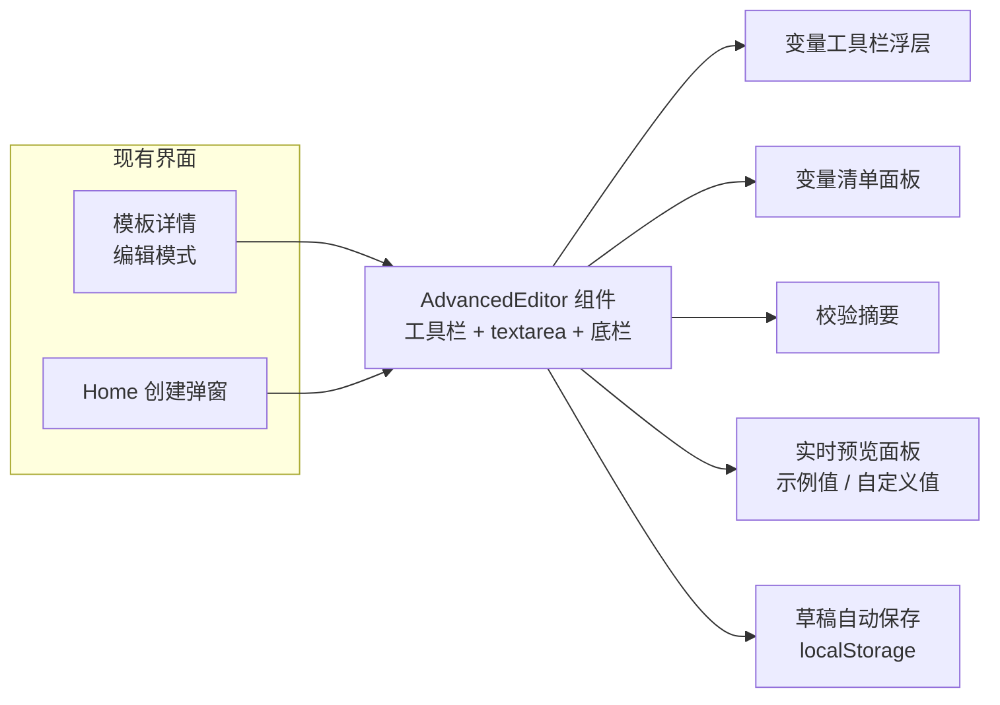
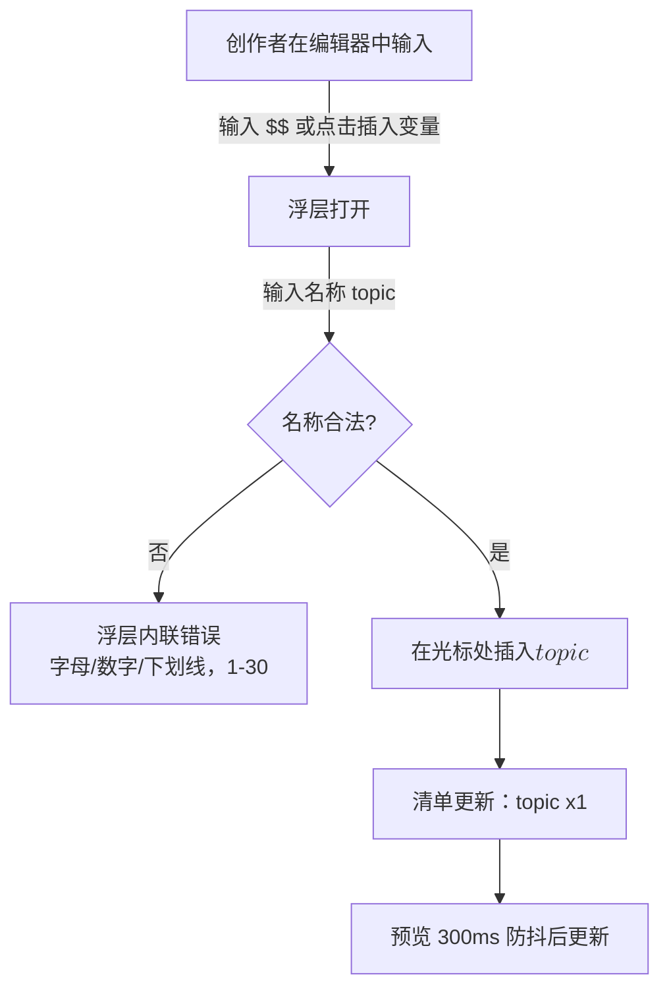
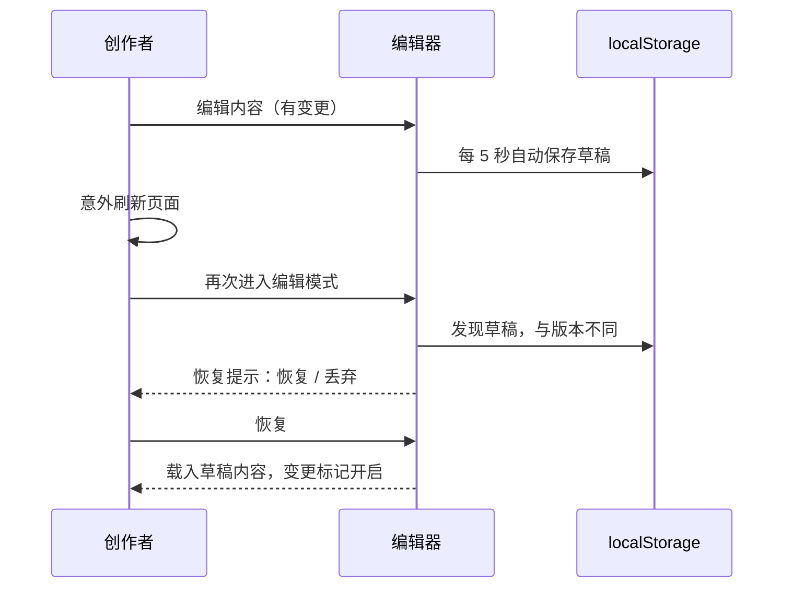
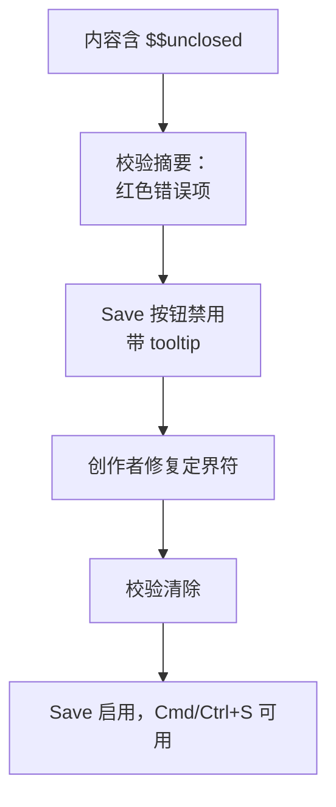

# 高级模板编辑器 — UI/UX 设计

- **Feature ID:** advanced-editor
- **Version:** 1.0
- **Status:** Proposed（待架构评审）
- **Author:** ui-ux-agent
- **Date:** 2026-10-12
- **Companion doc:** `advanced-editor-requirements-zh-CN.md`

## 1. 设计原则

1. **增强而非替换。** textarea 仍是 textarea —— 提示词内容是纯文本。我们在其周围增加辅助，而不是引入新的编辑范式。
2. **错误绝不迟到。** 校验持续且可见；Save 按钮本身传达就绪状态。
3. **绝不丢失工作。** 草稿本地自动保存；离开页面有守卫；恢复只需一次点击。
4. **处处同一编辑器。** 详情页编辑模式与创建弹窗共享同一组件、同一工具栏、同一校验摘要。
5. **Aurora 原生。** 内容用等宽字体、柔和面板、现有按钮样式；编辑器应像产品本身，而不是内嵌 IDE。

## 2. 信息架构



| 界面 | 位置 | 内容 |
|---|---|---|
| 模板详情编辑模式 | 现有区块，升级 | AdvancedEditor 替换裸 textarea；Save/Cancel 操作不变 |
| 创建弹窗 | Home 页弹窗，升级 | 内容字段使用 AdvancedEditor；其他字段不变 |
| 变量工具栏浮层 | 编辑器头部内 | 名称输入 + 已有变量 chip |
| 校验摘要 | 编辑器与操作按钮之间的固定条 | 阻断性错误 + 警告，可跳转到第一处出现 |
| 实时预览 | 编辑器旁/下的可折叠面板 | 高亮变量；示例/自定义切换 |
| 管理控制台 | — | 无（管理员以所有者身份走普通界面编辑） |

## 3. 用户流程

### 3.1 写作中插入变量



### 3.2 刷新后的草稿恢复



### 3.3 被阻断的保存



## 4. 页面布局

### 4.1 模板详情 — 编辑模式（桌面 ≥1024px）

```
┌───────────────────────────────────────────────────────────────────────┐
│ ◀ 返回预览                                                             │
│ ┌───────────────────────────────────────────────────────────────────┐ │
│ │ 编辑模板内容                                             v3 ▾      │ │
│ │ ┌─────────────────────────────────────────────────────────────┐ │ │
│ │ │ [+ 插入变量] [👁 预览 ▾]                          草稿已保存 12:04│ │ │
│ │ ├─────────────────────────────────────────────────────────────┤ │ │
│ │ │ You are an expert $$role$$.                                │ │ │
│ │ │ Review the following $$language$$ code and                 │ │ │
│ │ │ suggest improvements for $$goal$$.                         │ │ │
│ │ │                                                            │ │ │
│ │ │ $$unclosed                                                 │ │ │
│ │ └─────────────────────────────────────────────────────────────┘ │ │
│ │ ┌─────────────────────────────────────────────────────────────┐ │ │
│ │ │ ⚠ 1 个错误 · 0 个警告                                        │ │ │
│ │ │ • $$ 定界符未闭合（第 5 行）                         [跳转 ↗] │ │ │
│ │ └─────────────────────────────────────────────────────────────┘ │ │
│ │ 变量: [role ×1] [language ×1] [goal ×1] [+ 添加]               │ │
│ │ 1,204 字符 · 5 行 · 3 个变量                    1,204 / 10,000  │ │
│ │                                    [取消] [保存新版本]           │ │
│ └───────────────────────────────────────────────────────────────┘ │
└───────────────────────────────────────────────────────────────────────┘
```

### 4.2 开启实时预览的编辑器（分栏视图）

```
┌───────────────────────────────────────────────────────────────────────┐
│ [+ 插入变量] [👁 预览 ▼] [示例值 ◉ / 自定义值 ○]                       │
│ ┌──────────────────────────────┬────────────────────────────────────┐ │
│ │ 编辑器（等宽字体）            │ 预览                                │ │
│ │ You are an expert $$role$$.  │ You are an expert ⟨role⟩.          │ │
│ │ Review the following         │ Review the following               │ │
│ │ $$language$$ code and        │ ⟨language⟩ code and                 │ │
│ │ suggest improvements         │ suggest improvements               │ │
│ │ for $$goal$$.                │ for ⟨goal⟩.                        │ │
│ │                              │ （变量以强调色高亮）                │ │
│ └──────────────────────────────┴────────────────────────────────────┘ │
│ 变量: [role ×1] [language ×1] [goal ×1]                               │
└───────────────────────────────────────────────────────────────────────┘
```

### 4.3 创建弹窗（内容字段升级）

```
┌──────────────────────────── 创建模板 ──────────────────────────────────┐
│ 标题 [____________________]  分类 [▼]  语言 [▼]                       │
│ 描述 [_____________________________________________]                  │
│ 标签 [____] [____] [+]                                                  │
│ ── 内容 ─────────────────────────────────────────────────────────────  │
│ [+ 插入变量] [👁 预览 ▾]                                               │
│ ┌──────────────────────────────────────────────────────────────────┐  │
│ │ （AdvancedEditor textarea —— 与详情页同一组件）                   │  │
│ └──────────────────────────────────────────────────────────────────┘  │
│ ⚠ 0 个错误 · 0 个警告      0 / 10,000 字符                            │
│                                        [取消] [创建模板]              │
└─────────────────────────────────────────────────────────────────────────┘
```

### 4.4 移动端（<768px）

预览面板变为编辑器下方的全宽可折叠区块；工具栏折行为两行；校验摘要固定在操作按钮上方。

## 5. 组件规格

| 组件 | 基于 / 新建 | 规格 |
|---|---|---|
| `AdvancedEditor` | 新建共享组件 | 容器：工具栏行 + textarea（等宽字体，最小高度 240px，自动增高至 640px）+ 校验条 + 清单行 + 底部计数 |
| `VariableToolbar` | 新建 | "插入变量"按钮 → 浮层含名称输入（校验：`^[A-Za-z0-9_]{1,30}$`）、已有变量 chip、回车插入 |
| `VariableInventory` | 新建 | chip 列表 `name ×n`；点击 chip → 聚焦编辑器 + 选中第一处出现；`+ 添加` 打开工具栏浮层 |
| `ValidationSummary` | 新建 | 带计数的条（`⚠ n 个错误 · m 个警告`）；每项：图标、消息、行号、"跳转"链接；阻断为红，警告为琥珀 |
| `LivePreview` | 新建 | 分栏（桌面）/ 可折叠区块（移动端）；以强调色 `⟨name⟩` 令牌包裹渲染变量；示例/自定义切换；300 ms 防抖 |
| `EditorFooter` | 新建 | 字符数 `n / 上限`、行数、变量数；距上限 10% 内琥珀，达上限红色 |
| `DraftBadge` | 新建 | 工具栏中"草稿已保存 HH:MM"文字；低调不阻断 |
| `RestorePrompt` | 复用 Modal | 进入编辑模式存在不同草稿时："恢复草稿" / "丢弃"按钮，显示草稿时间戳 |
| `CancelConfirm` | 复用 Modal | 有变更时按 Esc/取消："丢弃变更？"含 丢弃 / 继续编辑 |

## 6. 交互细节

1. **光标处插入。** 插入使用 textarea 的 selection start/end；插入后光标落在闭合 `$$` 之后，浮层关闭。
2. **输入 `$$`。** v1 不自动弹窗（避免打断心流）；浮层由点击/`Cmd/Ctrl+Enter` 触发。无论变量如何输入，清单都实时更新。
3. **校验时机。** 击键后 300 ms 防抖重算；粘贴与尝试保存时立即校验。
4. **保存门控。** 存在阻断性错误时 Save 禁用；禁用态 tooltip 列出错误数。`Cmd/Ctrl+S` 走同一路径，被阻断时聚焦第一个错误。
5. **草稿生命周期。** 有变更时最多每 5 秒自动保存；保存成功或丢弃时删除 localStorage 键；登出时清除该用户的所有 `draft:*` 键。
6. **恢复提示。** 仅当草稿存在且与已加载版本内容不同时显示；选择丢弃立即删除草稿。
7. **预览模式。** 示例模式填入 `<name>` 令牌；自定义模式为每个变量渲染一个输入框（复用生成器样式）并显示解析后文本；切换模式保留组件状态中的自定义值。
8. **Esc 行为。** Esc 先关闭浮层/预览；仅当无覆盖层打开时才触发取消（有变更时需确认）。
9. **错误中的行号。** 错误引用从内容计算的 1 起始行号；"跳转"聚焦编辑器并选中问题文本范围。

## 7. 状态汇总

| 状态 | 触发 | UI |
|---|---|---|
| 干净 | 无变更 | 仅底部计数；Save 启用（无错误时） |
| 有变更 | 任意编辑 | 出现草稿徽标；开启 beforeunload 守卫 |
| 校验错误 | 阻断性问题 | 摘要中红色项；Save 禁用 + tooltip |
| 警告 | 近似重复名 | 琥珀项；Save 保持启用 |
| 超长 | 内容 > 上限 | 红色计数；Save 禁用 |
| 自动保存中 | 5 秒变更间隔 | "草稿已保存 HH:MM" 轻微更新 |
| 发现草稿 | 重新进入编辑模式 | 恢复提示弹窗 |
| 预览加载 | 防抖窗口内 | 预览显示上一帧渲染（无 spinner） |
| localStorage 不可用 | 隐私模式等 | 编辑器正常工作；隐藏草稿徽标；不报错 |

## 8. 国际化考量（EN/ZH）

- 文案位于 `frontend/src/locales/{en,zh}/translation.json` 的 `editor.*` 下。
- 关键术语："Insert variable" / "插入变量"；"Preview" / "预览"；"sample values" / "示例值"；"custom values" / "自定义值"；"Restore draft" / "恢复草稿"；"Discard" / "丢弃"；"Save new version" / "保存新版本"（复用现有键）；"Unclosed $$ delimiter" / "`$$` 定界符未闭合"；"Variables are similar but differ in case or spacing" / "变量相似但大小写或空格不同"；"draft saved" / "草稿已保存"。
- 错误消息以插值方式包含变量名与行号，绝不硬编码拼接字符串。
- 变量名、`$$` 语法与计数与语言环境无关。

## 9. 无障碍

- textarea 是带标签的字段（`aria-label` 取自区块标题）；工具栏按钮可聚焦且有可见标签。
- 校验摘要使用 `role="alert"`（错误）/ `role="status"`（警告）；每个错误经 `aria-describedby` 关联到编辑器区域。
- 键盘：Tab 顺序 工具栏 → textarea → 清单 → 操作；`Cmd/Ctrl+S` 保存、`Esc` 分层关闭、`Cmd/Ctrl+Enter` 插入浮层 —— 均在 tooltip/帮助文本中说明。
- 预览面板为 `role="region"` + `aria-label`；变量令牌是纯文本（屏幕阅读器自然读出 `⟨role⟩`）。
- 颜色绝不是唯一信号：错误带图标与文字；计数带 `/上限` 文本。

## 10. 数据分析（可选，若 analytics 功能上线）

- `editor_variable_inserted`、`editor_validation_blocked_save`（错误类型）、`editor_draft_restored`、`editor_preview_toggled`（模式）。

## 11. 不做范围（与需求文档 §8 一致）

- 富文本/markdown 内容、协同编辑、AI 辅助写作。
- 服务端校验端点或服务端存储草稿。
- 超出首处选中的文内出现位置高亮；textarea 内语法高亮。
- 任何形式的变现。
