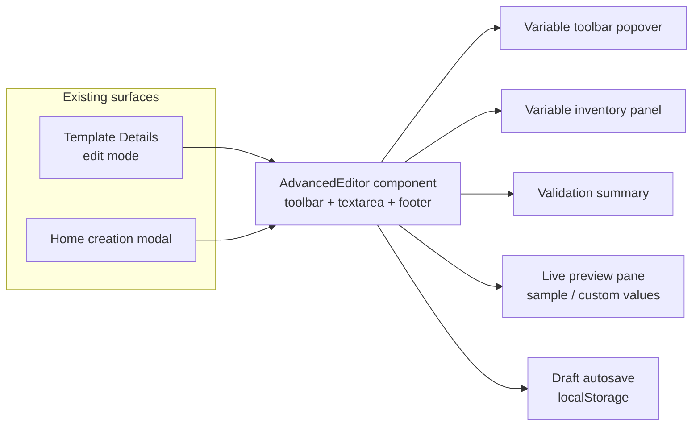
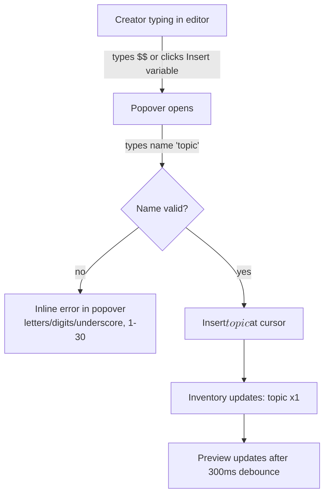
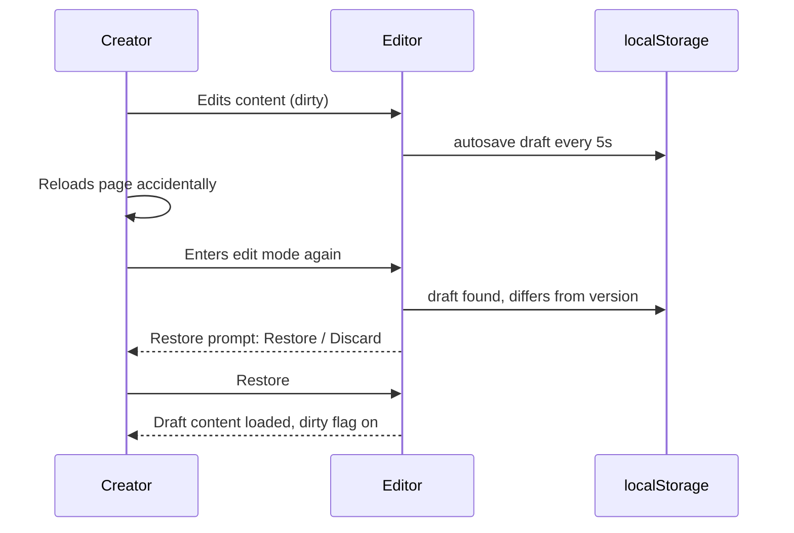
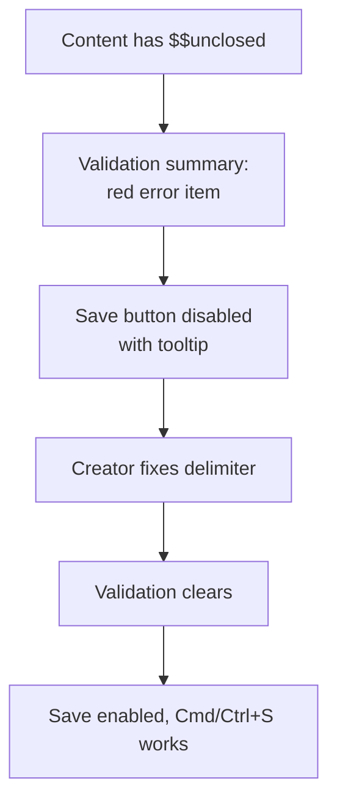

# Advanced Template Editor — UI/UX Design

- **Feature ID:** advanced-editor
- **Version:** 1.0
- **Status:** Proposed (for architecture review)
- **Author:** ui-ux-agent
- **Date:** 2026-10-12
- **Companion doc:** `advanced-editor-requirements.md`

## 1. Design Principles

1. **Augment, don't replace.** The textarea stays a textarea — prompt content is plain text. We add affordances around it, not a new editing paradigm.
2. **Errors never wait.** Validation is continuous and visible; the Save button itself communicates readiness.
3. **Never lose work.** Drafts autosave locally; navigation away is guarded; restore is one click.
4. **Same editor everywhere.** Details-page edit mode and the creation modal share one component, one toolbar, one validation summary.
5. **Aurora-native.** Monospace for content, soft panels, existing button styles; the editor should feel like the product, not like an embedded IDE.

## 2. Information Architecture



| Surface | Location | Contents |
|---|---|---|
| Template Details edit mode | Existing section, upgraded | AdvancedEditor replaces the bare textarea; Save/Cancel actions unchanged |
| Creation modal | Home page modal, upgraded | AdvancedEditor for the content field; other fields unchanged |
| Variable toolbar popover | Inside editor header | Name input + existing-variable chips |
| Validation summary | Fixed strip between editor and actions | Blocking errors + warnings with jump-to-first-occurrence |
| Live preview | Collapsible pane beside/below editor | Highlighted variables; sample/custom toggle |
| Admin console | — | None (admins edit as owners via the regular surface) |

## 3. User Flows

### 3.1 Insert a variable while writing



### 3.2 Draft recovery after reload



### 3.3 Blocked save



## 4. Page Layouts

### 4.1 Template Details — edit mode (desktop ≥1024px)

```
┌───────────────────────────────────────────────────────────────────────┐
│ ◀ Back to preview                                                      │
│ ┌───────────────────────────────────────────────────────────────────┐ │
│ │ EDIT TEMPLATE CONTENT                                   v3 ▾       │ │
│ │ ┌─────────────────────────────────────────────────────────────┐ │ │
│ │ │ [+ Insert variable] [👁 Preview ▾]        draft saved 12:04 │ │ │
│ │ ├─────────────────────────────────────────────────────────────┤ │ │
│ │ │ You are an expert $$role$$.                                │ │ │
│ │ │ Review the following $$language$$ code and                 │ │ │
│ │ │ suggest improvements for $$goal$$.                         │ │ │
│ │ │                                                            │ │ │
│ │ │ $$unclosed                                                 │ │ │
│ │ └─────────────────────────────────────────────────────────────┘ │ │
│ │ ┌─────────────────────────────────────────────────────────────┐ │ │
│ │ │ ⚠ 1 error · 0 warnings                                       │ │ │
│ │ │ • Unclosed $$ delimiter (line 5)                    [go ↗]  │ │ │
│ │ └─────────────────────────────────────────────────────────────┘ │ │
│ │ Variables: [role ×1] [language ×1] [goal ×1] [+ add]           │ │
│ │ 1,204 chars · 5 lines · 3 variables        1,204 / 10,000     │ │
│ │                                    [Cancel] [Save new version]  │ │
│ └───────────────────────────────────────────────────────────────┘ │
└───────────────────────────────────────────────────────────────────────┘
```

### 4.2 Editor with live preview open (split view)

```
┌───────────────────────────────────────────────────────────────────────┐
│ [+ Insert variable] [👁 Preview ▼] [sample values ◉ / custom ○]       │
│ ┌──────────────────────────────┬────────────────────────────────────┐ │
│ │ EDITOR (monospace)           │ PREVIEW                            │ │
│ │ You are an expert $$role$$.  │ You are an expert ⟨role⟩.          │ │
│ │ Review the following         │ Review the following               │ │
│ │ $$language$$ code and        │ ⟨language⟩ code and                 │ │
│ │ suggest improvements         │ suggest improvements               │ │
│ │ for $$goal$$.                │ for ⟨goal⟩.                        │ │
│ │                              │ (variables highlighted in accent)  │ │
│ └──────────────────────────────┴────────────────────────────────────┘ │
│ Variables: [role ×1] [language ×1] [goal ×1]                          │
└───────────────────────────────────────────────────────────────────────┘
```

### 4.3 Creation modal (content field upgraded)

```
┌──────────────────────────── Create Template ───────────────────────────┐
│ Title [____________________]  Category [▼]  Language [▼]              │
│ Description [_____________________________________________]          │
│ Tags [____] [____] [+]                                                  │
│ ── Content ──────────────────────────────────────────────────────────  │
│ [+ Insert variable] [👁 Preview ▾]                                     │
│ ┌──────────────────────────────────────────────────────────────────┐  │
│ │ (AdvancedEditor textarea — same component as details page)       │  │
│ └──────────────────────────────────────────────────────────────────┘  │
│ ⚠ 0 errors · 0 warnings    0 / 10,000 chars                           │
│                                        [Cancel] [Create template]     │
└─────────────────────────────────────────────────────────────────────────┘
```

### 4.4 Mobile (<768px)

Preview pane becomes a full-width collapsible section below the editor; toolbar wraps to two rows; validation summary stays pinned above the action buttons.

## 5. Component Specs

| Component | Based on / new | Spec |
|---|---|---|
| `AdvancedEditor` | New shared component | Container: toolbar row + textarea (monospace, min-height 240px, auto-grow to 640px) + validation strip + inventory row + footer counts |
| `VariableToolbar` | New | "Insert variable" button → popover with name input (validation: `^[A-Za-z0-9_]{1,30}$`), existing-variable chips, Enter to insert |
| `VariableInventory` | New | Chip list `name ×n`; click chip → focus editor + select first occurrence; `+ add` opens the toolbar popover |
| `ValidationSummary` | New | Strip with counts (`⚠ n errors · m warnings`); each item: icon, message, line number, "go" link; red for blocking, amber for warnings |
| `LivePreview` | New | Split pane (desktop) / collapsible section (mobile); renders content with variables wrapped in accent-colored `⟨name⟩` tokens; sample/custom toggle; debounced 300 ms |
| `EditorFooter` | New | Char count `n / limit`, line count, variable count; amber within 10% of limit, red at limit |
| `DraftBadge` | New | "draft saved HH:MM" text in toolbar; subtle, non-blocking |
| `RestorePrompt` | Reuse Modal | On entering edit mode with a differing draft: "Restore draft" / "Discard" buttons, shows draft timestamp |
| `CancelConfirm` | Reuse Modal | On Esc/cancel while dirty: "Discard changes?" with Discard / Keep editing |

## 6. Interaction Details

1. **Insert at cursor.** Insertion uses the textarea's selection start/end; after insert, cursor lands after the closing `$$` and the popover closes.
2. **Typing `$$`.** No auto-popup in v1 (avoid interrupting flow); the popover is click/`Cmd/Ctrl+Enter`-triggered. The inventory updates live regardless of how variables were typed.
3. **Validation timing.** Recompute debounced 300 ms after keystrokes; immediate on paste and on Save attempt.
4. **Save gating.** Save disabled while blocking errors exist; disabled state shows a tooltip listing the error count. `Cmd/Ctrl+S` triggers the same path and focuses the first error if blocked.
5. **Draft lifecycle.** Autosave at most every 5 s when dirty; on successful save or Discard, the localStorage key is removed; on logout, all `draft:*` keys for the user are cleared.
6. **Restore prompt.** Shown only when a draft exists AND differs from the loaded version content; choosing Discard deletes the draft immediately.
7. **Preview modes.** Sample mode fills `<name>` tokens; custom mode renders one input per variable (reusing generator styling) and shows the resolved text; switching modes preserves typed custom values in component state.
8. **Esc behavior.** Esc closes the popover/preview first; only when no overlay is open does it trigger cancel (with confirm if dirty).
9. **Line numbers in errors.** Errors reference 1-based line numbers computed from content; "go" focuses the editor and selects the offending text range.

## 7. States Summary

| State | Trigger | UI |
|---|---|---|
| Clean | No changes | Footer counts only; Save enabled (if no errors) |
| Dirty | Any edit | Draft badge appears; beforeunload guard on |
| Validation error | Blocking issue | Red items in summary; Save disabled + tooltip |
| Warning | Near-duplicate names | Amber items; Save stays enabled |
| Over length | Content > limit | Red count; Save disabled |
| Autosaving | 5 s dirty interval | Subtle "draft saved HH:MM" update |
| Draft found | Re-entering edit mode | Restore prompt modal |
| Preview loading | Debounce window | Preview shows previous render (no spinner) |
| localStorage unavailable | Private mode etc. | Editor works; draft badge hidden; no errors |

## 8. i18n Considerations (EN/ZH)

- Strings under `editor.*` in `frontend/src/locales/{en,zh}/translation.json`.
- Key terms: "Insert variable" / "插入变量"; "Preview" / "预览"; "sample values" / "示例值"; "custom values" / "自定义值"; "Restore draft" / "恢复草稿"; "Discard" / "丢弃"; "Save new version" / "保存新版本" (existing key reused); "Unclosed $$ delimiter" / "`$$` 定界符未闭合"; "Variables are similar but differ in case or spacing" / "变量相似但大小写或空格不同"; "draft saved" / "草稿已保存".
- Error messages include the variable name and line number as interpolated values, never concatenated hardcoded strings.
- Variable names, `$$` syntax, and counts are locale-neutral.

## 9. Accessibility

- Textarea is a labelled field (`aria-label` from section title); toolbar buttons are focusable with visible labels.
- Validation summary has `role="alert"` (errors) / `role="status"` (warnings); each error links to the editor region via `aria-describedby`.
- Keyboard: Tab order toolbar → textarea → inventory → actions; `Cmd/Ctrl+S` save, `Esc` layered close, `Cmd/Ctrl+Enter` insert popover — all documented in a tooltip/help text.
- Preview pane is `role="region"` with `aria-label`; variable tokens are plain text (screen readers read `⟨role⟩` naturally).
- Color is never the only signal: errors carry icons and text; counts carry the `/limit` text.

## 10. Analytics (optional, if analytics feature ships)

- `editor_variable_inserted`, `editor_validation_blocked_save` (error type), `editor_draft_restored`, `editor_preview_toggled` (mode).

## 11. Out of Scope (mirrors requirements §8)

- Rich text/markdown content, collaborative editing, AI-assisted writing.
- Server-side validation endpoint or server-stored drafts.
- In-text occurrence highlighting beyond first-occurrence selection; syntax highlighting inside the textarea.
- Monetization of any kind.
