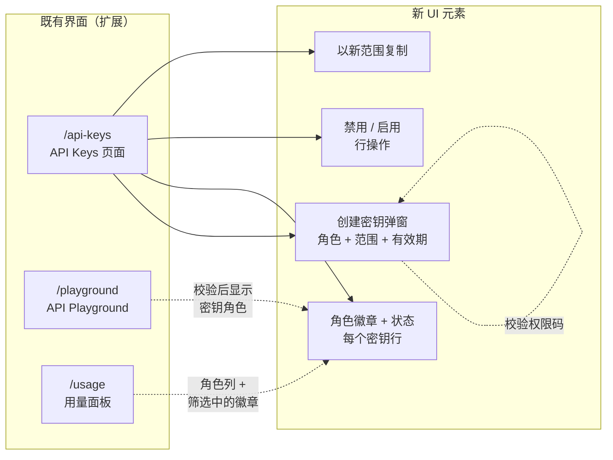
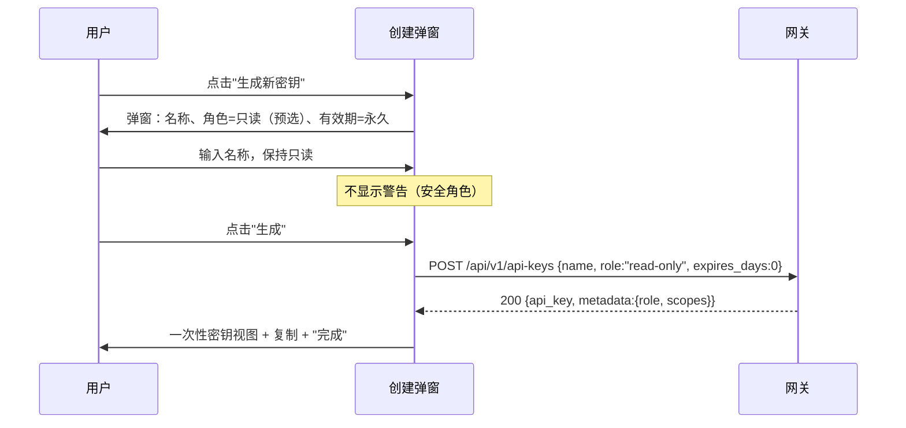
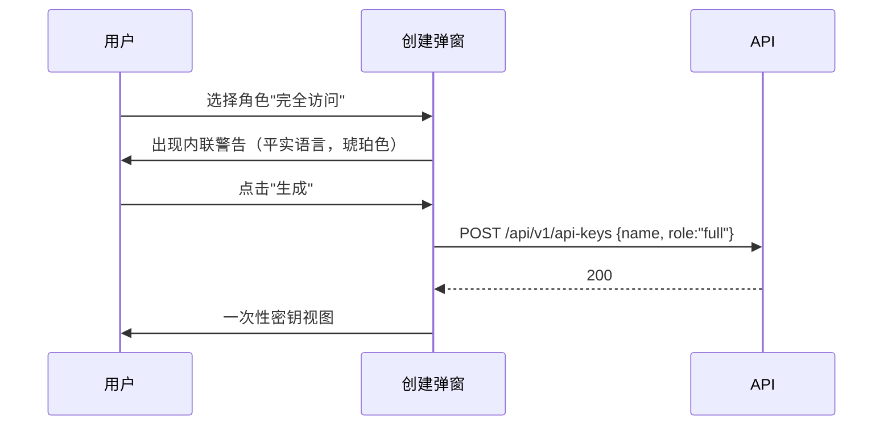
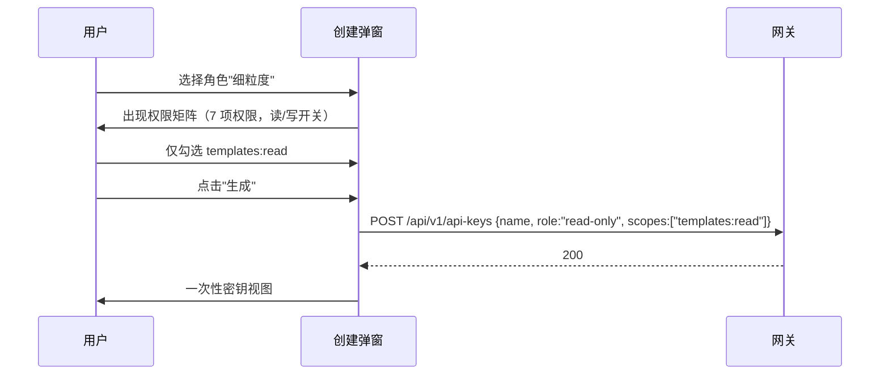
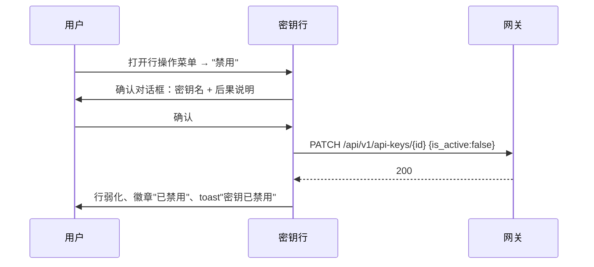
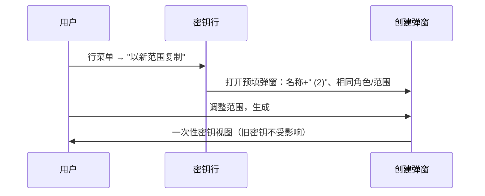

# API Key 权限范围（Scopes & Permissions）— UI/UX 设计

- **Feature ID:** api-key-scopes-permissions
- **Version:** 1.0
- **Status:** Proposed（待架构评审）
- **Author:** ui-ux-agent
- **Date:** 2026-10-12
- **相关文档：** [需求](./api-key-scopes-permissions-requirements-zh-CN.md) · [需求 (EN)](./api-key-scopes-permissions-requirements.md) · [UI/UX (EN)](./api-key-scopes-permissions-ui-ux-design.md)

## 1. 设计原则

1. **安全默认，危险需显式选择。** `read-only` 为预选角色；选 `full` 必须越过一条平实语言的警告（Stripe"默认受限"的教训）。
2. **爆炸半径始终可见。** 每个密钥行都显示角色徽章与状态；用户永远不该疑惑"这把密钥能做什么？"
3. **诚实的不可变。** 不提供虚假的编辑入口。变更范围 = 复制 + 替换，UI 明说这一点。
4. **可逆的补救。** 先禁用后删除；保留审计轨迹（名称、创建时间、最近使用）。
5. **本地化的安全语言。** 权限名称、警告与拒绝消息在 EN/ZH 中都自然可读 —— 绝不只展示原始代码。

## 2. 信息架构



不新增路由。本特性深化三个既有界面：API Keys 页面（主）、playground（角色展示）、用量面板（角色列）。

## 3. 用户流程

### 3.1 创建只读密钥（主流程）



### 3.2 创建完全访问密钥（带警告流程）



### 3.3 细粒度密钥



### 3.4 禁用可疑密钥



### 3.5 以新范围复制



## 4. 页面布局（线框图）

### 4.1 API Keys 页面 — 带徽章的列表（扩展现有表格）

```
┌──────────────────────────────────────────────────────────────────────────────┐
│  API 密钥管理                                                                  │
│  以编程方式管理用于访问服务的 API 密钥。                                          │
│                                                                              │
│  你的 API 密钥                                    [ + 生成新密钥 ]              │
│  ┌────────────────────────────────────────────────────────────────────────┐ │
│  │ 名称       密钥        角色            状态    创建于      最近使用       │ │
│  │            │           │               │         │           │ 操作     │ │
│  ├────────────┼───────────┼───────────────┼─────────┼───────────┼──────────┤ │
│  │ prod-app   sk-pro…4f2  ▸ 只读         ● 有效    10月2日     10月12日   ⋮ │ │
│  │ ci-deploy  sk-cid…9a1  ▸ 完全访问     ● 有效    9月18日     10月11日   ⋮ │ │
│  │ analytics  sk-ana…77c  ▸ 细粒度       ● 有效    10月10日    —          ⋮ │ │
│  │ old-script sk-old…3b8  ▸ 只读         ◌ 已禁用  9月2日      10月1日    ⋮ │ │
│  │ temp-test  sk-tmp…e5d  ▸ 完全访问     ◌ 已过期  8月30日     9月29日    ⋮ │ │
│  └────────────────────────────────────────────────────────────────────────┘ │
│  ‹ 上一页   第 1 / 2 页   下一页 ›                                              │
└──────────────────────────────────────────────────────────────────────────────┘
```

- **角色徽章**（`▸`）：带图标的胶囊 —— 只读（绿色盾牌）、完全访问（琥珀色警示）、细粒度（蓝色滑杆）。始终带文本标签（无障碍）。
- **状态**（`●`/`◌`）：有效（绿点）、已禁用（灰色）、已过期（灰色 + 时钟图标）。禁用/过期行 `opacity: 0.6`。
- **行操作菜单**（`⋮`）：禁用/启用 · 以新范围复制 · 删除（既有）。

### 4.2 创建密钥弹窗 — 单步表单

```
┌──────────────────────────────────────────────────────────────┐
│  生成新密钥                                             [×]  │
│  ────────────────────────────────────────────────────────────│
│                                                              │
│  名称 *                                                      │
│  ┌────────────────────────────────────────────────────────┐ │
│  │ 例如 production-app                                     │ │
│  └────────────────────────────────────────────────────────┘ │
│                                                              │
│  访问级别                                                     │
│  ┌────────────────────────────────────────────────────────┐ │
│  │ ◉ 只读（推荐）                                           │ │
│  │   可获取 prompt 并读取数据，不能修改或删除任何内容。          │ │
│  │ ○ 完全访问                                               │ │
│  │   可执行账号能做的一切，包括删除模板和创建密钥。              │ │
│  │ ○ 细粒度                                                 │ │
│  │   精确选择这把密钥获得哪些权限。                            │ │
│  └────────────────────────────────────────────────────────┘ │
│                                                              │
│  ⚠ 完全访问密钥可以删除你的模板。仅在确实需要写操作时选择。        │
│    ← 仅在选择"完全访问"时显示（琥珀色内联警告）                   │
│                                                              │
│  ┌ 细粒度矩阵（仅选中时显示）─────────────────────────────────┐│
│  │ 权限               读取         写入                      ││
│  │ 模板               [✓]         [ ]                       ││
│  │ 评论               [✓]         [ ]                       ││
│  │ API 密钥           [ ]         [ ]                       ││
│  │ （templates:delete 以 写入+删除 开关呈现）                  ││
│  └──────────────────────────────────────────────────────────┘│
│                                                              │
│  有效期                                                       │
│  ┌────────────────────────────────────────────────────────┐ │
│  │ 永久 ▾   （永久 / 30 / 60 / 90 / 180 天）                 │ │
│  └────────────────────────────────────────────────────────┘ │
│                                                              │
│                          [ 取消 ]  [ 生成 ]                    │
└──────────────────────────────────────────────────────────────┘
```

### 4.3 一次性密钥视图（既有弹窗，扩展）

```
┌──────────────────────────────────────────────────────────────┐
│  密钥已创建                                             [×] │
│  ────────────────────────────────────────────────────────────│
│  ✓ 你的新密钥已创建。                                          │
│                                                              │
│  角色：▸ 只读             有效期：永久                          │
│                                                              │
│  sk-live-9f8e7d6c…                    [ 📋 复制 ]             │
│  ─────────────────────────────────────────────────────────── │
│  ⚠ 完整密钥仅此一次展示。请立即复制并妥善保存。                    │
│                                        [ 完成 ]               │
└──────────────────────────────────────────────────────────────┘
```

### 4.4 禁用确认对话框

```
┌──────────────────────────────────────────────────────────────┐
│  禁用密钥"ci-deploy"？                                   [×] │
│  ────────────────────────────────────────────────────────────│
│                                                              │
│  使用该密钥的请求将立即失败（401）。密钥会被保留 —— 之后可         │
│  重新启用，其使用历史也保持完整。                                 │
│                                                              │
│  角色：▸ 完全访问    最近使用：2026年10月11日                     │
│                                                              │
│                        [ 保持启用 ]  [ 禁用密钥 ]               │
└──────────────────────────────────────────────────────────────┘
```

### 4.5 行操作菜单

```
        ┌───────────────────────────────┐
        │  ⏸ 禁用密钥                    │  （或 ▶ 重新启用密钥）
        ├───────────────────────────────┤
        │  ⧉ 以新范围复制                │
        ├───────────────────────────────┤
        │  🗑 删除密钥…                   │  （既有，破坏性）
        └───────────────────────────────┘
```

### 4.6 Playground 与用量集成

```
Playground 认证选择器（既有，扩展）：
┌────────────────────────────────────────────┐
│  认证方式：(●) 会话  ( ) API 密钥            │
│  ┌──────────────────────────────────────┐  │
│  │ sk-… 粘贴密钥                         │  │
│  └──────────────────────────────────────┘  │
│  ✓ 有效 —— 只读密钥（prod-app）              │  ← 新增内联角色展示
└────────────────────────────────────────────┘

用量面板密钥筛选（既有，扩展）：
┌────────────────────────────┐
│  密钥：全部密钥 ▾            │
│  ┌────────────────────────┐│
│  │ ▸ 只读       prod-app  ││
│  │ ▸ 完全       ci-deploy ││
│  │ ▸ 细粒度     analytics ││
│  └────────────────────────┘│
└────────────────────────────┘
```

## 5. 组件规格

| 组件 | 基于 | Props / 行为 |
|---|---|---|
| `RoleBadge` | 新建 | `{role: 'read-only'\|'full'\|'fine-grained'}` → 带图标 + 本地化标签的胶囊。颜色：绿/琥珀/蓝，且始终带文本（绝不只靠颜色）。 |
| `KeyStatusBadge` | 新建 | `{status: 'active'\|'disabled'\|'expired'}`，由 `is_active` + `expires_at` 与当前时间推导。圆点 + 标签。 |
| `ScopeMatrix` | 新建 | 角色=细粒度时显示的 7 项权限 × 读/写 复选框网格。映射到权限码：模板→`templates:read`/`templates:write`（写入下含 `templates:delete`）、评论→`comments:read`/`comments:write`、API 密钥→`keys:read`/`keys:write`。至少勾选一项。 |
| `CreateKeyModal` | 扩展 APIKeyManager 既有 Modal | 增加"访问级别"单选组（默认只读）、条件警告（完全访问）、条件 ScopeMatrix（细粒度）、"有效期"下拉。提交 → `createAPIKey({name, role, scopes, expires_days})`。 |
| `KeyRowActions` | 扩展既有行菜单 | 禁用/启用（带确认）、以新范围复制、删除（既有）。 |
| `DisableKeyDialog` | 既有 Modal | 文案见线框 4.4；主按钮 = 禁用（危险），次按钮 = 保持启用。 |
| `ExpirySelect` | 新建 | 选项：永久/30/60/90/180；渲染本地化的"N 天后"标签。 |
| `DuplicatePrefill` | APIKeyManager 内逻辑 | 打开 CreateKeyModal，预填 `name = 源名称 + ' (2)'`（后缀去重）、相同的角色/范围/有效期。 |

## 6. 交互细节

1. **角色预选：** 全新弹窗始终默认 `read-only`。复制操作预填源密钥的角色。
2. **完全访问警告：** 选择"完全访问"时显示琥珀色内联警告（非弹窗套弹窗）；在改选其他角色前保持可见。"生成"保持可用 —— 警告用于告知，不阻断。
3. **细粒度矩阵：** 选择"细粒度"时展开矩阵（高度动画）。默认所有"读取"勾选、所有"写入"未勾选。零勾选时点生成 → 内联错误，不发请求。
4. **有效期：** 默认永久。选择 30 天时显示辅助行"该密钥将于 2026年11月11日 失效"（客户端计算）。
5. **禁用流程：** 菜单 → 对话框 → PATCH → 行重渲染为弱化 + "已禁用"徽章 → toast `api_keys.toast_disabled`。启用无需确认（安全方向）→ toast `api_keys.toast_enabled`。
6. **复制流程：** 菜单 → 预填弹窗 → 用户调整 → 生成创建一把**新**密钥；旧密钥不受影响。完成后列表显示两行；toast 提示"旧密钥仍然有效 —— 切换完成后请删除它。"
7. **复制密钥：** 一次性视图中保留既有的复制到剪贴板行为。
8. **排序/筛选（v1）：** 不新增 —— 列表保持现有按时间倒序。
9. **错误映射：** `400 INVALID_ARGUMENT`（非法范围）→ 矩阵下方内联错误；创建时 `401` → 既有错误 toast；网络错误 → 既有错误 toast。
10. **Playground/SDK 文档中的 403：** 拒绝响应体 `{"error":"insufficient_scope","required":"templates:write"}` 在 playground 响应面板中原样展示；UI 将 `required` 映射为本地化的权限名称。

## 7. 状态汇总

| 状态 | 触发 | UI |
|---|---|---|
| 列表加载中 | 页面请求 | 既有表格骨架/加载动画 |
| 列表为空 | 无密钥 | 既有空状态 + "生成新密钥"CTA |
| 列表错误 | 拉取失败 | 既有错误 toast；下次访问重试 |
| 创建校验 | 名称为空 / 零勾选 / 非法码 | 字段内联错误；校验通过前"生成"禁用 |
| 创建成功 | 201 | 一次性密钥视图（4.3） |
| 创建失败 | 400/401/500 | 内联（400）或 toast；弹窗保持打开，输入保留 |
| 切换成功 | PATCH 200 | 行更新 + toast |
| 切换失败 | PATCH 失败 | 错误 toast；行不变 |
| 行已禁用 | is_active=false | 弱化行、灰色徽章 |
| 行已过期 | expires_at < 当前 | 弱化行、带时钟图标的"已过期"徽章 |
| Playground 密钥无效 | 校验 401 | 密钥输入框下方内联错误（既有模式） |
| Playground 范围被拒 | 403 insufficient_scope | 指明缺失权限的内联错误（本地化） |

## 8. i18n 字符串表

命名空间：`api_keys`（扩展既有）+ `permissions`（新增）。

| 键 / 中文 | 英文 |
|---|---|
| `api_keys.role` / 访问级别 | Access level |
| `api_keys.role_read_only` / 只读 | Read-only |
| `api_keys.role_full` / 完全访问 | Full access |
| `api_keys.role_fine_grained` / 细粒度 | Fine-grained |
| `api_keys.role_read_only_desc` / 可获取 prompt 并读取数据，不能修改或删除任何内容。 | Can fetch prompts and read data. Cannot modify or delete anything. |
| `api_keys.role_full_desc` / 可执行账号能做的一切，包括删除模板和创建密钥。 | Can do everything your account can, including deleting templates and creating keys. |
| `api_keys.role_fine_grained_desc` / 精确选择这把密钥获得哪些权限。 | Pick exactly which permissions this key gets. |
| `api_keys.role_recommended` / 推荐 | recommended |
| `api_keys.warning_full` / 完全访问密钥可以删除你的模板。仅在确实需要写操作时选择。 | Full access keys can delete your templates. Only choose this if you truly need write operations. |
| `api_keys.expires` / 有效期 | Expires |
| `api_keys.expires_never` / 永久 | Never |
| `api_keys.expires_days` / {{count}} 天后 | in {{count}} days |
| `api_keys.expires_on` / 该密钥将于 {{date}} 失效。 | This key will stop working on {{date}}. |
| `api_keys.status_active` / 有效 | Active |
| `api_keys.status_disabled` / 已禁用 | Disabled |
| `api_keys.status_expired` / 已过期 | Expired |
| `api_keys.action_disable` / 禁用密钥 | Disable key |
| `api_keys.action_enable` / 重新启用密钥 | Re-enable key |
| `api_keys.action_duplicate` / 以新范围复制 | Duplicate with new scopes |
| `api_keys.disable_title` / 禁用密钥"{{name}}"？ | Disable key "{{name}}"? |
| `api_keys.disable_body` / 使用该密钥的请求将立即失败（401）。密钥会被保留 —— 之后可重新启用，其使用历史也保持完整。 | Requests using this key will immediately stop working (401). The key is kept — you can re-enable it later and its usage history stays intact. |
| `api_keys.disable_confirm` / 禁用密钥 | Disable key |
| `api_keys.disable_cancel` / 保持启用 | Keep active |
| `api_keys.toast_disabled` / 密钥已禁用 | Key disabled |
| `api_keys.toast_enabled` / 密钥已重新启用 | Key re-enabled |
| `api_keys.toast_duplicate_hint` / 旧密钥仍然有效 —— 切换完成后请删除它。 | Old key still active — delete it when you've switched. |
| `api_keys.error_no_scopes` / 请至少选择一个权限。 | Select at least one permission. |
| `api_keys.error_invalid_scope` / 所选权限未知。 | Unknown permission selected. |
| `api_keys.error_toggle` / 更新密钥失败。 | Failed to update key. |
| `api_keys.created_role` / 角色 | Role |
| `permissions.templates` / 模板 | Templates |
| `permissions.comments` / 评论 | Comments |
| `permissions.keys` / API 密钥 | API keys |
| `permissions.read` / 读取 | Read |
| `permissions.write` / 写入 | Write |
| `permissions.denied` / 该密钥缺少"{{permission}}"权限。 | This key lacks the "{{permission}}" permission. |

## 9. 无障碍说明

- 角色与状态徽章始终包含文本标签（绝不只靠颜色/图标）；颜色对比度 ≥ 4.5:1。
- 访问级别单选组是原生 `fieldset`/`legend`，带 `role="radiogroup"` 语义；方向键按标准单选行为在选项间移动。
- ScopeMatrix 是真实的 `<table>`，带列标题（读取/写入）与行标题（权限分组）；复选框有程序化关联的标签。
- 完全访问警告使用 `role="note"` + `aria-live="polite"`，出现时会被播报。
- 对话框锁定焦点；关闭后焦点回到触发行的菜单按钮；Escape 取消。
- 禁用/过期行的文本保持完整对比度（通过背景/边框弱化，而非把文本对比度降到 4.5:1 以下）。
- Toast 使用既有通知系统的 live-region 行为。

## 10. 响应式行为

- **桌面（≥1024px）：** 表格显示全部列（名称、密钥、角色、状态、创建于、最近使用、操作）。
- **平板（768–1023px）：** 隐藏"创建于"列；角色与状态徽章保留。
- **手机（<768px）：** 表格折叠为堆叠卡片 —— 第 1 行名称 + 前缀，第 2 行角色 + 状态徽章，第 3 行创建/最近使用，第 4 行操作菜单。弹窗变为全屏 sheet；ScopeMatrix 需要时横向滚动并固定权限列。
- Playground 与用量集成继承各自页面既有的响应式规则；窄屏下角色徽章换行到密钥名下方。

## 11. 分析事件（可选，若 analytics 已上线）

- `api_key_created` `{role, scope_count, expires_days}`
- `api_key_disabled` / `api_key_enabled` `{key_id}`
- `api_key_duplicated` `{source_role, new_role}`
- `api_key_scope_denied` `{required}`（playground 中客户端观测到的 403）

## 12. 不做范围（UI）

- 密钥的批量启用/禁用（bulk-operations 日后可加）。
- 创建后修改范围（设计上不可变）。
- 行内按密钥用量迷你图（用量面板负责详情）。
- 管理台查看用户密钥。
