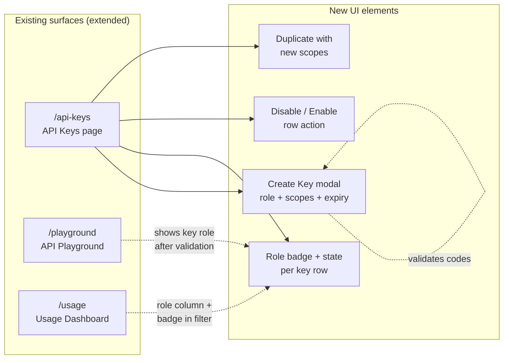
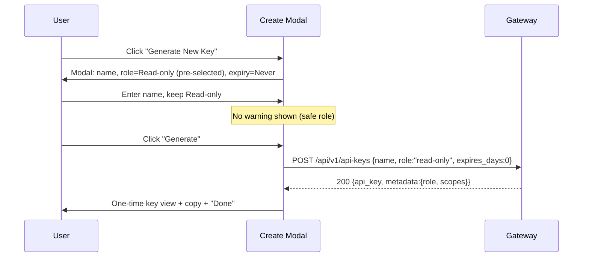
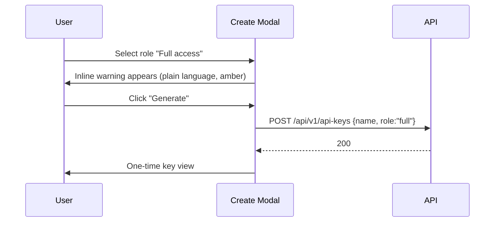
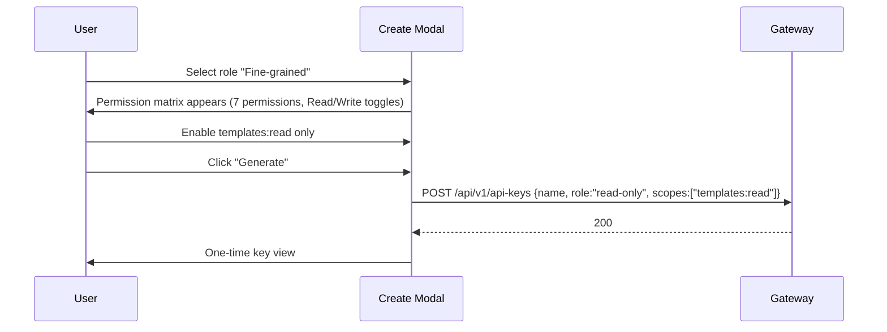
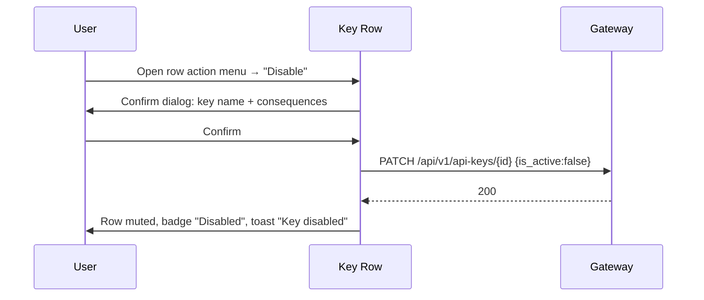
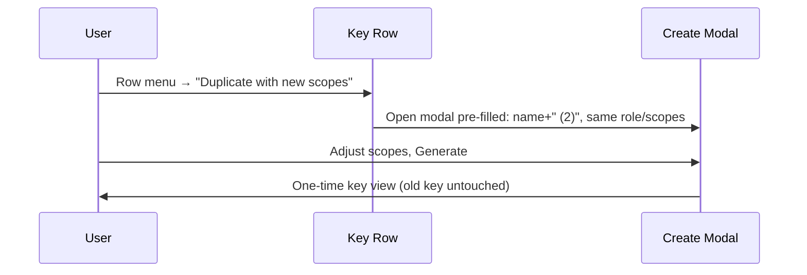

# API Key Scopes & Permissions — UI/UX Design

- **Feature ID:** api-key-scopes-permissions
- **Version:** 1.0
- **Status:** Proposed (for architecture review)
- **Author:** ui-ux-agent
- **Date:** 2026-10-12
- **Related docs:** [Requirements](./api-key-scopes-permissions-requirements.md) · [Requirements (ZH)](./api-key-scopes-permissions-requirements-zh-CN.md) · [UI/UX (ZH)](./api-key-scopes-permissions-ui-ux-design-zh-CN.md)

## 1. Design Principles

1. **Safe default, dangerous opt-in.** `read-only` is the pre-selected role; `full` requires an explicit click past a plain-language warning (Stripe's "restricted by default" lesson).
2. **Blast radius always visible.** Every key row shows its role badge and state; no user should ever wonder "what can this key do?"
3. **Immutable, honestly.** No fake edit affordance. Changing scopes = duplicate + replace, and the UI says exactly that.
4. **Reversible remediation.** Disable before delete; keep the audit trail (name, created, last used) intact.
5. **Localized security language.** Permission names, warnings, and denial messages read naturally in EN and ZH — never raw codes alone.

## 2. Information Architecture



No new routes. The feature deepens three existing surfaces: the API Keys page (primary), the playground (role display), and the usage dashboard (role column).

## 3. User Flows

### 3.1 Create a read-only key (primary flow)



### 3.2 Create a full-access key (warned flow)



### 3.3 Fine-grained key



### 3.4 Disable a suspicious key



### 3.5 Duplicate with new scopes



## 4. Page Layouts (Wireframes)

### 4.1 API Keys page — list with badges (extends existing table)

```
┌──────────────────────────────────────────────────────────────────────────────┐
│  API Keys Management                                                         │
│  Manage your API keys to access the service programmatically.                │
│                                                                              │
│  Your API Keys                                    [ + Generate New Key ]     │
│  ┌────────────────────────────────────────────────────────────────────────┐ │
│  │ Name        Key        Role            Status    Created    Last Used  │ │
│  │            │           │               │         │           │ Actions │ │
│  ├────────────┼───────────┼───────────────┼─────────┼───────────┼──────────┤ │
│  │ prod-app   sk-pro…4f2  ▸ Read-only    ● Active   Oct 2      Oct 12    ⋮ │ │
│  │ ci-deploy  sk-cid…9a1  ▸ Full access  ● Active   Sep 18     Oct 11    ⋮ │ │
│  │ analytics  sk-ana…77c  ▸ Fine-grained ● Active   Oct 10     —         ⋮ │ │
│  │ old-script sk-old…3b8  ▸ Read-only    ◌ Disabled Sep 2      Oct 1     ⋮ │ │
│  │ temp-test  sk-tmp…e5d  ▸ Full access  ◌ Expired  Aug 30     Sep 29    ⋮ │ │
│  └────────────────────────────────────────────────────────────────────────┘ │
│  ‹ Prev   Page 1 of 2   Next ›                                               │
└──────────────────────────────────────────────────────────────────────────────┘
```

- **Role badge** (`▸`): pill with icon — Read-only (green shield), Full access (amber alert), Fine-grained (blue sliders). Text label always present (a11y).
- **Status** (`●`/`◌`): Active (green dot), Disabled (gray), Expired (gray + clock icon). Disabled/Expired rows get `opacity: 0.6`.
- **Row action menu** (`⋮`): Disable/Enable · Duplicate with new scopes · Delete (existing).

### 4.2 Create Key modal — step-free single form

```
┌──────────────────────────────────────────────────────────────┐
│  Generate New Key                                       [×]  │
│  ────────────────────────────────────────────────────────────│
│                                                              │
│  Name *                                                      │
│  ┌────────────────────────────────────────────────────────┐ │
│  │ e.g. production-app                                     │ │
│  └────────────────────────────────────────────────────────┘ │
│                                                              │
│  Access level                                                │
│  ┌────────────────────────────────────────────────────────┐ │
│  │ ◉ Read-only  (recommended)                              │ │
│  │   Can fetch prompts and read data. Cannot modify or     │ │
│  │   delete anything.                                      │ │
│  │ ○ Full access                                           │ │
│  │   Can do everything your account can, including         │ │
│  │   deleting templates and creating keys.                 │ │
│  │ ○ Fine-grained                                          │ │
│  │   Pick exactly which permissions this key gets.         │ │
│  └────────────────────────────────────────────────────────┘ │
│                                                              │
│  ⚠ Full access keys can delete your templates. Only choose  │
│    this if you truly need write operations.   ← shown only   │
│    when Full access selected (amber inline warning)          │
│                                                              │
│  ┌ Fine-grained matrix (only when selected) ────────────────┐│
│  │ Permission          Read        Write                    ││
│  │ Templates           [✓]         [ ]                      ││
│  │ Comments            [✓]         [ ]                      ││
│  │ API keys            [ ]         [ ]                      ││
│  │ (templates:delete shown as Write+Delete toggle)          ││
│  └──────────────────────────────────────────────────────────┘│
│                                                              │
│  Expires                                                     │
│  ┌────────────────────────────────────────────────────────┐ │
│  │ Never ▾   (Never / 30 / 60 / 90 / 180 days)             │ │
│  └────────────────────────────────────────────────────────┘ │
│                                                              │
│                          [ Cancel ]  [ Generate ]            │
└──────────────────────────────────────────────────────────────┘
```

### 4.3 One-time key view (existing modal, extended)

```
┌──────────────────────────────────────────────────────────────┐
│  Key Created                                             [×]│
│  ────────────────────────────────────────────────────────────│
│  ✓ Your new key has been created.                           │
│                                                              │
│  Role: ▸ Read-only        Expires: Never                     │
│                                                              │
│  sk-live-9f8e7d6c…                    [ 📋 Copy ]            │
│  ─────────────────────────────────────────────────────────── │
│  ⚠ This is the only time the full key is shown.             │
│    Copy it now and store it safely.                          │
│                                        [ Done ]              │
└──────────────────────────────────────────────────────────────┘
```

### 4.4 Disable confirmation dialog

```
┌──────────────────────────────────────────────────────────────┐
│  Disable key "ci-deploy"?                               [×] │
│  ────────────────────────────────────────────────────────────│
│                                                              │
│  Requests using this key will immediately stop working       │
│  (401). The key is kept — you can re-enable it later and     │
│  its usage history stays intact.                             │
│                                                              │
│  Role: ▸ Full access   Last used: Oct 11, 2026               │
│                                                              │
│                        [ Keep active ]  [ Disable key ]      │
└──────────────────────────────────────────────────────────────┘
```

### 4.5 Row action menu

```
        ┌───────────────────────────────┐
        │  ⏸ Disable key                │  (or ▶ Re-enable key)
        ├───────────────────────────────┤
        │  ⧉ Duplicate with new scopes  │
        ├───────────────────────────────┤
        │  🗑 Delete key…                │  (existing, destructive)
        └───────────────────────────────┘
```

### 4.6 Playground + Usage integrations

```
Playground auth selector (existing, extended):
┌────────────────────────────────────────────┐
│  Authentication: (●) Session  ( ) API key  │
│  ┌──────────────────────────────────────┐  │
│  │ sk-… paste key                       │  │
│  └──────────────────────────────────────┘  │
│  ✓ Valid — Read-only key (prod-app)        │  ← new inline role display
└────────────────────────────────────────────┘

Usage dashboard key filter (existing, extended):
┌────────────────────────────┐
│  Key: All keys ▾           │
│  ┌────────────────────────┐│
│  │ ▸ Read-only  prod-app  ││
│  │ ▸ Full       ci-deploy ││
│  │ ▸ Fine       analytics ││
│  └────────────────────────┘│
└────────────────────────────┘
```

## 5. Component Specifications

| Component | Based on | Props / behavior |
|---|---|---|
| `RoleBadge` | new | `{role: 'read-only'\|'full'\|'fine-grained'}` → pill with icon + localized label. Colors: green/amber/blue with text (never color-only). |
| `KeyStatusBadge` | new | `{status: 'active'\|'disabled'\|'expired'}` derived from `is_active` + `expires_at` vs now. Dot + label. |
| `ScopeMatrix` | new | 7 permissions × Read/Write checkbox grid shown when role = fine-grained. Maps to codes: Templates→`templates:read`/`templates:write`(+`templates:delete` under Write), Comments→`comments:read`/`comments:write`, API keys→`keys:read`/`keys:write`. At least one box required. |
| `CreateKeyModal` | extends existing Modal in APIKeyManager | Adds `Access level` radio group (default read-only), conditional warning (full), conditional ScopeMatrix (fine-grained), `Expires` select. Submit → `createAPIKey({name, role, scopes, expires_days})`. |
| `KeyRowActions` | extends existing row menu | Disable/Enable (with confirm), Duplicate with new scopes, Delete (existing). |
| `DisableKeyDialog` | existing Modal | Copy per wireframe 4.4; primary = Disable (danger), secondary = Keep active. |
| `ExpirySelect` | new | Options: Never/30/60/90/180; renders localized "in N days" labels. |
| `DuplicatePrefill` | logic in APIKeyManager | Opens CreateKeyModal with `name = source.name + ' (2)'` (dedupe suffix), same role/scopes/expiry preselected. |

## 6. Interaction Details

1. **Role pre-selection:** `read-only` is always the default in a fresh modal. Duplicate pre-fills the source key's role.
2. **Full-access warning:** selecting `Full access` reveals an amber inline warning (no modal-in-modal); it stays visible until another role is chosen. Generate stays enabled — the warning informs, not blocks.
3. **Fine-grained matrix:** selecting `Fine-grained` expands the matrix (animated height). All Read boxes default checked, all Write unchecked. Generating with zero boxes → inline error, no request.
4. **Expiry:** default Never. Choosing 30 days shows a helper line "This key will stop working on Nov 11, 2026" (computed client-side).
5. **Disable flow:** menu → dialog → PATCH → row re-renders muted with Disabled badge → toast `api_keys.toast_disabled`. Enable has no confirm (safe direction) → toast `api_keys.toast_enabled`.
6. **Duplicate flow:** menu → modal pre-filled → user adjusts → Generate creates a NEW key; old key untouched. After Done, list shows both rows; toast hints "Old key still active — delete it when you've switched."
7. **Copy key:** existing copy-to-clipboard behavior retained in one-time view.
8. **Sorting/filtering (v1):** none added — list stays chronological (newest first) as today.
9. **Error mapping:** `400 INVALID_ARGUMENT` (bad scope) → inline error under matrix; `401` on create → existing error toast; network → existing error toast.
10. **403 in playground/SDK docs:** denial body `{"error":"insufficient_scope","required":"templates:write"}` is surfaced verbatim in the playground response pane; the UI maps `required` to a localized permission name.

## 7. States Summary

| State | Trigger | UI |
|---|---|---|
| List loading | page fetch | Existing table skeleton/spinner |
| List empty | no keys | Existing empty state + "Generate New Key" CTA |
| List error | fetch fails | Existing error toast; retry on next visit |
| Create validation | empty name / zero scopes / bad code | Inline field errors; Generate disabled until valid |
| Create success | 201 | One-time key view (4.3) |
| Create error | 400/401/500 | Inline (400) or toast; modal stays open, inputs preserved |
| Toggle success | PATCH 200 | Row updates + toast |
| Toggle error | PATCH fails | Error toast; row unchanged |
| Row disabled | is_active=false | Muted row, gray badge |
| Row expired | expires_at < now | Muted row, Expired badge with clock icon |
| Playground key invalid | 401 on validate | Inline error under key field (existing pattern) |
| Playground scope denied | 403 insufficient_scope | Inline error naming the missing permission (localized) |

## 8. i18n String Table

Namespace: `api_keys` (extends existing) + `permissions` (new).

| Key | English | 中文 |
|---|---|---|
| `api_keys.role` | Access level | 访问级别 |
| `api_keys.role_read_only` | Read-only | 只读 |
| `api_keys.role_full` | Full access | 完全访问 |
| `api_keys.role_fine_grained` | Fine-grained | 细粒度 |
| `api_keys.role_read_only_desc` | Can fetch prompts and read data. Cannot modify or delete anything. | 可获取 prompt 并读取数据，不能修改或删除任何内容。 |
| `api_keys.role_full_desc` | Can do everything your account can, including deleting templates and creating keys. | 可执行账号能做的一切，包括删除模板和创建密钥。 |
| `api_keys.role_fine_grained_desc` | Pick exactly which permissions this key gets. | 精确选择这把密钥获得哪些权限。 |
| `api_keys.role_recommended` | recommended | 推荐 |
| `api_keys.warning_full` | Full access keys can delete your templates. Only choose this if you truly need write operations. | 完全访问密钥可以删除你的模板。仅在确实需要写操作时选择。 |
| `api_keys.expires` | Expires | 有效期 |
| `api_keys.expires_never` | Never | 永久 |
| `api_keys.expires_days` | in {{count}} days | {{count}} 天后 |
| `api_keys.expires_on` | This key will stop working on {{date}}. | 该密钥将于 {{date}} 失效。 |
| `api_keys.status_active` | Active | 有效 |
| `api_keys.status_disabled` | Disabled | 已禁用 |
| `api_keys.status_expired` | Expired | 已过期 |
| `api_keys.action_disable` | Disable key | 禁用密钥 |
| `api_keys.action_enable` | Re-enable key | 重新启用密钥 |
| `api_keys.action_duplicate` | Duplicate with new scopes | 以新范围复制 |
| `api_keys.disable_title` | Disable key "{{name}}"? | 禁用密钥"{{name}}"？ |
| `api_keys.disable_body` | Requests using this key will immediately stop working (401). The key is kept — you can re-enable it later and its usage history stays intact. | 使用该密钥的请求将立即失败（401）。密钥会被保留 —— 之后可重新启用，其使用历史也保持完整。 |
| `api_keys.disable_confirm` | Disable key | 禁用密钥 |
| `api_keys.disable_cancel` | Keep active | 保持启用 |
| `api_keys.toast_disabled` | Key disabled | 密钥已禁用 |
| `api_keys.toast_enabled` | Key re-enabled | 密钥已重新启用 |
| `api_keys.toast_duplicate_hint` | Old key still active — delete it when you've switched. | 旧密钥仍然有效 —— 切换完成后请删除它。 |
| `api_keys.error_no_scopes` | Select at least one permission. | 请至少选择一个权限。 |
| `api_keys.error_invalid_scope` | Unknown permission selected. | 所选权限未知。 |
| `api_keys.error_toggle` | Failed to update key. | 更新密钥失败。 |
| `api_keys.created_role` | Role | 角色 |
| `permissions.templates` | Templates | 模板 |
| `permissions.comments` | Comments | 评论 |
| `permissions.keys` | API keys | API 密钥 |
| `permissions.read` | Read | 读取 |
| `permissions.write` | Write | 写入 |
| `permissions.denied` | This key lacks the "{{permission}}" permission. | 该密钥缺少"{{permission}}"权限。 |

## 9. Accessibility Notes

- Role and status badges always include a text label (never color/icon alone); color contrast ≥ 4.5:1.
- The access-level radio group is a native `fieldset`/`legend` with `role="radiogroup"` semantics; arrow keys move between options per standard radio behavior.
- The ScopeMatrix is a real `<table>` with column headers (Read/Write) and row headers (permission groups); checkboxes have programmatically associated labels.
- The full-access warning uses `role="note"` + `aria-live="polite"` so it is announced when revealed.
- Dialogs trap focus; focus returns to the triggering row menu button on close; Escape cancels.
- Disabled/expired rows keep full contrast for text (muted via background/border, not by lowering text contrast below 4.5:1).
- Toasts use the existing notification system's live-region behavior.

## 10. Responsive Behavior

- **Desktop (≥1024px):** table shows all columns (Name, Key, Role, Status, Created, Last Used, Actions).
- **Tablet (768–1023px):** Created column hidden; Role and Status badges remain.
- **Mobile (<768px):** table collapses to stacked cards — name + prefix on line 1, Role + Status badges on line 2, created/last-used on line 3, actions menu on line 4. Modal becomes full-screen sheet; ScopeMatrix scrolls horizontally if needed with sticky permission column.
- Playground and usage integrations inherit their pages' existing responsive rules; the role badge wraps below the key name on narrow widths.

## 11. Analytics Events (optional, if analytics shipped)

- `api_key_created` `{role, scope_count, expires_days}`
- `api_key_disabled` / `api_key_enabled` `{key_id}`
- `api_key_duplicated` `{source_role, new_role}`
- `api_key_scope_denied` `{required}` (client-observed 403s in playground)

## 12. Out of Scope (UI)

- Bulk enable/disable of keys (bulk-operations could add later).
- Scope editing after creation (immutable by design).
- Per-key usage sparkline in the row (usage dashboard owns detail).
- Admin console view of user keys.
