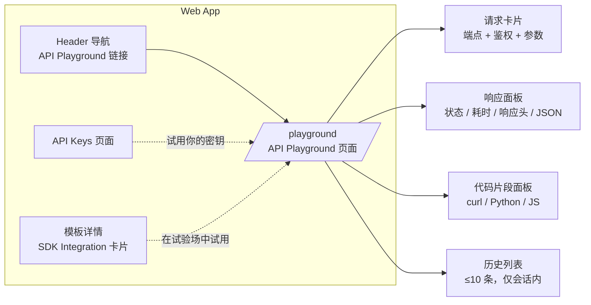
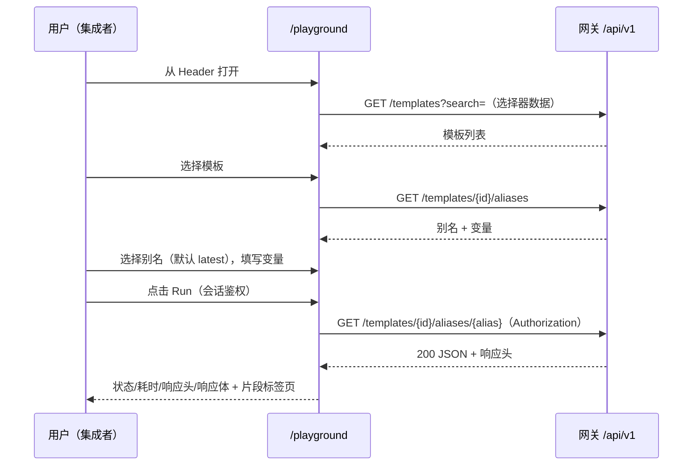
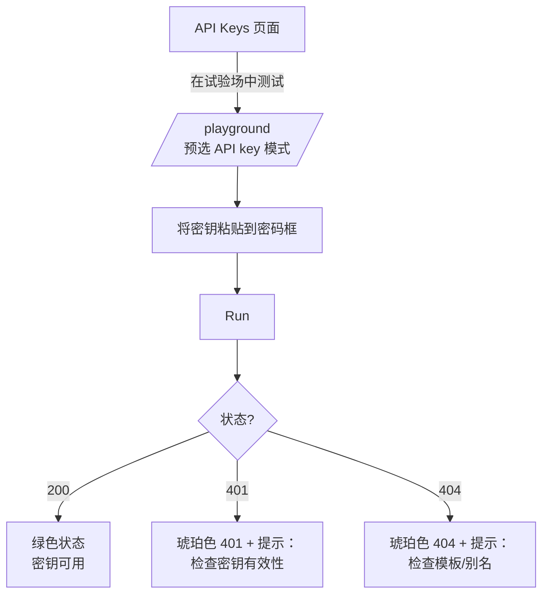

# API Playground — UI/UX 设计

- **Feature ID:** api-playground
- **Version:** 1.0
- **Status:** Proposed（待架构评审）
- **Author:** ui-ux-agent
- **Date:** 2026-10-12
- **Companion doc:** `api-playground-requirements-zh-CN.md`

## 1. 设计原则

1. **零配置试用。** 登录会话开箱即用；API key 是可选的，绝不是看到第一个响应的必要条件。
2. **表单优于裸 JSON。** 选择器与自动生成的变量输入防止路径参数和占位符拼写错误 —— 这是最常见的两类集成错误。
3. **忠实于真实代码。** API key 模式发送的请求头与服务端代码完全一致；代码片段以 `YOUR_API_KEY` 占位符镜像表单状态。
4. **冷静的技术美感。** Aurora 设计系统内的开发者工具：代码用等宽字体，留白充足，状态色只用于表达含义。
5. **一个端点，做到极致。** v1 只有单个只读端点；布局必须让它显得完整而非受限。

## 2. 信息架构



| 界面 | 位置 | 内容 |
|---|---|---|
| `/playground` 页面 | `App.js` 新路由，需登录 | 请求卡片、响应面板、代码片段面板、历史列表 |
| Header 导航 | 桌面导航 + 用户下拉 | "API Playground" 链接（图标：终端） |
| 模板详情 | SDK Integration 卡片 | "在试验场中试用" 按钮（深链，预选模板） |
| API Keys 页面 | 密钥列表行操作 | "在试验场中测试" 操作（深链，预选 API key 模式） |
| 管理控制台 | — | v1 无 |

## 3. 用户流程

### 3.1 首次成功请求（会话鉴权）



### 3.2 验证 API key



## 4. 页面布局

### 4.1 `/playground` — 桌面（≥1024px）

```
┌──────────────────────────────────────────────────────────────────────────┐
│ Header  [Logo]  Home  Templates  Collections  API Playground   [user ▾]  │
├──────────────────────────────────────────────────────────────────────────┤
│  API Playground                                    [Docs ↗] [History ▾] │
│  在浏览器中直接试用 Open Prompts API。                                     │
│┌──────────────────────────────┬──────────────────────────────────────────┐
││ REQUEST                      │ RESPONSE                                 │
││ ┌──────────────────────────┐ │ ┌──────────────────────────────────────┐ │
││ │ GET  /api/v1/templates/  │ │ │ ● 200 OK                    142 ms   │ │
││ │      {template_id}/      │ │ │ [Headers ▾] [Body ▾]                 │ │
││ │      aliases/{alias}     │ │ │ ┌──────────────────────────────────┐ │ │
││ └──────────────────────────┘ │ │ │ {                                  │ │ │
││ Template   [▼ Search…      ] │ │ │   "id": 42,                       │ │ │
││ Alias      [▼ latest      ] │ │ │   "content": "Translate $$text$$…",│ │ │
││ ── Authentication ────────── │ │ │   "variables": ["text"],           │ │ │
││ (•) Session  ( ) API key    │ │ │   …                                │ │ │
││ [••••••••••••]  [👁]         │ │ │ }                                  │ │ │
││ ── Variables ─────────────── │ │ └──────────────────────────────────┘ │ │
││ text      [______________]  │ └──────────────────────────────────────┘ │
││ tone      [______________]  │ ┌──────────────────────────────────────┐ │
││                              │ │ [curl] [Python] [JavaScript]  [📋]   │ │
││ [ ▶ Run request ]            │ │ curl "https://…/templates/42/        │ │
││                              │ │  aliases/latest" \                   │ │
││                              │ │  -H "X-API-Key: YOUR_API_KEY"        │ │
│└──────────────────────────────┴─┴──────────────────────────────────────┘ │
│  History (this session)                                                  │
│  ┌ 14:32  template "Code Reviewer" · latest · session · 200 · 142 ms ┐  │
│  └ 14:29  template "Translator" · v2 · api-key · 401 · 89 ms        ┘  │
└──────────────────────────────────────────────────────────────────────────┘
```

### 4.2 `/playground` — 移动端（<768px，堆叠）

```
┌───────────────────────────┐
│ Header        [☰]  [user] │
├───────────────────────────┤
│ API Playground            │
│ ┌───────────────────────┐ │
│ │ REQUEST               │ │
│ │ GET /templates/{id}/  │ │
│ │ aliases/{alias}       │ │
│ │ Template [▼ Search… ] │ │
│ │ Alias    [▼ latest  ] │ │
│ │ (•)Session ( )API key │ │
│ │ [•••••••] [👁]        │ │
│ │ Variables…            │ │
│ │ [ ▶ Run ]             │ │
│ └───────────────────────┘ │
│ ┌───────────────────────┐ │
│ │ RESPONSE  ● 200 ·142ms│ │
│ │ [Body ▾]              │ │
│ └───────────────────────┘ │
│ ┌───────────────────────┐ │
│ │ [curl][Py][JS] [📋]   │ │
│ └───────────────────────┘ │
│ History（≤10 条，折叠）    │
└───────────────────────────┘
```

## 5. 组件规格

| 组件 | 基于 / 新建 | 规格 |
|---|---|---|
| `PlaygroundPage` | `pages/` 新页面 | 双栏网格（请求 5fr / 响应 7fr），1024px 以下堆叠；页头含标题 + 描述 |
| `EndpointCard` | 新建 | 只读方法徽标（`GET`，绿色）+ 等宽字体路径，高亮 `{template_id}`/`{alias}`；v1 不可编辑 |
| `TemplatePicker` | 复用 Home 筛选的搜索下拉模式 | 可搜索异步下拉；展示标题 + 分类 chip；搜索防抖 |
| `AliasPicker` | 新建，样式与现有 select 一致 | 选项来自别名 API；`latest` 置顶；允许自由输入（运行时校验） |
| `AuthSelector` | 新建 | 单选组 `Session` / `API key`；密钥输入框 `type="password"` + 眼睛切换，仅 API key 模式显示 |
| `VariablesFieldList` | 镜像 TemplateDetails 生成器输入 | 每个 `$$var$$` 一个带标签输入框；占位符显示变量名 |
| `RunButton` | 样式与主按钮一致 | 主色、播放图标，请求进行中禁用 + 加载指示 |
| `ResponsePane` | 新建 | 状态胶囊（绿/琥珀/红）、耗时、可折叠的 Headers 与 Body 区；JSON 语法高亮，超过 100 项的数组折叠 |
| `SnippetTabs` | 复用 TemplateDetails SDK 卡片标签模式 | 标签页 `curl` / `Python` / `JavaScript`；复制按钮带已复制反馈；等宽代码块 |
| `HistoryList` | 新建 | 仅会话内列表，≤10 条，最新在前；每行：时间、模板标题、别名、鉴权模式图标、状态胶囊、耗时；点击即恢复 |
| `PlaygroundLink` | 新建小按钮 | "在试验场中试用"（模板详情 SDK 卡片）与"在试验场中测试"（API Keys 行）—— 深链 `/playground?template={id}` 与 `/playground?auth=api-key` |

## 6. 交互细节

1. **深链。** `/playground?template={id}` 预选模板并拉取别名；`/playground?auth=api-key` 预选 API key 模式（供 API Keys 页面使用）；两个参数可组合。
2. **Run 流程。** 点击 Run → 按钮禁用 + 加载指示 → 发起请求 → 响应面板更新（或错误状态）→ 历史记录前置。重跑会原地替换上一个响应（不堆叠）。
3. **鉴权模式切换。** 切到 API key 显示密码框；切回 Session 隐藏并从状态中清除密钥（绝不存储）。
4. **变量输入。** 选择别名后生成；空值以空字符串发送（与 SDK 行为一致）；片段反映当前值。
5. **片段复制。** 复制按钮写入当前标签页的片段；密钥始终渲染为 `YOUR_API_KEY`；上方小字提醒用户替换。
6. **历史恢复。** 点击记录恢复模板/别名/鉴权模式/变量并重新渲染存储的响应（不自动重跑）。
7. **错误提示。** 401 → "请检查 API key 是否有效且处于激活状态"；403 → "该密钥可能缺少权限或你的账号受限"；404 → "请检查模板 id 与别名"；429 → "已达限流阈值 —— 稍候重试"；网络错误 → 重试按钮。
8. **键盘。** 表单任意位置 `Cmd/Ctrl+Enter` 运行请求；选择器与标签页遵循标准焦点/方向键模式。

## 7. 状态汇总

| 状态 | 触发 | UI |
|---|---|---|
| 加载（初始） | 页面打开，选择器数据拉取中 | Template 选择器骨架行；Run 禁用 |
| 空态（未选模板） | 未选择模板 | 别名选择器与变量禁用，辅助文案"请先选择模板" |
| 加载（运行） | 请求进行中 | Run 加载指示；响应面板显示 shimmer 占位 |
| 成功 | 2xx | 绿色状态胶囊、耗时、响应头 + 响应体 |
| 错误（HTTP） | 4xx/5xx | 琥珀/红胶囊、服务端消息、通俗提示 |
| 错误（网络） | 请求发送失败 | 友好错误卡片 + Retry 按钮 |
| 空态（历史） | 尚未运行 | "还没有请求 —— 在上方运行你的第一个请求" |
| 历史已满 | 第 11 次运行 | 丢弃最旧记录（列表上限 10 条） |

## 8. 国际化考量（EN/ZH）

- 所有文案位于 `frontend/src/locales/{en,zh}/translation.json` 的 `playground.*` 下，匹配现有键结构。
- 关键术语："API Playground" / "API 试验场"；"Run request" / "运行请求"；"Session" / "会话"；"API key" / "API 密钥"；"History (this session)" / "历史（本次会话）"；"Try in Playground" / "在试验场中试用"；"Test in Playground" / "在试验场中测试"。
- 状态提示需翻译；HTTP 状态码与 JSON 键保持不译（技术常量）。
- 片段代码绝不翻译；只翻译其上方说明文字。
- 中文按现有语言包惯例在技术术语（API、JSON）旁使用半角括号。

## 9. 无障碍

- 全键盘可操作：选择器（combobox 模式）、单选组、变量输入、Run（`Cmd/Ctrl+Enter` 快捷键以 tooltip 说明）、片段标签页（tablist 模式）、历史行（按钮）。
- 状态胶囊颜色与文字并用（绝不只靠颜色）；两种主题下对比度 ≥ 4.5:1。
- 响应到达通过 `aria-live="polite"` 播报（"Response 200, 142 milliseconds"）。
- JSON 响应体区域是带标签的区域（`role="region"`、`aria-label`）便于屏幕阅读器导航；折叠的数组播报其条目数。
- 焦点管理：Run 完成后焦点保持在 Run 按钮上（响应被播报，而非聚焦）。

## 10. 数据分析（可选，若 analytics 功能上线）

- `playground_opened`、`playground_run`（鉴权模式、状态分桶）、`playground_snippet_copied`（语言）、`playground_key_tested`（来自 API Keys 页面深链）。

## 11. 不做范围（与需求文档 §8 一致）

- LLM 执行 / 模型厂商调用（试验场绝不调用 AI 模型）。
- 管理 API 探索、服务端历史、保存的集合。
- POST/PUT/DELETE 端点、原始 JSON 请求编辑、Mock 模式。
- 任何形式的变现。
