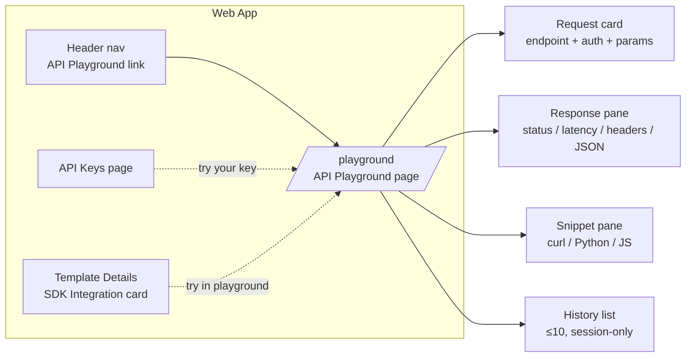
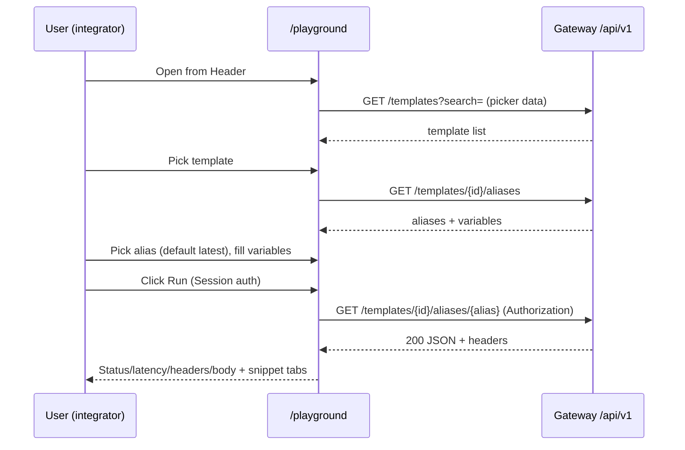
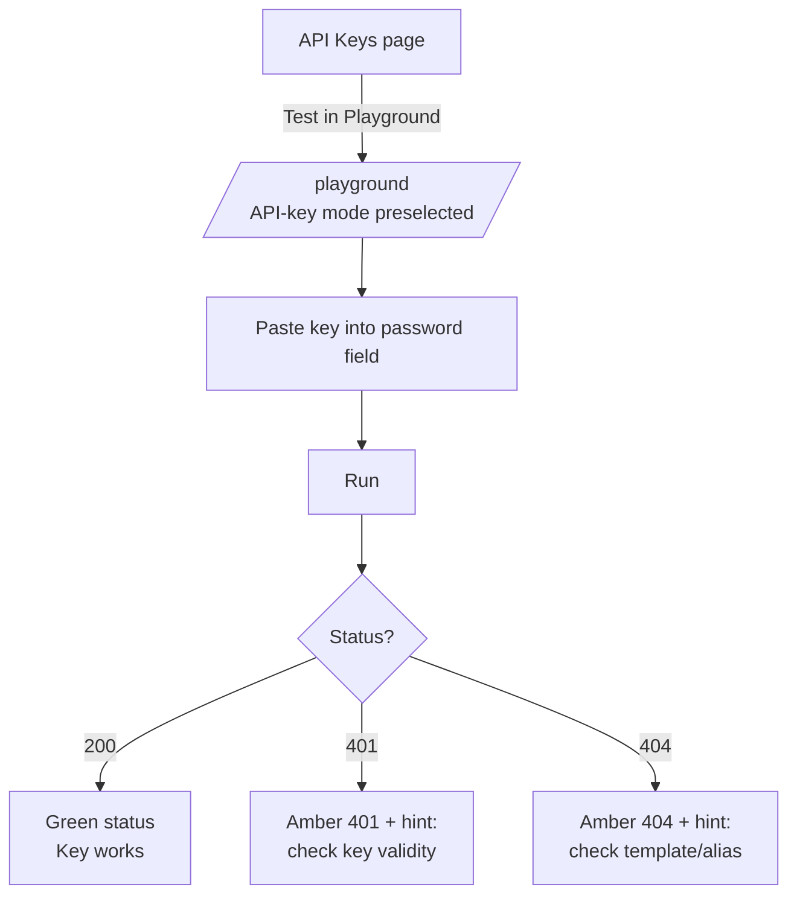

# API Playground — UI/UX Design

- **Feature ID:** api-playground
- **Version:** 1.0
- **Status:** Proposed (for architecture review)
- **Author:** ui-ux-agent
- **Date:** 2026-10-12
- **Companion doc:** `api-playground-requirements.md`

## 1. Design Principles

1. **Zero-setup trial.** The logged-in session works out of the box; an API key is optional, never required to see a first response.
2. **Form over raw JSON.** Pickers and generated variable inputs prevent path-param and placeholder typos — the two most common integration errors.
3. **Faithful to real code.** API-key mode sends exactly the headers server-side code would send; snippets mirror the form state with a `YOUR_API_KEY` placeholder.
4. **Calm, technical aesthetic.** A developer tool inside the Aurora design system: monospace for code, generous spacing, status colors used only for meaning.
5. **One endpoint, done well.** v1 is a single read-only endpoint; the layout must make it feel complete rather than limited.

## 2. Information Architecture



| Surface | Location | Contents |
|---|---|---|
| `/playground` page | New route in `App.js`, authenticated | Request card, response pane, snippet pane, history list |
| Header nav | Desktop nav + user dropdown | "API Playground" link (icon: terminal) |
| Template Details | SDK Integration card | "Try in Playground" button (deep link with template preselected) |
| API Keys page | Key list row actions | "Test in Playground" action (deep link, API-key mode preselected) |
| Admin console | — | None in v1 |

## 3. User Flows

### 3.1 First successful request (session auth)



### 3.2 Verify an API key



## 4. Page Layouts

### 4.1 `/playground` — desktop (≥1024px)

```
┌──────────────────────────────────────────────────────────────────────────┐
│ Header  [Logo]  Home  Templates  Collections  API Playground   [user ▾]  │
├──────────────────────────────────────────────────────────────────────────┤
│  API Playground                                    [Docs ↗] [History ▾] │
│  Try the Open Prompts API right in your browser.                         │
│┌──────────────────────────────┬──────────────────────────────────────────┐
││ REQUEST                      │ RESPONSE                                 │
││ ┌──────────────────────────┐ │ ┌──────────────────────────────────────┐ │
││ │ GET  /api/v1/templates/  │ │ │ ● 200 OK                    142 ms   │ │
││ │      {template_id}/      │ │ │ [Headers ▾] [Body ▾]                 │ │
││ │      aliases/{alias}     │ │ │ ┌──────────────────────────────────┐ │ │
││ └──────────────────────────┘ │ │ │ {                                  │ │ │
││ Template   [▼ Search…      ] │ │ │   "id": 42,                       │ │ │
││ Alias      [▼ latest      ] │ │ │   "content": "Translate $$text$$…",│ │ │
││ ── Authentication ────────── │ │ │   "variables": ["text"],           │ │ │
││ (•) Session  ( ) API key    │ │ │   …                                │ │ │
││ [••••••••••••]  [👁]         │ │ │ }                                  │ │ │
││ ── Variables ─────────────── │ │ └──────────────────────────────────┘ │ │
││ text      [______________]  │ └──────────────────────────────────────┘ │
││ tone      [______________]  │ ┌──────────────────────────────────────┐ │
││                              │ │ [curl] [Python] [JavaScript]  [📋]   │ │
││ [ ▶ Run request ]            │ │ curl "https://…/templates/42/        │ │
││                              │ │  aliases/latest" \                   │ │
││                              │ │  -H "X-API-Key: YOUR_API_KEY"        │ │
│└──────────────────────────────┴─┴──────────────────────────────────────┘ │
│  History (this session)                                                  │
│  ┌ 14:32  template "Code Reviewer" · latest · session · 200 · 142 ms ┐  │
│  └ 14:29  template "Translator" · v2 · api-key · 401 · 89 ms        ┘  │
└──────────────────────────────────────────────────────────────────────────┘
```

### 4.2 `/playground` — mobile (<768px, stacked)

```
┌───────────────────────────┐
│ Header        [☰]  [user] │
├───────────────────────────┤
│ API Playground            │
│ ┌───────────────────────┐ │
│ │ REQUEST               │ │
│ │ GET /templates/{id}/  │ │
│ │ aliases/{alias}       │ │
│ │ Template [▼ Search… ] │ │
│ │ Alias    [▼ latest  ] │ │
│ │ (•)Session ( )API key │ │
│ │ [•••••••] [👁]        │ │
│ │ Variables…            │ │
│ │ [ ▶ Run ]             │ │
│ └───────────────────────┘ │
│ ┌───────────────────────┐ │
│ │ RESPONSE  ● 200 ·142ms│ │
│ │ [Body ▾]              │ │
│ └───────────────────────┘ │
│ ┌───────────────────────┐ │
│ │ [curl][Py][JS] [📋]   │ │
│ └───────────────────────┘ │
│ History (≤10, collapsed)  │
└───────────────────────────┘
```

## 5. Component Specs

| Component | Based on / new | Spec |
|---|---|---|
| `PlaygroundPage` | New page in `pages/` | Two-column grid (request 5fr / response 7fr) → stacked below 1024px; page header with title + description |
| `EndpointCard` | New | Read-only method badge (`GET`, green) + monospace path with `{template_id}`/`{alias}` highlighted; no editing in v1 |
| `TemplatePicker` | Reuse search dropdown pattern from Home filters | Searchable async dropdown; shows title + category chip; debounced search |
| `AliasPicker` | New, styled like existing selects | Options from aliases API; `latest` first; free-text entry allowed (validated on run) |
| `AuthSelector` | New | Radio pair `Session` / `API key`; key input `type="password"` + eye toggle, shown only for API-key mode |
| `VariablesFieldList` | Mirrors TemplateDetails generator inputs | One labeled input per `$$var$$`; placeholder shows the variable name |
| `RunButton` | Styled like primary buttons | Primary color, play icon, disabled + spinner while in flight |
| `ResponsePane` | New | Status pill (green/amber/red), latency, collapsible Headers and Body sections; JSON syntax-highlighted, arrays >100 items collapsed |
| `SnippetTabs` | Reuse tab pattern from TemplateDetails SDK card | Tabs `curl` / `Python` / `JavaScript`; copy button with copied feedback; monospace block |
| `HistoryList` | New | Session-only list, ≤10 entries, newest first; each row: time, template title, alias, auth mode icon, status pill, latency; click = restore |
| `PlaygroundLink` | New small buttons | "Try in Playground" (Template Details SDK card) and "Test in Playground" (API Keys row) — deep links `/playground?template={id}` and `/playground?auth=api-key` |

## 6. Interaction Details

1. **Deep links.** `/playground?template={id}` preselects the template and fetches aliases; `/playground?auth=api-key` preselects API-key mode (used by the API Keys page); both params can combine.
2. **Run flow.** Click Run → button disabled + spinner → request fires → response pane updates (or error state) → history entry prepended. Re-run replaces the previous response in place (no stacking).
3. **Auth mode switch.** Switching to API key reveals the password field; switching back to Session hides it and clears the key from state (never stored).
4. **Variable inputs.** Generated after alias selection; empty values are sent as empty strings (matching the SDK behavior); the snippet reflects current values.
5. **Snippet copy.** Copy button writes the active tab's snippet; keys always render as `YOUR_API_KEY`; a small caption reminds users to replace it.
6. **History restore.** Clicking an entry restores template/alias/auth-mode/variables and re-renders the stored response (no automatic re-run).
7. **Error hints.** 401 → "Check that the API key is valid and active"; 403 → "This key may lack access or your account is restricted"; 404 → "Check the template id and alias name"; 429 → "Rate limit reached — wait a moment and retry"; network → retry button.
8. **Keyboard.** `Cmd/Ctrl+Enter` runs the request from anywhere in the form; pickers and tabs follow standard focus/arrow-key patterns.

## 7. States Summary

| State | Trigger | UI |
|---|---|---|
| Loading (initial) | Page open, picker data fetching | Skeleton rows in Template picker; Run disabled |
| Empty (no template) | No template selected | Alias picker + variables disabled with helper text "Select a template first" |
| Loading (run) | Request in flight | Run spinner; response pane shows shimmer placeholder |
| Success | 2xx | Green status pill, latency, headers + body |
| Error (HTTP) | 4xx/5xx | Amber/red pill, server message, plain-language hint |
| Error (network) | Request failed to send | Friendly error card + Retry button |
| Empty (history) | No runs yet | "No requests yet — run your first request above" |
| History full | 11th run | Oldest entry dropped (list capped at 10) |

## 8. i18n Considerations (EN/ZH)

- All strings under `playground.*` in `frontend/src/locales/{en,zh}/translation.json`, matching the existing key structure.
- Key terms: "API Playground" / "API 试验场"; "Run request" / "运行请求"; "Session" / "会话"; "API key" / "API 密钥"; "History (this session)" / "历史（本次会话）"; "Try in Playground" / "在试验场中试用"; "Test in Playground" / "在试验场中测试".
- Status hints translated; HTTP status codes and JSON keys remain untranslated (technical constants).
- Snippet code is never translated; only the caption above it.
- ZH uses half-width parentheses around technical terms (API、JSON) per existing locale conventions.

## 9. Accessibility

- Full keyboard operability: pickers (combobox pattern), radio group, variable inputs, Run (`Cmd/Ctrl+Enter` shortcut documented via tooltip), snippet tabs (tablist pattern), history rows (buttons).
- Status pills pair color with text (never color alone); contrast ≥ 4.5:1 in both themes.
- Response arrival announced via `aria-live="polite"` ("Response 200, 142 milliseconds").
- JSON body region is a labelled region (`role="region"`, `aria-label`) for screen-reader navigation; collapsed arrays are announced with their item count.
- Focus management: after Run completes, focus stays on the Run button (response is announced, not focused).

## 10. Analytics (optional, if analytics feature ships)

- `playground_opened`, `playground_run` (auth mode, status bucket), `playground_snippet_copied` (language), `playground_key_tested` (from API Keys page deep link).

## 11. Out of Scope (mirrors requirements §8)

- LLM execution / model provider calls (the playground never calls an AI model).
- Admin API exploration, server-side history, saved collections.
- POST/PUT/DELETE endpoints, raw JSON request editing, mock mode.
- Monetization of any kind.
