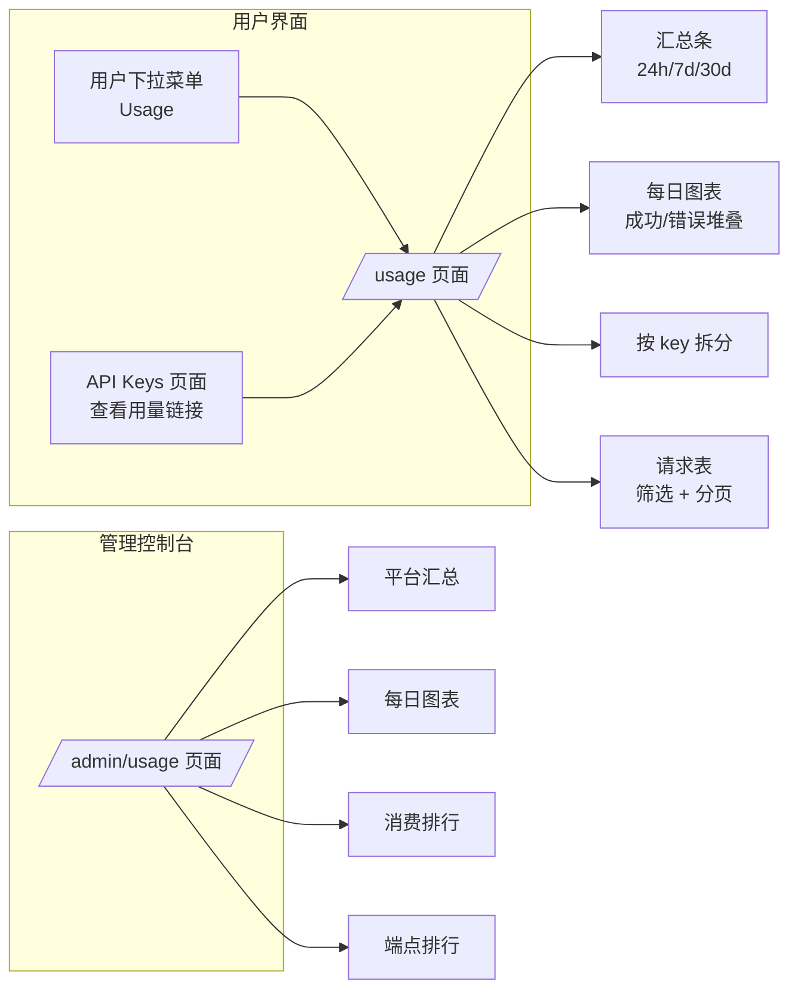
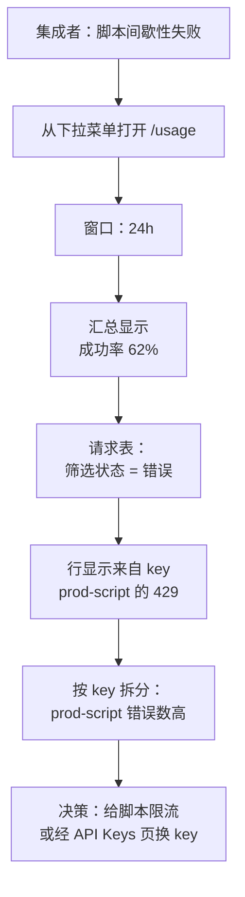
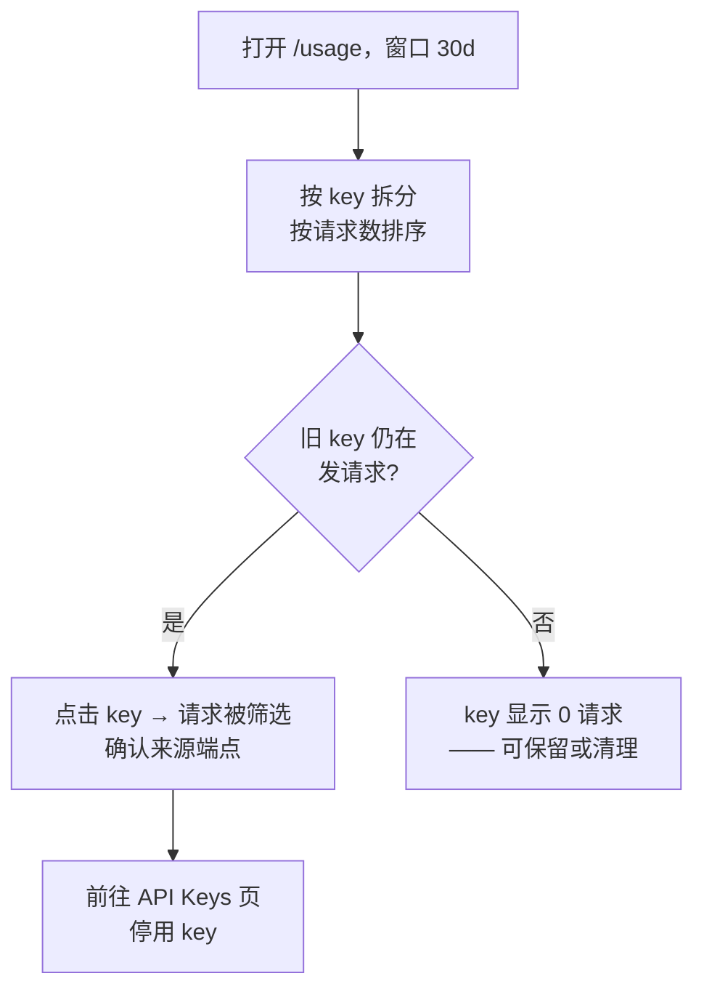

# API 使用历史 — UI/UX 设计

- **Feature ID:** api-usage-history
- **Version:** 1.0
- **Status:** Proposed（待架构评审）
- **Author:** ui-ux-agent
- **Date:** 2026-10-12
- **Companion doc:** `api-usage-history-requirements-zh-CN.md`

## 1. 设计原则

1. **回答两个问题。** "我用了多少？"（汇总 + 图表）与"刚才发生了什么？"（请求表）—— 桌面端无需滚动即可同时看到。
2. **调试优先的表格。** 请求表是主力：紧凑、可筛选、状态颜色编码、最新在前。
3. **Key 是透镜。** 集成对应 key；按 key 拆分距一键筛选一切只有一步。
4. **冷静的数字。** Aurora 面板、汇总用大号数字，不为仪表盘而仪表盘。
5. **设计即隐私。** 一切限定所有者；管理员视图是聚合，与用户视图在视觉上区分。

## 2. 信息架构



| 界面 | 位置 | 内容 |
|---|---|---|
| `/usage` | 新路由，需登录 | 窗口切换、汇总条、每日图表、按 key 拆分、请求表 |
| 用户下拉菜单 | Header | "Usage" 入口（图标：活动） |
| API Keys 页面 | 现有页面 | 每 key 行"查看用量"链接（深链带 key 筛选）+ 页面级链接 |
| `/admin/usage` | 管理控制台导航（新条目） | 平台汇总、每日图表、消费排行、端点排行 |
| Dashboard | 未来 | 用量小部件（v1 不做） |

## 3. 用户流程

### 3.1 调试失败的集成



### 3.2 Key 卫生检查



## 4. 页面布局

### 4.1 `/usage` — 桌面（≥1024px）

```
┌──────────────────────────────────────────────────────────────────────────┐
│ Header  [Logo]  Home  Templates  Collections        [user ▾]             │
├──────────────────────────────────────────────────────────────────────────┤
│  API 用量                                               [24h|7d|30d]     │
│  你的 API 密钥发起的请求。                                               │
│ ┌────────────┬────────────┬────────────┬────────────┐                    │
│ │ 请求数      │ 成功率      │ 平均延迟    │ 密钥数      │                    │
│ │   1,284    │  96.7%     │  142 ms    │    3       │                    │
│ └────────────┴────────────┴────────────┴────────────┘                    │
│ ┌──────────────────────────────────────────────────────────────────────┐ │
│ │ 每日请求数                    [图表 | 表格]                           │ │
│ │  ▂ ▄ █ █ ▆ █ █ ▄ ▂ ▄ █ █ ▆ █ █ ▄ ▂ ▄ █ █ ▆ █ █ ▄ ▂ ▄ █ █            │ │
│ │  （绿 = 成功，红 = 错误，堆叠）               10月3日      10月10日    │ │
│ └──────────────────────────────────────────────────────────────────────┘ │
│ ┌──────────────────────────────────────────────────────────────────────┐ │
│ │ 按 API 密钥                                                           │ │
│ │ prod-script   sk-pr…  1,102 次   38 错误   最近使用 2 分钟前          │ │
│ │ ci-tests      sk-ci…     176 次    4 错误   最近使用 1 小时前         │ │
│ │ backup        sk-ba…       6 次    0 错误   最近使用 12 天前          │ │
│ └──────────────────────────────────────────────────────────────────────┘ │
│ ┌──────────────────────────────────────────────────────────────────────┐ │
│ │ 最近请求        [密钥: 全部 ▾] [状态: 全部 ▾]                          │ │
│ │ 时间        密钥          端点                        状态   延迟      │ │
│ │ 14:32:07   prod-script  /templates/{id}/aliases/{a}   200   128 ms   │ │
│ │ 14:31:58   prod-script  /templates/{id}/aliases/{a}   429    12 ms   │ │
│ │ 14:31:40   ci-tests     /templates/{id}/aliases/{a}   200    96 ms   │ │
│ │ ‹ 1 2 3 … 9 ›                                     25 / 页            │ │
│ └──────────────────────────────────────────────────────────────────────┘ │
└──────────────────────────────────────────────────────────────────────────┘
```

### 4.2 `/usage` — 移动端（<768px）

汇总卡片 2×2 网格；图表全宽（高 160px）；按 key 拆分为堆叠卡片；请求表横向滚动且时间列固定。

### 4.3 `/admin/usage` — 桌面

```
┌──────────────────────────────────────────────────────────────────────────┐
│ 管理控制台   仪表盘 | 用户 | 模板 | 审计 | API 用量                        │
├──────────────────────────────────────────────────────────────────────────┤
│  API 用量（平台）                                       [24h|7d|30d]     │
│ ┌────────────┬────────────┬────────────┬────────────┐                    │
│ │ 请求数      │ 错误率      │ 平均延迟    │ 活跃密钥    │                    │
│ │  48,210    │  2.1%      │  151 ms    │  87 个      │                    │
│ └────────────┴────────────┴────────────┴────────────┘                    │
│ ┌───────────────────────────────────────┬──────────────────────────────┐ │
│ │ 每日请求数（堆叠）                     │ 端点排行                      │ │
│ │  ▂▄█▆█▄▂▄█▆█                          │ /templates/{id}/aliases/{a}  │ │
│ │                                       │   46,001  (95.4%)            │ │
│ │                                       │ /templates/{id}              │ │
│ │                                       │    2,102  ( 4.4%)            │ │
│ └───────────────────────────────────────┴──────────────────────────────┘ │
│ ┌──────────────────────────────────────────────────────────────────────┐ │
│ │ 消费排行（按请求数）                                                   │ │
│ │ 用户           邮箱                    请求数    错误    占比          │ │
│ │ u_9f2a…       dev@example.com         12,004     210   24.9%        │ │
│ │ u_3c8b…       ci@team.example          8,872      95   18.4%        │ │
│ │ …                                                                    │ │
│ └──────────────────────────────────────────────────────────────────────┘ │
└──────────────────────────────────────────────────────────────────────────┘
```

## 5. 组件规格

| 组件 | 基于 / 新建 | 规格 |
|---|---|---|
| `UsagePage` | `pages/` 新页面 | 页头 + 窗口切换；区块堆叠；Aurora 面板样式 |
| `WindowToggle` | 新建分段控件 | 24h / 7d / 30d；默认 7d；选择持久化到 localStorage |
| `SummaryStrip` | 复用仪表盘统计卡模式 | 4 卡：请求数、成功率、平均延迟、使用的密钥；大号数字 |
| `DailyChart` | 新建（轻量柱状） | 成功/错误堆叠柱；零请求日为零高度柱；"图表/表格"切换以支持无障碍（表格：日期、成功、错误、合计） |
| `KeyBreakdown` | 新建表格 | key 名称、前缀、请求数、错误数、最近使用（相对时间）；点击行 → 设置请求表的 key 筛选；按请求数降序 |
| `RequestsTable` | 复用管理列表表格模式 | 列：时间（HH:mm:ss + 日期 tooltip）、key 名称、端点（等宽）、方法徽标、状态胶囊、延迟；筛选：key 下拉、状态下拉；分页 25/页 |
| `StatusPill` | 新建 | 2xx 绿、4xx 琥珀、5xx 红；始终带文字标签 |
| `EmptyState` | 复用模式 | "此期间没有 API 请求" + Playground 链接 |
| `AdminUsagePage` | `pages/admin/` 新页面 | 平台汇总、图表、端点排行、消费排行表；只读 |
| `UsageLink` | 新建小链接 | API Keys 行"查看用量" → `/usage?key={key_id}`（预置 key 筛选） |

## 6. 交互细节

1. **窗口切换**重新拉取汇总、图表与 key 拆分；请求表与窗口无关（始终最近、分页），但 key 筛选列表反映窗口。
2. **key 筛选**来自拆分行或 API Keys 深链（`/usage?key={id}`）时，预选请求表筛选并滚动到表格。
3. **状态筛选**选项：全部 / 成功（2xx）/ 错误（4xx、5xx）。
4. **图表/表格切换**将每日可视化切换为数据完全相同的无障碍表格。
5. **相对时间**（"2 分钟前"）配绝对时间戳 tooltip；表格时间列显示 HH:mm:ss，悬停显示完整日期。
6. **分页**遵循现有管理列表模式（‹ 1 2 3 … n ›）。
7. **加载**各区块独立（每面板骨架屏）；**错误**每面板独立带重试，单个查询失败不会清空整页。
8. **管理页**交互镜像用户页（窗口切换、图表切换），v1 无按用户下钻链接。

## 7. 状态汇总

| 状态 | 触发 | UI |
|---|---|---|
| 加载 | 区块拉取 | 每面板骨架行/骨架柱 |
| 空态（无用量） | 窗口内零请求 | 汇总为零、零高度柱、空拆分、表格 EmptyState |
| 空态（被筛选） | 筛选无匹配 | "没有符合筛选条件的请求" + 清除筛选按钮 |
| 错误（区块） | 查询失败 | 面板级错误卡 + 重试 |
| 成功 | 数据载入 | 完整面板；数字格式化（1,284；96.7%） |
| 管理：无数据 | 平台为空 | 相同空态模式，平台文案 |

## 8. 国际化考量（EN/ZH）

- 文案位于 `frontend/src/locales/{en,zh}/translation.json` 的 `usage.*` 与 `admin.usage.*` 下。
- 关键术语："API Usage" / "API 用量"；"Requests" / "请求数"；"Success rate" / "成功率"；"Avg latency" / "平均延迟"；"Keys used" / "使用的密钥"；"By API key" / "按 API 密钥"；"Recent requests" / "最近请求"；"View usage" / "查看用量"；"Top consumers" / "消费排行"；"Top endpoints" / "端点排行"；"No API requests in this period" / "此期间没有 API 请求"。
- 数字格式化使用语言环境分隔符；相对时间沿用现有 time-ago 工具/惯例。
- 端点路径与 HTTP 方法保持不译（技术常量）。

## 9. 无障碍

- 图表有表格替代（切换）及 `role="img"` + `aria-label` 摘要（"每日请求柱状图，10月3日至10日，峰值 210 于 10月7日"）。
- 状态胶囊颜色配文字；两种主题对比度 ≥ 4.5:1。
- 表格使用真实 `<table>` 标记与 `<th scope>`；筛选控件有标签；分页是带 aria-current 的导航。
- 窗口切换后汇总刷新使用区块级 `aria-live="polite"`。
- 全键盘导航；行、筛选、切换的焦点可见。

## 10. 数据分析（可选，若 analytics 功能上线）

- `usage_page_opened`、`usage_window_changed`（窗口）、`usage_key_filter_applied`、`usage_chart_toggled`（模式）。

## 11. 不做范围（与需求文档 §8 一致）

- 配额/限额执行、任何形式的变现。
- Web 会话流量、请求体、按请求详情页。
- CSV 导出、告警/webhook、聚合汇总、管理端按用户下钻。
