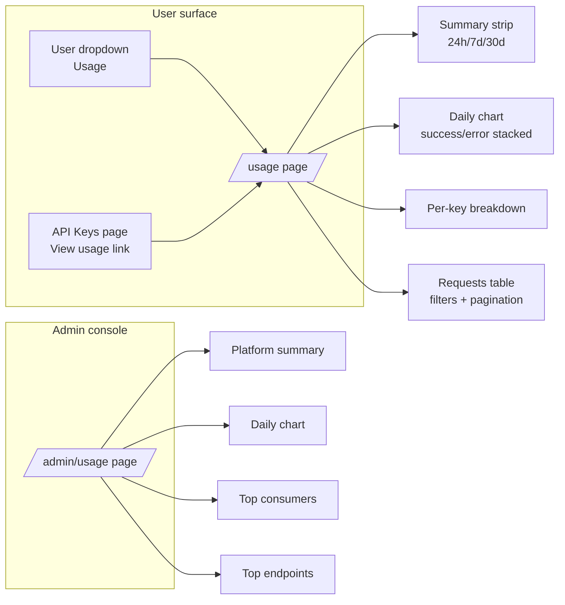
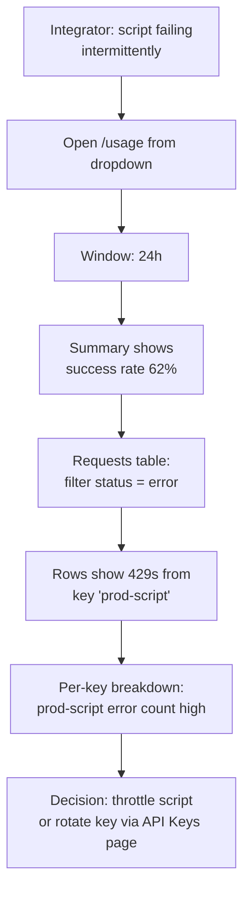
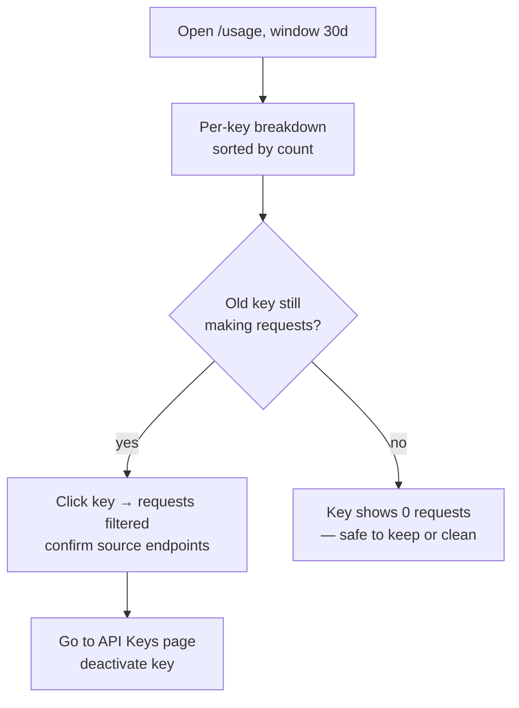

# API Usage History — UI/UX Design

- **Feature ID:** api-usage-history
- **Version:** 1.0
- **Status:** Proposed (for architecture review)
- **Author:** ui-ux-agent
- **Date:** 2026-10-12
- **Companion doc:** `api-usage-history-requirements.md`

## 1. Design Principles

1. **Answer two questions.** "How much am I using?" (summary + chart) and "What just happened?" (requests table) — both visible without scrolling on desktop.
2. **Debug-first table.** The requests table is the workhorse: dense, filterable, color-coded by status, newest first.
3. **Keys are the lens.** Integrations map to keys; the per-key breakdown is one click from filtering everything.
4. **Calm numbers.** Aurora panels, large numerals for the summary, no dashboards-for-the-sake-of-it.
5. **Privacy by design.** Everything owner-scoped; the admin view is aggregates, visually distinct from the user view.

## 2. Information Architecture



| Surface | Location | Contents |
|---|---|---|
| `/usage` | New route, authenticated | Window toggle, summary strip, daily chart, per-key breakdown, requests table |
| User dropdown | Header | "Usage" entry (icon: activity) |
| API Keys page | Existing page | "View usage" link per key row (deep link with key filter) + page-level link |
| `/admin/usage` | Admin console nav (new entry) | Platform summary, daily chart, top consumers, top endpoints |
| Dashboard | Future | Usage widget (out of scope v1) |

## 3. User Flows

### 3.1 Debug a failing integration



### 3.2 Key hygiene review



## 4. Page Layouts

### 4.1 `/usage` — desktop (≥1024px)

```
┌──────────────────────────────────────────────────────────────────────────┐
│ Header  [Logo]  Home  Templates  Collections        [user ▾]             │
├──────────────────────────────────────────────────────────────────────────┤
│  API Usage                                              [24h|7d|30d]     │
│  Requests made with your API keys.                                       │
│ ┌────────────┬────────────┬────────────┬────────────┐                    │
│ │ REQUESTS   │ SUCCESS    │ AVG        │ KEYS       │                    │
│ │    1,284   │   96.7%    │  142 ms    │     3      │                    │
│ └────────────┴────────────┴────────────┴────────────┘                    │
│ ┌──────────────────────────────────────────────────────────────────────┐ │
│ │ Requests per day            [chart | table]                          │ │
│ │  ▂ ▄ █ █ ▆ █ █ ▄ ▂ ▄ █ █ ▆ █ █ ▄ ▂ ▄ █ █ ▆ █ █ ▄ ▂ ▄ █ █            │ │
│ │  (green = success, red = error, stacked)      Oct 3      Oct 10     │ │
│ └──────────────────────────────────────────────────────────────────────┘ │
│ ┌──────────────────────────────────────────────────────────────────────┐ │
│ │ By API key                                                           │ │
│ │ prod-script   sk-pr…  1,102 reqs   38 errors   last used 2m ago      │ │
│ │ ci-tests      sk-ci…     176 reqs    4 errors   last used 1h ago     │ │
│ │ backup        sk-ba…       6 reqs    0 errors   last used 12d ago    │ │
│ └──────────────────────────────────────────────────────────────────────┘ │
│ ┌──────────────────────────────────────────────────────────────────────┐ │
│ │ Recent requests     [key: all ▾] [status: all ▾]                     │ │
│ │ TIME       KEY          ENDPOINT                    STATUS  LATENCY  │ │
│ │ 14:32:07   prod-script  /templates/{id}/aliases/{a}   200    128 ms  │ │
│ │ 14:31:58   prod-script  /templates/{id}/aliases/{a}   429     12 ms  │ │
│ │ 14:31:40   ci-tests     /templates/{id}/aliases/{a}   200     96 ms  │ │
│ │ ‹ 1 2 3 … 9 ›                                    25 / page          │ │
│ └──────────────────────────────────────────────────────────────────────┘ │
└──────────────────────────────────────────────────────────────────────────┘
```

### 4.2 `/usage` — mobile (<768px)

Summary cards in a 2×2 grid; chart full-width (height 160px); per-key breakdown as stacked cards; requests table horizontally scrollable with sticky time column.

### 4.3 `/admin/usage` — desktop

```
┌──────────────────────────────────────────────────────────────────────────┐
│ Admin Console   Dashboard | Users | Templates | Audit | API Usage         │
├──────────────────────────────────────────────────────────────────────────┤
│  API Usage (platform)                                   [24h|7d|30d]     │
│ ┌────────────┬────────────┬────────────┬────────────┐                    │
│ │ REQUESTS   │ ERROR      │ AVG        │ ACTIVE     │                    │
│ │   48,210   │   2.1%     │  151 ms    │  87 keys   │                    │
│ └────────────┴────────────┴────────────┴────────────┘                    │
│ ┌───────────────────────────────────────┬──────────────────────────────┐ │
│ │ Requests per day (stacked)            │ Top endpoints                │ │
│ │  ▂▄█▆█▄▂▄█▆█                          │ /templates/{id}/aliases/{a}  │ │
│ │                                       │   46,001  (95.4%)            │ │
│ │                                       │ /templates/{id}              │ │
│ │                                       │    2,102  ( 4.4%)            │ │
│ └───────────────────────────────────────┴──────────────────────────────┘ │
│ ┌──────────────────────────────────────────────────────────────────────┐ │
│ │ Top consumers (by requests)                                          │ │
│ │ USER            EMAIL                 REQUESTS   ERRORS   SHARE      │ │
│ │ u_9f2a…        dev@example.com         12,004      210   24.9%      │ │
│ │ u_3c8b…        ci@team.example          8,872       95   18.4%      │ │
│ │ …                                                                    │ │
│ └──────────────────────────────────────────────────────────────────────┘ │
└──────────────────────────────────────────────────────────────────────────┘
```

## 5. Component Specs

| Component | Based on / new | Spec |
|---|---|---|
| `UsagePage` | New page in `pages/` | Page header + window toggle; sections stacked; Aurora panel styling |
| `WindowToggle` | New segmented control | 24h / 7d / 30d; default 7d; persists choice in localStorage |
| `SummaryStrip` | Reuse dashboard stat-card pattern | 4 cards: requests, success rate, avg latency, keys used; large numerals |
| `DailyChart` | New (lightweight bars) | Stacked bars success/error; zero-days as zero-height; "chart/table" toggle for a11y (table: date, success, error, total) |
| `KeyBreakdown` | New table | Key name, prefix, request count, error count, last used (relative time); row click → sets requests-table key filter; sorted by count desc |
| `RequestsTable` | Reuse admin list-table patterns | Columns: time (HH:mm:ss + date tooltip), key name, endpoint (monospace), method badge, status pill, latency; filters: key dropdown, status dropdown; pagination 25/page |
| `StatusPill` | New | 2xx green, 4xx amber, 5xx red; text label always present |
| `EmptyState` | Reuse pattern | "No API requests in this period" + Playground link |
| `AdminUsagePage` | New page in `pages/admin/` | Platform summary, chart, top endpoints list, top consumers table; read-only |
| `UsageLink` | New small link | "View usage" on API Keys rows → `/usage?key={key_id}` (pre-applies key filter) |

## 6. Interaction Details

1. **Window toggle** refetches summary, chart, and key breakdown; the requests table is window-independent (always recent, paginated) but the key filter list reflects the window.
2. **Key filter** from breakdown row or API Keys deep link (`/usage?key={id}`) pre-selects the key in the requests filter and scrolls to the table.
3. **Status filter** options: All / Success (2xx) / Error (4xx, 5xx).
4. **Chart/table toggle** switches the daily visualization to an accessible table with identical data.
5. **Relative times** ("2m ago") with absolute timestamp tooltips; table time column shows HH:mm:ss with full date on hover.
6. **Pagination** follows the existing admin list pattern (‹ 1 2 3 … n ›).
7. **Loading** each section independently (skeleton per panel); **error** per panel with retry, so one failing query doesn't blank the page.
8. **Admin page** interactions mirror the user page (window toggle, chart toggle) with no per-user drill-down links in v1.

## 7. States Summary

| State | Trigger | UI |
|---|---|---|
| Loading | Section fetch | Skeleton rows/bars per panel |
| Empty (no usage) | Zero requests in window | Summary zeros, zero-height bars, empty breakdown, EmptyState in table |
| Empty (filtered) | Filter matches nothing | "No requests match these filters" + clear-filters button |
| Error (section) | Query fails | Panel-level error card + Retry |
| Success | Data loaded | Full panels; numbers formatted (1,284; 96.7%) |
| Admin: no data | Platform empty | Same empty patterns, platform copy |

## 8. i18n Considerations (EN/ZH)

- Strings under `usage.*` and `admin.usage.*` in `frontend/src/locales/{en,zh}/translation.json`.
- Key terms: "API Usage" / "API 用量"; "Requests" / "请求数"; "Success rate" / "成功率"; "Avg latency" / "平均延迟"; "Keys used" / "使用的密钥"; "By API key" / "按 API 密钥"; "Recent requests" / "最近请求"; "View usage" / "查看用量"; "Top consumers" / "消费排行"; "Top endpoints" / "端点排行"; "No API requests in this period" / "此期间没有 API 请求".
- Number formatting via locale-aware separators; relative times via existing time-ago utilities/conventions.
- Endpoint paths and HTTP methods remain untranslated (technical constants).

## 9. Accessibility

- Chart has a table alternative (toggle) and `role="img"` + `aria-label` summary ("Bar chart of daily requests, October 3 to 10, peak 210 on October 7").
- Status pills pair color with text; contrast ≥ 4.5:1 both themes.
- Tables use real `<table>` markup with `<th scope>`; filter controls are labelled; pagination is a nav with aria-current.
- Section-level `aria-live="polite"` for summary refresh after window change.
- Full keyboard navigation; focus visible on rows, filters, toggle.

## 10. Analytics (optional, if analytics feature ships)

- `usage_page_opened`, `usage_window_changed` (window), `usage_key_filter_applied`, `usage_chart_toggled` (mode).

## 11. Out of Scope (mirrors requirements §8)

- Quotas/limits enforcement, monetization of any kind.
- Web-session traffic, request bodies, per-request detail pages.
- CSV export, alerts/webhooks, aggregate rollups, admin per-user drill-down.
