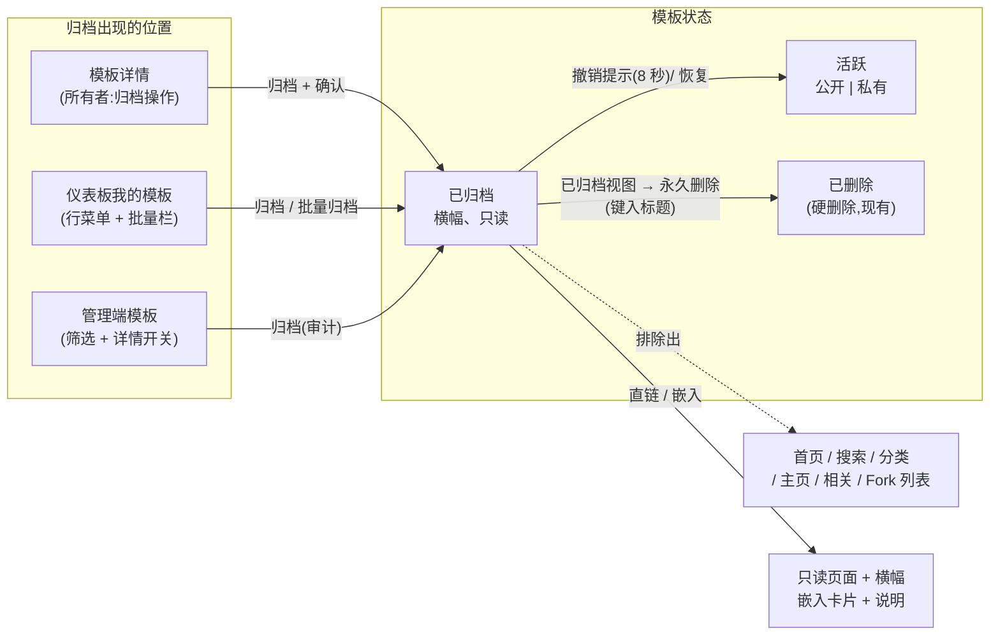
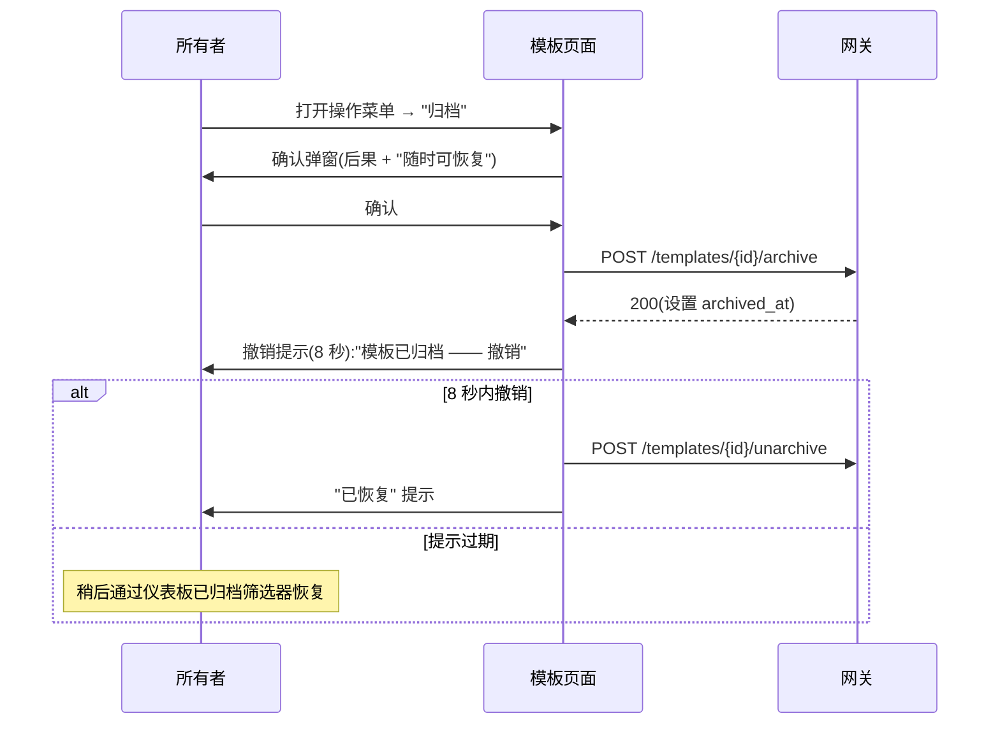

# 归档模板(Archive Templates)— UI/UX 设计

- **功能 ID:** archive-templates
- **版本:** 1.0
- **状态:** 已提议(待架构评审)
- **作者:** ui-ux-agent
- **日期:** 2026-10-12
- **相关需求文档:** [archive-templates-requirements-zh-CN.md](./archive-templates-requirements-zh-CN.md)

## 1. 设计原则

1. **归档是安全的,且感觉安全。** 每个确认都说 "你随时可以恢复";撤销提示让可逆性可感知。
2. **退役即隐身 —— 直链除外。** 发现表面展示零归档内容;直链总是有效并带诚实的横幅。
3. **已归档视图是档案柜,不是墓地。** 冷静、实用,恢复是主操作,永久删除刻意藏在键入确认之后。
4. **不引入新模式。** 筛选芯片、操作菜单、确认弹窗、提示 —— 全部复用现有组件;归档增加的是状态,不是外壳。

## 2. 信息架构



## 3. 用户流程

### 3.1 从详情页归档(带撤销)



### 3.2 访客打开已归档模板

```mermaid
sequenceDiagram
    participant V as 访客
    participant P as 已归档模板页面
    V->>P: 跟随直链(旧书签 / fork 署名)
    P->>V: 横幅:"此模板已归档" + 内容(只读)
    Note over P: 点赞/收藏/评论/Fork 控件隐藏<br/>现有评论可见
    V->>V: 阅读内容;无可用操作
```

### 3.3 管理已归档模板(仪表板)

```mermaid
sequenceDiagram
    participant O as 所有者
    participant D as 仪表板(已归档筛选)
    participant API as 网关
    O->>D: 切换筛选到 "已归档"
    D->>O: 已归档模板列表(变淡的行)
    alt 恢复
        O->>D: 点击 "恢复"
        D->>API: POST /templates/{id}/unarchive
        API-->>D: 200
        D->>O: 行离开列表;"已恢复" 提示
    else 永久删除
        O->>D: 点击 "永久删除"
        D->>O: 弹窗:键入模板标题
        O->>D: 键入确切标题 → 确认
        D->>API: DELETE /templates/{id}
        D->>O: 行离开列表;永久消失
    end
```

## 4. 页面布局(线框图)

### 4.1 归档确认弹窗

```
┌────────────────────────────────────────────────────────────┐
│  归档 "代码审查助手"?                              [×]     │
├────────────────────────────────────────────────────────────┤
│  此模板将从以下位置消失:                                   │
│    • 公开列表、搜索和你的主页                               │
│    • 仪表板默认视图                                        │
│                                                            │
│  保留的内容:                                               │
│    ✓ 直链继续有效(只读)                                  │
│    ✓ 现有 fork 和嵌入继续工作                              │
│    ✓ 点赞、评论和版本保留                                  │
│                                                            │
│  你随时可以从仪表板恢复。                                   │
├────────────────────────────────────────────────────────────┤
│                          [ 取消 ]  [ 归档 ]                │
└────────────────────────────────────────────────────────────┘
```

### 4.2 已归档模板详情页(访客视图)

```
┌────────────────────────────────────────────────────────────┐
│ ┌────────────────────────────────────────────────────────┐ │
│ │ 🗄  此模板已归档 —— 作者不再积极维护。                  │ │
│ └────────────────────────────────────────────────────────┘ │
│ 代码审查助手                                     v8        │
│ 👤 作者 · 128 赞 · 12 评论                                 │
│                                                            │
│ [内容 —— 只读,完整详情页与今天一致]                        │
│                                                            │
│ ── 评论(12)──────────────────────────────────────────    │
│ [现有评论正常渲染;输入框隐藏]                              │
│                                                            │
│ (任何地方都没有 点赞/收藏/Fork/评论 按钮)                  │
└────────────────────────────────────────────────────────────┘
```

### 4.3 仪表板我的模板 —— 筛选芯片 + 已归档行

```
┌────────────────────────────────────────────────────────────┐
│ 我的模板   ( 全部 ) ( 活跃● ) ( 已归档 )                   │
├────────────────────────────────────────────────────────────┤
│ 标题                 可见性      点赞   更新时间   ⋮       │
│ ────────────────────────────────────────────────────────── │
│ 代码审查助手         ● 公开      128   2 天前    ⋮        │
│ SQL 讲解器           ● 公开      64    1 周前    ⋮        │
└────────────────────────────────────────────────────────────┘

已归档筛选视图:
┌────────────────────────────────────────────────────────────┐
│ 我的模板   ( 全部 ) ( 活跃 ) ( 已归档● )                   │
├────────────────────────────────────────────────────────────┤
│ 标题                 归档于       点赞   操作              │
│ ────────────────────────────────────────────────────────── │
│ 文章润色器           3 周前       12    [恢复] [删除]      │
│ 旧 GPT-3 提示词      2 个月前     3     [恢复] [删除]      │
└────────────────────────────────────────────────────────────┘
```

### 4.4 行操作菜单(活跃模板,所有者)

```
⋮ ──────────────┐
│ 编辑           │
│ 归档           │
│ ────────────── │
│ 删除           │
└────────────────┘
```

### 4.5 永久删除弹窗(键入标题)

```
┌────────────────────────────────────────────────────────────┐
│  永久删除 "文章润色器"?                          [×]      │
├────────────────────────────────────────────────────────────┤
│  此操作不可撤销。模板及其版本、点赞、评论和别名            │
│  将被永久移除。现有 fork 将继续工作,                      │
│  但会失去与此模板的链接。                                   │
│                                                            │
│  键入模板标题以确认:                                       │
│  ┌──────────────────────┐                                  │
│  │                      │                                  │
│  └──────────────────────┘                                  │
├────────────────────────────────────────────────────────────┤
│              [ 取消 ]  [ 永久删除 ]                        │
└────────────────────────────────────────────────────────────┘
```

### 4.6 已归档模板的嵌入卡片

```
┌───────────────────────────────┐
│ 🗄 已归档                      │
│ ✦ 模板标题                    │
│ 👤 作者名                     │
│ [内容预览 —— 可见]            │
│ ⚡ Open Prompts    查看 →     │
└───────────────────────────────┘
```

## 5. 组件规格

### 5.1 `ArchivedBanner`(frontend/src/components/archive/ArchivedBanner.js)

详情页(和嵌入卡片)顶部的全宽信息横幅:图标 + `archive.banner` 文本;`role="status"`;无操作(访客无法恢复)。所有者自己的视图追加内联 "恢复" 操作。

### 5.2 `ArchiveConfirmModal`(frontend/src/components/archive/ArchiveConfirmModal.js)

Props:`template {title}`、`onConfirm`、`onClose`、`bulk?`(批量归档的计数模式:标题变为 "归档 {{count}} 个模板?")。按线框图的静态内容(消失自 / 保留列表);主操作 "归档"(非危险样式 —— 可逆)。

### 5.3 `DeletePermanentModal`(frontend/src/components/archive/DeletePermanentModal.js)

Props:`template {title}`、`onConfirm`、`onClose`。键入确认:输入必须与确切标题一致(区分大小写);匹配前确认按钮禁用;危险样式。正文枚举被销毁的内容和 fork 谱系后果。

### 5.4 `ArchiveFilterChips`(仪表板集成)

扩展现有筛选芯片行:全部 / 活跃 / 已归档(默认活跃)。已归档视图交换列(归档日期替代更新时间;恢复 + 删除操作替代 ⋮ 菜单)并轻微变淡行(`opacity: 0.75`)。

### 5.5 `UndoToast`(frontend/src/components/archive/UndoToast.js)

带 "模板已归档" + 撤销操作按钮的提示;8 秒自动消失;撤销调用取消归档并显示 "已恢复"。复用带操作槽的现有提示系统。

### 5.6 行操作菜单集成

模板行上的所有者 ⋮ 菜单和详情页操作行增加 "归档"(编辑和删除之间)。已归档视图中菜单被显式的 恢复/删除 按钮取代(无菜单 —— 这两个操作就是该视图的意义)。

### 5.7 嵌入页面集成

嵌入路由(embedding-widget)获取后检查 `archived_at`:已归档 → 渲染顶部带 `ArchivedBadge` 条的 `EmbedCard`(内容按 FR-8 仍可见);署名链接仍指向详情页。

## 6. 交互细节

1. **归档是一键 + 一次确认。** 无键入确认(可逆);弹窗的 "保留的内容" 列表承担安抚工作。
2. **撤销窗口:** 8 秒提示;过期后,恢复只需两次点击(筛选 → 恢复)。提示的撤销是真实按钮(48px+ 目标),不是文本链接。
3. **批量归档**使用 bulk-operations 栏:选择 N → 归档 → 计数确认弹窗 → 逐项结果提示。从已归档视图批量取消归档与之对应。
4. **已归档行变淡但完全可读** —— 退役而非删除;对比度保持在 AA 内。
5. **已归档页面上的互动控件被隐藏而非禁用** —— 没有变灰的点赞按钮引人发问 "为什么点不了";横幅中的一行解释只读状态。
6. **所有者查看自己的已归档模板**看到带内联 "恢复" 操作的横幅(一键,无弹窗 —— 可逆)。
7. **永久删除只能从已归档视图到达** —— 活跃列表的删除保持今天的流程;退役必须先于销毁。
8. **键入标题确认**区分大小写并修剪空白;不匹配显示内联 "标题不匹配"。
9. **筛选状态**在仪表板标签页会话中保持;切换标签页重置为活跃(默认)。
10. **管理控制台:** 模板列表增加 "已归档" 状态筛选选项和归档徽标;管理详情页有 归档/恢复 开关(审计)。

## 7. 状态汇总

| 表面 | 加载 | 空态 | 错误 | 成功 |
|---|---|---|---|---|
| 归档确认弹窗 | — | — | 409/5xx → 内联错误,弹窗保持 | 归档;撤销提示 |
| 撤销提示 | — | — | 撤销 API 失败 → 错误提示,模板保持归档 | "已恢复" 提示 |
| 已归档详情页 | 现有骨架 | — | 现有错误状态 | 横幅 + 只读内容 |
| 已归档筛选视图 | 行骨架 | "没有已归档的模板" 插图 + 文案 | 列表错误 → 重试行 | 变淡的行带操作 |
| 永久删除弹窗 | 按钮加载动画 | — | API 失败 → 内联错误,保持打开 | 行移除;确认提示 |
| 嵌入(已归档) | 嵌入骨架 | — | 不可用卡片(现有) | 卡片 + 已归档条 |

## 8. 国际化字符串表

命名空间:`archive.*`、`admin.archive.*`。键添加到 `frontend/src/locales/{en,zh}/translation.json`。

| 键 / 中文文案 | 英文 |
|---|---|
| `archive.action` / "归档" | "Archive" |
| `archive.confirmTitle` / "归档 \"{{title}}\"?" | "Archive \"{{title}}\"?" |
| `archive.confirmBulkTitle` / "归档 {{count}} 个模板?" | "Archive {{count}} templates?" |
| `archive.disappearsFrom` / "此模板将从以下位置消失:" | "This template will disappear from:" |
| `archive.disappearsItems` / "公开列表、搜索和你的主页;仪表板默认视图" | "Public listings, search, and your profile; Your dashboard's default view" |
| `archive.whatStays` / "保留的内容:" | "What stays:" |
| `archive.whatStaysItems` / "直链继续有效(只读);现有 fork 和嵌入继续工作;点赞、评论和版本保留" | "Direct links keep working (read-only); Existing forks and embeds keep working; Likes, comments and versions are preserved" |
| `archive.restoreAnytime` / "你随时可以从仪表板恢复。" | "You can restore it anytime from your dashboard." |
| `archive.confirm` / "归档" | "Archive" |
| `archive.cancel` / "取消" | "Cancel" |
| `archive.undoToast` / "模板已归档" | "Template archived" |
| `archive.undoAction` / "撤销" | "Undo" |
| `archive.restored` / "模板已恢复" | "Template restored" |
| `archive.banner` / "此模板已归档 —— 作者不再积极维护。" | "This template is archived — the author is no longer actively maintaining it." |
| `archive.bannerOwner` / "你已归档此模板。它已从公开表面隐藏。" | "You archived this template. It is hidden from public surfaces." |
| `archive.restore` / "恢复" | "Restore" |
| `archive.unarchive` / "取消归档" | "Unarchive" |
| `archive.filterAll` / "全部" | "All" |
| `archive.filterActive` / "活跃" | "Active" |
| `archive.filterArchived` / "已归档" | "Archived" |
| `archive.archivedEmpty` / "没有已归档的模板" | "No archived templates" |
| `archive.archivedEmptyBody` / "你归档的模板会出现在这里,供审查、恢复或永久删除。" | "Templates you archive will appear here for review, restore, or permanent deletion." |
| `archive.archivedColumn` / "归档于" | "Archived" |
| `archive.deletePermanent` / "永久删除" | "Delete permanently" |
| `archive.deleteTitle` / "永久删除 \"{{title}}\"?" | "Delete \"{{title}}\" permanently?" |
| `archive.deleteBody` / "此操作不可撤销。模板及其版本、点赞、评论和别名将被永久移除。现有 fork 将继续工作,但会失去与此模板的链接。" | "This cannot be undone. The template, its versions, likes, comments and aliases will be permanently removed. Existing forks will keep working but lose their link to this template." |
| `archive.typeTitle` / "键入模板标题以确认" | "Type the template title to confirm" |
| `archive.titleMismatch` / "标题不匹配" | "Title doesn't match" |
| `archive.deleteConfirm` / "永久删除" | "Delete permanently" |
| `archive.embedBadge` / "已归档" | "Archived" |
| `admin.archive.filter` / "已归档" | "Archived" |
| `admin.archive.toggle` / "归档 / 恢复" | "Archive / Restore" |
| `admin.archive.badge` / "已归档" | "Archived" |

## 9. 无障碍说明

1. 归档横幅是 `role="status"`(信息性,非紧急);图标 `aria-hidden`,文本承载含义。
2. 筛选芯片是单选组(`role="radiogroup"`,每个芯片 `aria-checked`),匹配现有仪表板芯片模式。
3. 确认弹窗遵循标准契约(焦点陷阱、Escape = 取消、初始焦点在主操作)。
4. 键入标题输入通过 `aria-describedby` 指向说明;不匹配错误通过输入错误区域的 `aria-live="assertive"` 播报。
5. 撤销提示:撤销按钮是 Tab 顺序中的真实按钮;提示容器是 `role="status"`,归档播报为礼貌级别。
6. 变淡的已归档行保持 AA 对比度(透明度上限 0.75 并针对背景验证)。
7. 隐藏的互动控件从 DOM 中移除(而非 `aria-disabled`)—— 屏幕阅读器绝不会遇到死控件。

## 10. 响应式行为

1. **横幅:** 全宽,窄屏换行到两行;图标缩小,文本保持可读。
2. **已归档筛选视图:** 640px 以下操作列折叠进 ⋮ 菜单(恢复作为主操作保持可见;删除移入菜单)。
3. **确认弹窗:** 480px 以下标准全屏面板;列表堆叠。
4. **嵌入卡片已归档条:** 紧凑单行;徽标在标题之前截断。
5. **仪表板芯片:** 移动端横向滚动(现有模式)。

## 11. 分析事件(可选,若分析已上线)

- `template_archived` {template_id, surface: detail|dashboard|bulk|admin}
- `template_archive_undone` {template_id, within_seconds}
- `template_unarchived` {template_id, surface: toast|filter|admin}
- `template_deleted_permanently` {template_id}

## 12. 不在范围内(UI)

- 自动归档设置 UI、归档过期配置、已归档模板公开画廊、按表面的归档排除开关、管理端批量归档 UI。
