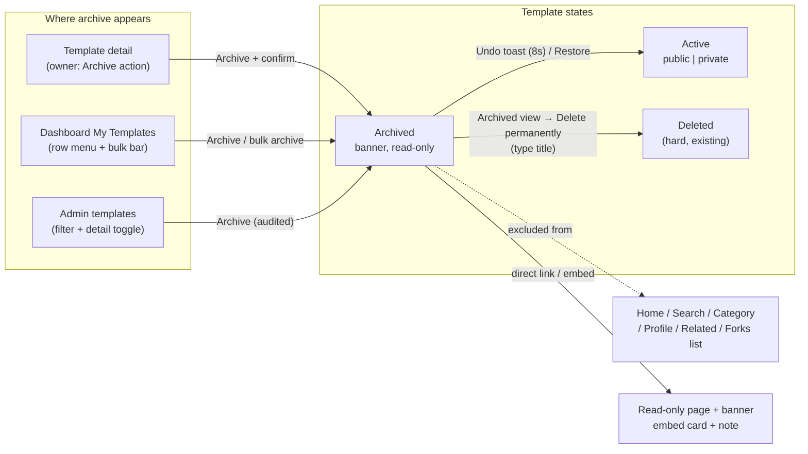
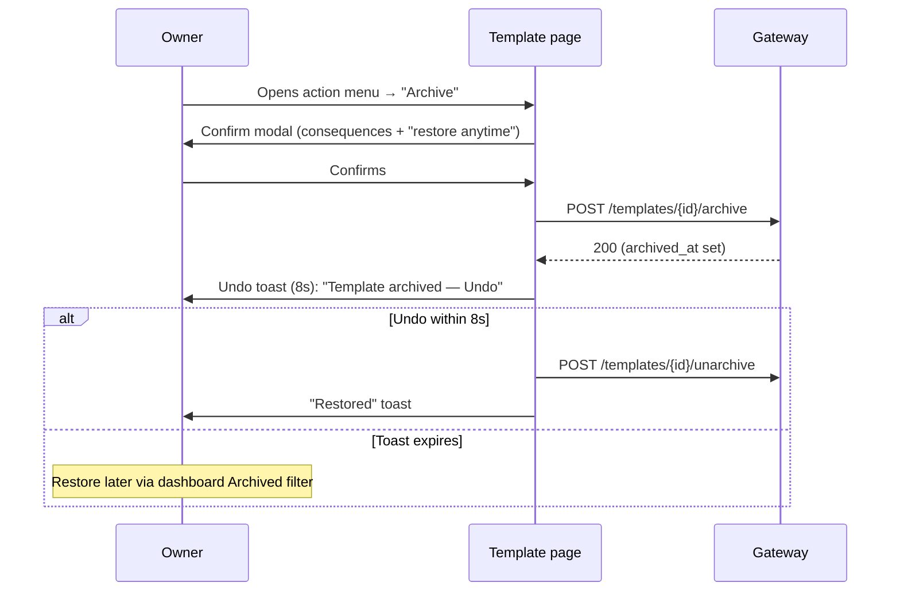

# Archive Templates — UI/UX Design

- **Feature ID:** archive-templates
- **Version:** 1.0
- **Status:** Proposed (for architecture review)
- **Author:** ui-ux-agent
- **Date:** 2026-10-12
- **Related requirements:** [archive-templates-requirements.md](./archive-templates-requirements.md)

## 1. Design Principles

1. **Archive is safe, and feels safe.** Every confirmation says "you can restore it anytime"; the undo toast makes reversibility tangible.
2. **Retired means invisible — except by link.** Discovery surfaces show zero archived content; direct links always work with an honest banner.
3. **The Archived view is a filing cabinet, not a graveyard.** Calm, utilitarian, with Restore as the primary action and permanent delete deliberately buried behind typed confirmation.
4. **No new patterns.** Filter chips, action menus, confirm modals, toasts — all reuse existing components; archive adds states, not chrome.

## 2. Information Architecture



## 3. User Flows

### 3.1 Archive from detail page (with undo)



### 3.2 Visitor opens an archived template

```mermaid
sequenceDiagram
    participant V as Visitor
    participant P as Archived template page
    V->>P: Follows direct link (old bookmark / fork attribution)
    P->>V: Banner: "This template is archived" + content (read-only)
    Note over P: Like/Favorite/Comment/Fork controls hidden<br/>existing comments visible
    V->>V: Reads content; no actions available
```

### 3.3 Manage archived templates (dashboard)

```mermaid
sequenceDiagram
    participant O as Owner
    participant D as Dashboard (Archived filter)
    participant API as Gateway
    O->>D: Switches filter to "Archived"
    D->>O: List of archived templates (dimmed rows)
    alt Restore
        O->>D: Clicks "Restore"
        D->>API: POST /templates/{id}/unarchive
        API-->>D: 200
        D->>O: Row leaves list; "Restored" toast
    else Delete permanently
        O->>D: Clicks "Delete permanently"
        D->>O: Modal: type the template title
        O->>D: Types exact title → Confirm
        D->>API: DELETE /templates/{id}
        D->>O: Row leaves list; gone forever
    end
```

## 4. Page Layouts (Wireframes)

### 4.1 Archive confirmation modal

```
┌────────────────────────────────────────────────────────────┐
│  Archive "Code Review Buddy"?                     [×]      │
├────────────────────────────────────────────────────────────┤
│  This template will disappear from:                        │
│    • Public listings, search, and your profile             │
│    • Your dashboard's default view                         │
│                                                            │
│  What stays:                                               │
│    ✓ Direct links keep working (read-only)                 │
│    ✓ Existing forks and embeds keep working                │
│    ✓ Likes, comments and versions are preserved            │
│                                                            │
│  You can restore it anytime from your dashboard.           │
├────────────────────────────────────────────────────────────┤
│                          [ Cancel ]  [ Archive ]           │
└────────────────────────────────────────────────────────────┘
```

### 4.2 Archived template detail page (visitor view)

```
┌────────────────────────────────────────────────────────────┐
│ ┌────────────────────────────────────────────────────────┐ │
│ │ 🗄  This template is archived — the author is no       │ │
│ │     longer actively maintaining it.                    │ │
│ └────────────────────────────────────────────────────────┘ │
│ Code Review Buddy                              v8         │
│ 👤 author · 128 likes · 12 comments                        │
│                                                            │
│ [content — read-only, full detail page as today]           │
│                                                            │
│ ── Comments (12) ──────────────────────────────────────    │
│ [existing comments render; composer hidden]                │
│                                                            │
│ (no Like / Favorite / Fork / Comment buttons anywhere)     │
└────────────────────────────────────────────────────────────┘
```

### 4.3 Dashboard My Templates — filter chips + archived rows

```
┌────────────────────────────────────────────────────────────┐
│ My Templates   ( All ) ( Active● ) ( Archived )            │
├────────────────────────────────────────────────────────────┤
│ Title                Visibility   Likes   Updated   ⋮      │
│ ────────────────────────────────────────────────────────── │
│ Code Review Buddy    ● Public     128    2 days    ⋮      │
│ SQL Explainer        ● Public     64     1 week    ⋮      │
└────────────────────────────────────────────────────────────┘

Archived filter view:
┌────────────────────────────────────────────────────────────┐
│ My Templates   ( All ) ( Active ) ( Archived● )            │
├────────────────────────────────────────────────────────────┤
│ Title                Archived     Likes   Actions          │
│ ────────────────────────────────────────────────────────── │
│ Essay Polisher       3 weeks ago  12    [Restore] [Delete] │
│ Old GPT-3 Prompt    2 months ago  3     [Restore] [Delete] │
└────────────────────────────────────────────────────────────┘
```

### 4.4 Row action menu (active template, owner)

```
⋮ ──────────────┐
│ Edit           │
│ Archive        │
│ ────────────── │
│ Delete         │
└────────────────┘
```

### 4.5 Delete permanently modal (typed title)

```
┌────────────────────────────────────────────────────────────┐
│  Delete "Essay Polisher" permanently?            [×]      │
├────────────────────────────────────────────────────────────┤
│  This cannot be undone. The template, its versions,       │
│  likes, comments and aliases will be permanently          │
│  removed. Existing forks will keep working but lose       │
│  their link to this template.                             │
│                                                            │
│  Type the template title to confirm:                       │
│  ┌──────────────────────┐                                  │
│  │                      │                                  │
│  └──────────────────────┘                                  │
├────────────────────────────────────────────────────────────┤
│              [ Cancel ]  [ Delete permanently ]            │
└────────────────────────────────────────────────────────────┘
```

### 4.6 Embed card of an archived template

```
┌───────────────────────────────┐
│ 🗄 Archived                    │
│ ✦ Title of the Template       │
│ 👤 Author Name                │
│ [content preview — visible]   │
│ ⚡ Open Prompts    View →     │
└───────────────────────────────┘
```

## 5. Component Specifications

### 5.1 `ArchivedBanner` (frontend/src/components/archive/ArchivedBanner.js)

Full-width info banner at the top of the detail page (and embed card): icon + `archive.banner` text; `role="status"`; no actions (visitors can't restore). On the owner's own view, it appends a "Restore" inline action.

### 5.2 `ArchiveConfirmModal` (frontend/src/components/archive/ArchiveConfirmModal.js)

Props: `template {title}`, `onConfirm`, `onClose`, `bulk?` (count mode for bulk archive: title becomes "Archive {{count}} templates?"). Static content per the wireframe (disappears-from / what-stays lists); primary action "Archive" (not danger-styled — reversible).

### 5.3 `DeletePermanentModal` (frontend/src/components/archive/DeletePermanentModal.js)

Props: `template {title}`, `onConfirm`, `onClose`. Typed confirmation: input must equal the exact title (case-sensitive); confirm button disabled until match; danger-styled. Body enumerates what is destroyed and the fork-lineage consequence.

### 5.4 `ArchiveFilterChips` (dashboard integration)

Extends the existing filter-chip row: All / Active / Archived (Active default). Archived view swaps the columns (Archived date instead of Updated; Restore + Delete actions instead of the ⋮ menu) and dims rows slightly (`opacity: 0.75`).

### 5.5 `UndoToast` (frontend/src/components/archive/UndoToast.js)

Toast with "Template archived" + Undo action button; 8s auto-dismiss; Undo calls unarchive and shows "Restored". Reuses the existing toast system with an action slot.

### 5.6 Row action menu integration

The owner's ⋮ menu on template rows and the detail page action row gain "Archive" (between Edit and Delete). In the Archived view the menu is replaced by explicit Restore/Delete buttons (no menu — the two actions are the point of the view).

### 5.7 Embed page integration

The embed route (embedding-widget) checks `archived_at` after fetching: archived → render `EmbedCard` with the `ArchivedBadge` strip at top (content still visible per FR-8); the attribution link still points to the detail page.

## 6. Interaction Details

1. **Archive is one click + one confirm.** No typed confirmation (reversible); the modal's "what stays" list does the reassurance work.
2. **Undo window:** 8s toast; after expiry, restoration is two clicks away (filter → Restore). The toast's Undo is a real button (48px+ target), not a text link.
3. **Bulk archive** uses the bulk-operations bar: select N → Archive → count-confirmed modal → per-item result toast. Bulk unarchive mirrors it from the Archived view.
4. **Archived rows are dimmed but fully readable** — retired, not deleted; contrast stays within AA.
5. **Engagement controls on archived pages are hidden, not disabled** — no grayed-out Like buttons inviting "why can't I click this"; a single line in the banner explains read-only status.
6. **Owner viewing their own archived template** sees the banner with an inline "Restore" action (one click, no modal — reversible).
7. **Delete permanently is only reachable from the Archived view** — the active-list Delete keeps today's flow; retirement must precede destruction.
8. **Typed-title confirmation** is case-sensitive and trims whitespace; mismatch shows inline "Title doesn't match".
9. **Filter state** persists in the dashboard tab session; switching tabs resets to Active (default).
10. **Admin console:** the templates list gains an "Archived" status filter option and an archive badge; the admin detail page has an Archive/Restore toggle (audited).

## 7. States Summary

| Surface | Loading | Empty | Error | Success |
|---|---|---|---|---|
| Archive confirm modal | — | — | 409/5xx → inline error, modal stays | Archives; undo toast |
| Undo toast | — | — | Undo API fail → error toast, template stays archived | "Restored" toast |
| Archived detail page | Existing skeleton | — | Existing error states | Banner + read-only content |
| Archived filter view | Row skeletons | "No archived templates" illustration + copy | List error → retry row | Dimmed rows with actions |
| Delete permanent modal | Button spinner | — | API fail → inline error, stays open | Row removed; confirmation toast |
| Embed (archived) | Embed skeleton | — | Unavailable card (existing) | Card + archived strip |

## 8. i18n String Table

Namespace: `archive.*`, `admin.archive.*`. Keys added to `frontend/src/locales/{en,zh}/translation.json`.

| Key / EN text | ZH |
|---|---|
| `archive.action` / "Archive" | "归档" |
| `archive.confirmTitle` / "Archive \"{{title}}\"?" | "归档 \"{{title}}\"?" |
| `archive.confirmBulkTitle` / "Archive {{count}} templates?" | "归档 {{count}} 个模板?" |
| `archive.disappearsFrom` / "This template will disappear from:" | "此模板将从以下位置消失:" |
| `archive.disappearsItems` / "Public listings, search, and your profile; Your dashboard's default view" | "公开列表、搜索和你的主页;仪表板默认视图" |
| `archive.whatStays` / "What stays:" | "保留的内容:" |
| `archive.whatStaysItems` / "Direct links keep working (read-only); Existing forks and embeds keep working; Likes, comments and versions are preserved" | "直链继续有效(只读);现有 fork 和嵌入继续工作;点赞、评论和版本保留" |
| `archive.restoreAnytime` / "You can restore it anytime from your dashboard." | "你随时可以从仪表板恢复。" |
| `archive.confirm` / "Archive" | "归档" |
| `archive.cancel` / "Cancel" | "取消" |
| `archive.undoToast` / "Template archived" | "模板已归档" |
| `archive.undoAction` / "Undo" | "撤销" |
| `archive.restored` / "Template restored" | "模板已恢复" |
| `archive.banner` / "This template is archived — the author is no longer actively maintaining it." | "此模板已归档 —— 作者不再积极维护。" |
| `archive.bannerOwner` / "You archived this template. It is hidden from public surfaces." | "你已归档此模板。它已从公开表面隐藏。" |
| `archive.restore` / "Restore" | "恢复" |
| `archive.unarchive` / "Unarchive" | "取消归档" |
| `archive.filterAll` / "All" | "全部" |
| `archive.filterActive` / "Active" | "活跃" |
| `archive.filterArchived` / "Archived" | "已归档" |
| `archive.archivedEmpty` / "No archived templates" | "没有已归档的模板" |
| `archive.archivedEmptyBody` / "Templates you archive will appear here for review, restore, or permanent deletion." | "你归档的模板会出现在这里,供审查、恢复或永久删除。" |
| `archive.archivedColumn` / "Archived" | "归档于" |
| `archive.deletePermanent` / "Delete permanently" | "永久删除" |
| `archive.deleteTitle` / "Delete \"{{title}}\" permanently?" | "永久删除 \"{{title}}\"?" |
| `archive.deleteBody` / "This cannot be undone. The template, its versions, likes, comments and aliases will be permanently removed. Existing forks will keep working but lose their link to this template." | "此操作不可撤销。模板及其版本、点赞、评论和别名将被永久移除。现有 fork 将继续工作,但会失去与此模板的链接。" |
| `archive.typeTitle` / "Type the template title to confirm" | "键入模板标题以确认" |
| `archive.titleMismatch` / "Title doesn't match" | "标题不匹配" |
| `archive.deleteConfirm` / "Delete permanently" | "永久删除" |
| `archive.embedBadge` / "Archived" | "已归档" |
| `admin.archive.filter` / "Archived" | "已归档" |
| `admin.archive.toggle` / "Archive / Restore" | "归档 / 恢复" |
| `admin.archive.badge` / "Archived" | "已归档" |

## 9. Accessibility Notes

1. The archived banner is `role="status"` (informative, not urgent); its icon is `aria-hidden` with text carrying meaning.
2. Filter chips are a radiogroup (`role="radiogroup"`, `aria-checked` per chip) matching the existing dashboard chip pattern.
3. Confirm modals follow the standard contract (focus trap, Escape = cancel, initial focus on the primary action).
4. The typed-title input has `aria-describedby` pointing at the instruction; the mismatch error is announced via `aria-live="assertive"` on the input's error region.
5. Undo toast: the Undo button is a real button in the tab order; the toast container is `role="status"` so the archive announcement is polite.
6. Dimmed archived rows keep AA contrast (opacity capped at 0.75 and verified against the background).
7. Hidden engagement controls are removed from the DOM (not `aria-disabled`) — screen readers never encounter dead controls.

## 10. Responsive Behavior

1. **Banner:** full-width, wraps to two lines on narrow screens; icon shrinks, text remains readable.
2. **Archived filter view:** the actions column collapses into the ⋮ menu below 640px (Restore stays visible as the primary action; Delete moves into the menu).
3. **Confirm modals:** standard full-screen sheet below 480px; the lists stack.
4. **Embed card archived strip:** compact single line; the badge truncates before the title does.
5. **Dashboard chips:** horizontally scrollable on mobile (existing pattern).

## 11. Analytics Events (optional, if analytics shipped)

- `template_archived` {template_id, surface: detail|dashboard|bulk|admin}
- `template_archive_undone` {template_id, within_seconds}
- `template_unarchived` {template_id, surface: toast|filter|admin}
- `template_deleted_permanently` {template_id}

## 12. Out of Scope (UI)

- Auto-archive settings UI, archive expiry configuration, archived-templates public gallery, per-surface archive exclusions toggles, admin bulk archive UI.
