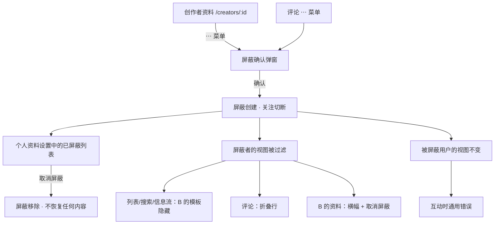
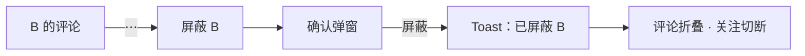
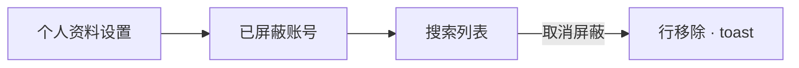
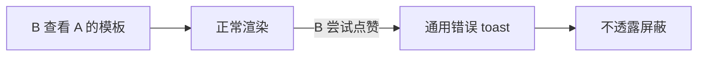

# 屏蔽用户（Block Users）— UI/UX 设计

- **功能 ID：** block-users
- **版本：** 1.0
- **状态：** 已提案（待架构评审）
- **作者：** ui-ux-agent
- **日期：** 2026-10-12
- **配套文档：** `block-users-requirements-zh-CN.md`

## 1. 设计原则

1. **静默而平静。** 屏蔽绝不自我宣告 —— 没有通知、没有屏蔽专属错误、没有戏剧性的 UI。被屏蔽用户的体验不变，只是操作通用失败。
2. **一次确认，完整解释。** 屏蔽弹窗准确说明会发生什么（切断关注、停止互动、不通知），以便用户在知情下屏蔽。
3. **可逆而无残留。** 取消屏蔽是一键且静默不恢复任何内容 —— 没有"重新关注"提示，没有尴尬。
4. **渐进披露。** 被屏蔽评论折叠为一行；屏蔽者选择是否显示。列表默认保持干净。

## 2. 信息架构



| 界面 | 位置 | 受众 | 目的 |
|---|---|---|---|
| 屏蔽确认弹窗 | 资料 ⋯ 菜单、评论 ⋯ 菜单 | 屏蔽者 | 知情确认 |
| 已屏蔽账号区 | 个人资料页设置 | 屏蔽者 | 管理/取消屏蔽 |
| 已屏蔽创作者横幅 | `/creators/:id`（屏蔽者视图） | 屏蔽者 | 上下文 + 取消屏蔽快捷方式 |
| 折叠评论行 | 模板详情评论 | 屏蔽者 | 干净的话题 |
| 已屏蔽创作者提示 | 模板详情（屏蔽者视图，直接 URL） | 屏蔽者 | 深链上的上下文 |

## 3. 用户流程

### 3.1 从评论屏蔽



### 3.2 管理已屏蔽列表



### 3.3 被屏蔽用户的体验（不变）



## 4. 页面布局

### 4.1 屏蔽确认弹窗

```
+------------------------------------------+
|  屏蔽 alice？                             |
|                                          |
|  他们将无法再：                           |
|  • 关注你                                 |
|  • 点赞、收藏或评论你的模板               |
|                                          |
|  你将不再看到他们的模板和评论。            |
|  他们不会收到通知。                        |
|                                          |
|            [ 取消 ]  [ 屏蔽 ]             |
+------------------------------------------+
```

### 4.2 个人资料设置 — 已屏蔽账号区

```
+--------------------------------------------------------------+
|  设置                                                         |
|  [ 个人资料 ]  [ API 密钥 ]  [ 已屏蔽账号 ]                    |
+--------------------------------------------------------------+
|  已屏蔽账号（3）                                               |
|  [ 搜索已屏蔽账号…                      ]                     |
|                                                              |
|  ◉ bob        屏蔽于 2026-09-30             [ 取消屏蔽 ]      |
|  ◉ carol      屏蔽于 2026-08-12             [ 取消屏蔽 ]      |
|  ◉ dave       屏蔽于 2026-07-01             [ 取消屏蔽 ]      |
|                                                              |
|  ⓘ 屏蔽会双向切断关注并停止互动。                              |
|    取消屏蔽不会恢复任何内容。                                  |
+--------------------------------------------------------------+
```

### 4.3 被屏蔽创作者横幅（屏蔽者视图）

```
+--------------------------------------------------------------+
|  ⛔ 你已屏蔽此创作者。                        [ 取消屏蔽 ]     |
+--------------------------------------------------------------+
|  alice · 128 关注者 · 加入于 2026-01                          |
|  （资料内容在下方正常渲染）                                    |
+--------------------------------------------------------------+
```

### 4.4 折叠评论（屏蔽者视图）

```
+--------------------------------------------------------------+
|  alice · 2小时前 · ★ 12                                      |
|  这个模板配合…效果很好                                        |
+--------------------------------------------------------------+
|  ▸ 来自已屏蔽账号的评论                （点击显示）             |
+--------------------------------------------------------------+
|  carol · 1小时前                                              |
|  谢谢，帮到我了！                                              |
+--------------------------------------------------------------+
```

### 4.5 移动端

所有界面堆叠为单列；⋯ 菜单保持图标按钮；弹窗按既有移动弹窗模式全宽底部对齐；已屏蔽列表行变成卡片（头像 + 名称 + 日期 + 取消屏蔽）。

## 5. 组件规格

| 组件 | 行为 | 状态 |
|---|---|---|
| BlockConfirmModal | 静态说明列表 + 屏蔽/取消；焦点在取消（安全默认） | 默认 / 提交中 |
| BlockedAccountsSection | 可搜索列表、每行取消屏蔽、信息说明 | 加载中 / 空 / 已加载 |
| BlockedCreatorBanner | 被屏蔽资料上的横幅，带内联取消屏蔽 | 可见（仅屏蔽者） |
| CollapsedComment | 带展开切换的单行占位符 | 折叠 / 展开 |
| BlockedTemplateNotice | 直接 URL 模板视图上的微妙提示 | 可见（仅屏蔽者） |
| BlockMenuItem | ⋯ 菜单项"屏蔽用户"（资料和评论菜单） | 启用 / 禁用（自己、管理员） |

## 6. 交互细节

1. **安全默认：** 确认弹窗的初始焦点和主要样式位于取消；屏蔽是次要样式操作（近似破坏性）。
2. **屏蔽 toast：** "已屏蔽 {name}"，带 5 秒的撤销操作（撤销 = 取消屏蔽；关注不恢复 —— 保持简单，撤销只是取消屏蔽）。
3. **评论折叠：** 占位行是一个按钮（可键盘聚焦，`aria-expanded`）；展开显示评论并带"再次隐藏"控件。
4. **列表过滤立即生效：** 屏蔽后，屏蔽者当前的列表视图刷新（或下次导航时重新获取）—— 当前会话中当前页之外没有过期的被屏蔽内容。
5. **取消屏蔽无确认**（非破坏性，可通过重新屏蔽逆转）—— 一键，toast"已取消屏蔽 {name}"。
6. **通用错误 toast：** 所有被屏蔽互动显示共享键 `block.error.generic`（"此操作不可用"）—— 与其他失败 toast 相同，无时间或细节提示。
7. **深链提示：** 模板详情上的已屏蔽创作者提示是标题下的一行安静文字，不是弹窗 —— 页面保持完全可用（复制、使用、版本）。
8. **已屏蔽列表搜索：** 对已加载页面的客户端过滤（列表很小）；很长的列表用服务端分页。
9. **菜单门控：** 屏蔽菜单项在自己的资料/评论上隐藏，在管理员资料上禁用并带提示（"管理员不可被屏蔽"）。

## 7. 状态汇总

| 界面 | 加载中 | 空状态 | 错误 |
|---|---|---|---|
| 屏蔽确认弹窗 | 屏蔽按钮上加载图标 | — | 失败时 toast |
| 已屏蔽账号列表 | 骨架行 | "你还没有屏蔽任何人" + 解释 | 错误横幅 + 重试 |
| 已屏蔽创作者横幅 | — | — | 静默（横幅直接缺失） |
| 折叠评论 | — | — | 渲染为正常评论（失败开放） |
| 已屏蔽模板提示 | — | — | 静默（提示缺失） |

失败开放策略：可见性辅助功能静默降级；强制（FR-7）始终在服务端，与 UI 状态无关。

## 8. 国际化

| 键（EN） | ZH |
|---|---|
| block.title / Block {{name}}? | 屏蔽 {{name}}？ |
| block.explain.follow / Follow you | 关注你 |
| block.explain.interact / Like, favorite, or comment on your templates | 点赞、收藏或评论你的模板 |
| block.explain.hide / You will stop seeing their templates and comments. | 你将不再看到他们的模板和评论。 |
| block.explain.silent / They are not notified. | 他们不会收到通知。 |
| block.action / Block | 屏蔽 |
| block.cancel / Cancel | 取消 |
| block.toast.blocked / Blocked {{name}} | 已屏蔽 {{name}} |
| block.toast.unblocked / Unblocked {{name}} | 已取消屏蔽 {{name}} |
| block.undo / Undo | 撤销 |
| block.menu / Block user | 屏蔽用户 |
| block.menu.adminDisabled / Admins cannot be blocked | 管理员不可被屏蔽 |
| block.settings.title / Blocked accounts | 已屏蔽账号 |
| block.settings.empty / You haven't blocked anyone | 你还没有屏蔽任何人 |
| block.settings.note / Blocking severs follows both ways and stops interaction. Unblock restores nothing. | 屏蔽会双向切断关注并停止互动。取消屏蔽不会恢复任何内容。 |
| block.settings.unblock / Unblock | 取消屏蔽 |
| block.banner / You have blocked this creator. | 你已屏蔽此创作者。 |
| block.comment.collapsed / Comment from a blocked account | 来自已屏蔽账号的评论 |
| block.comment.show / Show | 显示 |
| block.comment.hide / Hide again | 再次隐藏 |
| block.templateNotice / You blocked this creator | 你已屏蔽此创作者 |
| block.error.generic / This action is not available | 此操作不可用 |

## 9. 无障碍

- 确认弹窗复用无障碍 `Modal`（焦点陷阱、Esc、初始焦点在取消）。
- 折叠评论占位符是带 `aria-expanded` 的真实 `<button>`；展开的内容只在显示时存在于 DOM 中。
- 已屏蔽列表是语义列表，每行的取消屏蔽按钮可通过 Tab 到达；行焦点顺序与视觉顺序一致。
- 横幅为 `role="status"`，以便屏幕阅读器在进入资料时播报。
- 无仅颜色状态：横幅和折叠行带文本和图标。
- 通用错误 toast 通过既有的 toast live region 播报。

## 10. 分析（可选）

- `user_blocked`（入口）、`user_unblocked`（来自列表 vs 横幅 vs 撤销）—— 仅产品使用；绝不与内容一起记录。

## 11. 范围之外

- 互相不可见、屏蔽作为剑、管理员屏蔽可见性、域名/IP 屏蔽、影子封禁、静音。
- 从模板卡片屏蔽；批量屏蔽/取消屏蔽。
- 任何形式的变现 —— 本产品永久排除。
