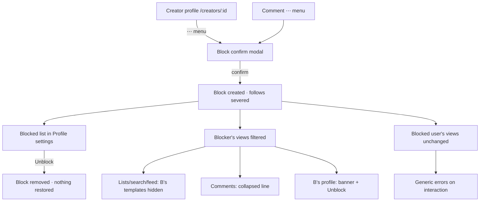
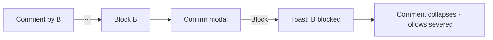
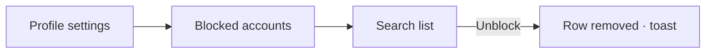
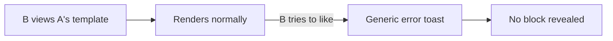

# Block Users — UI/UX Design

- **Feature ID:** block-users
- **Version:** 1.0
- **Status:** Proposed (for architecture review)
- **Author:** ui-ux-agent
- **Date:** 2026-10-12
- **Companion doc:** `block-users-requirements.md`

## 1. Design Principles

1. **Silent and calm.** Blocking never announces itself — no notifications, no block-specific errors, no dramatic UI. The blocked user's experience is unchanged except that actions fail generically.
2. **One confirmation, fully explained.** The block modal states exactly what happens (severs follows, stops interaction, not notified) so users block with informed intent.
3. **Reversible without residue.** Unblock is one click and restores nothing silently — no "re-follow" prompts, no awkwardness.
4. **Progressive disclosure.** Blocked comments collapse to one line; the blocker chooses to reveal. Lists stay clean by default.

## 2. Information Architecture



| Surface | Location | Audience | Purpose |
|---|---|---|---|
| Block confirm modal | Profile ⋯ menu, comment ⋯ menu | Blockers | Informed confirmation |
| Blocked accounts section | Profile page settings | Blockers | Manage/unblock |
| Blocked-creator banner | `/creators/:id` (blocker's view) | Blockers | Context + unblock shortcut |
| Collapsed comment line | Template detail comments | Blockers | Clean threads |
| Blocked-creator notice | Template detail (blocker's view, direct URL) | Blockers | Context on deep links |

## 3. User Flows

### 3.1 Block from a comment



### 3.2 Manage blocked list



### 3.3 Blocked user's experience (unchanged)



## 4. Page Layouts

### 4.1 Block confirmation modal

```
+------------------------------------------+
|  Block alice?                            |
|                                          |
|  They will no longer be able to:         |
|  • Follow you                            |
|  • Like, favorite, or comment on         |
|    your templates                        |
|                                          |
|  You will stop seeing their templates    |
|  and comments. They are not notified.    |
|                                          |
|            [ Cancel ]  [ Block ]         |
+------------------------------------------+
```

### 4.2 Profile settings — Blocked accounts section

```
+--------------------------------------------------------------+
|  Settings                                                    |
|  [ Profile ]  [ API Keys ]  [ Blocked accounts ]             |
+--------------------------------------------------------------+
|  Blocked accounts (3)                                        |
|  [ Search blocked accounts…            ]                     |
|                                                              |
|  ◉ bob        Blocked 2026-09-30            [ Unblock ]      |
|  ◉ carol      Blocked 2026-08-12            [ Unblock ]      |
|  ◉ dave       Blocked 2026-07-01            [ Unblock ]      |
|                                                              |
|  ⓘ Blocking severs follows both ways and stops               |
|    interaction. Unblock restores nothing.                    |
+--------------------------------------------------------------+
```

### 4.3 Blocked creator banner on profile (blocker's view)

```
+--------------------------------------------------------------+
|  ⛔ You have blocked this creator.            [ Unblock ]     |
+--------------------------------------------------------------+
|  alice · 128 followers · joined 2026-01                      |
|  (profile content renders normally below)                    |
+--------------------------------------------------------------+
```

### 4.4 Collapsed comment (blocker's view)

```
+--------------------------------------------------------------+
|  alice · 2h · ★ 12                                           |
|  This template works great with…                             |
+--------------------------------------------------------------+
|  ▸ Comment from a blocked account            (click to show) |
+--------------------------------------------------------------+
|  carol · 1h                                                  |
|  Thanks, this helped!                                        |
+--------------------------------------------------------------+
```

### 4.5 Mobile

All surfaces stack to single column; the ⋯ menus remain icon buttons; the modal is full-width bottom-anchored per existing mobile modal pattern; the blocked list rows become cards (avatar + name + date + Unblock).

## 5. Component Specs

| Component | Behavior | States |
|---|---|---|
| BlockConfirmModal | Static explanation list + Block/Cancel; focus on Cancel (safe default) | Default / submitting |
| BlockedAccountsSection | Searchable list, Unblock per row, info note | Loading / empty / loaded |
| BlockedCreatorBanner | Banner on blocked profiles with inline Unblock | Visible (blocker only) |
| CollapsedComment | One-line placeholder with expand toggle | Collapsed / expanded |
| BlockedTemplateNotice | Subtle notice on direct-URL template view | Visible (blocker only) |
| BlockMenuItem | ⋯ menu entry "Block user" (profile & comment menus) | Enabled / disabled (self, admin) |

## 6. Interaction Details

1. **Safe default:** the confirm modal's initial focus and primary styling sit on Cancel; Block is the secondary-styled action (destructive-adjacent).
2. **Toast on block:** "Blocked {name}" with an Undo action for 5 seconds (undo = unblock; follows are not restored — the toast says so in its tooltip? No: keep it simple, Undo just unblocks).
3. **Comment collapse:** the placeholder line is a button (keyboard focusable, `aria-expanded`); expanding reveals the comment with a "Hide again" control.
4. **List filtering is immediate:** after blocking, the blocker's current list views refresh (or refetch on next navigation) — no stale blocked content mid-session beyond the current page.
5. **Unblock has no confirmation** (non-destructive, reversible by re-blocking) — one click, toast "Unblocked {name}".
6. **Generic error toast:** all blocked interactions surface the shared key `block.error.generic` ("This action is not available") — identical to other failure toasts, no timing or detail hints.
7. **Deep-link notice:** the blocked-creator notice on template detail is a single quiet line under the title, not a modal — the page stays fully usable (copy, use, versions).
8. **Search in blocked list:** client-side filter over the loaded page (list is small); server pagination for very long lists.
9. **Menu gating:** the Block menu item is hidden on one's own profile/comments and disabled with a tooltip on admin profiles ("Admins cannot be blocked").

## 7. States Summary

| Surface | Loading | Empty | Error |
|---|---|---|---|
| Block confirm modal | Submitting spinner on Block | — | Toast on failure |
| Blocked accounts list | Skeleton rows | "You haven't blocked anyone" + explanation | Error banner + retry |
| Blocked creator banner | — | — | Silent (banner simply absent) |
| Collapsed comment | — | — | Renders as normal comment (fail-open) |
| Blocked template notice | — | — | Silent (notice absent) |

Fail-open policy: visibility affordances degrade silently; enforcement (FR-7) is always server-side regardless of UI state.

## 8. i18n

| Key (EN) | ZH |
|---|---|
| block.title / Block {{name}}? | 屏蔽 {{name}}？ |
| block.explain.follow / Follow you | 关注你 |
| block.explain.interact / Like, favorite, or comment on your templates | 点赞、收藏或评论你的模板 |
| block.explain.hide / You will stop seeing their templates and comments. | 你将不再看到他们的模板和评论。 |
| block.explain.silent / They are not notified. | 他们不会收到通知。 |
| block.action / Block | 屏蔽 |
| block.cancel / Cancel | 取消 |
| block.toast.blocked / Blocked {{name}} | 已屏蔽 {{name}} |
| block.toast.unblocked / Unblocked {{name}} | 已取消屏蔽 {{name}} |
| block.undo / Undo | 撤销 |
| block.menu / Block user | 屏蔽用户 |
| block.menu.adminDisabled / Admins cannot be blocked | 管理员不可被屏蔽 |
| block.settings.title / Blocked accounts | 已屏蔽账号 |
| block.settings.empty / You haven't blocked anyone | 你还没有屏蔽任何人 |
| block.settings.note / Blocking severs follows both ways and stops interaction. Unblock restores nothing. | 屏蔽会双向切断关注并停止互动。取消屏蔽不会恢复任何内容。 |
| block.settings.unblock / Unblock | 取消屏蔽 |
| block.banner / You have blocked this creator. | 你已屏蔽此创作者。 |
| block.comment.collapsed / Comment from a blocked account | 来自已屏蔽账号的评论 |
| block.comment.show / Show | 显示 |
| block.comment.hide / Hide again | 再次隐藏 |
| block.templateNotice / You blocked this creator | 你已屏蔽此创作者 |
| block.error.generic / This action is not available | 此操作不可用 |

## 9. Accessibility

- The confirm modal reuses the accessible `Modal` (focus trap, Esc, initial focus on Cancel).
- The collapsed comment placeholder is a real `<button>` with `aria-expanded`; expanded content is in the DOM only when revealed.
- The blocked list is a semantic list with per-row Unblock buttons reachable by Tab; row focus order matches visual order.
- The banner is `role="status"` so screen readers announce it on profile entry.
- No color-only state: the banner and collapsed line carry text and icons.
- The generic error toast is announced via the existing toast live region.

## 10. Analytics (optional)

- `user_blocked` (entry point), `user_unblocked` (from list vs banner vs undo) — product usage only; never logged with content.

## 11. Out of Scope

- Mutual invisibility, block-as-sword, admin block visibility, domain/IP blocking, shadow-banning, muting.
- Block from template cards; bulk block/unblock.
- Monetization of any kind — permanently out of scope for this product.
